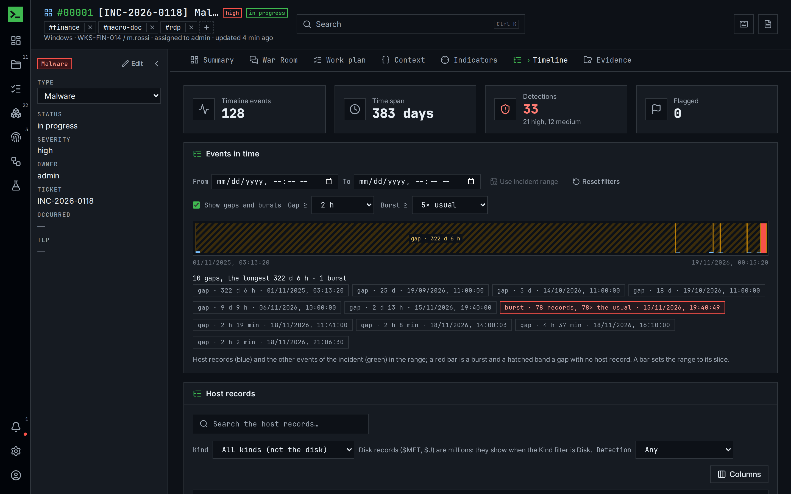
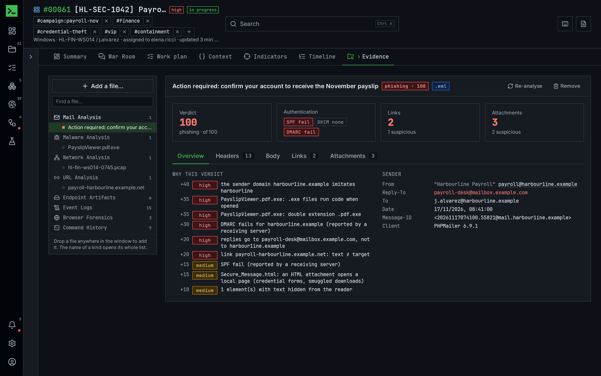
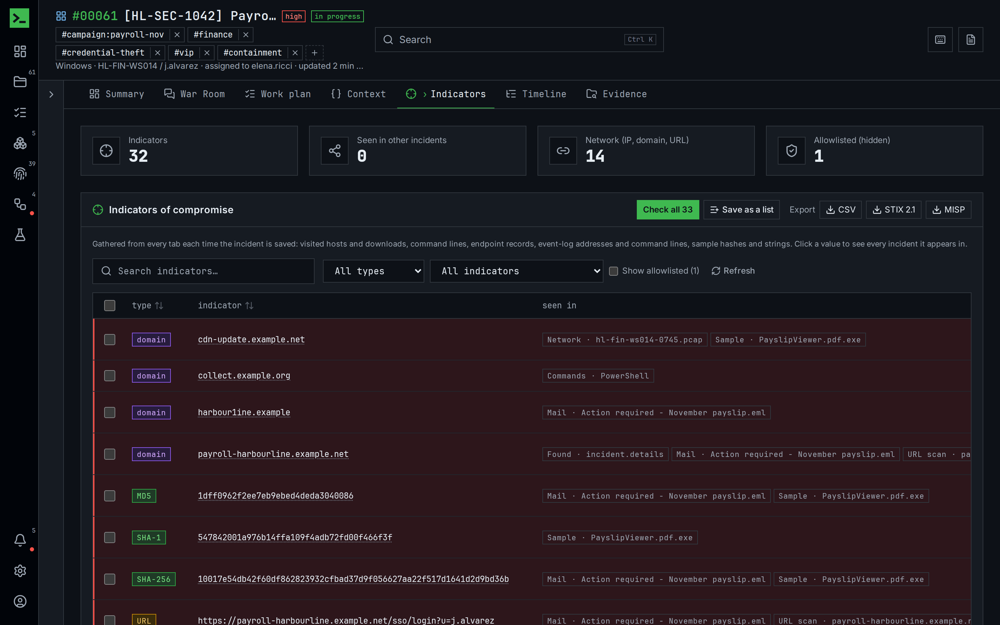
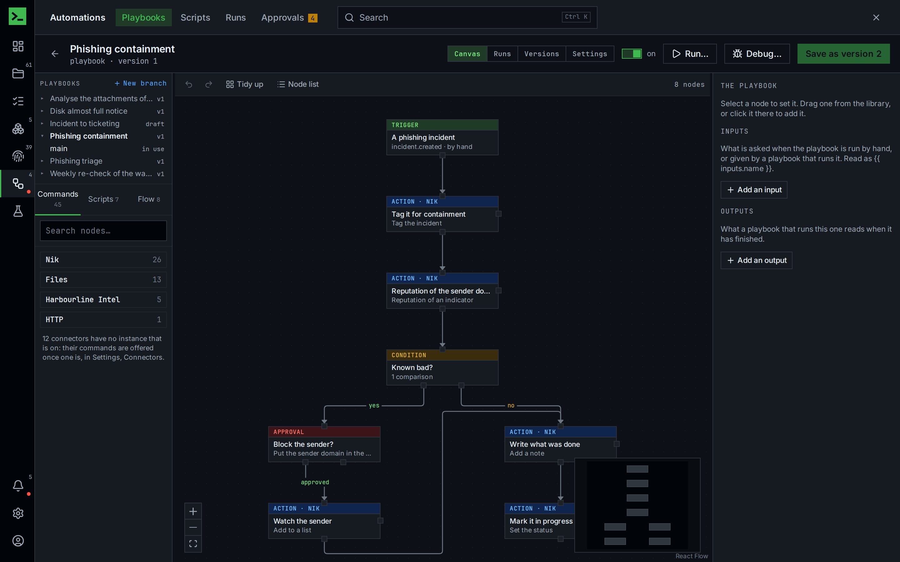
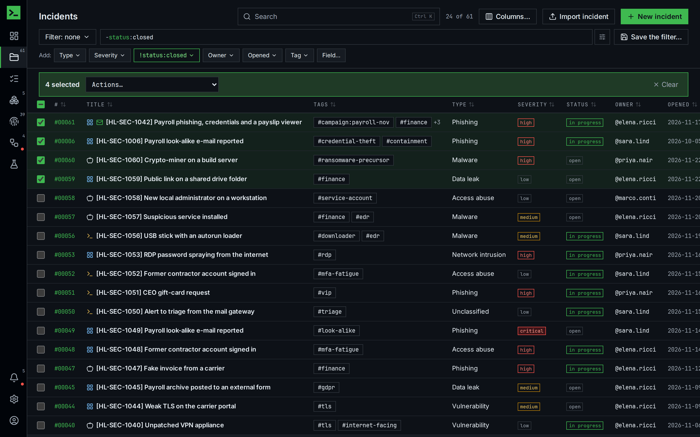

<p align="center">
  
</p>

<h1 align="center">Nik</h1>

<p align="center">
  A self-hosted platform for incident response teams: open an incident, drop the evidence,<br>
  read it on one timeline, automate the routine and hand over a report.
</p>

<p align="center">
  <a href="https://github.com/n36l3c7/Nik/actions/workflows/ci.yml"></a>
  <a href="https://github.com/n36l3c7/Nik/releases"></a>
  <a href="LICENSE"></a>
</p>

<p align="center">
  <a href="https://n36l3c7.github.io/Nik/"><strong>Documentation</strong></a> ·
  <a href="https://n36l3c7.github.io/Nik/get-started/install/">Install</a> ·
  <a href="https://n36l3c7.github.io/Nik/guide/">User guide</a> ·
  <a href="https://n36l3c7.github.io/Nik/changelog/">Changelog</a>
</p>



## What it does

- **Incidents worked as a team**: one timeline of every event, a War Room for what was said and done, owners, SLAs and a report at the end.
- **Evidence analysis**: reported e-mails, malware samples (never executed), network captures, links visited by an isolated browser, host artifacts and event logs.
- **Indicators** found by themselves in what comes in, checked against threat intelligence, exported as CSV, STIX 2.1 or MISP.
- **Playbooks** drawn on a canvas, with approvals and Python scripts in a sandbox.
- **Connectors** for Jira, ServiceNow, SentinelOne, mailboxes and more, mirrored both ways, or your own written in YAML.
- **Bulk actions** on thousands of incidents, artifacts or indicators at once.
- **Safe by default**: two-factor sign-in, an encrypted store, a signed audit log, backups that test themselves.

| | |
|---|---|
|  |  |
|  |  |

## Install

You need Git and Docker with Compose, or Podman. The analysis workers run under their own memory limits (4 GB each for the analyzer, capa and capture workers by default, set in `.env.example`).

```bash
git clone https://github.com/n36l3c7/Nik.git && cd Nik
deploy/init-env.sh             # writes .env and fresh random secrets
docker compose up -d --build   # Podman: podman compose up -d --build
```

Open **https://localhost:8443** and create the first account: it becomes the admin.

Production, TLS, backups and upgrades: [Run the server](https://n36l3c7.github.io/Nik/admin/).

## Licence

[PolyForm Shield 1.0.0](LICENSE): you may use, change and share Nik for free, in a company too, but not to offer a product or service that competes with it. Releases up to 6.10.0 were published under the MIT licence and stay so.
