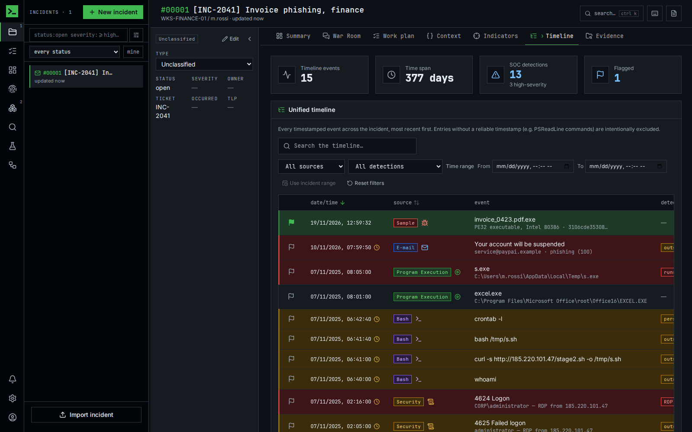

# Nik — Forensic analysis platform

[](https://github.com/n36l3c7/Nik/actions/workflows/ci.yml)
[](https://github.com/n36l3c7/Nik/releases)
[](LICENSE)

A self-hosted web platform for incident response teams: open an incident, drop
the evidence, read it on one timeline and hand over a report.

**Documentation: <https://n36l3c7.github.io/Nik/>** — user guide with
screenshots, deployment, configuration, API, architecture.



## What it does

Nik is for SOC and DFIR analysts who work an incident as a team. Each
**incident** is one case; everything found about it lives in its tabs, and
every action is attributed to a named analyst in the audit log.

- **Overview** — incident details and notes, a super-timeline of every
  timestamped event, and the indicators of compromise of every tab, seen
  across incidents and checked with threat intelligence.
- **Mail analysis** — a verdict for reported e-mails: headers, SPF/DKIM/DMARC,
  links, attachments, previews in isolated workers.
- **Malware analysis** — static analysis, YARA, capa and a disassembler view.
  Samples are stored read-only and never executed.
- **Network analysis** — pcap and pcapng read by Wireshark's engine: display
  filters, Follow Stream, Export Objects, TLS decryption, beacons.
- **URL analysis** — the isolated browser visits a link for you: screenshot,
  redirects, the page's forms and a phishing verdict with its reasons.
- **Host evidence** — browser and shell history, endpoint artifacts and
  Windows event logs, parsed in the analyst's browser where possible.
- **Automation** — playbooks drawn on a canvas and run by Nik: triggers
  (what Nik analyses, a schedule, a request from outside, a person),
  conditions, approvals, Python scripts in a sandbox with no network, and a
  guard on where a playbook connects and what it sends.
- **Incidents your way** — types of incident with fields of your own, a page
  laid out for each type, a form for closing, and a War Room: one log of
  what was said and done, with a command line (`!ip 185.220.101.47`).
- **Tasks, SLA and lists** — playbooks give people tasks and ask them
  questions, each incident has a work plan and each analyst a page of their
  tasks; types of incident time their incidents, in business hours if you
  want; and what features and playbooks compare with lives in lists you
  edit, import and export.
- **Connectors** — other products reached through YAML files anyone can read
  and write, with no code: Check Point, Zscaler, SentinelOne, ServiceNow,
  Jira, Confluence and Bitbucket ship (written from the vendors' public
  documentation, not yet run against real systems).
- **Reporting and API** — a PDF/HTML incident report, a REST API with
  API keys, webhooks and a Cortex XSOAR integration.
- **Roles and queries** — accounts and API keys hold one or more roles
  (viewer, analyst, playbooks, connectors, rules, audit, admin), and one query language filters
  incidents, artifacts and indicators:
  `status:open severity:>=high owner:""`.

## Requirements

- Docker with Compose, or Podman with `podman compose` / `podman-compose`.
- Memory for the analysis workers: each runs under its own limit, set in
  `.env.example` (4 GB for the analyzer, capa and packet capture workers by
  default).

## Installation

```bash
git clone https://github.com/n36l3c7/Nik.git && cd Nik
deploy/init-env.sh                # writes .env and fresh random secrets, each in a file of its own
docker compose up -d --build      # or: podman compose up -d --build
```

Open **https://localhost:8443** (the certificate is self-signed on first
start) and create the first account: it becomes the admin. Plain HTTP on
port 8080 only redirects there.

The stack does not start without its secrets and refuses the example
values, which are public. Upgrading from 2.x: see
[Upgrading to 3.0](https://n36l3c7.github.io/Nik/deployment.html#upgrading-to-30).

Production, TLS certificates, start on boot, backups and a manual
install on RHEL: see [Deployment](https://n36l3c7.github.io/Nik/deployment.html).

## Configuration

Compose reads `.env`, which `deploy/init-env.sh` creates; the secrets are
kept as files beside it (an install from before 6.8 keeps them in `.env`
until `deploy/secrets.sh move`), and are changed with
`deploy/secrets.sh rotate`. The values that matter before the first start:

| Variable | Purpose |
| --- | --- |
| `DB_PASSWORD` | PostgreSQL password (generated). |
| `SECRET_KEY` | Encrypts the provider API keys and TLS key logs stored in the database (generated). Keep it with the backups; change it only together with `SECRET_KEY_PREVIOUS`. |
| `STORE_KEY` | Encrypts the files Nik holds on the disk (generated). It is in no database and in no backup: keep a copy off the server. |
| `ANALYZER_TOKEN`, `CAPA_TOKEN`, `DOCVIEW_TOKEN`, `BROWSER_TOKEN`, `PCAP_TOKEN`, `SANDBOX_TOKEN` | Shared secrets between the API and each worker (generated). |
| `TLS_HOSTNAME` | Name users type in the browser, written into the self-signed certificate. |
| `WEB_TLS_PORT`, `WEB_PORT` | Published HTTPS port (8443) and the HTTP port that redirects to it (8080). |

Every other variable and the in-app settings are in the
[configuration reference](https://n36l3c7.github.io/Nik/configuration.html).

## Usage

1. **New incident** in the list of incidents: ticket, title, host, user.
2. Drop the evidence anywhere on the app; Nik proposes the tab. An e-mail, a
   suspicious file or a capture can also be analysed on its own (**New
   analysis**) and linked to an incident later.
3. Read each tab, flag events (right-click, or `F` on the row under the
   pointer), check the indicators.
4. Write the report from the header and download it.

The [user guide](https://n36l3c7.github.io/Nik/guide.html) walks through every
screen.

## Repository layout

```
frontend/      React single-page app, its Dockerfile and nginx configuration, E2E tests
backend/       FastAPI API, Alembic migrations, tests
workers/       Isolated workers: analyzer (rizin), capa, docview, browser, pcap, sandbox (scripts)
deploy/        Database entrypoint and archive, backups and restore, secrets, standby host, systemd units
packs/         Content packs: connectors, mappers and playbooks for the products Nik talks to
integrations/  Cortex XSOAR integration pack
docs/          GitHub Pages site
```

## Development

```bash
# Backend (Python 3.12)
cd backend
python -m venv .venv && source .venv/bin/activate
pip install -r requirements-dev.txt
cp .env.example .env              # set COOKIE_SECURE=false for plain-HTTP development
uvicorn app.main:app --reload --port 8000

# Frontend (Node.js 22+), in a second terminal
cd frontend
npm install
npm run dev                       # http://localhost:5173, proxies /api to the backend
```

Checks, all run by CI on every pull request:

```bash
cd backend && pytest && ruff check . && ruff format --check .
cd frontend && npm run lint && npm run format:check && npm test && npm run build && npm run test:e2e
```

The [developer guide](https://n36l3c7.github.io/Nik/developer.html) covers the
analysis workers in development, adding a tab, detection rules, parsers and
the incident JSON format.

## Roadmap

The 4.x series is being built release by release. 4.0 brought roles as tags,
Settings as a page and the query language; 4.1 Nik's own automation engine,
with a canvas of playbooks and a sandbox for scripts; 4.2 connectors written
as YAML files (twelve ship, for nine products), playbooks started by what Nik
analyses or by a request from outside, and five playbooks ready to turn on;
4.3 a registry of fields, types of incident with their own page, the context
of an incident as data playbooks read and write, and a War Room with a
command line; 4.4 tasks and questions in playbooks, the work plan of an
incident, SLA timers, notifications and lists; 4.5 alerts fetched from other
products as incidents, classifiers and mappers, pre-processing rules and an
incident kept in step with its ticket; 4.6 dashboards, content packs that
carry what Nik is taught from one Nik to another, and a debugger for
playbooks; 4.7 closed the series with script signatures that can be edited,
the history of a list of indicators, an optional expiry for artifacts,
mailboxes in the export of artifacts and Outlook PST files of several
gigabytes.

The 5.x series reworks how the platform is used. 5.0 gave incidents a
number, moved "is not" before the field in a query and added lists to it,
made every side panel resizable and put a right-click menu on what is not
evidence; 5.1 put connectors and their instances on one page, made a
connector a package with a logo and a README, and made mail a connector
that sends, reads and listens; 5.2 gave playbooks branches that are pushed
over the version in use, connections routed by hand, and a library of
blocks in tabs; 5.3 put the analysis tabs inside one Evidence tab, made
the Summary a page each type arranges like a dashboard, and added the
Playground, a War Room without an incident; 5.4 read the platform against
itself and put right what one release said differently from another.

The 6.x series makes Nik a platform that is extended from outside. 6.0 took
the connectors of vendors out of Nik: what Nik knows about a product is a
content pack (its connector, mappers, playbooks, types, dashboards),
installed from a signed catalogue published from the folder `packs/`; 6.1
made the sources of threat intelligence connectors too, with every command
of their public APIs, and gave an instance several keys that take turns;
6.2 made the list of incidents a page with a quick view and saved filters,
let a type arrange its tabs and add pages of its own, and put buttons that
run a script on them; 6.3 made a playbook branch something that is compared
with main and run only in the debugger, and taught the Mail connector to
keep attachments and the messages it reads; 6.4 gave incidents tags and
made every field of theirs something a query can ask for, put fetching,
the classifier and the mappers in the instance, and made Nik's own menu
answer the right button on every page; 6.5 taught connectors to keep and
send files and their expressions to decide and count, and made the
reputation of an indicator something only connectors are asked for; 6.6
made the rail lead home and ask before unsaved work is lost, kept
credentials once for every instance, gave playbooks nodes for files and
their analyses, and put the data guard on every look-up; 6.7 made Nik
take and test its own backups, rehearse an upgrade before it touches the
data, and ask for a second factor at sign-in; 6.8 encrypted the store on
the disk, took the keys out of `.env`, made the audit log a signed chain
sent to syslog, and added a page that says whether the server is well;
6.9 brought recovery to a moment, a standby host that takes the
server's place by one command, and work that survives a restart;
6.10 lets many incidents, artifacts or indicators be acted on at once,
finds indicators in what comes in, and mirrors everything that fetches.

Not planned yet: scripts for playbooks written in JavaScript, engines that
run scripts on another host, and custom fields on indicators.

## Contributing

Changes are welcome: [CONTRIBUTING.md](CONTRIBUTING.md) says what one needs
to be merged (tests, documentation in the same change, Conventional Commits).

## Security

Nik handles hostile files; how it contains them, what leaves the server and a
hardening checklist are on the
[Security page](https://n36l3c7.github.io/Nik/security.html). Report a
vulnerability privately: see [SECURITY.md](SECURITY.md).

## Licence

[MIT](LICENSE).
