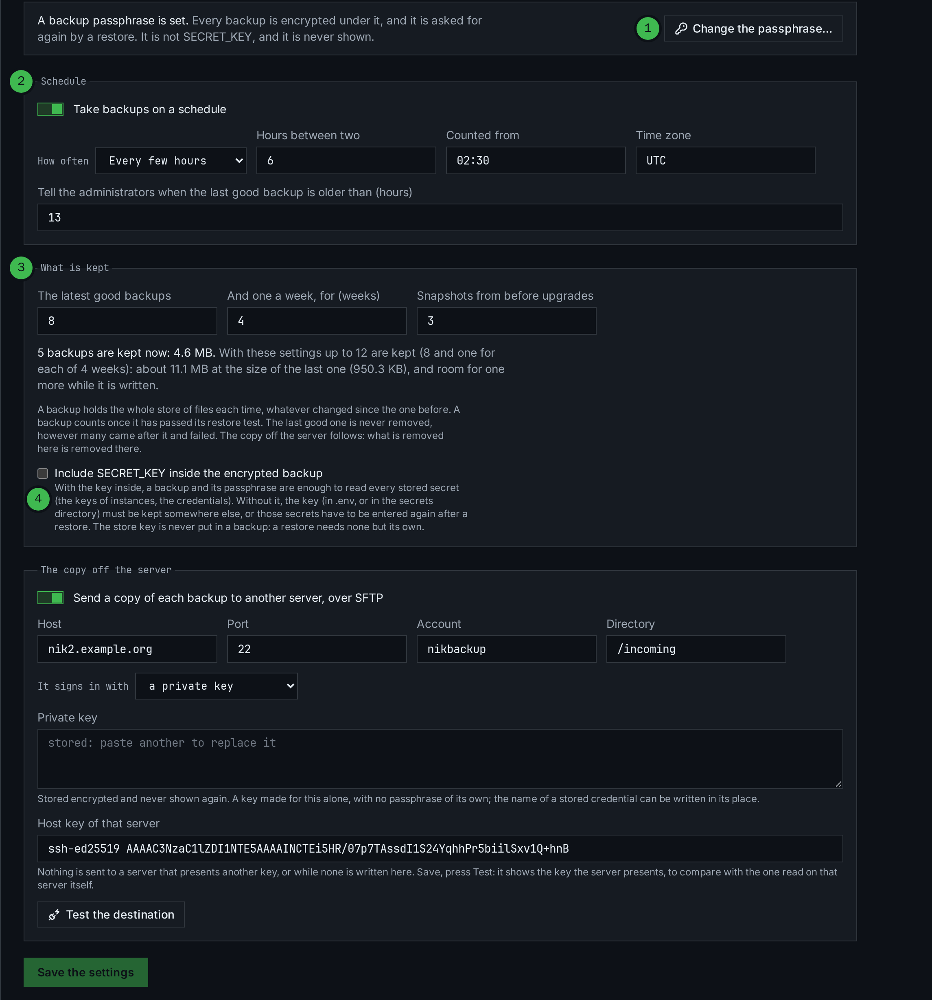
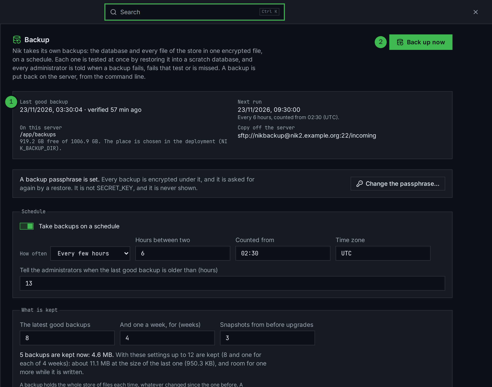
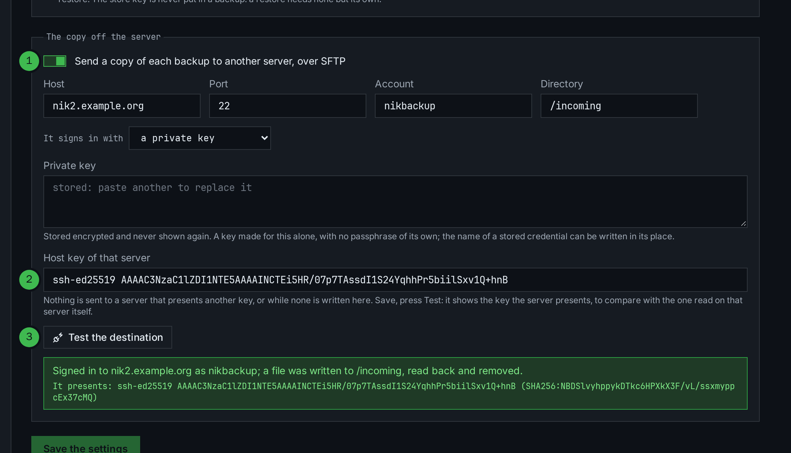
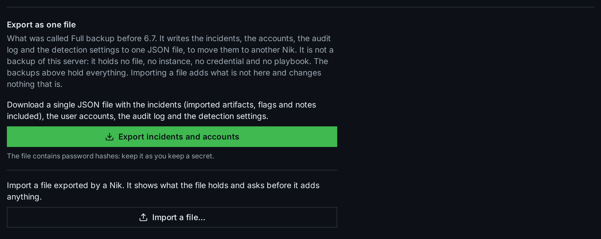

# Backups and restore

Let Nik take, test and copy its own encrypted backups, restore one on the server or on a new host, and move content between servers.

!!! note "You need"
    The **Admin** role for **Platform settings › System › Backup**. A shell on the host to restore: no button restores a backup.

!!! warning "The passphrase is the backup"
    A backup can only be read with its passphrase. If it is lost, every backup made under it is lost, and nobody can recover it. Write it down when you set it, and keep it away from the server.

## What a backup is

One file, `nik-YYYYMMDD-HHMMSS.nikbak`, encrypted from end to end. Beside it, `nik-….json` says in clear what it is and how its restore test went (no secret).

| In a backup | Not in a backup: keep it elsewhere |
| --- | --- |
| The whole database at one moment: incidents, accounts, settings, audit log, analyses, playbooks, connectors and their instances (their secrets stay under `SECRET_KEY`) | `.env` and `./secrets`, among them `SECRET_KEY` (unless you tick **Include SECRET_KEY inside the encrypted backup**) |
| The whole store of files: samples (live malware), e-mails, captures, mailboxes, screenshots, rule files, decrypted and encrypted again under the passphrase | The TLS certificate and its key |
| A manifest: Nik version, database revision, row counts, the size and SHA-256 of every part | Your Compose overrides |

A backup is read with its passphrase alone: the store key is not needed to restore. See [What to keep off the server](secrets.md#what-to-keep-off-the-server).

## Set up the backups

Nik takes no backup until a passphrase is set. Do this on the first day.

1. Open **Platform settings › System › Backup**.
2. Under **Passphrase**, type the **Passphrase** and **The same passphrase again**. Once one is set, they are behind **Change the passphrase…** <span class="step">1</span>.
3. Check the **Schedule** <span class="step">2</span>: every few hours, every day at a time, or every week, in the **Time zone** you name.
4. Check **What is kept** <span class="step">3</span>.
5. Decide on **Include SECRET_KEY inside the encrypted backup** <span class="step">4</span> (off by default). On: a backup and its passphrase bring everything back, and are also enough for whoever holds both to read every stored secret.
6. Press **Save the settings**, then **Back up now** to take the first one.
7. Set up [the copy off the server](#the-copy-off-the-server).



| Setting | Default |
| --- | --- |
| Schedule | Every 6 hours from 02:30 UTC: 02:30, 08:30, 14:30, 20:30 |
| **The latest good backups** | 8 (two days) |
| **And one a week, for (weeks)** | 4 |
| **Snapshots from before upgrades** | 3 |
| **Tell the administrators when the last good backup is older than (hours)** | 13 |

What a lost server loses is what was written since the last backup: up to six hours with this schedule. The archive of the database log closes most of that gap ([Recovery](recovery.md)).

## The Backup page



- **State of the backups** <span class="step">1</span>: the last good one, the next run, the directory and its free room, what the kept backups take.
- **Back up now** <span class="step">2</span> takes one at once (the same as `deploy/backup.sh` on the host, which exits 0 when the backup passed its test).
- Each row of the **Backups** list, further down: **Verify now** runs the restore test again, **Download the encrypted file**, **Copy the restore command**, **Delete…** (deleting the last good backup is asked twice).

Never two at once, and none while a release is migrating the database. A file is written as `….nikbak.partial` and renamed when complete.

### Every backup is tested

Right after it is written, each backup is restored for real: every chunk decrypted, every checksum compared, the database restored into a scratch database (dropped afterwards) and its row counts compared, every file of the store checked. A backup that fails is marked, not counted by the retention, and the administrators are told. The last good backup is never removed.

### What the administrators are told

One notice when a problem appears and one when it is solved: a backup failed or failed its test; the schedule passed and none started; the last good backup is too old; the directory is nearly full (less than a tenth free, or less than twice the last backup); the copy off the server failed or waited six hours; no passphrase a day after install. Every run, test, copy, download, deletion and change is in the audit log (`backup.*`).

## Where backups go

By default into the volume `backups`. A backup on the disk it protects is of little use: point [`NIK_BACKUP_DIR`](../reference/configuration.md#NIK_BACKUP_DIR) at another disk or a mount in `.env`:

```sh
NIK_BACKUP_DIR=/srv/nik-backups
```

- Create it as the user that runs the stack; label it once under SELinux: `chcon -Rt container_file_t /srv/nik-backups`.
- Room: about the database plus the store for each backup kept (samples barely compress). Each backup holds the whole store: twelve kept backups take about twelve times one. The page shows the figures; Nik refuses to start a backup there is no room for.

## The copy off the server

The `automation` container sends each tested backup over SFTP to a second host you name. The second host must be reachable directly (SFTP does not use an HTTP proxy).

On the second host:

1. Create an account that can do nothing else, and the directory:

    ```sh
    sudo useradd --system --create-home --shell /usr/sbin/nologin nikbackup
    sudo mkdir -p /srv/nik-backups/incoming
    sudo chown root:root /srv/nik-backups && sudo chmod 755 /srv/nik-backups
    sudo chown nikbackup: /srv/nik-backups/incoming && sudo chmod 700 /srv/nik-backups/incoming
    ```

2. On any machine, make a key for this alone, and put `nik-backups-key.pub` in `/home/nikbackup/.ssh/authorized_keys` of the second host:

    ```sh
    ssh-keygen -t ed25519 -N "" -C nik-backups -f nik-backups-key
    ```

3. Limit the account to SFTP in its directory, in `/etc/ssh/sshd_config`, then reload `sshd`:

    ```text
    Match User nikbackup
        ChrootDirectory /srv/nik-backups
        ForceCommand internal-sftp
        AllowTcpForwarding no
        X11Forwarding no
        PasswordAuthentication no
    ```

4. Read the host key, to paste in Nik: `cat /etc/ssh/ssh_host_ed25519_key.pub` (the first two words), or its fingerprint with `ssh-keygen -lf /etc/ssh/ssh_host_ed25519_key.pub`.

In Nik, on the Backup page:

1. Under **The copy off the server**, tick **Send a copy to another server** <span class="step">1</span>.
2. Fill **Host**, **Port**, **Account** (`nikbackup`), **Directory** (`/incoming`, the path inside the chroot), **It signs in with** a private key (pasted, or the name of a stored credential) and **Host key of that server** <span class="step">2</span>.
3. **Save the settings**, then **Test the destination** <span class="step">3</span>: it signs in, writes a small file, reads it back, removes it, and shows the key the server presented.



Nik never trusts a host key on first sight: with no pinned key, or another key, nothing is sent and the administrators are told. A cut transfer is resumed; what arrived is checked against the local SHA-256. What the retention removes here is removed there. The second host ends up with `nik-….nikbak` and `nik-….json` for each backup kept.

The same destination and passphrase also carry the archive of the database log ([Recovery](recovery.md)).

## Restore a backup

Done on the server, from the command line, by `deploy/restore.sh` (Docker or Podman, rootless too):

```sh
deploy/restore.sh nik-20261120-023000                    # a backup of this stack's directory
deploy/restore.sh /mnt/copy/nik-20261120-023000.nikbak   # a file brought from elsewhere
deploy/restore.sh --inspect nik-20261120-023000          # only read it and say what it holds
```

1. It asks for the passphrase (or reads [`NIK_BACKUP_PASSPHRASE`](../reference/configuration.md#NIK_BACKUP_PASSPHRASE) / `NIK_BACKUP_PASSPHRASE_FILE`; never the command line).
2. It stops the stack, starts the database alone, reads the whole file and checks every checksum. Nothing changes before that passes.
3. It restores the database in one transaction and the store (each file sealed under this server's store key).
4. It starts the stack, checks the server answers, and says what to look at.

| Option | Effect |
| --- | --- |
| `--replace` | Replace a database and a store that are not empty (refused otherwise) |
| `--database-only` | Leave the store of files alone |
| `--secret-key` | First write the `SECRET_KEY` the backup holds where this stack keeps its keys (the old one kept as `secret_key.before-restore` or `.env.before-restore`), and add the backup's audit keys to `AUDIT_KEY_PREVIOUS` |
| `--no-start` | Leave the stack stopped |
| `--yes` | Do not ask |

After a restore:

- **Nobody is signed in.** Sessions of that day end; accounts, second factors and the sign-in policy are kept.
- **The audit log is the backup's**, with a first new entry `audit.restore` naming the backup. What the old server wrote after the backup is only on the syslog receiver, if forwarded.
- **Versions.** A backup from this version or an earlier one is restored (an older one is migrated at the next start, after a snapshot and a rehearsal). A backup from a later version is refused, with the version to check out.

To restore on a new host after the first one is gone, follow [Restore the last backup on a new host](recovery.md#restore-the-last-backup-on-a-new-host).

??? info "The file format, and reading a backup without Nik"
    The format (format 1) is described at the top of `backend/app/backups/container.py`, which is also a program that needs only Python and the `cryptography` package:

    ```sh
    python container.py list nik-20261120-023000.nikbak           # parts, sizes, checksums
    python container.py extract nik-20261120-023000.nikbak out/   # every part, and manifest.json
    ```

    A clear header, then 1 MB chunks, each encrypted and authenticated with AES-256-GCM under a key derived from the passphrase with scrypt. Inside: `db/schema.json`, one `db/<table>.copy` per table in PostgreSQL `COPY` text format, and `store.tar`. It is not a `pg_dump`: a database holding anything Nik does not make (a view, a trigger, a function of yours) is refused, loudly.

??? info "A backup taken before 6.7"
    Directories written by `deploy/backup.sh` before 6.7 (`db.dump`, `samples.tar`, `env`, `SHA256SUMS`) are unencrypted and restored by hand with the version that wrote them:

    ```sh
    cd "$B" && sha256sum -c SHA256SUMS
    podman exec -i nik_db_1 pg_restore -U nik -d nik --clean --if-exists < "$B/db.dump"
    podman exec -i nik_api_1 tar -C /app/samples -xf - < "$B/samples.tar"
    podman restart nik_api_1
    ```

    Once the server has verified backups of its own, remove them: they hold samples and `.env` in clear.

## Export as one file

At the foot of the Backup page, **Export as one file** moves content to another Nik. **It is not a backup**: not encrypted, not tested, and incomplete.



| The file holds | It does not hold |
| --- | --- |
| Every incident (imported artifacts, flags, notes), every account with its roles and password hash, the audit log, the detection settings | The files of the store (samples, e-mails, captures) and their analyses, the artifact registry, rule sets, API keys, webhooks, instances, credentials, playbooks |

- **Export incidents and accounts** downloads `nik-backup-<timestamp>.json` (`GET /api/backup/export`, logged as `backup.export`). It holds bcrypt password hashes: treat it like a database dump.
- **Import a file…** shows what the file holds; **Add to this server** adds it in one transaction (`POST /api/backup/import`, logged as `backup.import`):
    - an incident whose id is new is added (with its number if free);
    - an account whose name is new is added, with the password it had;
    - an audit entry that is not there is added (marked as imported);
    - the detection settings are taken only by a server that has none;
    - nothing that exists is changed or deleted.

To put a server back as it was, restore a backup instead.

## Related

- [Recovery and standby](recovery.md) — go back to a moment, a standby host
- [Keys and secrets](secrets.md#what-to-keep-off-the-server) — what to keep apart from the backups
- [Upgrades](upgrades.md) — the snapshot before each upgrade
- [Security: backups](../reference/security.md#backups) — how backups are protected
- [API: backups](../reference/api.md#backups-recovery-and-health)
