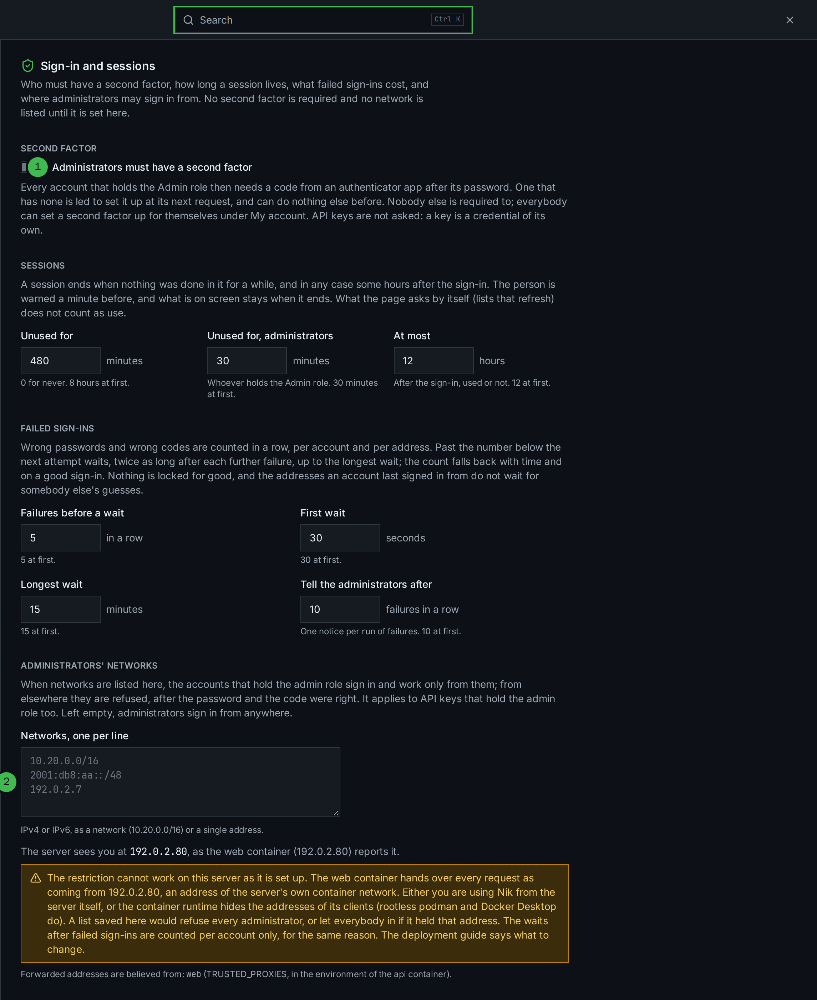

# Configuration

Set what the server needs in `.env` before the first start, change it later, and find the system settings an administrator changes in the app.

## Two places

| What | Where | Who changes it | Takes effect |
| --- | --- | --- | --- |
| How the stack runs: ports, names, directories, limits, secrets | `.env` and the files of `./secrets`, on the host | Whoever has a shell on the host | When the containers are made again: `docker compose up -d` |
| How Nik behaves: sign-in policy, backups, health thresholds, bulk limits, what leaves the server… | **Platform settings**, in the app | An account with the **Admin** role | At once |

Every variable is in [Environment variables](../reference/configuration.md), with its default.

## The .env file

`deploy/init-env.sh` writes it from `.env.example`, with a fresh value for every secret. On a new install the secrets go into files of `./secrets` and their lines in `.env` stay empty ([Keys and secrets](secrets.md)).

To change a variable:

1. Edit `.env` (one `NAME=value` a line).
2. Run `docker compose up -d` (or `podman compose up -d`). Compose makes again the containers whose settings changed.

!!! tip "A variable the Compose file does not pass"
    Some variables (marked *override* in the [reference](../reference/configuration.md)) are not passed to the containers. Add them to the service's `environment` in a `docker-compose.override.yml` beside the Compose file:

    ```yaml
    services:
      api:
        environment:
          LOG_LEVEL: DEBUG
    ```

## Before the first start

Set these in `.env`; the rest can wait.

| Variable | Set it to | Why now |
| --- | --- | --- |
| [`TLS_HOSTNAME`](../reference/configuration.md#TLS_HOSTNAME) | The name users type (`nik.example.org`) | It goes into the self-signed certificate made at the first start |
| [`WEB_TLS_PORT`](../reference/configuration.md#WEB_TLS_PORT), [`WEB_PORT`](../reference/configuration.md#WEB_PORT) | Free host ports (8443, 8080) | They are published on the host |
| [`NIK_SECRETS_DIR`](../reference/configuration.md#NIK_SECRETS_DIR) | Leave `./secrets`, or a path on another disk | A store key on the disk it protects does not protect a stolen host ([why](secrets.md#where-the-secrets-are)) |
| [`NIK_BACKUP_DIR`](../reference/configuration.md#NIK_BACKUP_DIR) | A directory on another disk (`/srv/nik-backups`) | A backup on the disk it protects is lost with it |
| [`NIK_WAL_ARCHIVE_DIR`](../reference/configuration.md#NIK_WAL_ARCHIVE_DIR) | A directory on another disk (`/srv/nik-archive`) | The same, for the archive of the database log |
| [`AUTOMATION_HTTPS_PROXY`](../reference/configuration.md#AUTOMATION_HTTPS_PROXY), [`AUTOMATION_NO_PROXY`](../reference/configuration.md#AUTOMATION_HTTPS_PROXY) | Your explicit proxy, if any | Playbooks and connectors reach the outside through it |

A host directory needs the right owner and, under SELinux, a label: create it as the user that runs the stack, then `chcon -Rt container_file_t <dir>`.

## Size limits

| Variable | Default | Limits |
| --- | --- | --- |
| [`SAMPLE_MAX_MB`](../reference/configuration.md#SAMPLE_MAX_MB) | 100 | A sample or an e-mail |
| [`ARTIFACT_MAX_MB`](../reference/configuration.md#ARTIFACT_MAX_MB) | 500 | An evidence file sent with the old route `POST /incidents/{id}/upload` |
| [`EVIDENCE_MAX_MB`](../reference/configuration.md#EVIDENCE_MAX_MB) | 8192 | A file of host evidence sent in parts (what the app uses) |
| [`COLLECTION_MAX_MB`](../reference/configuration.md#COLLECTION_MAX_MB) | 20480 | A collection (a KAPE or Velociraptor zip) |
| [`PCAP_MAX_MB`](../reference/configuration.md#PCAP_MAX_MB) | 500 | A packet capture |
| [`MAILBOX_MAX_MB`](../reference/configuration.md#MAILBOX_MAX_MB) | 2048 | A mailbox (mbox, Maildir archive) |
| [`PST_MAX_MB`](../reference/configuration.md#PST_MAX_MB) | 4096 | An Outlook PST |

Files of host evidence are sent in parts of 8 MB, so the 600 MB of the shipped nginx does not limit them: only `EVIDENCE_MAX_MB` and `COLLECTION_MAX_MB` do, and the free room of the store, which is checked before the transfer. The shipped nginx lets a mailbox upload of 4200 MB through. To raise `MAILBOX_MAX_MB` or `PST_MAX_MB` above that, also raise `client_max_body_size` of the mailbox location in `frontend/nginx/nginx.conf`.

## Settings in the app

Open **Platform settings** at the foot of the rail. These are the sections an administrator owns:

| Section | What you set there | More |
| --- | --- | --- |
| **System › Health** | Thresholds of the warnings, the Prometheus scrape token | [Health and audit](health.md) |
| **System › Storage** | Disk use, encryption of the store | [Keys and secrets](secrets.md#the-encryption-of-the-store) |
| **System › Keys** | Where each key comes from; asking for a change | [Keys and secrets](secrets.md#change-a-key) |
| **System › Workers** | The state of each worker, the forensics worker among them | [Health and audit](health.md#workers) |
| **System › Bulk actions** | Limits of the bulk actions; the jobs | [below](#bulk-action-limits) |
| **System › Backup** | Passphrase, schedule, retention, copy off the server, recovery to a moment | [Backups](backups.md), [Recovery](recovery.md) |
| **System › Audit log** | The chain, forwarding to syslog, removing old entries | [Health and audit](health.md#the-audit-log) |
| **Access › Sign-in and sessions** | Second factor for administrators, session times, failed sign-ins, administrators' networks | [below](#sign-in-and-sessions) |
| **Access › Accounts and roles**, **API keys** | People, roles, keys | [Accounts, roles and sign-in](../guide/accounts.md) |
| **Automation › Network and data** | Hosts every playbook may reach, the SMTP server | [Connectors](../guide/connectors.md) |
| **Automation › Stop all** | The general switch of automation | [Health and audit](health.md#stop-all) |
| **Automation › Content packs** | The catalogue, installing and updating packs | [Content packs](../guide/packs.md) |
| **Indicators › Threat intelligence**, **Indicators found** | Automatic look-ups, what they may send; finding indicators as incidents come in | [Threat intelligence](../guide/threat-intel.md) |
| **Analysis › Business hours** | The working hours **and their time zone** (UTC until set): the rule for remote logons outside working hours and the timers read it | [Detection and rules](../guide/detection.md) |
| **Rule sets › Sigma rules** | The rules host evidence is matched against, by the forensics worker (needs the role **rules** to change) | [Detection and rules](../guide/detection.md) |
| **Incidents › Archiving** | Archive the incidents closed for more than N days (off by default; needs the role **archive**) | [Reference: API](../reference/api.md#archive) |
| **Analysis › Mail analysis**, **Report header** | Your mail domains and trusted servers; name and logo on reports | [E-mail](../guide/mail.md), [Reports](../guide/reports.md) |

## Sign-in and sessions

**Platform settings › Access › Sign-in and sessions** holds the sign-in policy. How each rule works for users is in [Accounts, roles and sign-in](../guide/accounts.md).



| Setting | Default |
| --- | --- |
| **Administrators must have a second factor** | off |
| Session ends after no use | 8 hours; 30 minutes for an administrator |
| Session ends at most after | 12 hours ([`SESSION_TTL_HOURS`](../reference/configuration.md#SESSION_TTL_HOURS) until set here) |
| Failed sign-ins before a wait | 5; first wait 30 seconds, doubling up to 15 minutes |
| Administrators are told after | 10 failures in a row |
| **Administrators' networks** | empty: from anywhere |

1. Set up your own second factor first (**My account**), and keep its recovery codes.
2. Turn on **Administrators must have a second factor** <span class="step">1</span>. From that moment an administrator without one can only set one up.
3. Before listing **Administrators' networks** <span class="step">2</span>, read the line **The server sees you at …** under it from another machine. If it is an address of the container network, the server cannot see client addresses: leave the list empty. The page then says so in a warning, as in the picture, taken on Docker Desktop.

### The client's address

The waits per address and the administrators' networks need the backend to know where a request comes from. The `web` container writes the address it saw in `X-Forwarded-For`; the backend believes it only from [`TRUSTED_PROXIES`](../reference/configuration.md#TRUSTED_PROXIES) (`web` in Compose). Keep [`FORWARDED_ALLOW_IPS`](../reference/configuration.md#FORWARDED_ALLOW_IPS) empty, as the Compose file has it; remove any override that sets it to `*`.

| Set-up | The address the backend gets | Per-address waits, administrators' networks |
| --- | --- | --- |
| Docker Engine on Linux, as root | The client's own (a browser on the server itself shows the container gateway) | Work |
| Podman as root | The client's own | Work |
| Rootless Podman, rootless Docker | One address for everybody | Do not work: the page says so and refuses a list; failures are counted per account |
| Docker Desktop (Windows, macOS) | One address for everybody | Do not work |
| A reverse proxy on the host in front of the port | The proxy's address | Do not work |

To give the backend real addresses under rootless Podman, run the stack with Podman as root. On an [install without containers](manual-install.md) nothing is to be set.

### Getting back in

A person who lost their phone uses a recovery code; without codes, an admin resets their second factor under **Accounts and roles**. For the last administrator, or a network list that keeps every administrator out, run on the server:

```sh
# Take the second factor of an account away: it signs in with its password and sets one up again
docker compose exec api python -m app.account reset-second-factor <username>

# Empty the administrators' networks: administrators sign in from anywhere again
docker compose exec api python -m app.account clear-admin-networks
```

Each is written to the audit log under **server console**. The first also ends the account's sessions and removes its recovery codes; the password is unchanged.

## Bulk action limits

**Platform settings › System › Bulk actions** lists the bulk jobs and, for an admin, holds three limits. They are kept in the database and change without a restart.

| Limit | Default | Range |
| --- | --- | --- |
| Rows one bulk action takes | 5,000 | 1 to 50,000 |
| Done before the answer (more goes on in the background) | 50 | 0 to 500 |
| Closing incidents is confirmed by typing above | 100 | (deleting always is) |

See [Act on many at once](../guide/bulk.md).

## Related

- [Environment variables](../reference/configuration.md) — every variable and its default
- [Keys and secrets](secrets.md) — the secrets in `./secrets`
- [Health and audit](health.md) — thresholds, workers, audit log
- [Accounts, roles and sign-in](../guide/accounts.md) — the user side of the policy
- [Security](../reference/security.md#accounts-sessions-and-the-audit-log) — how sign-in is protected
