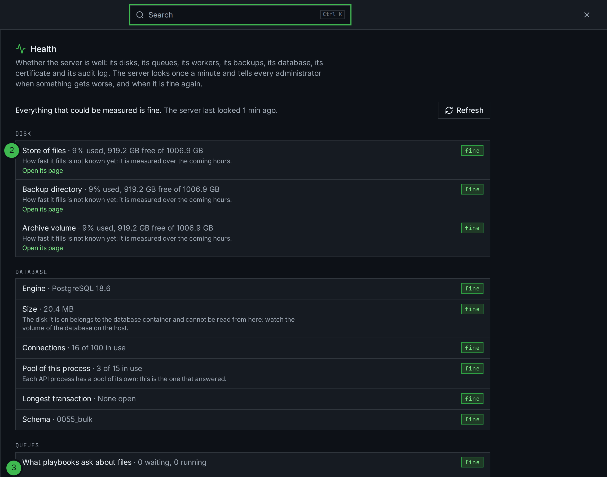
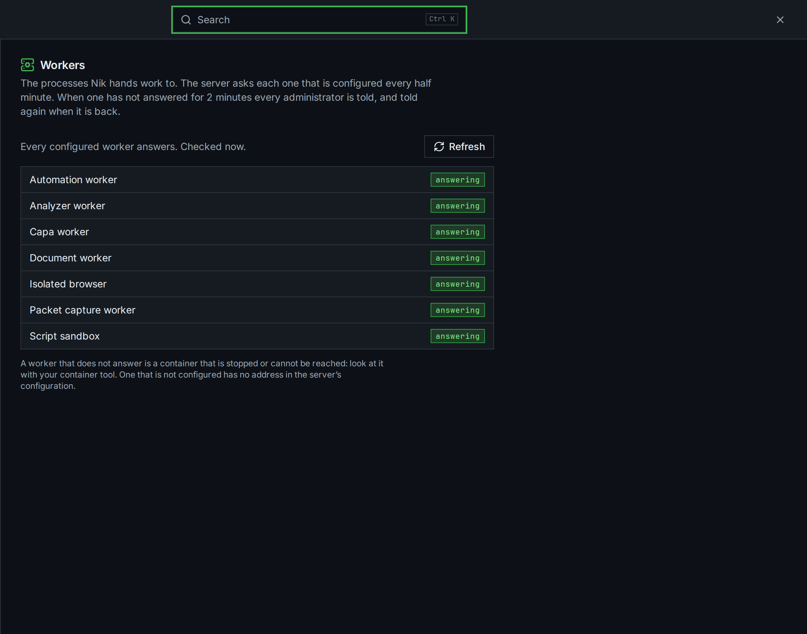
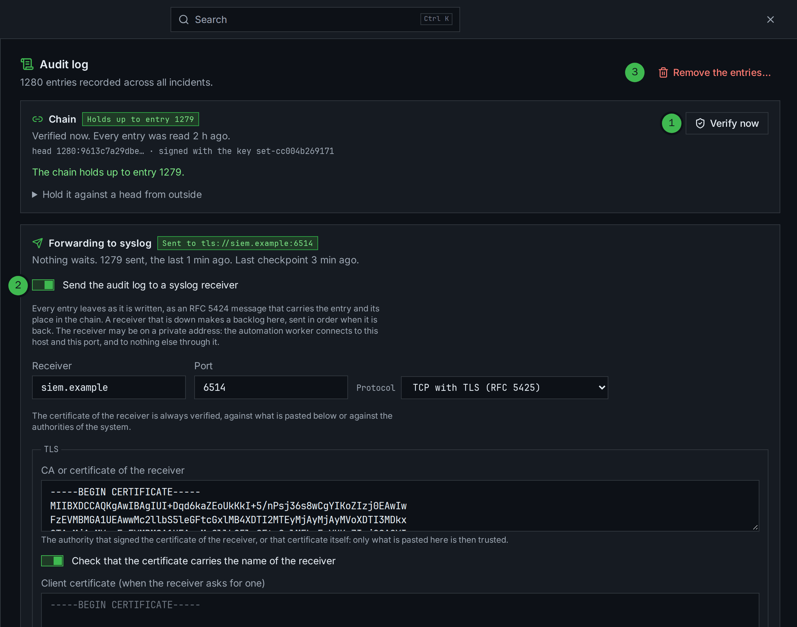
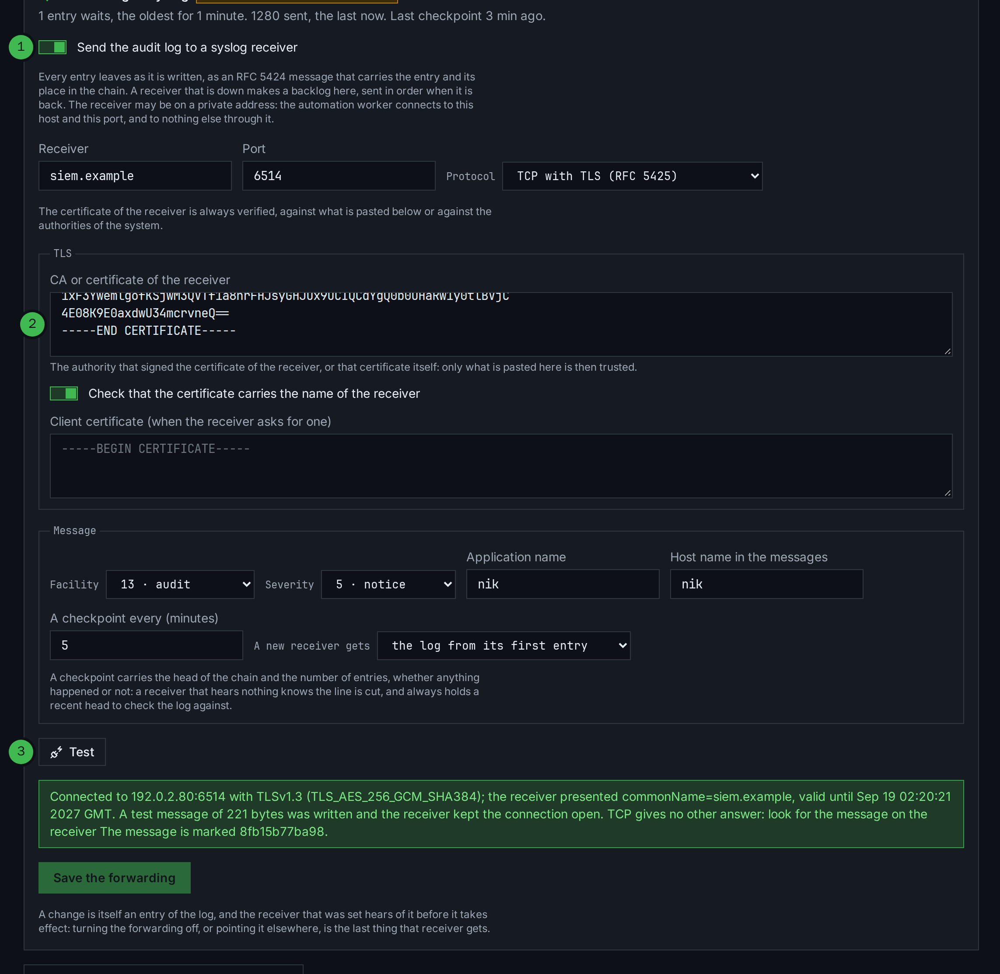
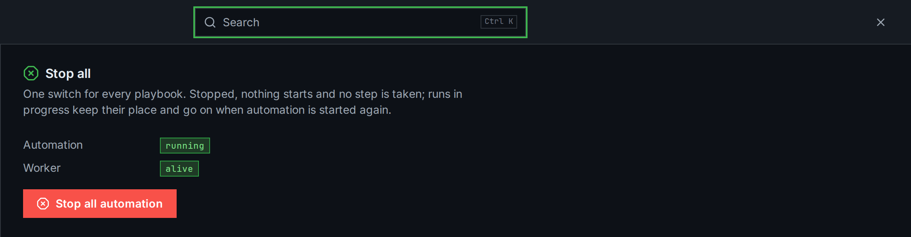

# Health and audit

See at a glance whether the server is well, get told when it is not, scrape it with Prometheus, and keep an audit log that cannot be quietly changed.

!!! note "You need"
    The **Admin** role for **Platform settings › System › Health**, **Storage** and **Workers**, and for **Automation › Stop all**. **Audit log** needs the permission `audit.read` (roles **audit** or **admin**).

## The Health page

**Platform settings › System › Health** says in one place whether the server is well. Each row is fine, needs attention or is a problem, and leads to the page with the whole story.



| Group | What it watches |
| --- | --- |
| Disk | The store of files, the backup directory, the archive: use, growth, when full at that rate |
| Database | Engine, size and growth, connections, pool, longest transaction, schema revision |
| Queues | What waits in each queue and for how long; schedules of playbooks; fetching |
| Work in progress | What restarts left behind ([below](#work-in-progress)); bulk actions |
| Workers | Each worker, the **forensics worker** among them; the automation worker's last sign of life |
| Backups | Last good backup, last restore test, next backup, snapshots before upgrades; recovery to a moment and the second host |
| Audit log | The chain; forwarding to syslog |
| Sign-in | Whose word is taken for the client's address; second factor of the administrators |
| Keys and encryption | Keys of the server; encryption of the store |
| Server | Version, the web certificate, the clock against the database |

1. Read **What needs attention** <span class="step">1</span> at the top.
2. Open a row <span class="step">2</span> to go to its page.
3. Change the limits under **Thresholds** at the foot (below the picture), then **Save the thresholds**.

### Warnings

The server looks once a minute (from the backend and from the automation worker, whichever is alive). Every administrator gets one notification when a row gets worse and one when it is fine again. A value must be found twice in a row first.

| Row | Attention | Problem |
| --- | --- | --- |
| A disk used | 80% | 90% |
| A disk full within | 30 days | 7 days |
| Oldest item of a queue | 10 minutes | 60 minutes |
| A schedule or a fetch late | 5 minutes | 60 minutes |
| Web certificate expires in | 30 days | 7 days |
| An audit entry waiting to be forwarded | 5 minutes | 30 minutes |
| Database connections used | 80% | 95% |
| A transaction open for | 15 minutes (a backup's is not counted) | |
| Clock apart from the database | 5 seconds | 60 seconds |

Workers, backups, recovery, keys and the store keep their own notices; the page does not repeat them. The database disk belongs to the `db` container and cannot be measured from the backend: watch that volume on the host. The certificate is read from `web:443` ([`NIK_WEB_TLS`](../reference/configuration.md#NIK_WEB_TLS)).

### Work in progress

Three rows say what restarts left behind:

| Row | Needs attention when |
| --- | --- |
| **Steps a restart interrupted that wait for a person** | There is one: open the runs and say whether the call happened |
| **Work set aside after it was interrupted** | Work interrupted three times, or a mirror comment not sent again, is there (kept a week) |
| **Oldest work held without a sign of life** | Over two minutes (a problem after ten): what should take it back is not running |

## Workers

**Platform settings › System › Workers** shows every worker and its state.



The backend checks every 30 seconds each worker it is configured with (analyzer, capa, document viewer, isolated browser, packet capture, forensics, script sandbox) and the automation container's heartbeat. A worker that has not answered for **two minutes without a break** is down: every admin gets one notification naming it, and one more when it is back. A container restarting for an update is back well within two minutes and tells nobody.

When a worker is down:

```sh
docker compose ps
docker compose logs -f <service>      # analyzer, capa, docview, browser, pcap, forensics, sandbox, automation
```

A worker that is not configured (no `*_URL`, or `AUTOMATION_WORKER=off`) is not watched.

!!! warning "When the forensics worker is down"
    **Files of host evidence cannot be read.** What was sent is kept as it was given and waits; no Sigma rule is checked or run; a record cannot be opened in its original; the viewer, the search in a file and the unpacking of a collection do not answer. Nothing is lost. A file being read when the worker restarts is given again at once, and a file sent in parts goes on from where it stopped. If it keeps failing, look at `docker compose logs forensics` and at its memory (`FORENSICS_MEMORY`, `FORENSICS_JOB_MEMORY_MB`).

### A server that is a copy

A stack restored with `deploy/restore.sh --as-copy` (`NIK_COPY=true`) shows the banner **COPY of** the name of the original on every screen, and reaches nothing outside itself. The Health page has no row for it: the banner, and `server.copy` in `GET /api/auth/me`, are the sign. What it refuses and how to check it: [Try a release on a copy](try-on-a-copy.md). The warnings about the copy off the server and the standby do not apply to it.

## Storage

**Platform settings › System › Storage** shows how the disk is used (**Free**, **Used**, **Used by Nik**), the **Largest objects** (open one to delete it from its page), **Artifacts with a date**, and the **Encryption of the store** ([Keys and secrets](secrets.md#the-encryption-of-the-store)).

## Metrics for Prometheus

The same numbers are at `/api/metrics`, through the web port, for whoever presents the scrape token.

1. At the foot of the Health page, under **Metrics for Prometheus**, make a **Scrape token**. It is shown once: **Copy the token**, then **I copied it**.
2. Put it in a file only Prometheus reads.
3. **Copy the job** the page gives, or write it:

    ```yaml
    scrape_configs:
      - job_name: nik
        scheme: https
        metrics_path: /api/metrics
        authorization:
          type: Bearer
          credentials_file: /etc/prometheus/nik-metrics-token
        tls_config:
          ca_file: /etc/prometheus/nik-ca.crt   # Nik's certificate, or its authority
        static_configs:
          - targets: ["nik.example:8443"]
    ```

Without the token the route answers 401, to a signed-in administrator too. [`METRICS_TOKEN`](../reference/configuration.md#METRICS_TOKEN) in `.env` is still accepted beside it. **Remove the token** stops it.

??? info "The metrics"
    | Metric | Labels | What it is |
    | --- | --- | --- |
    | `nik_health_state` | `check` | Each row of the Health page: 0 fine, 1 attention, 2 problem, -1 unknown |
    | `nik_disk_total_bytes`, `nik_disk_used_bytes`, `nik_disk_free_bytes` | `disk` (`store`, `backups`, `archive`) | The disks of the store, the backups and the archive |
    | `nik_disk_growth_bytes_per_day`, `nik_disk_full_in_seconds` | `disk` | How fast it fills, and the time left |
    | `nik_database_size_bytes`, `nik_database_growth_bytes_per_day` | | Size of the database and its growth |
    | `nik_database_connections`, `nik_database_connections_max` | | Connections open, and the maximum |
    | `nik_database_pool_in_use`, `nik_database_pool_size` | | The pool of the process that answered |
    | `nik_database_longest_transaction_seconds` | | Age of the oldest open transaction |
    | `nik_database_revision_current` | | 1 when the schema is the one this version expects |
    | `nik_clock_skew_seconds` | | Server clock minus database clock |
    | `nik_queue_waiting`, `nik_queue_running`, `nik_queue_oldest_seconds` | `queue` | Each queue: `artifact_jobs`, `url_scans`, `uploads`, `playbook_steps`, `events`, `fetch`, `lookups`, `mirror`, `backup_copies` |
    | `nik_playbook_runs` | `state` | Runs kept, by state |
    | `nik_schedules`, `nik_schedules_late` | | Schedules, and those late |
    | `nik_fetch_instances` | `state` (`ok`, `failing`, `paused`) | Instances that fetch |
    | `nik_work_interrupted`, `nik_work_interrupted_oldest_seconds` | | Steps waiting for a person after a restart |
    | `nik_work_set_aside` | | Work set aside after three interruptions |
    | `nik_bulk_running`, `nik_bulk_failed` | | Bulk actions running; given up in the last month |
    | `nik_work_held`, `nik_work_silent_seconds` | | Work an API process holds; the oldest sign of life (over 45: should have been taken back) |
    | `nik_worker_up` | `worker` | 1 when a worker answered its last check |
    | `nik_automation_heartbeat_age_seconds` | | Since the automation worker last said it was alive |
    | `nik_backup_last_good_age_seconds`, `nik_backup_last_good_size_bytes` | | The last backup that passed its test |
    | `nik_backup_problems`, `nik_backup_next_run_timestamp_seconds`, `nik_upgrade_snapshots` | | Backup problems, next run, snapshots kept |
    | `nik_recovery_archive_ok`, `nik_recovery_archive_last_timestamp_seconds` | | The archive works; when the last segment was archived |
    | `nik_recovery_wal_waiting_bytes`, `nik_recovery_wal_bytes` | | Log not archived yet; log in PostgreSQL's directory |
    | `nik_recovery_archive_bytes` | `what` (`log`, `base`, `kept`) | What the archive takes |
    | `nik_recovery_oldest_timestamp_seconds`, `nik_recovery_base_last_timestamp_seconds`, `nik_recovery_base_last_size_bytes` | | Oldest moment reachable; last base backup |
    | `nik_recovery_test_ok`, `nik_recovery_test_timestamp_seconds` | | Last recovery test |
    | `nik_recovery_service_up`, `nik_recovery_problems` | | The recovery service; its problems |
    | `nik_recovery_copy_link_ok`, `nik_recovery_copy_behind_seconds`, `nik_recovery_copy_behind_bytes`, `nik_recovery_store_files_waiting` | | Only with copies: the second host reached, how far behind, files waiting |
    | `nik_server_role`, `nik_server_generation`, `nik_server_promoted_timestamp_seconds` | `role` (`primary`, `standby`, `superseded`) | The role of this server |
    | `nik_certificate_expiry_timestamp_seconds` | | When the web certificate expires |
    | `nik_audit_entries_total`, `nik_audit_entries` | | Entries ever linked; entries held now |
    | `nik_audit_chain_ok`, `nik_audit_chain_verified_timestamp_seconds` | | Last walk of the chain |
    | `nik_audit_forward_enabled`, `nik_audit_forward_backlog`, `nik_audit_forward_oldest_seconds`, `nik_audit_forward_sent_total` | | Forwarding to syslog |
    | `nik_signin_failures_total`, `nik_signin_waiting` | | Failed sign-ins; accounts and addresses waiting |
    | `nik_administrators_without_second_factor` | | Administrators with no second factor |
    | `nik_keys_in_environment`, `nik_key_rotation_state`, `nik_key_rotated_timestamp_seconds` | `key` (on the last two) | Secrets in the environment; a change of key (0 none, 1 half-way, 2 failed); last change |
    | `nik_audit_entries_unchecked` | | Entries whose key the server cannot make any more |
    | `nik_store_encrypted`, `nik_store_files_in_clear`, `nik_store_bytes_in_clear`, `nik_store_files_stuck`, `nik_store_files_damaged` | | Encryption of the store |
    | `nik_info` | `version` | The version of Nik |
    | `nik_http_requests_total` | `method`, `path` (the route, never the address asked), `status` | Requests answered |
    | `nik_http_request_duration_seconds` | `method`, `path`, `le` | How long they took (histogram) |

## The audit log

**Platform settings › System › Audit log** lists every change, whoever made it and however (the app, an API key, a request by hand). It is a **chain**: each entry carries the hash of the one before and its own, and an HMAC signature under [`AUDIT_KEY`](../reference/configuration.md#AUDIT_KEY). Nothing has to be set for the chain.



- The server walks the chain every five minutes (every entry once a day) and tells every administrator once when it finds a break.
- **Verify now** <span class="step">1</span> walks it on demand. **Hold it against a head from outside** <span class="step">2</span> checks the end of the log against a head kept elsewhere (`4182:9f2c…`: an entry number, a colon, its hash), such as the last checkpoint your syslog receiver got.
- **Remove the entries…** <span class="step">3</span> (a signed-in administrator) removes the oldest entries; the chain keeps an entry saying how many went and up to which hash. Nothing is removed by itself: there is no retention to set. Entries not yet forwarded are never removed.

What a chain cannot show alone: removing the newest entries, or rewriting the whole log by somebody who holds the database and the key. Only a copy off the server shows that: forward it.

### Forward the audit log to syslog

The `automation` container sends, so the receiver must be reachable from it. It connects straight to the receiver (not through an HTTP proxy), on a private address too; this exception opens nothing for playbooks.

1. Open **Audit log › Forwarding to syslog**, **Forwarding settings**.
2. Tick **Send the audit log to a syslog receiver** <span class="step">1</span>.
3. Fill **Receiver** and **Port**, choose **Protocol** **TLS** (6514), paste the **CA or certificate of the receiver** (empty: the system's authorities), and a **Client certificate** with its key if the receiver asks for one <span class="step">2</span>.
4. Choose what **A new receiver gets**: **the log from its first entry** or **the log from this change on**.
5. Press **Test** <span class="step">3</span>: a marked message is sent and the **Result of the test** shows what the socket said.
6. Press **Save the forwarding**.



- A receiver that is down loses nothing: entries wait and leave in order. The page and the Health page show what waits; the administrators are told after five minutes.
- Plain TCP and UDP exist for receivers that take nothing else: not encrypted, not authenticated, and UDP can lose messages.

??? info "On the receiver, and checking the log against its copy"
    Each message is one line: an RFC 5424 header, structured data `[nik@32473 seq="…" hash="…" prev="…" id="…" action="…"]` and the entry as JSON (`origin="import"` for an entry that came from another server's file). Keep the raw message (rsyslog: a template with `%rawmsg%`; syslog-ng: `${MSG}` with `flags(syslog-protocol)`) in a file the administrators of Nik cannot write. A `checkpoint` message arrives every five minutes even when nothing happened: **alert on its absence**.

    To check the log against the receiver's copy, on any machine with Python:

    ```sh
    # on the server: every entry, one JSON object a line
    docker compose exec api python -m app.auditlog export > audit-export.jsonl
    # anywhere
    python backend/app/auditlog/verifier.py audit-export.jsonl
    python backend/app/auditlog/verifier.py audit-export.jsonl --syslog /var/log/nik-audit.log
    # or against the last checkpoint only
    docker compose exec api python -m app.auditlog verify-audit --head 4182:9f2c…
    ```

    It exits 0 when everything holds, and names what does not: an entry edited, entries missing, a log cut at its end, a log rewritten. Signatures are checked only when given the keys (`--keys FILE`, or `NIK_AUDIT_KEYS`). `python -m app.auditlog key` says which key signs now.

    After a restore, the receiver sees numbers it already has arrive again with other content, starting with `audit.restore`: the verifier reads it as a restore and counts the entries that exist only on the receiver.

What is and is not recorded is listed in [Security](../reference/security.md#what-is-in-the-audit-log).

## Stop all

**Platform settings › Automation › Stop all** is the general switch of automation. It shows whether **Automation** is running and whether the **Worker** is alive.



- **Stop all automation** (confirmed in a dialog): no playbook starts, no step is taken, no schedule fires, nothing is fetched. A step already talking to another system finishes. Runs keep their place.
- **Start automation again** turns it back on; runs go on from where they were.

Going back to a moment turns it off by itself ([Recovery](recovery.md#what-the-server-does-after-going-back)). Turning it off and on is in the audit log.

## Related

- [Configuration](configuration.md) — the settings an admin changes
- [Keys and secrets](secrets.md) — the audit key, the store
- [Backups and restore](backups.md) — the backup notices
- [Security: the audit log](../reference/security.md#accounts-sessions-and-the-audit-log)
- [API: health and metrics](../reference/api.md#backups-recovery-and-health)
