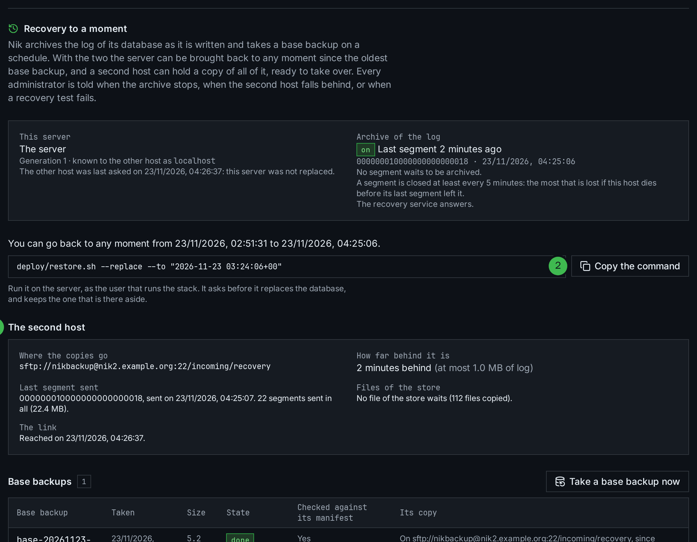

# Recovery and standby

Bring the database back to any recent moment, keep a second host ready to take over, and choose the right way back when the first host is lost.

!!! note "You need"
    A shell on the host concerned: every recovery, set-up and promotion is a command there, never a button. The **Admin** role for **Platform settings › System › Backup**.

## How it works

A backup is the server at one moment. Beside the backups, the Compose stack keeps:

- **the archive of the log**: PostgreSQL hands every finished segment of its write-ahead log to the volume `wal-archive`, compressed. While something is written it closes a segment at least every [`NIK_ARCHIVE_TIMEOUT`](../reference/configuration.md#NIK_ARCHIVE_TIMEOUT) seconds (300);
- **base backups**: a physical copy of the database every day at 03:30 UTC, one at once when there is none, and after each recovery or promotion. Taken by the `recovery` service, which has no network;
- **two days to go back in**: the base backups of the last two days, the one before, and all the log since;
- **a recovery test** every 24 hours: the latest base backup and the archive are replayed into a scratch server, and its audit log is held against the server's;
- **deleted files kept**: a file deleted from the store is moved to `.kept/` and removed only when no recovery can reach before its deletion.

All this turns on by itself. **The copies off the host do not**: they start when a backup passphrase and a destination with its pinned host key are set ([The copy off the server](backups.md#the-copy-off-the-server)). Until then the archive is lost with the disk.

An [install without containers](manual-install.md) has no archive.

## The Recovery to a moment section

At the foot of **Platform settings › System › Backup**, **Recovery to a moment** shows the state and holds the settings.



- **Moments one can go back to** <span class="step">1</span>, and **Command to go back to a moment** with **Copy the command** <span class="step">2</span>.
- **The second host** <span class="step">3</span>: the last segment sent and how far behind it is.
- **Recovery test** and **Room the archive takes**.
- **Recovery settings**: when base backups are taken, **Days one can go back**, how often the archive is proven, the delay of the second host that is warned about (15 minutes), **Name of this server for the other host**.

Every administrator is told when the archive stops, the recovery service does not answer, a base backup or test fails, or the second host is not reached or falls behind.

### What it takes on the disk

About `(days + 1) × (the database compressed + one day of log)` in the archive, plus the files deleted in those days in the store. A server nobody works on archives roughly 10 to 30 MB of log a day with the default timeout. The page shows the figures of your server.

The archive and the base backups on the server are **in clear**, like the database: protect the disk. What leaves the host is sealed.

When the archive cannot be written (disk full), nothing is lost, but PostgreSQL keeps the segments on the database disk, which then fills. The administrators are told after five minutes; the reason is in `docker compose logs db`.

| Variable | Default | Effect |
| --- | --- | --- |
| [`NIK_ARCHIVE_TIMEOUT`](../reference/configuration.md#NIK_ARCHIVE_TIMEOUT) | 300 | Lower loses less when the host dies, and writes more small files |
| [`NIK_WAL_ARCHIVE_DIR`](../reference/configuration.md#NIK_WAL_ARCHIVE_DIR) | volume `wal-archive` | A host directory on another disk (`chcon -Rt container_file_t` it under SELinux) |
| [`NIK_WAL_ARCHIVE`](../reference/configuration.md#NIK_WAL_ARCHIVE) | `on` | `off`: no recovery to a moment, no standby |

A change is read when the containers are made again (`compose up -d`).

## Go back to a moment

For a mistake found later: the database comes back as it was at the moment you name. It never writes over a database: the one there is kept aside under a name that says when.

1. In **Recovery to a moment**, read from when to when you can go back, and copy the command. Write the moment with its offset (`+00`); without one it is read as UTC.
2. On the server, as the user that runs the stack:

    ```sh
    deploy/restore.sh --to "2026-11-21 14:03:00+00" --replace   # a minute before the mistake
    deploy/restore.sh --to latest --replace                     # everything the archive holds
    ```

    It says which base backup it starts from, how many segments follow and what will be left out, then asks for the word `replace`. If the archive does not reach the moment, it says up to when it can go and changes nothing.
3. It stops the stack, keeps the database aside, puts the base backup in place, replays the log to the moment, checks the revision, the audit chain and every file the database names (deleted files are put back from `.kept/`), then starts the stack.
4. Read **What was lost** at the end, then check: sign in, open the incident you came back for and one file; **Audit log** (the chain verifies, the first new entry `audit.restore` names the moment); **Backup** (a new base backup is being taken).
5. **Turn automation on again** once you have checked other systems: going back to a named moment turns **Stop all** on ([below](#what-the-server-does-after-going-back)).
6. Remove the database kept aside when all is well.

Run again with another moment to correct one that was too early or too late. `--no-start` leaves the stack stopped; `--yes` does not ask; `--no-aside` (with `--replace`) removes the old database instead of keeping it, only when the disk has no room for both.

### What the server does after going back

The database of that moment comes back with everything that was in progress then, handled as after a restart:

- analyses, scans, captures and mailboxes start again by themselves;
- a playbook step is done again, or, if it may not be repeated, waits for a person;
- a schedule whose time passed runs once; a fetch goes on from where it was at that moment, so alerts fetched since come in again as new incidents.

What the server did in other systems after the moment (a host isolated, a ticket opened, a mail sent) it no longer knows, and a playbook started again would do it again. So **going back to a named moment turns the general switch of automation off**: nothing runs, fires or fetches until an administrator turns it on in **Platform settings › Automation › Stop all**. `--to latest` loses only the last seconds and leaves the switch as it was.

### The databases kept aside

```sh
deploy/restore.sh --asides              # list them, with their size
deploy/restore.sh --drop-aside NAME     # remove one for good (asks for "remove")
deploy/restore.sh --put-back NAME       # put one back: undoes a recovery
```

Keeping a database aside needs free room for a whole database on its disk: the script stops first and says how much is missing.

## A standby host

A standby runs the same stack with a database that replays the log the first host sends. It serves nothing and becomes the server when an operator runs one command on it.

- **The link is the backups' SFTP account.** The first host writes every log segment and base backup (sealed under the backup passphrase) and the files of the store (sealed under the store key) into a directory of the second host. No other port is opened; only the first host connects; there is no streaming replication.
- **It is behind** by the archive timeout and a few seconds. The first host also leaves a heartbeat at least once a minute.

### Set it up

1. **On the second host**, make the SFTP account and directory as for [the backup copy](backups.md#the-copy-off-the-server) (steps 1 to 4), then let the stack read it:

    ```sh
    sudo chmod 755 /srv/nik-backups/incoming
    ```

    Install Docker or Podman, and git.
2. **On the first host**, in **Backup**: set the passphrase and the destination (the second host, its account, the directory, the pinned host key). **Save the settings**, **Test the destination**, and wait until **Recovery to a moment** shows a base backup on the second host and **The second host** names the last segment sent.
3. **On the first host**, export the keys the standby needs:

    ```sh
    deploy/standby.sh secrets export nik-keys.txt
    ```

    It asks twice for a passphrase made for this transfer (12 characters or more). Carry the file by any channel, the passphrase by another.
4. **On the second host**, at the same version:

    ```sh
    git clone https://github.com/n36l3c7/Nik.git /opt/Nik && cd /opt/Nik
    git checkout v7.0.0                                    # the version the first host runs
    deploy/init-env.sh
    $EDITOR .env                                           # TLS_HOSTNAME, ports
    deploy/standby.sh secrets import nik-keys.txt
    deploy/standby.sh init --inbox /srv/nik-backups/incoming
    ```

    `init` asks for the backup passphrase once and the word `standby`, opens the latest base backup and the log, writes `NIK_STANDBY_INBOX` in `.env`, and starts four containers: `db`, `recovery`, `api`, `web`. On a stack that already holds a database it refuses unless `--replace` is added.
5. Remove `nik-keys.txt` from both hosts. The second host's address now shows: *This server is the standby: it follows the first host and serves nothing.*

### Watch it

```sh
deploy/standby.sh status
```

On either host: the role and generation, the last file received, how old the last change replayed is, when the first host last spoke, and what a promotion would lose now. On the first host, **Backup** and the **Health** page say how far behind it is.

A standby holds every key of the first host: give it the same protection. When the link is cut, the first host goes on and archives locally; the administrators are told after ten minutes, and what waited is sent in order when the link is back.

## The first host is gone

Three ways back, the best first. Which one is open depends on what was set up before.

| Way back | When | What is lost | Time |
| --- | --- | --- | --- |
| [Promote the standby](#promote-the-standby) | A standby was set up | The last segment that had not left: up to the archive timeout and a few seconds | Minutes |
| [A new host from the copies](#a-new-host-from-the-copies) | Copies were sent, no standby | The same | The same, plus installing a host |
| [Restore the last backup](#restore-the-last-backup-on-a-new-host) | No archive copies, or the store key was lost | Everything since that backup (up to six hours by default) | Installing a host, then seconds to minutes |

### Promote the standby

Nothing promotes by itself: not a screen, not a timer, not the first host falling silent.

1. **Make sure the first host is down, or off the network.** Two servers must never work at once.
2. On the second host:

    ```sh
    deploy/standby.sh status     # what a promotion would lose now
    deploy/standby.sh promote
    ```

    It says what would be lost, asks for the word `promote`, replays everything that arrived, makes this server the server (one generation later), leaves `recovery/superseded.json` for the old host, starts the whole stack and waits until it answers.
3. Point users at this host (DNS, or the proxy in front). The certificate must carry that name (`TLS_HOSTNAME`).
4. Keep the old host off the network until it [rejoins](#the-first-host-is-back).
5. Sign in and check the last incidents and **Automations › Runs** around the moment named. In **Backup**, set a new destination: the one there is this host itself, so nothing is sent until you do.

If not everything can be replayed, `promote` stops and changes nothing; `--force` promotes with what was replayed. An interrupted promotion is finished by running the command again. `--name` sets what this server calls itself in the file it leaves.

### A new host from the copies

Any host that can read the directory of the copies can bring the server back, with the backup passphrase and the keys of the first host.

1. Get the code at the version the first host ran, and make the settings:

    ```sh
    git clone https://github.com/n36l3c7/Nik.git /opt/Nik && cd /opt/Nik
    git checkout v7.0.0
    deploy/init-env.sh
    $EDITOR .env                   # TLS_HOSTNAME, ports
    ```

2. Put the first host's keys in place: `deploy/standby.sh secrets import nik-keys.txt` with a file exported earlier, or write `secrets/db_password`, `secret_key`, `store_key`, `audit_key` (and the `…_previous` files) by hand from your copy.
3. Make the copies readable: `sudo chmod -R o+rX /srv/nik-backups/incoming`.
4. Recover:

    ```sh
    deploy/restore.sh --to latest --from /srv/nik-backups/incoming
    ```

    It asks for the backup passphrase, opens and checks the base backup and the log, takes the copied files of the store, and goes on as a recovery on the server. A moment can be named in place of `latest`.
5. This server now replaces the old one and leaves `recovery/superseded.json` beside the copies. Point users at it and set a new destination in **Backup**.

!!! tip "Rehearse it"
    To learn how long it takes on your data, copy the directory of the copies to a host that is **not** the second host, off its network, and run step 4 on the copy. Never rehearse on the directory the server sends to: the server would read the file and stop.

### Restore the last backup on a new host

When there is no archive on the second host, or the store key was lost with the first host (a backup needs only its passphrase).

You need: Docker or Podman and git, the backups received (`/srv/nik-backups/incoming`, with the `pool-*` folders beside them from 7.0), the backup passphrase, and the first host's `SECRET_KEY` with its `AUDIT_KEY` and `AUDIT_KEY_PREVIOUS` (or a backup that includes the key).

1. Get the code at the version that took the backup or later (the `.json` beside each backup names it):

    ```sh
    git clone https://github.com/n36l3c7/Nik.git /opt/Nik && cd /opt/Nik
    grep '"nik"' /srv/nik-backups/incoming/nik-20261120-023000.json
    git checkout v7.0.0
    ```

2. Make this host's settings, then put the old keys in (skip if the backup holds the key):

    ```sh
    deploy/init-env.sh
    $EDITOR secrets/secret_key           # the first host's SECRET_KEY, one line
    $EDITOR secrets/audit_key_previous   # its AUDIT_KEY, then its AUDIT_KEY_PREVIOUS, commas between
    $EDITOR .env                         # TLS_HOSTNAME, ports
    ```

3. Restore the latest backup marked verified (`"passed": true` in its `.json`). The backup account's directory is closed to other users, so give the file a second name in an open folder first:

    ```sh
    sudo install -d -m 755 /srv/nik-restore
    sudo ln /srv/nik-backups/incoming/nik-20261120-023000.nikbak /srv/nik-restore/
    sudo chmod 644 /srv/nik-restore/nik-20261120-023000.nikbak
    deploy/restore.sh /srv/nik-restore/nik-20261120-023000.nikbak
    # with the key inside the backup:  deploy/restore.sh --secret-key /srv/nik-restore/nik-….nikbak
    ```

    **A backup made by 7.0 needs its pool.** The files it names are in a folder `pool-<id>` beside it on the second host. A second name is not enough for a folder: copy it into the open folder too, and open it to the restore, which runs as a user that is nobody on the host. Without it the restore stops before changing anything and names what is missing ([The pool beside the backups](backups.md#the-pool-beside-the-backups)).

    ```sh
    sudo cp -r /srv/nik-backups/incoming/pool-* /srv/nik-restore/
    sudo chmod -R a+rX /srv/nik-restore
    ```

4. Sign in with an account of the first host (password, second factor and recovery codes as they were). Check incidents, a file of the store, **Workers**, an instance of a connector, and **Keys** (no audit entry should be unchecked).
5. Put the TLS certificate in place, point the name at this host, and set **Backup** again (set the passphrase again if `SECRET_KEY` changed).

## The first host is back

After a promotion or a recovery from the copies, the old host holds a database that is no longer the server's.

- **Started where it can reach the second host**, it asks first, learns it was replaced, and serves nothing: *This server was replaced on … by ….*
- **Started where it cannot**, it waits 45 seconds, then serves and tells its administrators the second host could not be asked. That is why the old host stays off the network until it rejoins.

To make it the standby of the new server:

1. On the old host, make sure there is an SFTP account and a readable directory for the copies (as in [Set it up](#set-it-up), step 1).
2. On the new server, in **Backup**, set the old host as the destination with its host key pinned, test it, and wait until a base backup was sent.
3. On the old host:

    ```sh
    deploy/standby.sh rejoin --inbox /srv/nik-backups/incoming
    ```

    It asks for the backup passphrase and the word `standby`, keeps the old database aside, and starts the host as a standby.
4. `deploy/standby.sh status` on the old host says it follows the new server. What the old host wrote after the last copy is only in the database kept aside: read it from there if it matters, before removing it.

To swap roles back later: stop the server, promote the standby, rejoin the other host.

## Upgrading a pair

**The standby first, then the server.** Never the other way.

1. On the standby: `git pull`, then `docker compose up -d --build db recovery api web`. It migrates nothing. For 7.0 run `deploy/init-env.sh` first on both hosts: the Compose file asks `api` for `FORENSICS_TOKEN`, even on a standby that starts no `forensics` container.
2. On the server: `git pull`, then `docker compose up -d --build`. The snapshot, rehearsal and migrations run there.
3. The migration reaches the standby through the log.

Both hosts must run the same PostgreSQL major version. A new minor version comes with the image: pull and recreate in the same order.

## Which secrets each way back needs

*In place* means the host already holds it.

| Way back | Backup passphrase | Database password | `SECRET_KEY` | `STORE_KEY` | `AUDIT_KEY` |
| --- | --- | --- | --- | --- | --- |
| Go back to a moment on the server (`restore.sh --to`) | Not needed | In place | In place | In place | In place |
| Promote the standby (`standby.sh promote`) | Not typed | In place | In place | In place | In place |
| Set up a standby or rejoin (`standby.sh init`, `rejoin`) | Typed once | The first host's, imported | The first host's, imported | The first host's, imported | The first host's and earlier ones, imported |
| A new host from the copies (`restore.sh --to … --from`) | Typed | The old server's | The old server's | The old server's | The old server's and earlier ones |
| Restore a backup (`restore.sh <backup>`) | Typed | This host's | The old server's (or `--secret-key`); without it stored secrets are entered again | Not needed | The old server's, among `AUDIT_KEY_PREVIOUS` |

*Imported* is `deploy/standby.sh secrets export` on the first host and `secrets import` on the other. A lost host cannot export: keep a copy of its secrets directory away from it ([Keys and secrets](secrets.md#what-to-keep-off-the-server)).

## What is lost, and how long it takes

Measured on a small test pair (two stacks on one machine, little data, an archive timeout of 20 seconds instead of 300). They show how the pieces behave, not how long your data takes: rehearse on your own.

| What happened | What is lost | Time on the test pair |
| --- | --- | --- |
| A mistake: go back to a moment | Everything after the moment | 10–11 s to recover, 35 s until the server answers |
| Host died, standby promoted | The writes after the last segment that arrived | 16–17 s from the command to a sign-in |
| Host died, new host from the copies | The same | 14 s to recover, 44 s until it answers; plus installing the engine and building the images |
| Host died, last backup restored | Everything since that backup | Seconds for an 800 MB store |
| Setting up a standby; a rejoin | — | 28 s; 27–40 s |

With the default timeout of 300 seconds, a host that dies loses about five minutes at most. Durations grow with the size of the database and the amount of log to replay.

??? info "Limits, as they are"
    - None of this was measured under Podman, on two separate machines, or across a corporate network: try it on your hosts.
    - No streaming replication: a standby is never closer than the last closed segment.
    - A file of the store rewritten in place (an open capture's log, a mailbox file) exists in one version: a recovery brings back the database of the moment and the latest content of such a file.
    - After a promotion or a change of destination everything is sent again, except samples and e-mails the other host already holds.
    - A server that cannot reach the second host cannot know it was replaced.

## Related

- [Backups and restore](backups.md) — the passphrase, the destination, a restore
- [Upgrades](upgrades.md) — the snapshot and rollback
- [Keys and secrets](secrets.md) — exporting and keeping the keys
- [Security: recovery and the standby](../reference/security.md#recovery-and-the-standby)
- [Health and audit](health.md) — the rows that watch the archive and the second host
