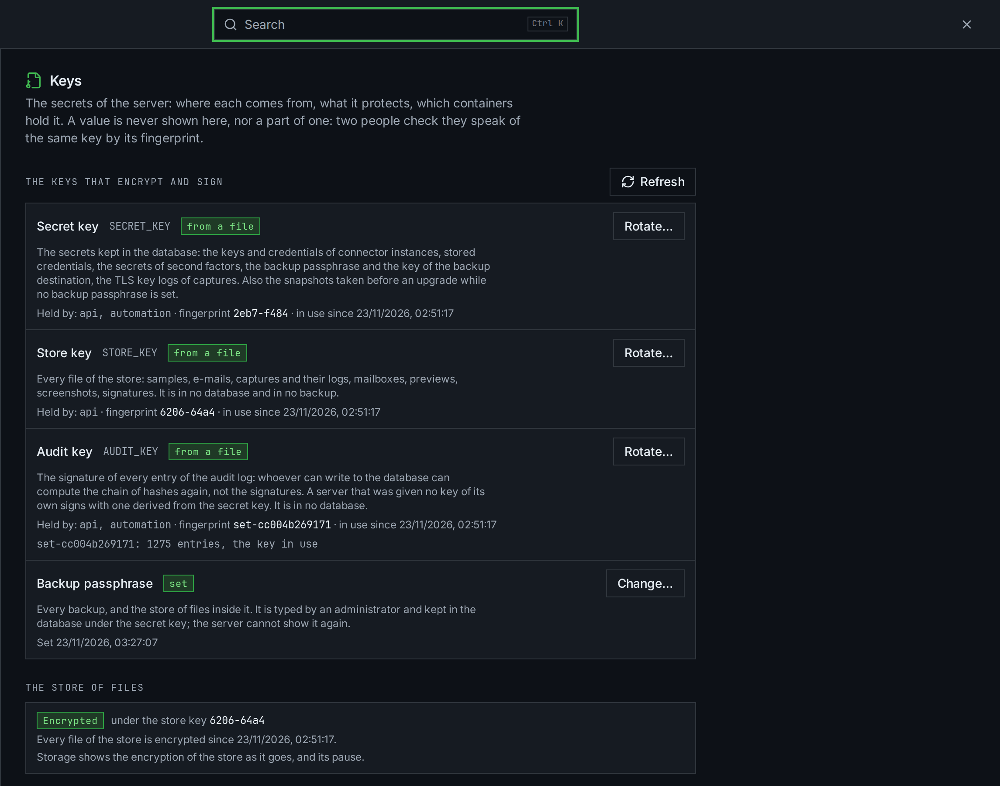
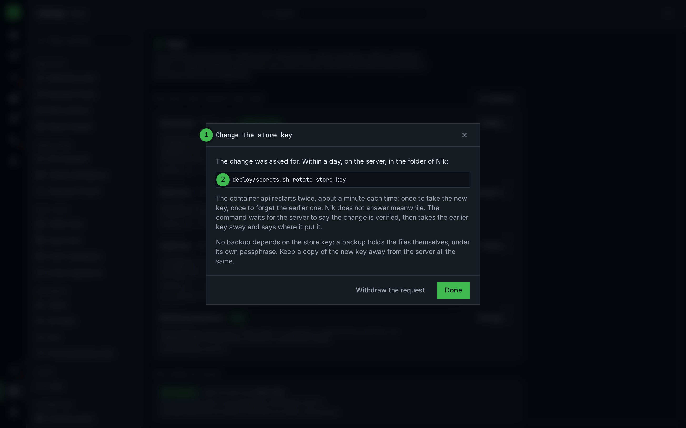
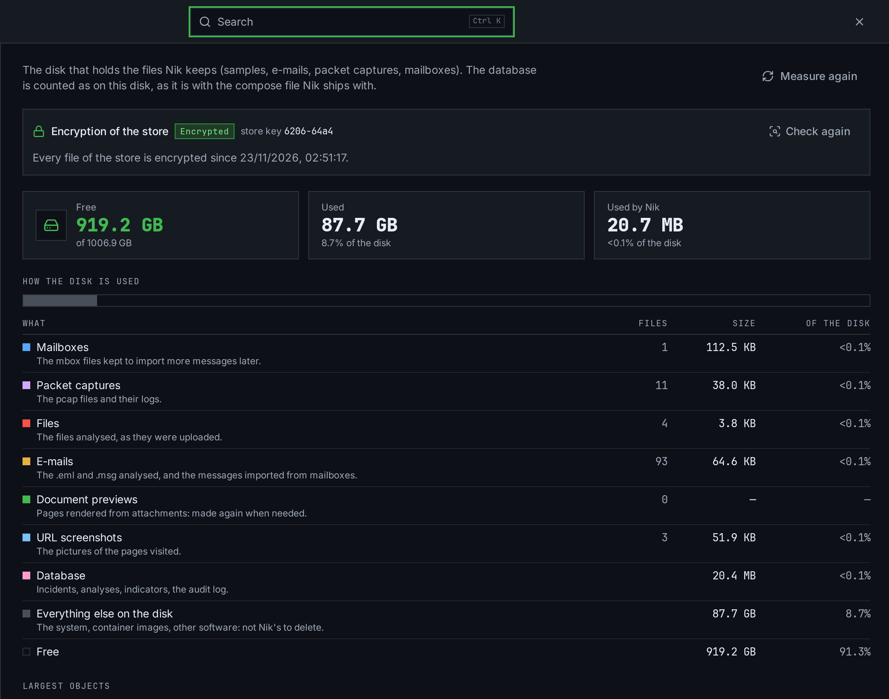

# Keys and secrets

Know where each secret of the server is, change a key safely, and keep the right copies away from the server.

!!! note "You need"
    A shell on the host for `deploy/secrets.sh`, and a signed-in administrator (with the password again, and a code if the account has a second factor) to ask for a change in **Platform settings › System › Keys**.

## The secrets

| Secret | What it protects | Containers given it |
| --- | --- | --- |
| `SECRET_KEY` | The secrets stored in the database: credentials of instances, second factors, the backup passphrase, TLS key logs | `api`, `automation` |
| `STORE_KEY` | Every file of the store, sealed on disk | `api` only |
| `AUDIT_KEY` (and `AUDIT_KEY_PREVIOUS`) | The signature of every audit log entry | `api`, `automation` |
| `DB_PASSWORD` | The connection to PostgreSQL | `api`, `automation`, `db` (only to create the database) |
| `ANALYZER_TOKEN`, `CAPA_TOKEN`, `DOCVIEW_TOKEN`, `BROWSER_TOKEN`, `PCAP_TOKEN`, `FORENSICS_TOKEN` | What the backend says to one worker. `FORENSICS_TOKEN` is new in 7.0: `deploy/init-env.sh` makes it on an install that has none (a file `forensics_token`) | `api` and that worker |
| `SANDBOX_TOKEN` | What is said to the script sandbox | `api`, `automation`, `sandbox` |
| `METRICS_TOKEN` (optional) | Who reads `/api/metrics` | `api` |
| Backup passphrase | Every backup | none: it is in the database, under `SECRET_KEY` |

The web container holds no secret. Session tokens depend on no key. Each variable is described in [Environment variables](../reference/configuration.md#keys-and-secrets).

## Where the secrets are

On a new install `deploy/init-env.sh` makes `./secrets` beside `docker-compose.yml`, one file per secret, and writes `NIK_SECRETS_DIR=./secrets` in `.env`. `.env` then holds no secret (the lines `SECRET_KEY=`, `DB_PASSWORD=`… stay, empty: Compose asks for them by name). Each container gets only its files, read-only, under `/run/secrets`. A secret is then not in any container's environment: `inspect` does not show it.

- **Permissions.** The directory is mode 700, the files 644: the directory protects them. The containers run as users that are nobody on the host, so a file only its owner could read would be unreadable to the server. Create the directory as the user that runs the stack.
- **Another place.** Set `NIK_SECRETS_DIR` to an absolute path: another disk, a volume unlocked at boot, a mount of another machine. A store key on the disk it protects does not protect a host stolen whole.
- **SELinux.** The files are mounted with `z`. A directory outside the Nik folder may need a label once: `chcon -Rt container_file_t /srv/nik-secrets`.
- **podman secret / docker secret** work too, with a Compose override that mounts each one at the same `/run/secrets/<name>`.

### A server that keeps them in .env

A server installed before 6.8 keeps its secrets in `.env`, and goes on working. **Health** and **Keys** say the keys are in the environment. To move them into files:

```sh
deploy/secrets.sh status     # where each secret is; never a value
deploy/secrets.sh move       # from .env into ./secrets
```

`move` writes each secret into a file, keeps the old file as `.env.before-secrets`, writes an `.env` without secrets, recreates the containers (about a minute) and checks the server reads its keys from the files. If it does not, it puts `.env` back. It can be run twice.

!!! warning "Destroy the leftover"
    `.env.before-secrets` still holds every secret in clear. Once the server works, destroy it (`shred -u .env.before-secrets`) or lock it away. A secret must never be in both places: the server refuses to start and says which one is given twice.

`deploy/secrets.sh back` puts the secrets back into `.env` (to return to a version before 6.8).

## The Keys page

**Platform settings › System › Keys** shows, for every key, where it comes from on this server (a file or the environment), its fingerprint (eight characters, never the key), and when it last changed. Under the audit key it lists how many entries each key signed and how many cannot be checked.



## Change a key

A change is asked for in the app and carried out on the host: the server cannot write where its own keys are kept.

1. In **Platform settings › System › Keys**, press **Rotate…** <span class="step">1</span> beside the key. Give your password (and a code). The dialog counts what will be put under the new key and shows the command <span class="step">2</span>.
2. On the server, within a day, run the command it shows:

    ```sh
    deploy/secrets.sh rotate secret-key     # or: rotate store-key, rotate audit-key
    ```

3. Wait until the script says the change is verified. The Keys page shows the same progress.
4. Do what the script says with the earlier key it moved to `secrets/retired/`.



| Key | What the script restarts | How long | The earlier key afterwards |
| --- | --- | --- | --- |
| `SECRET_KEY` | `api` and `automation` (about a minute without service) | Seconds | Keep it with the backups taken before the change (their secrets are under it); destroy it when they are gone |
| `STORE_KEY` | `api` | Grows with the number of files, not their size (only the head of each is rewritten) | Destroy it, unless you keep copies of the store volume made before |
| `AUDIT_KEY` | `api` and `automation` once | Nothing to wait for | Stays in `AUDIT_KEY_PREVIOUS` for as long as the log holds what it signed |

??? info "How a change of key is made safe"
    - The new key is made by the running server and written straight where the keys are kept: never on a screen.
    - Until the change is verified the server holds both keys, and everything stays readable. Stopped at any step, the script is run again and goes on.
    - If the server could not put something under the new key, the script stops, shows what, and leaves the earlier key in place.
    - Run without a request from the app, the script says so and asks (`--yes` answers for it).
    - On a server that still signs its audit log with a key derived from `SECRET_KEY`, `rotate secret-key` first writes that derived key into `AUDIT_KEY_PREVIOUS`, so no entry loses its key. If it cannot, it stops.
    - `rotate audit-key` is also how a server from before 6.8 gets an audit key of its own.

**Other secrets:**

- Worker tokens: `deploy/secrets.sh rotate tokens` writes new ones and restarts the stack.
- Database password: change it in PostgreSQL first (`ALTER ROLE nik PASSWORD '…'`), then in `secrets/db_password` (or `.env`).
- Backup passphrase: on the Keys page or in **Backup**. Earlier backups keep the passphrase they were made with ([Backups](backups.md)).

## Nik did not start: a key is missing or wrong

The `api` container then stays up and answers every request with a sentence that says what is wrong; the same lines are in `docker compose logs api`. Nothing is written meanwhile.

| The page says the key… | Do this |
| --- | --- |
| is not set | Run `deploy/init-env.sh`: it writes what is missing and changes nothing else |
| is given twice | Remove the value from `.env`, or run `deploy/secrets.sh move` |
| cannot be read | The file must exist and be readable: `chmod 700 secrets; chmod 644 secrets/*` |
| is not the key the store is sealed under | Put back the store key this server had. The message gives the fingerprints of the key expected and of the one given |

## The encryption of the store

Every file of the store (samples, e-mails, captures, mailboxes, previews, screenshots, rule files) is sealed under `STORE_KEY`. **Platform settings › System › Storage** shows the disk, the largest objects, and the state of the encryption.



A store from before 6.8 is sealed in the background, one file at a time, while the server is used:

- It reads at most `STORE_SEAL_MBPS` MB a second (40; 0 is as fast as the disk): about half a minute per gigabyte. **Pause** and **Go on** control it.
- Until it ends, the files it has not reached are in clear on disk.
- A file without room, or that cannot be read, is listed and tried again every ten minutes. After the store is sealed, a file put back by hand from an old copy is refused until **Check again** has sealed it.

The database itself is not encrypted by Nik: encrypt the host disk if it must be ([Security](../reference/security.md#the-store-of-files-encrypted)).

??? info "The work volumes"
    No worker mounts the store. `pcap` keeps a capture larger than `PCAP_MEMORY_FILE_MB` (64 MB) in clear on its `pcap-work` volume while it is open; `docview` converts a PST on `pst-work`; `forensics` is given each original it reads and keeps it **in clear** on `forensics-work` until nobody has asked for it for 15 minutes (`FORENSICS_FILE_IDLE`), up to 48 GB. All are emptied when their worker starts and hold nothing to back up. The originals themselves are in the store, sealed like every file. To keep even a large capture off the disk, replace `pcap-work` with a tmpfs in a Compose override and give the worker the memory.

## What to keep off the server

| Keep | Where | Why |
| --- | --- | --- |
| A copy of `./secrets` (or of `.env` on an older server) | Away from the server and from where its backups go | A new host needs these keys for most ways back ([which](recovery.md#which-secrets-each-way-back-needs)) |
| `SECRET_KEY`, `AUDIT_KEY`, `AUDIT_KEY_PREVIOUS` | With the backups | Without the old `SECRET_KEY` a restored server works, but stored credentials must be entered again; the audit keys check the restored log |
| `STORE_KEY` | Apart from the backups | The store on disk cannot be read without it. A backup does not need it |
| The backup passphrase | Written down, away from the server | No backup can be read without it, by anybody |
| The TLS certificate and key, your Compose overrides | With the configuration | Not in any backup |

Whoever holds the copies of the backups, the passphrase and these keys holds everything the server held.

## Related

- [Backups and restore](backups.md) — what a backup holds and does not
- [Recovery and standby](recovery.md#which-secrets-each-way-back-needs) — which secrets each way back needs
- [Security: secrets and backups](../reference/security.md#secrets-and-backups) — what each key protects, in depth
- [Environment variables](../reference/configuration.md#keys-and-secrets)
