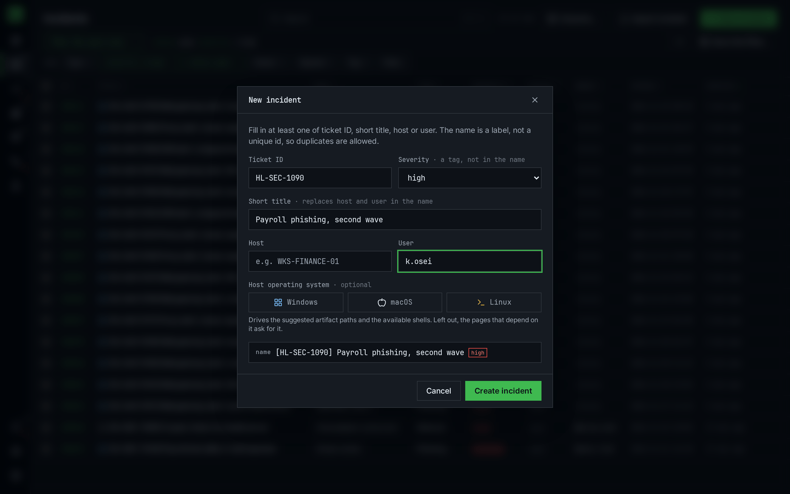
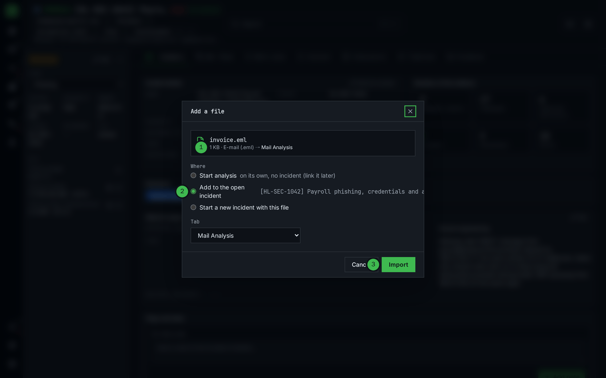
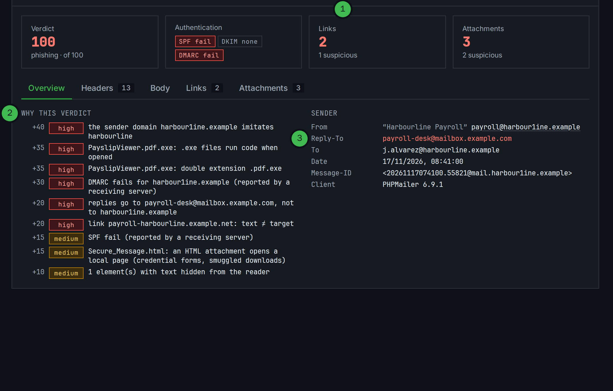
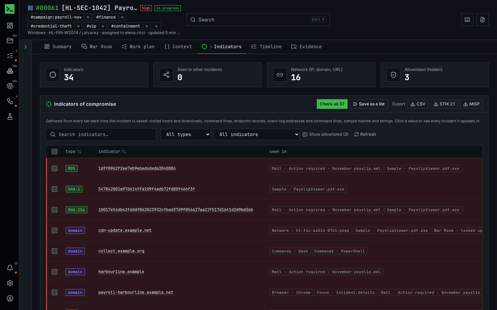
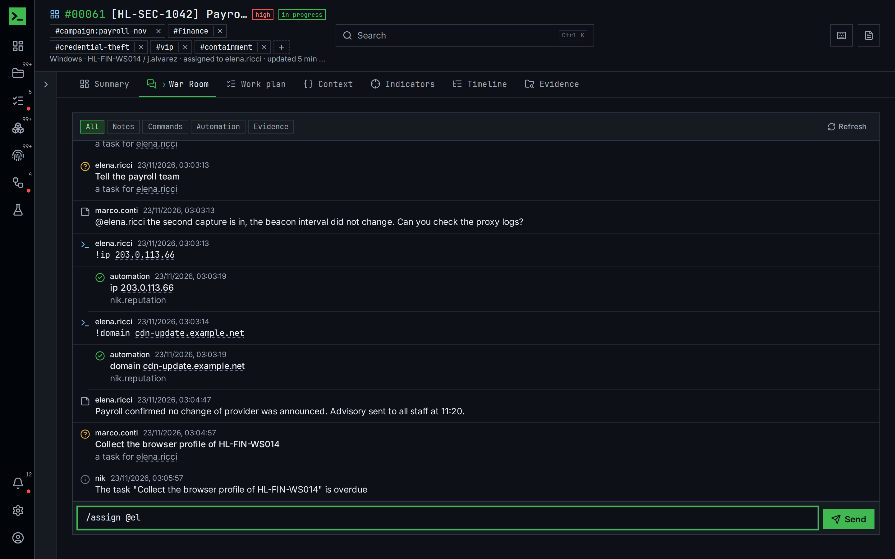
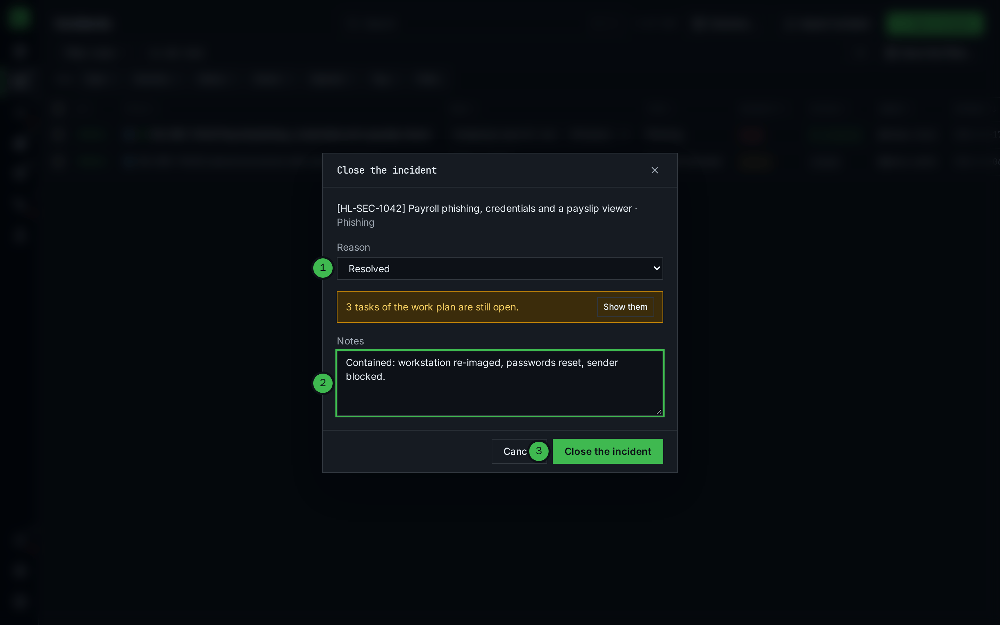

# Your first incident

Work one case from start to end in about ten minutes: a user reported a suspicious e-mail.

!!! note "You need"
    The **Analyst** role (or Admin), and an e-mail saved as a file (`.eml` or `.msg`). Any e-mail you can export from your mail client will do.

## 1. Create the incident

1. In **Incidents**, click **New incident**.
2. Fill in what you know. At least one of **Ticket ID**, **Short title**, **Host** or **User** is needed:
    - **Ticket ID**: `HL-SEC-1090`
    - **Short title**: `Payroll phishing, second wave`
    - **Severity**: `high`
    - **User**: the person who reported it, `k.osei` here.
3. Pick the host's operating system if the case is about a machine. You can leave it out.
4. Click **Create incident**.

The incident opens on its **Summary** tab. Its name is built from the fields: `[HL-SEC-1090] Payroll phishing, second wave`. Its number, `#00061` for example, is how you find it again: type `#61` in the search.

More: [Work an incident](../guide/incidents.md#create-an-incident).

## 2. Add the e-mail

1. Drag the `.eml` file from your desktop and drop it **anywhere** in the window.
2. The **Add a file** dialog says what Nik recognised: `E-mail (.eml) → Mail Analysis` 1.
3. Under **Where**, keep **Add to the open incident** 2.
4. Click **Import** 3.

The e-mail opens in the **Evidence** tab, in the Mail Analysis page.

More: [Add evidence](../guide/evidence.md).

## 3. Read the verdict

1. Look at the verdict 1, in the badge next to the subject and in the **Verdict** card: **phishing**, **suspicious** or **no strong signs**, with a score out of 100.
2. Read **Why this verdict** 2: each reason, such as a failed DMARC or a link that hides another address.
3. Check the sender 3: **Reply-To** and **Return-Path** are marked when they differ from the sender.
4. Look at the links and attachments further down. Nothing is opened on your machine.

More: [E-mail](../guide/mail.md).

## 4. Look at the indicators

1. Open the **Indicators** tab. It lists every address, domain, URL, e-mail address and hash found in the evidence.
2. A row is red when the indicator is malicious, amber when suspicious.
3. Click an indicator to open its window: the verdict of each threat-intelligence source.
4. Click **Check now** to ask the sources again.

!!! tip
    A known-good value? Right-click it › **Add to the allowlist…**. It is left out from then on.

More: [Indicators of an incident](../guide/indicators.md).

## 5. Flag what matters

1. Right-click the e-mail in the Evidence list, or a row of any table.
2. Choose **Flag the …** (the menu names what it flags), or press ++f++ with the pointer on the row.
3. To say why, choose **Add a comment…** (or press ++c++). The row is flagged too.

Flagged items are listed on the Summary and go into the report.

More: [Find your way around](../guide/screen.md#right-click-menus).

## 6. Write in the War Room

1. Open the **War Room** tab.
2. Type a note in the line at the bottom: `Reported by the user at 09:12, link not clicked.` Press ++enter++.
3. Type `/assign @` and the start of your username, `/assign @el` for elena.ricci. Pick the name in the list to take the incident.

Everything said and done on the incident appears here, in order: your notes, commands, what playbooks did.

More: [Summary, timeline and War Room](../guide/war-room.md).

## 7. Close it

1. Type `/close` in the War Room, or right-click the incident in the list › **Mark as closed**.
2. In **Close the incident**, pick a **Reason** 1 and write **Notes** 2.
3. Fill in any field marked **required**: the type of the incident wants it.
4. Click **Close the incident** 3.

To write the report first, click the report button in the header: see [Reports and exports](../guide/reports.md).

More: [Closing and reopening](../guide/incidents.md#close-an-incident).

## What next

-   **Work faster on many**

    ---

    Select rows and act on them at once.

    [:octicons-arrow-right-24: Act on many at once](../guide/bulk.md)

-   **Find anything**

    ---

    Queries, saved filters and the search.

    [:octicons-arrow-right-24: Search and filters](../guide/search.md)

-   **Automate the triage**

    ---

    A playbook that does steps 2 to 4 for you.

    [:octicons-arrow-right-24: Your first playbook](../guide/playbooks.md)

