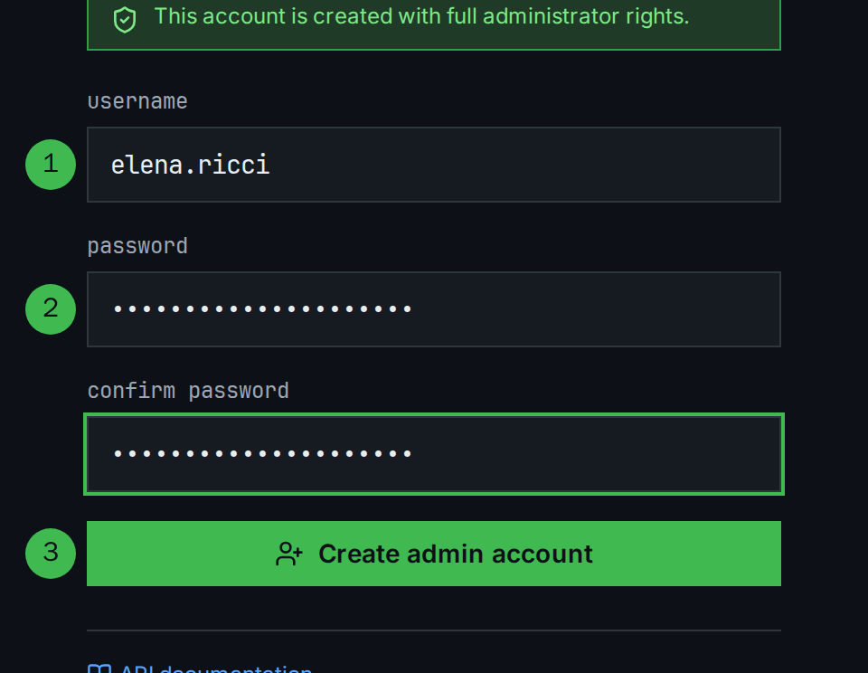
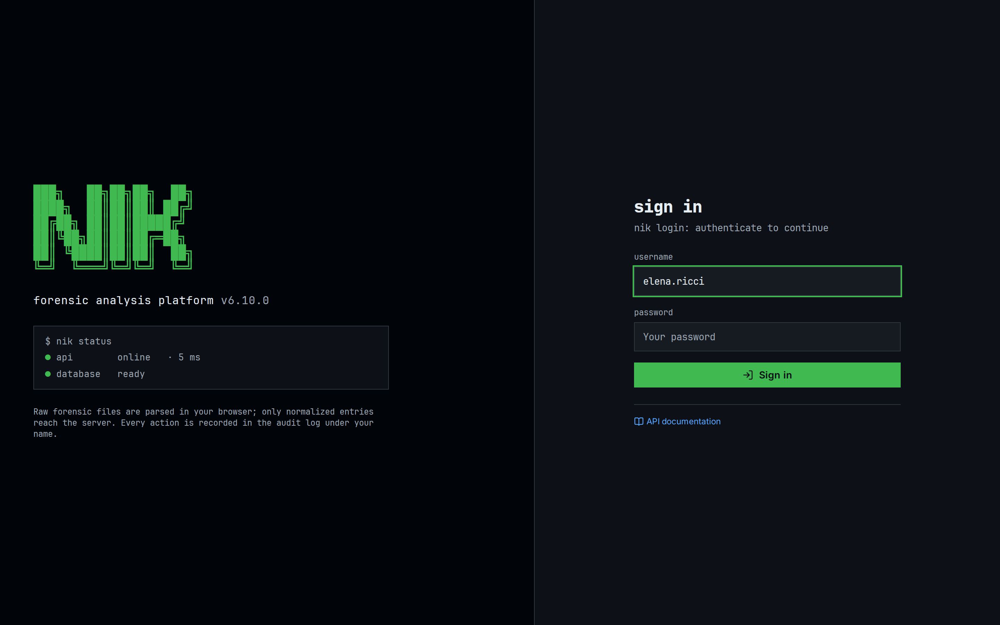
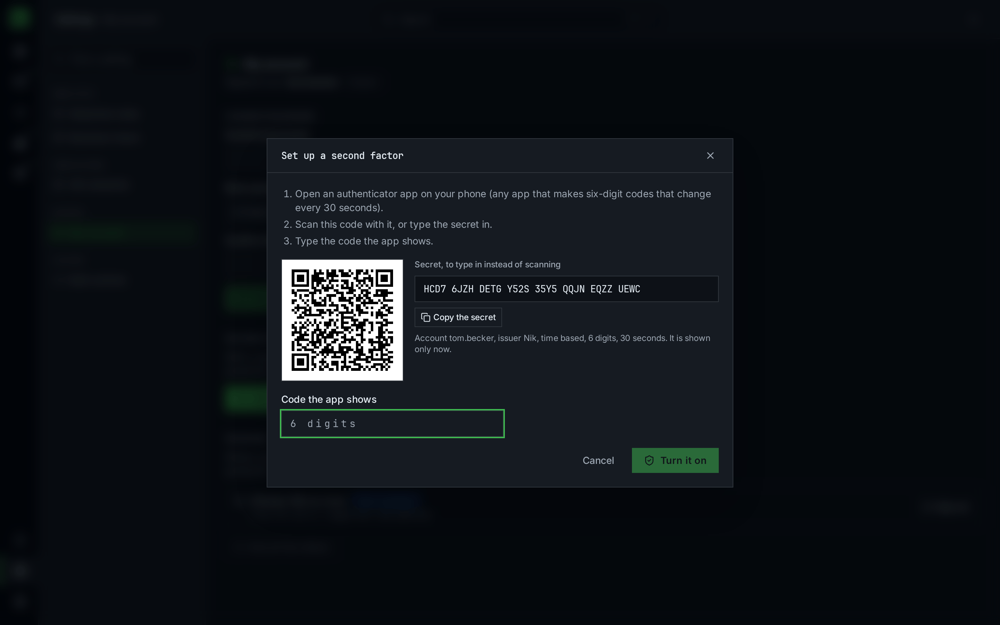
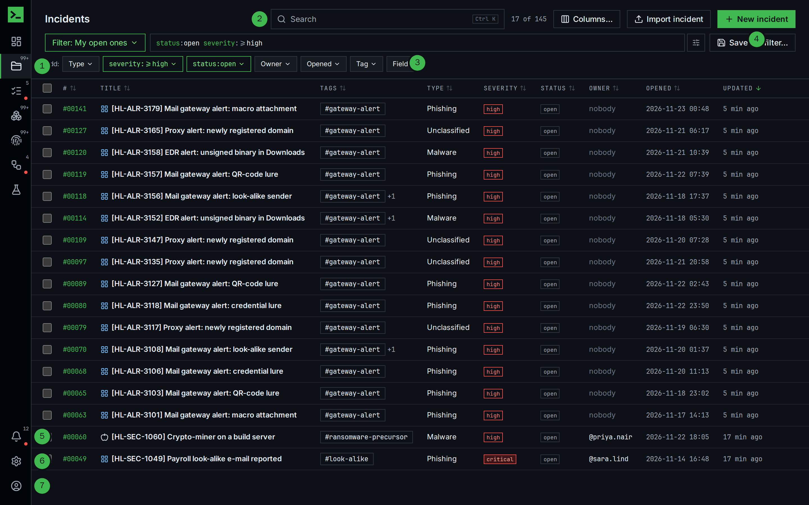

# First sign-in

Create the admin account, sign in, and find your way around the screen.

## Create the admin account

On a new server the first screen is **first run**: no account exists yet.

1. Type a **username** 1.
2. Type a **password** of at least 8 characters 2, and again in **confirm password**.
3. Click **Create admin account** 3.

The account is created with full administrator rights. The sign-in screen follows.

!!! warning "Do it before anyone else can reach the port"
    The first account created becomes the admin, whoever creates it.

Everyone else gets an account from you, under **Platform settings › Access › Accounts and roles**, with the roles their work needs. See [Accounts, roles and sign-in](../guide/accounts.md).

## Sign in

1. Type your **username** and **password**.
2. Click **Sign in**.

The `$ nik status` box beside the form shows whether the `api` and the `database` answer.

!!! info "Wrong passwords cost time"
    After 5 failures in a row the next attempt waits 30 seconds, then twice as long after each further failure, up to 15 minutes. The page says how long. Nothing is locked for good. An administrator can change these numbers.

## The second factor

An account with a second factor signs in in two steps: the password, then the **code from your authenticator app**.

1. Type the six-digit code the app shows now.
2. Click **Continue**.

No phone at hand? Click **Use a recovery code instead** and type one of your recovery codes. **Start again** goes back to the password.

If administrators must have a second factor and you have none yet, Nik asks you to set one up right after the password. Nothing else opens before.

1. Type your password again and click **Continue**.
2. Scan the QR code with an authenticator app (any app that makes six-digit codes that change every 30 seconds), or type the secret shown beside it.
3. Type the **Code the app shows** and click **Turn it on**.
4. **Copy** or **Download** the ten recovery codes. They are shown only once. Keep them away from your password.

Any account can set up a second factor later, under **Platform settings › Access › My account › Set up a second factor…**. See [Accounts, roles and sign-in](../guide/accounts.md).

## The screen at a glance

Nik opens on the list of incidents.

| | Part | What it does |
|---|---|---|
| 1 | **The rail** | One icon per section: Dashboards, Incidents, My tasks, Artifacts, Indicators, Automations, Playground. |
| 2 | **Search** | The bar in the middle of the header. ++ctrl+k++ or ++"/"++ opens it from anywhere. |
| 3 | **The query box** | Filters the list as you type: `status:open severity:>=high`. |
| 4 | **New incident** | Opens the form of a new incident. **Import incident** is beside it. |
| 5 | **Notifications** | Tasks given to you, approvals that wait, mentions, timers past their time. |
| 6 | **Platform settings** | Every setting, in sections. |
| 7 | **Your account** | Who is signed in, **My account**, **Sign out**. |

An entry of the rail is shown only when your roles let you use it. [Find your way around](../guide/screen.md) explains each part.

## Your session

A session ends when nothing was done in it for a while (8 hours, 30 minutes for administrators), and in any case 12 hours after the sign-in. A minute before, Nik says so and offers **Stay signed in**.

When a session ends, the screen stays. A dialog asks for your password (and code) again; what was not saved yet is saved after you sign in.

## Related

- [Your first incident](first-incident.md)
- [Find your way around](../guide/screen.md)
- [Accounts, roles and sign-in](../guide/accounts.md)
- [Install](install.md)
