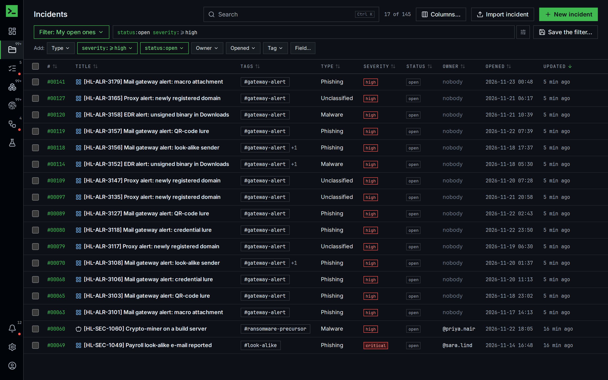

# Get started

Go from nothing to a first closed incident in three steps.

-   **1. Install**

    ---

    Clone the repository, write the secrets, start the stack with Docker or Podman.

    [:octicons-arrow-right-24: Install](install.md)

-   **2. Sign in**

    ---

    Create the admin account, sign in, and learn where everything is on the screen.

    [:octicons-arrow-right-24: First sign-in](first-sign-in.md)

-   **3. Work an incident**

    ---

    Ten minutes: open an incident, add a reported e-mail, read the verdict, close it.

    [:octicons-arrow-right-24: Your first incident](first-incident.md)

!!! tip "Installing for a team?"
    The quick install is for a laptop or a test server. For a server other people use, follow [Install in production](../admin/install.md): real certificates, start on boot, backups.

## Next

- The [user guide](../guide/index.md) explains every screen.
- [Run the server](../admin/index.md) is for the administrator.
- The [Reference](../reference/index.md) holds the query language, the API and every setting.
