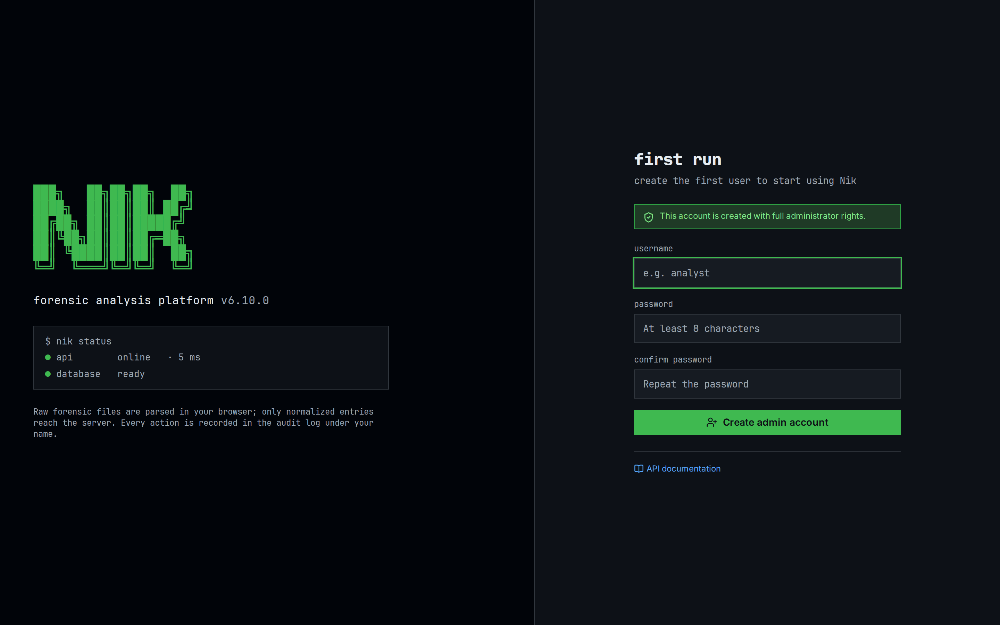

# Install

Run Nik on your own machine in a few minutes, with Docker or Podman.

!!! note "You need"
    - Docker with Compose, or Podman with `podman compose` / `podman-compose`.
    - `git`.
    - Memory for the analysis workers: each runs under its own limit, set in `.env.example` (4 GB for the analyzer, capa and packet capture workers by default).

## Start the stack

=== "Docker"

    ```sh
    git clone https://github.com/n36l3c7/Nik.git && cd Nik
    deploy/init-env.sh             # writes .env, and the secrets as files in ./secrets
    docker compose up -d --build   # builds the images and starts the whole stack
    ```

=== "Podman"

    ```sh
    git clone https://github.com/n36l3c7/Nik.git && cd Nik
    deploy/init-env.sh             # writes .env, and the secrets as files in ./secrets
    podman compose up -d --build   # or: podman-compose up -d --build
    ```

    Rootless Podman is fine for ports 8080 and 8443.

1. **Clone** the repository and go into it.
2. **Run `deploy/init-env.sh`.** It writes `.env` and a fresh random value for every secret, each in a file of `./secrets`. It is safe to run again.
3. **Start the stack.** The first build takes a while. The `api` container creates the database at its first start.
4. **Open <https://localhost:8443>.** The certificate is self-signed at the first start, so the browser warns once: accept it. <http://localhost:8080> only redirects there.
5. **Create the first account at once.** Whoever creates it becomes the **admin**. See [First sign-in](first-sign-in.md).



!!! warning "The stack refuses example secrets"
    Nik does not start without its secrets (`DB_PASSWORD`, `SECRET_KEY`, `STORE_KEY` and one token per worker), and refuses the values printed in `.env.example`, which are public. Always run `deploy/init-env.sh` first. Keep a copy of `./secrets` away from the machine.

## Check that it runs

```sh
docker compose ps              # every container should be "running" or "healthy"
docker compose logs -f api     # follow the backend
```

With Podman, write `podman compose` instead of `docker compose`.

If the page says Nik is not running, wait a minute and reload: the `api` container waits for the database at start.

## Stop it, or remove it

```sh
docker compose down            # stop; the database and the files stay
docker compose down -v         # stop AND delete every volume: database, files, certificate
```

!!! warning
    `down -v` deletes everything Nik holds. Use it only on a test machine.

## For a real server

The quick install is enough to try Nik. For a server your team uses, follow [Install in production](../admin/install.md): your own host name and certificate, start on boot, rootless Podman and SELinux, then [backups](../admin/backups.md).

## Related

- [First sign-in](first-sign-in.md)
- [Install in production](../admin/install.md)
- [Keys and secrets](../admin/secrets.md)
- [Environment variables](../reference/configuration.md)
- [Upgrades](../admin/upgrades.md)
