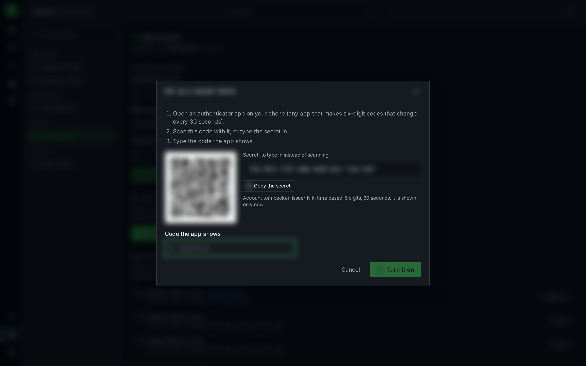
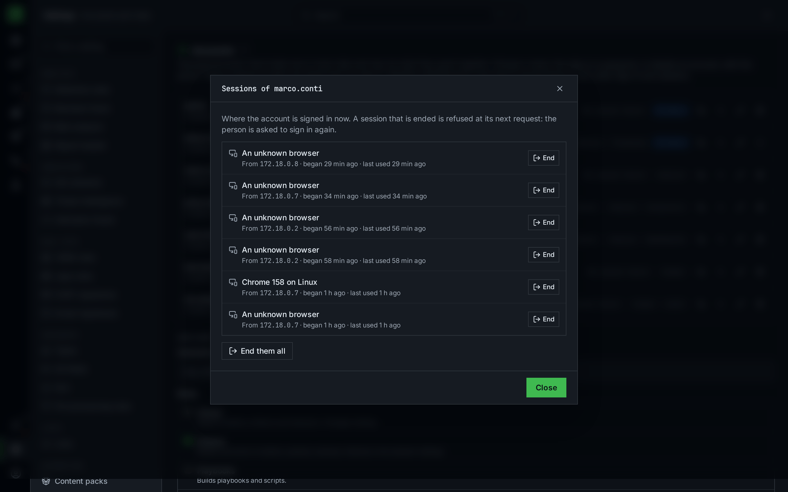
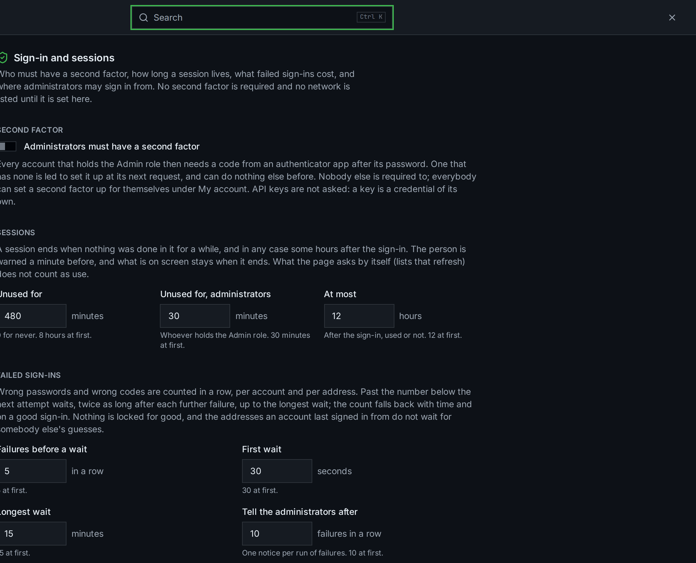
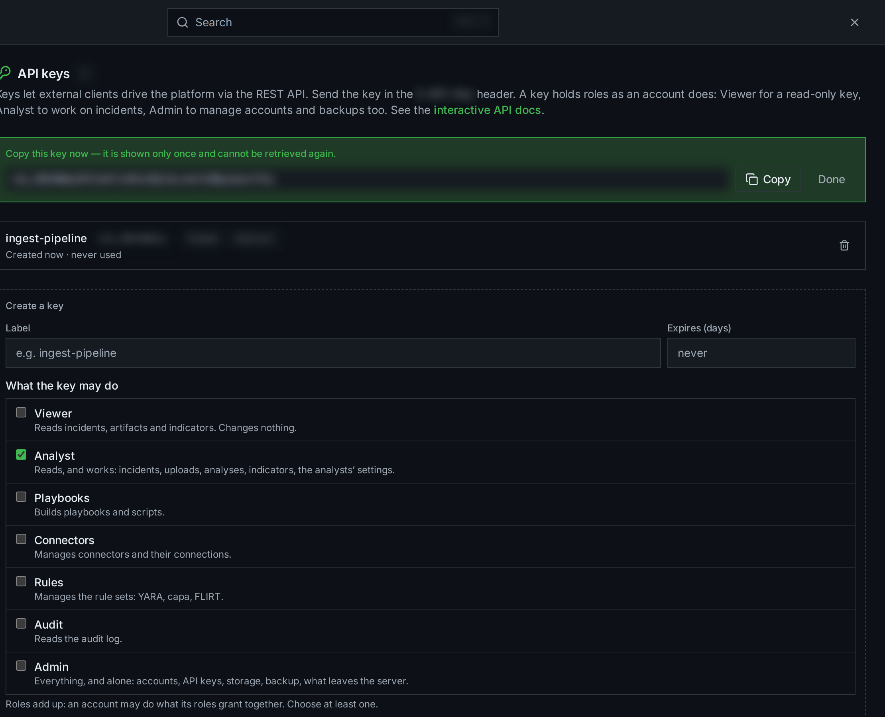

# Accounts, roles and sign-in

Manage your own account and second factor, give people the roles they need, set the sign-in rules, and make API keys.

!!! note "You need"
    **My account** is for everybody. **Accounts and roles**, **Sign-in and sessions** and **API keys** are for **Admin**. All are under **Platform settings › Access**.

## My account

**Platform settings › Access › My account** (or your name at the foot of the rail, then **My account**) shows who you are signed in as and your roles.

### Change your password

1. Under **Change password**, type the **Current password**, the **New password** (at least 8 characters) and **Confirm the new password**.
2. Save. Your other sessions are signed out.

### Set up a second factor

A second factor is a six-digit code from an authenticator app, asked after your password at every sign-in.

1. Press **Set up a second factor…**. Unless you signed in a moment ago, your password is asked first.
2. Scan the QR code with the app, or type the secret shown beside it. The secret is shown only now.
3. Type the code the app shows and turn it on.
4. Keep the ten **recovery codes**: copy or download them, and store them where your password is not. Each signs you in once without the phone.

- **New recovery codes…** makes ten new ones; the old ones stop working.
- **Turn it off…** takes the second factor away. It asks your password and a current code (or a recovery code).
- Turning it on or off signs your account out everywhere else.
- Nik never remembers a browser: the code is asked at every sign-in.
- Lost the phone and the codes? An admin resets your second factor ([below](#accounts)).

### Your sessions

**Sessions** lists where your account is signed in now: the browser, the address, when it began and when it was last used. **End** closes one; **End all the others** keeps only yours.

!!! tip "A session you do not recognise"
    End it, then change your password.

## Accounts

**Platform settings › Access › Accounts and roles**.

1. Press **Add user**. Type the **Username**, a **Password** (at least 8 characters), and tick one or more roles.
2. To change an account, press the pencil on its row (**Edit…**):
    - **Username**: incidents assigned to it follow the new name; notes, flags and audit entries keep the old one.
    - Roles: other roles sign the account out everywhere.
    - **New password**: for someone who forgot theirs. It signs the account out and ends the wait its failed sign-ins earned.
    - **Disabled**: cannot sign in, signed out at once; everything it did stays. Use it when somebody leaves.

Each row says **Second factor**, **No second factor**, or **Second factor required**. Its menu has:

- **Sessions…**: where the account is signed in, with **End** on each and one button for all.
- **Reset the second factor…**: for somebody who lost the phone and the codes. Make sure it is them who asks. You cannot reset your own.

There is always one admin who can sign in: you cannot remove the Admin role from yourself, disable or delete yourself, nor do so to the last admin.

## Roles

A role is a tag on an account. An account holds one or more and may do what they grant together: an analyst who also keeps the YARA rules is **Analyst** + **Rules**, not an admin.

| Role | What the account can do |
| --- | --- |
| **Viewer** | Read incidents, artifacts, indicators and analyses. Changes nothing (*read-only* in the header). |
| **Analyst** | Read and work: incidents, uploads, analyses, indicators, detection rules, business hours, the allowlist. Run playbooks, stop a run, answer an approval. |
| **Playbooks** | Build playbooks and scripts, turn them on or off, debug them, manage lists. Reads no incident by itself: give it with **Analyst** or **Viewer**. |
| **Connectors** | Install connectors, make instances, keep credentials. Builds no playbook by itself. |
| **Rules** | YARA rules, capa rules, FLIRT signatures, script signatures. |
| **Audit** | Read the audit log. |
| **Dashboards** | Share dashboards with others. |
| **Admin** | Everything, and alone: accounts, API keys, storage, backup, types and fields, content packs, mail and threat-intelligence settings, the hosts and data of playbooks, stopping all automation. |

??? info "The permissions behind the roles"
    Routes ask for a permission, never a role.

    | Permission | Viewer | Analyst | Playbooks | Connectors | Rules | Audit | Dashboards | Admin |
    | --- | :-: | :-: | :-: | :-: | :-: | :-: | :-: | :-: |
    | `read` | ✓ | ✓ | | | | | | ✓ |
    | `write` | | ✓ | | | | | | ✓ |
    | `automation.run` | | ✓ | ✓ | | | | | ✓ |
    | `automation.edit` | | | ✓ | | | | | ✓ |
    | `automation.debug` | | | ✓ | | | | | ✓ |
    | `lists.manage` | | | ✓ | | | | | ✓ |
    | `connectors.manage` | | | | ✓ | | | | ✓ |
    | `rules.manage` | | | | | ✓ | | | ✓ |
    | `audit.read` | | | | | | ✓ | | ✓ |
    | `dashboards.share` | | | | | | | ✓ | ✓ |
    | `automation.open` | | | | | | | | ✓ |
    | `incidents.configure` | | | | | | | | ✓ |
    | `content.manage` | | | | | | | | ✓ |
    | `admin` | | | | | | | | ✓ |

An account with one narrow role sees only that: **Audit** alone signs in and finds the audit log and its own account. To let an auditor read incidents, add **Viewer**.

## Sign-in and sessions

**Platform settings › Access › Sign-in and sessions** holds the sign-in rules, in one form with one **Save**.

| Part | Setting | At first |
| --- | --- | --- |
| **Second factor** | **Administrators must have a second factor** | off |
| **Sessions** | Ends after this long without use, for everybody · for administrators | 8 hours · 30 minutes |
| | Lasts at most | 12 hours (`SESSION_TTL_HOURS`) |
| **Failed sign-ins** | Failures in a row before an attempt waits | 5 |
| | First wait · longest wait | 30 seconds · 15 minutes |
| | Failures before administrators get a notice | 10 |
| **Administrators' networks** | **Networks, one per line** | none: anywhere |

- **Second factor** concerns every account with the Admin role, nobody else. It takes effect at once: such an account can do nothing but set one up. API keys are never asked for a code.
- What the page asks by itself (lists that refresh) is not use. A shorter time applies to open sessions too.
- Failures are counted per account and per address, wrong codes apart from wrong passwords. Each further failure doubles the wait. Addresses an account last signed in from do not wait for someone else's guesses.
- With networks listed (`10.20.0.0/16`, `2001:db8:aa::/48`, one address), accounts and API keys with the Admin role are accepted only from them. The page shows the address the server sees you at, and warns before saving a list that would refuse you.

!!! warning "Behind a proxy"
    Where the server cannot know its clients' addresses, the page says why and refuses the list. See [Configuration](../admin/configuration.md).

## API keys

**Platform settings › Access › API keys**.

1. Under **Create a key**, give a **Label** (`ingest-pipeline`) and, if you want, **Expires (days)** (empty: never).
2. Tick **What the key may do**: the same roles as an account. **Viewer** for a key that only reads (a feed for a firewall), **Analyst** for one that uploads and edits, **Admin** for backups and accounts.
3. Create it, and copy the key now: it is shown only once.

A script sends it in the `X-API-Key` header. The trash button revokes a key. See [API](../reference/api.md).

## Related

- [First sign-in](../get-started/first-sign-in.md)
- [Health and audit](../admin/health.md)
- [Configuration](../admin/configuration.md)
- [API](../reference/api.md)
- [Security](../reference/security.md)
