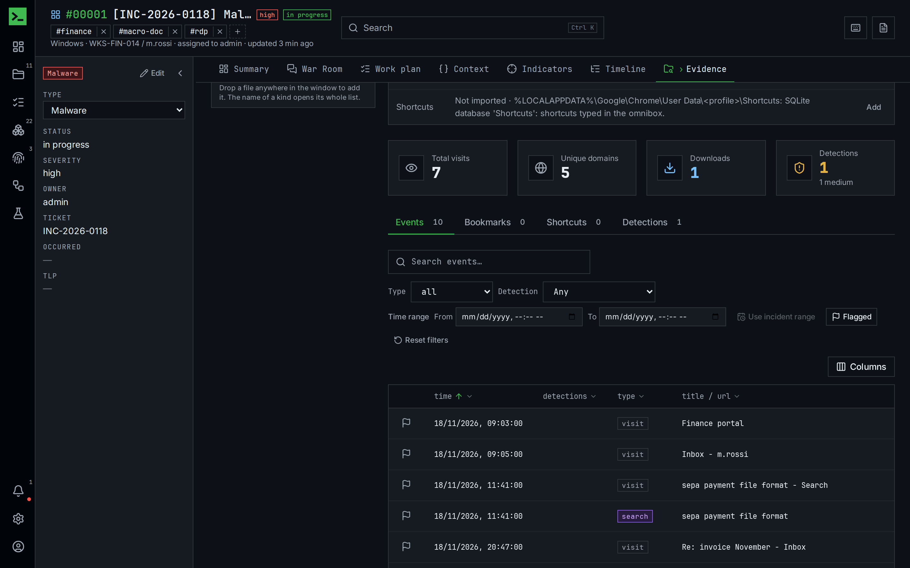

# Browser Forensics

Read the history, downloads, searches, bookmarks and shortcuts of the browsers of a machine.

**Evidence › Browser Forensics.** One tab for each browser: **Chrome**, **Firefox**, **Edge**, **Brave**, **Opera**, **Safari**, and under it the **profiles** the browser has. **Rename profile** gives a profile a name you will recognise.

1. Open the browser's tab and the profile.
2. In **Data sources**, add the files as the browser keeps them:
    - Chrome, Edge, Brave and Opera: `History`, `Bookmarks`, `Shortcuts`
    - Firefox: `places.sqlite`
    - Safari: `History.db`, `Downloads.plist`, `Bookmarks.plist`
    - or a CSV or JSON export
3. Read **Events** (visits, searches, redirects, downloads), **Bookmarks** and **Shortcuts**.

The file goes to the server as it is and is read there: see [Host evidence](host.md#files-are-no-longer-read-in-your-browser). A browser that is **running** locks its database: copy the file first, or close the browser.

## What you see

- The totals, with **Detections** from the rules.
- A table of events with the time, the type (visit, search, download…), the title and the address. **Source** opens the [original](viewer.md): the row of the SQLite database.
- The flag marks a record as malicious; **Add a note…** comments it. Both stay when you **Analyse again**.
- Filters by type, detection and time. **Stack values** on a column counts the addresses or domains: see [Stacking](stacking.md).

The rules of **nik / browser** flag the Tor network, disposable file sharing, paste sites and similar. See [Detection and rules](detection.md).

## Addresses are never live links

An address in the evidence is not a link. The arrow next to it asks first, shows the address defanged and offers to copy it. Only `http` and `https` can be opened, and doing so contacts the site **from your workstation**.

!!! tip
    To look at a page safely, scan it in [URL Analysis](url.md): the isolated browser visits it, not you.

## Related

- [Host evidence](host.md)
- [Timeline](timeline.md)
- [Links](url.md)
