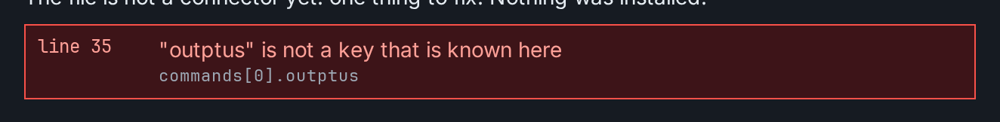
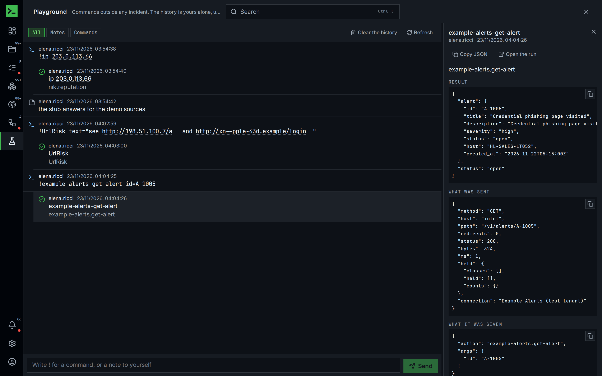
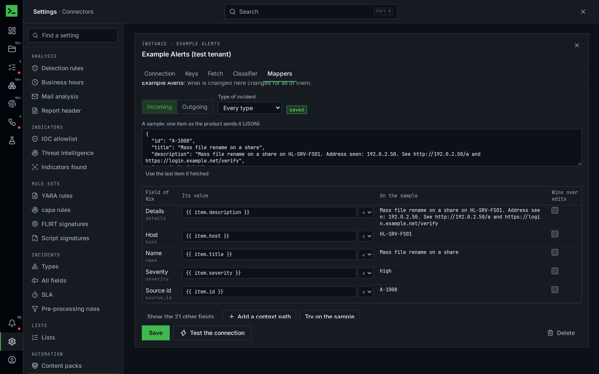

# An integration (connector)

Teach Nik a product with an HTTP API: write its connector file, install it, make an instance, test each command, bring its alerts in as incidents and keep them in step.

**The product.** *Example Alerts*, an imaginary alerting service with a REST API at `https://api.example.com/v1`, signed in with a bearer token. It has alerts (read, list, change, comment), cases (opened once per idempotency key) and an IP reputation look-up. The finished file is at the [end of the page](#the-complete-file); every piece below is part of it.

!!! note "You need"
    The **Connectors** role (or **Admin**) to add the file and make instances. **Playbooks** or **Analyst** to use its commands.

A connector is **data, not code**: YAML checked against a fixed format, whose templates are the [expression language](../../reference/playbook-nodes.md#expressions). Every key is in [Connector and pack format](../../reference/connector-format.md).

## 1. Who it is

```yaml
# Example Alerts: alerts of an imaginary product, through its REST API at api.example.com.
# Signs in with a bearer token. Brings alerts in as incidents and keeps them in step both ways.
name: Example Alerts
id: example-alerts
version: 1
description: Alerts of Example Alerts as incidents, kept in step both ways; an IP reputation look-up.
api_version: "Example Alerts API v1"
verified: false
```

- `id` is what playbooks call: commands become `example-alerts.get-alert` on the canvas and `!example-alerts-get-alert` in the War Room. Never change it once used.
- `version` is raised at each change: an installed connector is replaced only by a higher one.
- `verified: false` until you have run each command against the real product.

## 2. What an instance asks for

```yaml
configuration:
  - name: url
    label: Address
    type: url
    required: true
    default: https://api.example.com
    help: "The address of the API, https://api.example.com"
  - name: credentials
    type: bearer

base_url: "{{ config.url }}/v1"
headers:
  Accept: application/json

test:
  request: { method: GET, path: /me }
  expect: { status: 200 }
```

- Each entry becomes a field of the instance's **Connection** tab. `config.url` reads it.
- `type: bearer` asks for a token and sends `Authorization: Bearer …` with every request. Other kinds: `basic`, `header`, `query`, `oauth2_client`, `session` ([the list](../../reference/connector-format.md#configuration-entries)).
- Every request goes to the host of `base_url`, and nowhere else (more hosts only through `more_hosts`).
- `test` is what **Test** sends: something that needs a good token and changes nothing.

## 3. Commands that read

```yaml
commands:
  - name: get-alert
    description: Read an alert by its id.
    arguments:
      - { name: id, type: text, required: true, description: "The id of the alert: A-1005" }
    request: { method: GET, path: "/alerts/{{ args.id | urlencode }}" }
    error: { message: "{{ response.error.message }}" }
    outputs:
      alert: "{{ response }}"
      status: "{{ response.status }}"
    context:
      - path: Alert(val.ID == obj.ID)
        value: { ID: "{{ response.id }}", Name: "{{ response.title }}", Severity: "{{ response.severity }}", Source: Example Alerts }
    sample:
      alert: { id: A-1005, title: Credential phishing page visited, severity: high, status: open }
      status: open

  - name: list-alerts
    description: The alerts created since a moment, read page by page.
    arguments:
      - { name: since, type: text, description: "An ISO date; empty for every alert" }
      - { name: limit, type: number, default: 200, description: How many at most }
    request:
      method: GET
      path: /alerts
      query: { created_after: "{{ args.since }}" }
    pagination:
      type: cursor
      items: "{{ response.data }}"
      param: cursor
      next: "{{ response.next_cursor }}"
      limit_param: page_size
      limit: 100
      max_pages: 10
    outputs:
      alerts: "{{ response.items }}"
      count: "{{ response.items | length }}"
      truncated: "{{ response.truncated }}"
```

| Piece | Does |
| --- | --- |
| `arguments` | What the node asks for, and the War Room hints. `urlencode` keeps a value from changing the path |
| `error.message` | Where the product explains a refusal: the step fails with *name answered status: message* |
| `outputs` | What later nodes read: `{{ get_alert.status }}`. With none, the node gives `response` |
| `context` | What goes to the incident's context: here an `Alert` entity |
| `sample` | What a dry run gives instead, so later nodes can be read |
| `pagination` | Sends the request again with `cursor` until `next_cursor` is empty; gives `response.items` |

## 4. Commands that change something

```yaml
  - name: set-status
    description: Set the status of an alert. Setting it twice leaves it as once.
    changes_outside: true
    arguments:
      - { name: id, type: text, required: true }
      - { name: status, type: choice, choices: [open, in_progress, closed], required: true }
    request:
      method: PATCH
      path: "/alerts/{{ args.id | urlencode }}"
      json: { status: "{{ args.status }}" }
    error: { message: "{{ response.error.message }}" }
    outputs:
      status: "{{ response.status }}"
    sample: { status: closed }

  - name: update-alert
    description: Change the fields of an alert (what the outgoing mapper gives).
    changes_outside: true
    arguments:
      - { name: id, type: text, required: true }
      - { name: fields, type: object, required: true }
    request:
      method: PATCH
      path: "/alerts/{{ args.id | urlencode }}"
      json: "{{ args.fields }}"
    error: { message: "{{ response.error.message }}" }
    outputs:
      status: "{{ response.status }}"
    sample: { status: open }

  - name: get-comments
    description: The comments of an alert, oldest first.
    arguments:
      - { name: id, type: text, required: true }
    request: { method: GET, path: "/alerts/{{ args.id | urlencode }}/comments" }
    outputs:
      comments: "{{ response.data }}"
    sample:
      comments: [{ id: c-1, body: Seen on two hosts., author: ana, created_at: "2026-11-20T08:00:00Z" }]

  - name: add-comment
    description: Add a comment to an alert. Twice is two comments.
    changes_outside: true
    idempotent: false
    arguments:
      - { name: id, type: text, required: true }
      - { name: text, type: text, required: true }
    request:
      method: POST
      path: "/alerts/{{ args.id | urlencode }}/comments"
      json: { body: "{{ args.text }}" }
    success: { status: [200, 201] }
    outputs:
      comment: "{{ response.id }}"
    sample: { comment: c-2 }

  - name: open-case
    description: Open a case for an alert. The API acts once per Idempotency-Key.
    changes_outside: true
    idempotency_key: true
    arguments:
      - { name: alert, type: text, required: true }
      - { name: title, type: text, required: true }
    request:
      method: POST
      path: /cases
      headers: { Idempotency-Key: "{{ idempotency.key }}" }
      json: { alert_id: "{{ args.alert }}", title: "{{ args.title }}" }
    success: { status: 201 }
    error: { message: "{{ response.error.message }}" }
    outputs:
      case: "{{ response.id }}"
      url: "{{ response.url }}"
    sample: { case: K-1, url: "https://app.example.com/cases/K-1" }
```

Three keys decide what happens when a step is cut by a restart, or its answer is lost:

| The command | Keys | After a restart, or an answer that never came |
| --- | --- | --- |
| `set-status` sets a state | `changes_outside: true` (`idempotent` is `true` by default) | Sent again: twice is as once |
| `add-comment` makes something | `changes_outside: true`, `idempotent: false` | Not sent again: the step is *interrupted* and a person answers |
| `open-case` makes something, with a key | `changes_outside: true`, `idempotency_key: true` | Sent again with the same key: the product acts once |

`changes_outside: true` also makes the node ask for approval by default and never send in a dry run. Say `idempotent: false` for every command that creates something and has no key.

## 5. A reputation look-up

```yaml
  - name: ip-reputation
    description: What Example Alerts knows of an IP address.
    reputation: ip
    arguments:
      - { name: ip, type: text, required: true }
    request: { method: GET, path: "/reputation/ip/{{ args.ip | urlencode }}" }
    outputs:
      verdict: "{{ response.verdict | map(bad='malicious', risky='suspicious', good='harmless', else='unknown') }}"
      summary: "{{ response.reports | plural('report') }} in 90 days"
      link: "https://app.example.com/ip/{{ args.ip | urlencode }}"
      reports: "{{ response.reports }}"
    sample: { verdict: unknown, summary: "0 reports in 90 days", link: "https://app.example.com/ip/192.0.2.1", reports: 0 }
```

`reputation: ip` makes the connector a [threat-intelligence source](../threat-intel.md#sources) for IP addresses: **Check now**, the automatic look-ups and `!ip` run it. Its first argument takes the value; `verdict` must be `malicious`, `suspicious`, `harmless` or `unknown`. Add `lookups: { weight: 2 }` at the top level to make it count more in the overall score (1 to 3).

## 6. Bring alerts in: fetch

```yaml
fetch:
  interval_seconds: 120
  first_fetch: 3 days
  lookback_minutes: 5
  request:
    method: GET
    path: /alerts
    query:
      created_after: "{{ since.iso }}"
      order: created_at
  error: { message: "{{ response.error.message }}" }
  pagination:
    type: cursor
    items: "{{ response.data }}"
    param: cursor
    next: "{{ response.next_cursor }}"
    limit_param: page_size
    limit: 100
    max_pages: 2
  item_id: "{{ item.id }}"
  occurred: "{{ item.created_at }}"
```

- `since` is worked out by Nik (first fetch, then the newest time seen, less the look-back): the file does no date arithmetic. Ask the oldest first, and include the moment itself.
- `item_id` tells alerts apart: one alert makes one incident, however often it comes back.
- The first three keys are what a new instance starts with; each is changed on its **Fetch** tab.
- A product read from a cursor rather than a time uses `first_state` and `next_state` instead of `since`.

## 7. Keep in step: mirror

```yaml
mirror:
  interval_seconds: 120
  get: { command: get-alert }
  item: "{{ result.alert }}"
  update:
    command: update-alert
    args: { id: "{{ mirror.id }}", fields: "{{ fields }}" }
  comments:
    list: { command: get-comments }
    items: "{{ result.comments }}"
    id: "{{ item.id }}"
    text: "{{ item.body }}"
    author: "{{ item.author }}"
    at: "{{ item.created_at }}"
    add:
      command: add-comment
      args: { id: "{{ mirror.id }}", text: "{{ comment.text }}" }
```

- `get` reads the object; `item` says where it is in the result (it must have the shape of a fetched item: the same mapper reads both). With no `args`, the id goes to the command's first argument.
- `update` sends what the outgoing mapper gives (`fields`).
- `comments` reads and adds comments: a note tagged `mirror` in Nik is sent with `add`.
- The object's id is the fetch's `item_id` unless `id:` says where it is (`id: "{{ item.key }}"`).

Variants, when the product needs them:

| Key | For |
| --- | --- |
| `kinds` | More than one object (a ticket and a task), each with its own `get`, `item`, `update`, `comments`; the mirror id is written `<kind>:<id>` |
| `thread` | What follows an item arrives as other items (replies to a message): the fetch feeds the mirror, which goes in only |
| `no_mirror` | A connector that fetches and cannot mirror: a sentence that says why, shown where the direction is chosen |

A file with `fetch` and neither `mirror` nor `no_mirror` installs, with a warning, and its instances are offered **None** only.

## 8. Names for the mapper editor

```yaml
schema:
  incoming:
    - { name: id, type: text, description: "The id of the alert: A-1005" }
    - { name: title, type: text }
    - { name: description, type: text }
    - { name: severity, type: text, description: "low, medium, high or critical" }
    - { name: status, type: text, description: "open, in_progress or closed" }
    - { name: host, type: text }
    - { name: created_at, type: date }
  outgoing:
    - { name: title, type: text }
    - { name: status, type: text }
```

The **+** of a row of the mapper editor offers these names. Nothing is checked against them.

## 9. Install it

1. Save the file as `example-alerts.yml`.
2. **Platform settings › Automation › Connectors**, press **Add a connector file**, choose the file.
3. The file is checked as it is read. If something is wrong, nothing is installed and each problem is listed with its line:

    ```text
    line 35: "outptus" is not a key that is known here
    ```

    A warning does not stop it:

    ```text
    line 155: It fetches and says nothing of mirroring: add "mirror" (how an incident is kept in step with what it was made from), or "no_mirror" with the reason there is none. Until then its instances are offered None only
    ```

4. Installed, the connector is listed, marked *not verified*. Open it for its commands and its file.



To change it: raise `version`, and add the file again. A file with a lower or equal version is refused.

## 10. Make an instance and test it

1. Press **Add instance** under *Example Alerts*. **Name** `Example Alerts`, **Address** (already `https://api.example.com`), the **token**. Press **Create**.
2. Press **Test**. *never tested* becomes the answer of `GET /me`: a failure shows the status and the product's message.
3. Turn the instance on with its switch. The connector is now *enabled*; its commands are in the library and the War Room.

## 11. Try each command

1. Open the connector's commands and press **Try it** beside `get-alert`. The [Playground](../scripts.md#the-playground) opens with `!example-alerts-get-alert id=` ready.
2. Give an id and press ++enter++. Open the result: what was sent, what came back, the outputs.
3. For a command marked *changes*, Nik asks you to confirm the line first. Try it on something harmless.



| What you see | Look at |
| --- | --- |
| `example-alerts answered 404: …` | The path, or the id given |
| `answered 401` | The token of the instance |
| An output empty | Its template: an answer without that key gives an empty output, not an error |
| A request to another host refused | A full address in `path` must be on the instance's host, or in `more_hosts` |

On the canvas, the commands are in **Commands › Example Alerts**, each with an **Instance** field. In a dry run nothing is sent: the step shows the request that would have left and gives `sample`.

## 12. Fetch and map

1. Open the instance, tab **Fetch**. Turn on **Fetch incidents**, keep **How often** and **First fetch**, **Save**.
2. Under **How it goes**, press **Fetch now**, then **What it fetched…**: each alert and what became of it.
3. Tab **Mappers**, direction **Incoming**, **Every type**. Fill the rows: **name** `{{ item.title }}`, **details** `{{ item.description }}`, **severity** `{{ item.severity }}`, **host** `{{ item.host }}`, **source_id** `{{ item.id }}`. **Add a context path**: `Alert(val.ID == obj.ID)` with `{"ID": "{{ item.id }}", "Name": "{{ item.title }}", "Source": "Example Alerts"}`.
4. **Use the last item it fetched**, then **Try on the sample**: each row shows the value the incident would get.
5. Direction **Outgoing**: **title** `{{ incident.name }}`, **status** `{{ incident.status }}`. **Save**.



An item the mapper cannot make whole still becomes an incident, listed as *incomplete* in **What it fetched…** with what was wrong.

## 13. Turn mirroring on

1. Tab **Fetch**, part **Mirroring**: choose **In-out**. Each choice says what it does with this connector.
2. **Save**. Incidents fetched from now on are mirrored. **Apply mirroring to open incidents…** does it for those already there.
3. On an incident, write a note tagged `mirror`: it is sent with `add-comment`. Change the alert's status on the product: **Read now** in the incident's **Mirror** panel shows it.

See [Mirroring](../connectors.md#mirroring).

## 14. Contribute it to Nik's repository

A connector in Nik's repository lives in a pack, `packs/<id>/connectors/<id>/connector.yml`, with a `logo.png` and a `README.md` that says what it was written against ([A content pack](pack.md)). It is tested without the real product, against **recorded exchanges**: one file per command in `backend/tests/data/connectors/<id>/`.

`connection.json`: the configuration and invented credentials the recordings use.

```json
{
  "config": { "url": "https://api.example.com" },
  "secrets": { "token": "ea-token-0123456789" }
}
```

`get-alert.json`: the arguments, every request the command must send, the answers the product's documentation shows, and the outputs Nik must give.

```json
{
  "args": { "id": "A-1005" },
  "exchanges": [
    {
      "request": {
        "method": "GET",
        "path": "/v1/alerts/A-1005",
        "headers": { "Authorization": "Bearer ea-token-0123456789" }
      },
      "response": {
        "status": 200,
        "json": { "id": "A-1005", "title": "Credential phishing page visited", "severity": "high", "status": "open" }
      }
    }
  ],
  "outputs": {
    "alert": { "id": "A-1005", "title": "Credential phishing page visited", "severity": "high", "status": "open" },
    "status": "open"
  }
}
```

- Every command needs one; `fetch.json` records the fetch (with `since`), and `mirror.json` each call of the mirror (`mirror.get`, …). Copy the shape from an existing connector of `backend/tests/data/connectors/`.
- `backend/tests/test_shipped_connectors.py` runs them, with the other backend tests ([Developer guide](../../reference/developer.md)).
- Keep `verified: false` until someone has run every command against a real system.

## The complete file

??? example "example-alerts.yml"

    ```yaml
    # Example Alerts: alerts of an imaginary product, through its REST API at api.example.com.
    # Signs in with a bearer token. Brings alerts in as incidents and keeps them in step both ways.
    name: Example Alerts
    id: example-alerts
    version: 1
    description: Alerts of Example Alerts as incidents, kept in step both ways; an IP reputation look-up.
    api_version: "Example Alerts API v1"
    verified: false
    
    configuration:
      - name: url
        label: Address
        type: url
        required: true
        default: https://api.example.com
        help: "The address of the API, https://api.example.com"
      - name: credentials
        type: bearer
    
    base_url: "{{ config.url }}/v1"
    headers:
      Accept: application/json
    
    test:
      request: { method: GET, path: /me }
      expect: { status: 200 }
    
    commands:
      - name: get-alert
        description: Read an alert by its id.
        arguments:
          - { name: id, type: text, required: true, description: "The id of the alert: A-1005" }
        request: { method: GET, path: "/alerts/{{ args.id | urlencode }}" }
        error: { message: "{{ response.error.message }}" }
        outputs:
          alert: "{{ response }}"
          status: "{{ response.status }}"
        context:
          - path: Alert(val.ID == obj.ID)
            value: { ID: "{{ response.id }}", Name: "{{ response.title }}", Severity: "{{ response.severity }}", Source: Example Alerts }
        sample:
          alert: { id: A-1005, title: Credential phishing page visited, severity: high, status: open }
          status: open
    
      - name: list-alerts
        description: The alerts created since a moment, read page by page.
        arguments:
          - { name: since, type: text, description: "An ISO date; empty for every alert" }
          - { name: limit, type: number, default: 200, description: How many at most }
        request:
          method: GET
          path: /alerts
          query: { created_after: "{{ args.since }}" }
        pagination:
          type: cursor
          items: "{{ response.data }}"
          param: cursor
          next: "{{ response.next_cursor }}"
          limit_param: page_size
          limit: 100
          max_pages: 10
        outputs:
          alerts: "{{ response.items }}"
          count: "{{ response.items | length }}"
          truncated: "{{ response.truncated }}"
    
      - name: set-status
        description: Set the status of an alert. Setting it twice leaves it as once.
        changes_outside: true
        arguments:
          - { name: id, type: text, required: true }
          - { name: status, type: choice, choices: [open, in_progress, closed], required: true }
        request:
          method: PATCH
          path: "/alerts/{{ args.id | urlencode }}"
          json: { status: "{{ args.status }}" }
        error: { message: "{{ response.error.message }}" }
        outputs:
          status: "{{ response.status }}"
        sample: { status: closed }
    
      - name: update-alert
        description: Change the fields of an alert (what the outgoing mapper gives).
        changes_outside: true
        arguments:
          - { name: id, type: text, required: true }
          - { name: fields, type: object, required: true }
        request:
          method: PATCH
          path: "/alerts/{{ args.id | urlencode }}"
          json: "{{ args.fields }}"
        error: { message: "{{ response.error.message }}" }
        outputs:
          status: "{{ response.status }}"
        sample: { status: open }
    
      - name: get-comments
        description: The comments of an alert, oldest first.
        arguments:
          - { name: id, type: text, required: true }
        request: { method: GET, path: "/alerts/{{ args.id | urlencode }}/comments" }
        outputs:
          comments: "{{ response.data }}"
        sample:
          comments: [{ id: c-1, body: Seen on two hosts., author: ana, created_at: "2026-11-20T08:00:00Z" }]
    
      - name: add-comment
        description: Add a comment to an alert. Twice is two comments.
        changes_outside: true
        idempotent: false
        arguments:
          - { name: id, type: text, required: true }
          - { name: text, type: text, required: true }
        request:
          method: POST
          path: "/alerts/{{ args.id | urlencode }}/comments"
          json: { body: "{{ args.text }}" }
        success: { status: [200, 201] }
        outputs:
          comment: "{{ response.id }}"
        sample: { comment: c-2 }
    
      - name: open-case
        description: Open a case for an alert. The API acts once per Idempotency-Key.
        changes_outside: true
        idempotency_key: true
        arguments:
          - { name: alert, type: text, required: true }
          - { name: title, type: text, required: true }
        request:
          method: POST
          path: /cases
          headers: { Idempotency-Key: "{{ idempotency.key }}" }
          json: { alert_id: "{{ args.alert }}", title: "{{ args.title }}" }
        success: { status: 201 }
        error: { message: "{{ response.error.message }}" }
        outputs:
          case: "{{ response.id }}"
          url: "{{ response.url }}"
        sample: { case: K-1, url: "https://app.example.com/cases/K-1" }
    
      - name: ip-reputation
        description: What Example Alerts knows of an IP address.
        reputation: ip
        arguments:
          - { name: ip, type: text, required: true }
        request: { method: GET, path: "/reputation/ip/{{ args.ip | urlencode }}" }
        outputs:
          verdict: "{{ response.verdict | map(bad='malicious', risky='suspicious', good='harmless', else='unknown') }}"
          summary: "{{ response.reports | plural('report') }} in 90 days"
          link: "https://app.example.com/ip/{{ args.ip | urlencode }}"
          reports: "{{ response.reports }}"
        sample: { verdict: unknown, summary: "0 reports in 90 days", link: "https://app.example.com/ip/192.0.2.1", reports: 0 }
    
    fetch:
      interval_seconds: 120
      first_fetch: 3 days
      lookback_minutes: 5
      request:
        method: GET
        path: /alerts
        query:
          created_after: "{{ since.iso }}"
          order: created_at
      error: { message: "{{ response.error.message }}" }
      pagination:
        type: cursor
        items: "{{ response.data }}"
        param: cursor
        next: "{{ response.next_cursor }}"
        limit_param: page_size
        limit: 100
        max_pages: 2
      item_id: "{{ item.id }}"
      occurred: "{{ item.created_at }}"
    
    mirror:
      interval_seconds: 120
      get: { command: get-alert }
      item: "{{ result.alert }}"
      update:
        command: update-alert
        args: { id: "{{ mirror.id }}", fields: "{{ fields }}" }
      comments:
        list: { command: get-comments }
        items: "{{ result.comments }}"
        id: "{{ item.id }}"
        text: "{{ item.body }}"
        author: "{{ item.author }}"
        at: "{{ item.created_at }}"
        add:
          command: add-comment
          args: { id: "{{ mirror.id }}", text: "{{ comment.text }}" }
    
    schema:
      incoming:
        - { name: id, type: text, description: "The id of the alert: A-1005" }
        - { name: title, type: text }
        - { name: description, type: text }
        - { name: severity, type: text, description: "low, medium, high or critical" }
        - { name: status, type: text, description: "open, in_progress or closed" }
        - { name: host, type: text }
        - { name: created_at, type: date }
      outgoing:
        - { name: title, type: text }
        - { name: status, type: text }
    ```

## Related

- [Connector and pack format](../../reference/connector-format.md)
- [Connectors and mirroring](../connectors.md)
- [A content pack](pack.md)
- [A playbook from scratch](playbook.md)
- [War Room commands](../commands.md)
