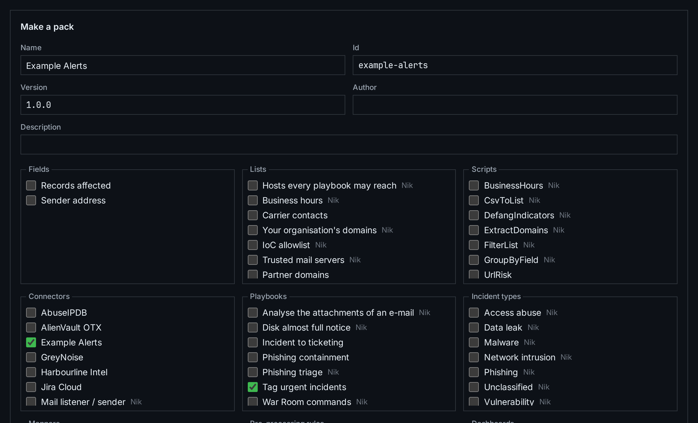
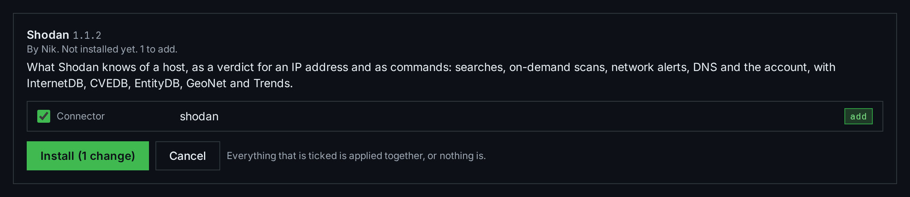
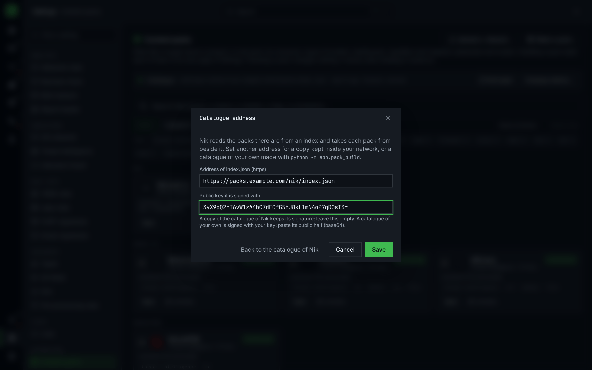

# A content pack

Bundle a connector, its mappers, a script, a playbook and a list into one pack, install it on another Nik, and ship an update.

**The pack.** `example-alerts`: the [Example Alerts connector](connector.md), its mappers, the [UrlRisk script](script.md), a playbook that comments the risky links of a fetched alert back on it, and a list of hosts. You can make it in two ways: from the screens (**Make a pack…**), or as a folder you keep in a repository. Both give the same file.

!!! note "You need"
    The **Admin** role (`content.manage`): **Platform settings › Automation › Content packs**.

## What goes in a pack

| Folder | Item | Named by |
| --- | --- | --- |
| `connectors/<id>/connector.yml` | A connector, with `logo.png` (or `logo.svg`) and `README.md` beside it | Its `id` |
| `mappers/<connector>.json` | The mappers of a connector, and the classifier a new instance starts with | The connector's id |
| `scripts/<Name>.yml` | A script | Its name |
| `playbooks/<slug>.json` | A playbook: its current graph and its limits | Its name |
| `lists/<name>.json` | A list, with its items only when you choose | Its name |
| `fields/`, `incident_types/`, `dashboards/`, `preprocess_rules/` | Fields, types, dashboards, pre-processing rules | Their names |

A pack never carries an instance, a credential, the hosts a playbook may reach or an opened class of data: those belong to the Nik they are set in.

## Way 1: make it from the screens

1. Build and test the items on your Nik first (the connector, its mappers, the script, the playbook).
2. **Platform settings › Automation › Content packs**, press **Make a pack…**.
3. Give its id `example-alerts`, **Name** `Example Alerts`, **Version** `1.0.0`, **Author**, **Description**.
4. Choose the items. What they need comes with them (*Comes with them, because they need it*): the playbook brings its script and its connector. Tick **Lists go with what they hold** only when the items of a list are yours to share.
5. Download: `example-alerts-1.0.0.nikpack`.



A `.nikpack` is a zip: unzip it into a folder to keep it in a repository, and go on with Way 2 for the next versions.

## Way 2: write it as a folder

```text
example-alerts/
├── pack.yml
├── connectors/
│   └── example-alerts/
│       ├── connector.yml
│       └── README.md
├── mappers/
│   └── example-alerts.json
├── scripts/
│   └── UrlRisk.yml
├── playbooks/
│   └── comment-risky-links.json
└── lists/
    └── example_alerts_hosts.json
```

### pack.yml

```yaml
id: example-alerts
name: Example Alerts
vendor: Example
category: Alerting
tags: [alerts, ip]
version: 1.0.0
description: Alerts of Example Alerts as incidents, kept in step; their risky links commented back.
author: Your team
nik: ">=6.10"
```

| Key | Rule |
| --- | --- |
| `id` | A lower-case letter, then lower-case letters, digits or `-` (2 to 49). Never change it: updates find the pack by it |
| `version` | Three numbers. Raise it at each change: a Nik offers an update only for a higher version |
| `tags` | Lower-case words, 8 at most: what the product is, what it works on. The catalogue filters by them |
| `vendor`, `category` | The catalogue groups cards by vendor |
| `nik` | `>=` and the oldest Nik it is for (`">=6.10"`). A pack for a later Nik is not offered |
| `requires` | Packs to install first: `- { pack: other-pack, version: 1.0.0 }` |

### The connector

`connectors/example-alerts/connector.yml` is the file of [An integration (connector)](connector.md#the-complete-file), unchanged. Beside it, a `README.md` says what it was written against and what an instance needs, and a `logo.png` (256 KB at most) marks it.

### The mappers

`mappers/example-alerts.json`:

```json
{
  "connector": "example-alerts",
  "incoming": [
    { "to": "name", "from": "{{ item.title }}" },
    { "to": "details", "from": "{{ item.description }}" },
    { "to": "severity", "from": "{{ item.severity }}" },
    { "to": "status", "from": "{{ item.status }}" },
    { "to": "host", "from": "{{ item.host }}" },
    { "to": "source_id", "from": "{{ item.id }}" },
    { "to": "Alert(val.ID == obj.ID)",
      "from": { "ID": "{{ item.id }}", "Name": "{{ item.title }}", "Severity": "{{ item.severity }}", "Source": "Example Alerts" } }
  ],
  "outgoing": [
    { "to": "title", "from": "{{ incident.name }}" },
    { "to": "status", "from": "{{ incident.status }}" }
  ],
  "classifier": { "rules": [], "defaultType": null }
}
```

Add `"authoritative": true` to an incoming rule for **Wins over edits**. `"types": { "Phishing": { "incoming": [...] } }` holds a mapper for one type. The classifier is what a new instance starts with: `rules` of `{ "when": {...}, "type": "<type id>" }`.

### The script

`scripts/UrlRisk.yml` (the code is the one of [A script](script.md#2-write-the-code)):

```yaml
name: UrlRisk
description: Finds the web addresses in a text and scores each on signs of a lure.
arguments:
  - { name: text, type: any, required: true, description: "A text, or a list of texts" }
  - { name: threshold, type: number, description: "The score from which an address is risky (50)" }
outputs:
  - { name: urls, type: list, description: "Every address: Data, Host, Score", context_path: "URL(val.Data == obj.Data)" }
  - { name: risky, type: list, description: "The risky ones, with their reasons" }
  - { name: count, type: number, description: How many addresses }
test:
  args: { text: "Pay at http://bank.example@198.51.100.7/inv, or https://login.example.com/a. New: http://secure-update.zip/x" }
code: |
  import re
  from urllib.parse import urlsplit

  URL = re.compile(r"https?://[^\s<>\"']+", re.IGNORECASE)
  SUSPICIOUS_TLDS = {"zip", "top", "xyz", "click", "country", "gq"}


  def judge(url):
      parts = urlsplit(url)
      host = (parts.hostname or "").lower()
      reasons = []
      if re.fullmatch(r"[0-9.]+", host):
          reasons.append("an IP address as host")
      if host.startswith("xn--") or ".xn--" in host:
          reasons.append("punycode")
      if host.rsplit(".", 1)[-1] in SUSPICIOUS_TLDS:
          reasons.append("a suspicious top-level domain")
      if "@" in parts.netloc:
          reasons.append("a user name before the host")
      if len(url) > 150:
          reasons.append("a very long address")
      return host, min(100, 25 * len(reasons)), reasons


  def main(args):
      given = args.get("text") or ""
      texts = given if isinstance(given, list) else [given]
      found = []
      for text in texts:
          for url in URL.findall(str(text)):
              url = url.rstrip(".,;)")
              if url not in found:
                  found.append(url)
      urls, risky = [], []
      for url in found:
          host, points, reasons = judge(url)
          urls.append({"Data": url, "Host": host, "Score": points})
          if points >= int(args.get("threshold") or 50):
              risky.append({"url": url, "score": points, "reasons": reasons})
      print(f"{len(urls)} addresses, {len(risky)} risky")
      return {"urls": urls, "risky": risky, "count": len(urls)}
```

### The playbook

`playbooks/comment-risky-links.json`. A script node names the script, not a version: the version installed is used.

```json
{
  "app": "Nik", "type": "playbook", "version": 1,
  "playbook": {
    "name": "Comment risky links on the alert",
    "description": "An incident fetched from Example Alerts whose details hold risky links gets a comment on its alert. Before turning it on: choose the instance in the node Comment on the alert; an admin opens Results of scripts for this playbook.",
    "maxRunsPerHour": 60, "onePerObject": true, "maxSeconds": 86400, "approvalDefault": true,
    "graph": {
      "nodes": [
        { "id": "start", "kind": "trigger", "name": "An incident is created", "position": { "x": 60, "y": 40 },
          "config": { "event": "incident.created", "manual": true } },
        { "id": "from_alert", "kind": "condition", "name": "From Example Alerts?", "position": { "x": 60, "y": 160 },
          "config": { "all": [{ "left": "{{ context.Alert[0].Source | default('') }}", "op": "eq", "right": "Example Alerts" }] } },
        { "id": "risk", "kind": "script", "name": "Score the links", "position": { "x": 60, "y": 280 },
          "config": { "script": "UrlRisk", "args": { "text": "{{ incident.details | default('') }}" } } },
        { "id": "any_risky", "kind": "condition", "name": "Anything risky?", "position": { "x": 60, "y": 400 },
          "config": { "all": [{ "left": "{{ risk.risky | length }}", "op": "gt", "right": 0 }] } },
        { "id": "comment", "kind": "action", "name": "Comment on the alert", "position": { "x": 60, "y": 520 },
          "config": { "action": "example-alerts.add-comment", "connection": "",
                      "args": { "id": "{{ incident.source_id }}",
                                "text": "Nik: risky links {{ risk.risky | pluck('url') | defang | join(', ') }}" } } }
      ],
      "edges": [
        { "from": "start", "to": "from_alert" },
        { "from": "from_alert", "port": "yes", "to": "risk" },
        { "from": "risk", "to": "any_risky" },
        { "from": "any_risky", "port": "yes", "to": "comment" }
      ],
      "inputs": [], "outputs": []
    }
  }
}
```

The node of a connector names no instance (`"connection": ""`): the playbook arrives as a draft until someone chooses one there. It arrives **off** in any case.

### The list

`lists/example_alerts_hosts.json` (a name of lower-case letters, digits and `_`):

```json
{
  "name": "example_alerts_hosts",
  "label": "Example Alerts: hosts to watch",
  "description": "Hosts whose alerts are handled first.",
  "kind": "values",
  "itemType": "host",
  "writableByAutomation": false,
  "entries": [{ "value": "dc01.corp.example" }]
}
```

`kind` is `values`, `key_value` or `json`. Leave `entries` out to ship the list empty.

### Zip it

The files go at the root of the zip, `pack.yml` first level:

```sh
cd example-alerts && zip -r ../example-alerts-1.0.0.nikpack . -x '.*'
```

## Install it from a file

1. On the other Nik, **Platform settings › Automation › Content packs**, press **Upload a .nikpack…** and choose the file.
2. Nothing changes yet. Each item is listed with **add**, **update**, **same** or **conflict**. Read the difference of the script: it is code that will run in the sandbox.
3. Press **Install**. Everything is applied in one transaction: all of it, or nothing.



| The pack is refused, or an item says | Fix |
| --- | --- |
| `The version of a pack is three numbers: 1.0.0` | `version: 1.0.0`, not `1` or `1.0` |
| `"nik" says the oldest Nik the pack is for: ">=4.6"` | Write `">=6.10"`, with the quotes |
| `"tags" is a list of lower-case words (a letter, then letters, digits or -): [ticketing, itsm]` | Lower-case tags, 8 at most |
| `connectors/example-alerts: …` | The connector file has a problem: the message is the checker's ([Install it](connector.md#9-install-it)) |
| **conflict** on an item | A field of another type, an older connector than the installed one…: leave it out or settle it |

Then, on that Nik:

1. Make an instance of the connector ([Add an instance](../connectors.md#add-an-instance)); it starts with the pack's classifier.
2. Open the playbook, choose the instance in *Comment on the alert*, save a version.
3. An admin opens *Results of scripts* in the playbook's **Settings › Data that may leave** (the comment carries what the script returned), then turns it on.

## Ship an update

1. Change what you need (a command, a mapper row, the script).
2. Raise `version` in `pack.yml` (`1.0.1`) and, if the connector file changed, its own `version` too.
3. Zip and upload it again. The card says *update*; **See what changes…** shows each item's difference line by line.
4. Install. A playbook or a script gets a new version; a version in use is never rewritten. What someone changed on that Nik shows as **update**: they can leave it out to keep theirs.

## Publish a catalogue

Nik's own catalogue is built from the folder `packs/` of its repository by a workflow that runs, on every change:

```sh
python -m app.pack_build ../packs ../dist-packs
```

It writes one `.nikpack` per pack, `index.json`, and `index.json.sig`, an Ed25519 signature with the key in `PACKS_SIGNING_KEY`, then uploads them to the release `packs`. Nik reads only a signed index, and takes a pack only when its size and SHA-256 match it.

To serve a catalogue of your own:

1. Make an Ed25519 key pair. Put the private key (base64 of its 32 bytes) in `PACKS_SIGNING_KEY`.
2. In the backend container: `python -m app.pack_build <folder of packs> <folder to write>`.
3. Serve the folder over HTTPS.
4. On each Nik, **Catalogue address…**: the address of `index.json`, and the public key (base64).



A folder set in `NIK_PACKS_DIR` is installed at start without signature: it is the administrator's. See [Content packs](../packs.md#make-a-pack-and-packs-without-the-catalogue).

## Related

- [Connector and pack format](../../reference/connector-format.md#the-pack-format)
- [Content packs](../packs.md)
- [An integration (connector)](connector.md)
- [A script](script.md)
- [A playbook from scratch](playbook.md)
