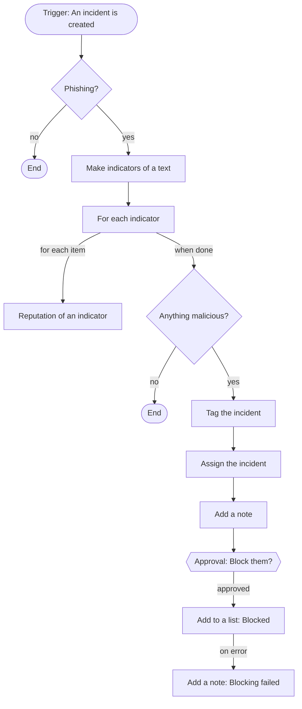
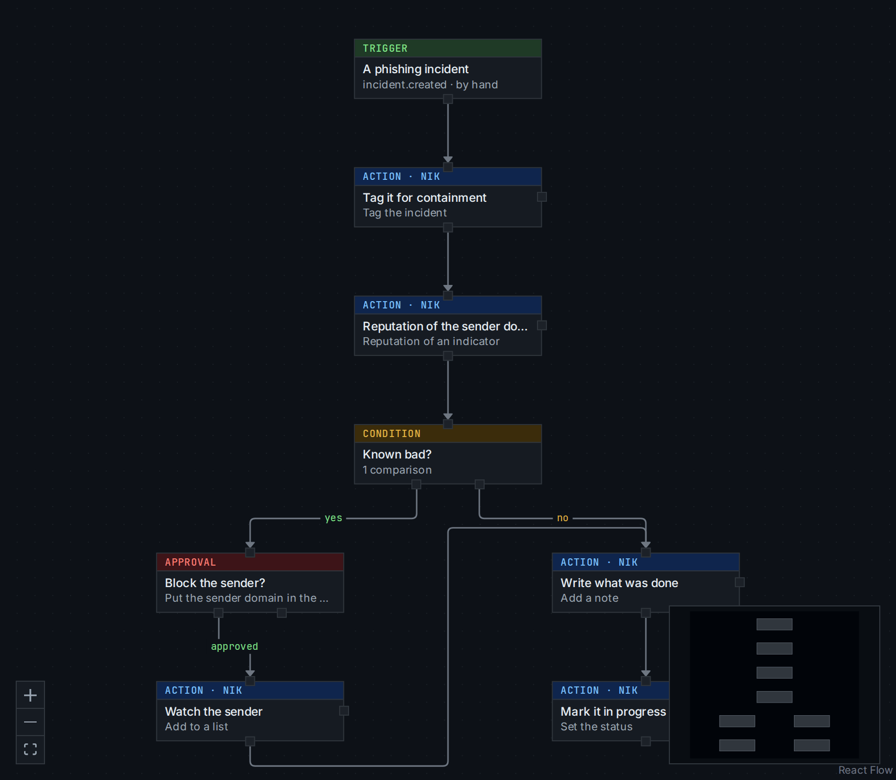
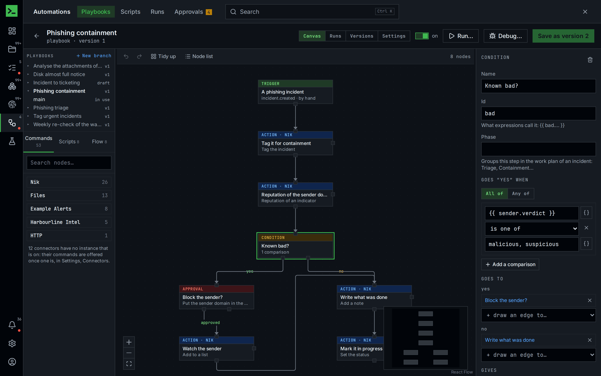
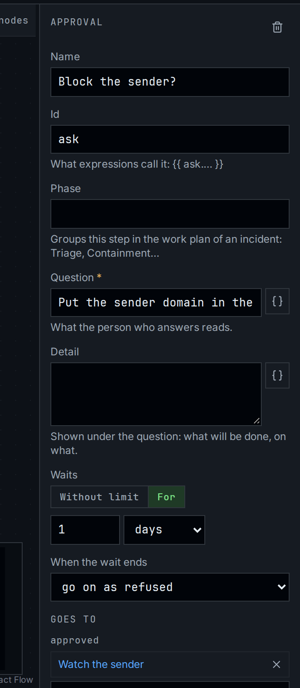
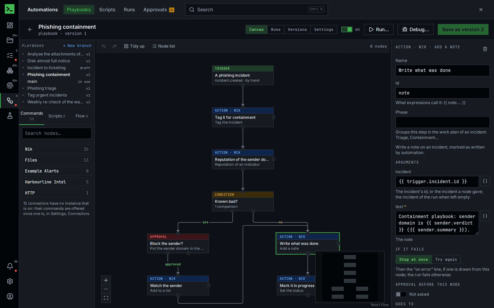
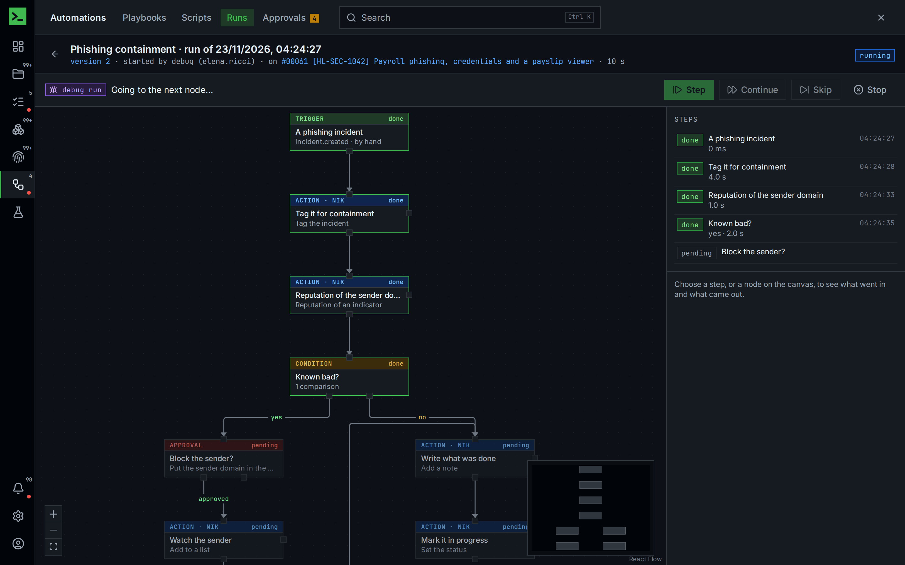
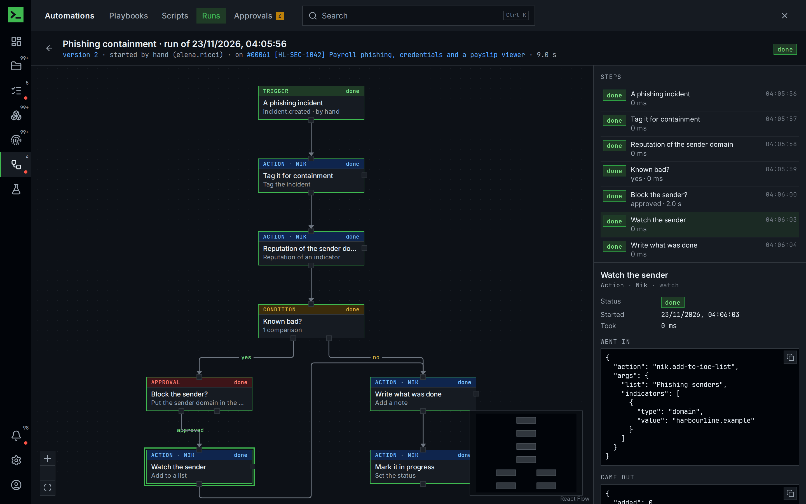

# A playbook from scratch

Build a playbook for a real need, test it without risk, turn it on and read what it did.

**The need.** When a phishing incident comes in: find the indicators in it, check each with the threat-intelligence sources, and if one is malicious tag the incident, assign it, and ask a person before putting the malicious values on a block list.

**What you will have at the end:**



A finished playbook looks like this on the canvas. The pictures on this page show *Phishing containment*, a smaller playbook shipped with the examples, built the same way: a trigger, actions, a condition with **yes** and **no**, an approval.



!!! note "You need"
    - The **Playbooks** role, to build; **Analyst** too, to try it on an incident.
    - At least one threat-intelligence source on ([Threat intelligence](../threat-intel.md#sources)). Without one, every verdict is empty and the playbook takes its *no* branches, which is still a good test.
    - An account to assign incidents to. This page uses `soc-lead`: use one of yours.

## 1. Create the playbook

1. Open **Automations › Playbooks**, press **New playbook**.
2. **Name**: `Phishing: check and contain`. **Description**: `Checks the indicators of a new phishing incident; asks before blocking.` Press **Create**.

The canvas opens with the **Trigger**. Every change saves itself as a draft.

## 2. The trigger

1. Select the **Trigger**.
2. **On an event**: **An incident is created · incident.created**.
3. Turn on **Can be run by hand**: you will try it on an existing incident.

The event does not carry the type of the incident, so the type is tested in the next node.

## 3. Only phishing incidents

1. Open **Flow** in the library and click **Condition**: it lands under the trigger, joined to it.
2. In the inspector: **Name** `Phishing?`, **Id** `is_phishing`.
3. Under **Goes "yes" when**, write one comparison: `{{ incident.type }}` **is** `phishing`.
4. Add an **End** node. **The run ends as** done, **Message** `Not a phishing incident.` Draw the **no** port of `Phishing?` to it.

`{{ incident.… }}` reads the incident of the run as it is now, every field by its name. `phishing` is the id of the shipped *Phishing* type; a type of yours has its own id (see **Platform settings › Incidents › Types**).

## 4. Find the indicators

1. Open **Commands › Nik**, add **Make indicators of a text**, and draw **yes** of `Phishing?` to it.
2. **Id** `found`.
3. **text**: `{{ incident.name }} {{ incident.details | default("") }}`
4. **leave_out_harmless**: on (private addresses, your own domains and the allowlist are left out).

It gives `found.indicators`: a list of `{type, value, new, marks}`. It is safe to run twice: an indicator Nik knows is linked, not made again.

!!! tip "Why `| default("")`"
    A field with no value is not there when the step runs, and a path that leads nowhere fails the step. `default` gives an empty text instead.

## 5. Check each indicator

1. From **Flow**, add **For each** after `found`. **Id** `each_ioc`.
2. **For each item of**: `{{ found.indicators }}`. **At most**: `100`.
3. Turn on **Go on with the other items when one fails**.
4. Add **Reputation of an indicator** (**Commands › Nik**) and draw the **for each item** port of `each_ioc` to it. **Id** `check`.
5. **kind**: `{{ item.type | map(md5='file', sha1='file', sha256='file') }}` (a hash is looked up as a file; the other types keep their name).
6. **value**: `{{ item.value }}`.
7. **If it fails**: **Try again**, `3` times.



Inside the loop, `{{ item }}` is the current indicator. After the loop, `{{ each_ioc.results }}` is what `check` gave for each item, in order: each with `verdict`, `score`, `value`, `sources`.

## 6. Decide

1. Add a **Condition** and draw **when done** of `each_ioc` to it. **Name** `Anything malicious?`, **Id** `any_bad`.
2. Comparison: `{{ each_ioc.results | where("verdict", "eq", "malicious") | length }}` **is more than** `0`.
3. Add an **End** (done, `Nothing malicious.`) on its **no** port.

## 7. Tag, assign, note

On the **yes** port of `any_bad`, add one after the other:

1. **Tag the incident**, **Id** `tag`, **tags** `phishing-confirmed`.
2. **Assign the incident**, **Id** `assign`, **assignee** `soc-lead`.
3. **Add a note**, **Id** `note`, **text**:

    ```text
    Malicious: {{ each_ioc.results | where("verdict", "eq", "malicious") | pluck("value") | join(", ") }}
    ```

Leave **incident** empty in each: it is the incident of the run.

## 8. Ask before blocking

1. Add an **Approval** after `note`. **Id** `ask_block`.
2. **Question**: `Put the malicious values on the Blocked list?`
3. **Detail**: `{{ each_ioc.results | where("verdict", "eq", "malicious") | pluck("value") | join(", ") }}`
4. **Waits**: **For** 4 hours. **When the wait ends**: **go on as refused**.
5. On **approved**, add **Add to a list** (the one described *Put indicators in a watch list*). **Id** `block`. **list**: `Blocked`. **indicators**: `{{ each_ioc.results | where("verdict", "eq", "malicious") | pluck("value") }}`.



The watch list *Blocked* is made if there is none. A firewall that reads a list from Nik, or a connector command placed here instead (Check Point, Zscaler…), turns it into a real block: such a command changes something outside, and asks for its own approval by default.

## 9. Handle an error

1. Select `block`. **If it fails**: **Stop at once**.
2. Add **Add a note** (**Id** `block_failed`), **text** `Blocking failed: {{ block.error }}`.
3. Draw the **on error** square, on the right side of `block`, to `block_failed`.

A failed node gives `error` (what went wrong) to the node on its error line. Without the line, the run ends as failed.

## 10. Save a version

Press **Tidy up**, then **Save as version 1**.

If something is wrong, nothing is saved: the nodes show *N to fix* and the inspector says what. Messages you may meet here:

| Message | Fix |
| --- | --- |
| `"value" is required` | Fill the argument (marked on the node) |
| `"check" runs once per item: read the results of "each_ioc" instead` | After the loop, read `each_ioc.results`, not `check` |
| `"tag" is not certain to have run before this node` | Read only nodes every path to this one passes through |
| `"chek" is not a node of this playbook` | A typo, or the **Id** changed: correct the expression |
| `Nothing leads to this node` | Draw its line, or delete it |
| `A step of a "for each" body cannot also come after the loop` | Draw the line after the loop from **when done**, not from a node of the body |



## 11. Dry run

1. Press **Run…**. **On which incident**: choose a phishing incident with a few links in it.
2. Tick **Dry run**, press **Start the dry run**.
3. Read the run: `found` shows the indicators it would make; each `check` shows a verdict; nothing was tagged, assigned or added.

!!! info "What a dry run does not show"
    A dry run asks no source: `check` gives what Nik already holds, often nothing, so the run usually ends at *Nothing malicious*. To walk the **yes** path, use the debugger.

## 12. Walk the yes path in the debugger

1. Press **Debug…**. **What to run**: the draft. **On**: the same incident. **Where to stop**: **Before every node, one at a time**.
2. Press **Continue** until `any_bad`.
3. Select the step of `each_ioc`. In **What it gave**, change one `verdict` to `malicious`, and press **Write it**.
4. **Step**: the condition takes **yes**. Go on with **Step** and read each node. A debug run holds what would go outside, as a dry run does, and counts for no limit.



## 13. Turn it on and read the runs

1. Flip the switch to **on**.
2. Create a test incident of type *Phishing* with a known-bad test value in its details. The playbook starts.
3. **Automations › Approvals** (and the top of the incident) shows *Put the malicious values on the Blocked list?*. Press **Approve**.
4. Open **Automations › Runs**, then the run: green nodes are done; select one for **Went in**, **Came out** and the **Log**.



!!! warning "Limits"
    The playbook starts 60 runs an hour by default (**Settings › Limits and approvals**). A bulk creation of incidents beyond that starts nothing for the rest.

## 14. Make a part reusable: inputs and outputs

A check you want in several playbooks can be a playbook of its own, run by others.

1. Create a playbook `Check one indicator`. Its trigger has no event; turn on **Can be run by hand**.
2. With no node selected, under **Inputs**, add `value` (text, required) and `kind` (text, required).
3. Add **Reputation of an indicator** (**Id** `check`): **kind** `{{ inputs.kind }}`, **value** `{{ inputs.value }}`.
4. Under **Outputs**, add `verdict` from `{{ check.verdict }}` and `score` from `{{ check.score }}`. Save a version.
5. In the main playbook, replace `check` by **Run another playbook**: **Playbook** `Check one indicator`, **Inputs given to it** `value` = `{{ item.value }}`, `kind` = `{{ item.type | map(md5='file', sha1='file', sha256='file') }}`, **Wait for it to finish** on. It gives `{{ node.result.verdict }}`.

Playbooks call each other five deep at most; a circle is refused when the version is saved.

## 15. Share it as a file

1. Open the playbook's **Settings**, press **Export**: a JSON file.
2. On another Nik, **Automations › Playbooks › Import** brings it in as a draft, **off**.
3. Save a version there. What it may reach and send is never in the file: an admin opens it again where it is imported.

To carry it with its scripts and connectors, put it in a pack: [A content pack](pack.md).

## Related

- [Playbook nodes and expressions](../../reference/playbook-nodes.md)
- [Triggers and events](../triggers.md)
- [A script](script.md)
- [Your first playbook](../playbooks.md)
- [Events](../../reference/events.md)
