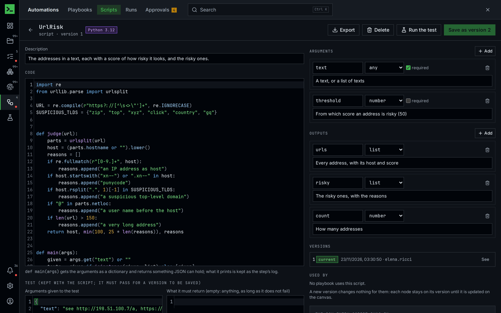
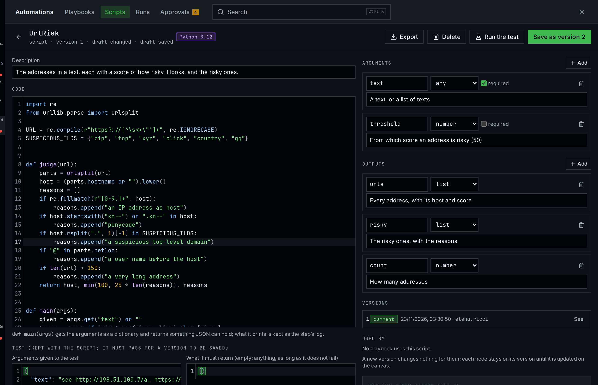
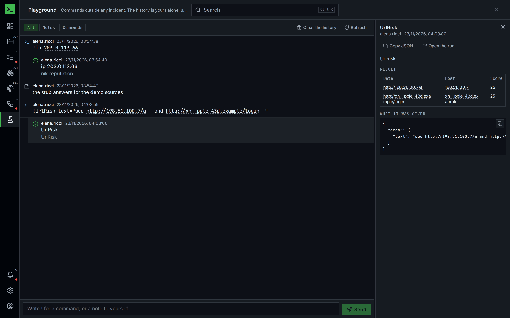
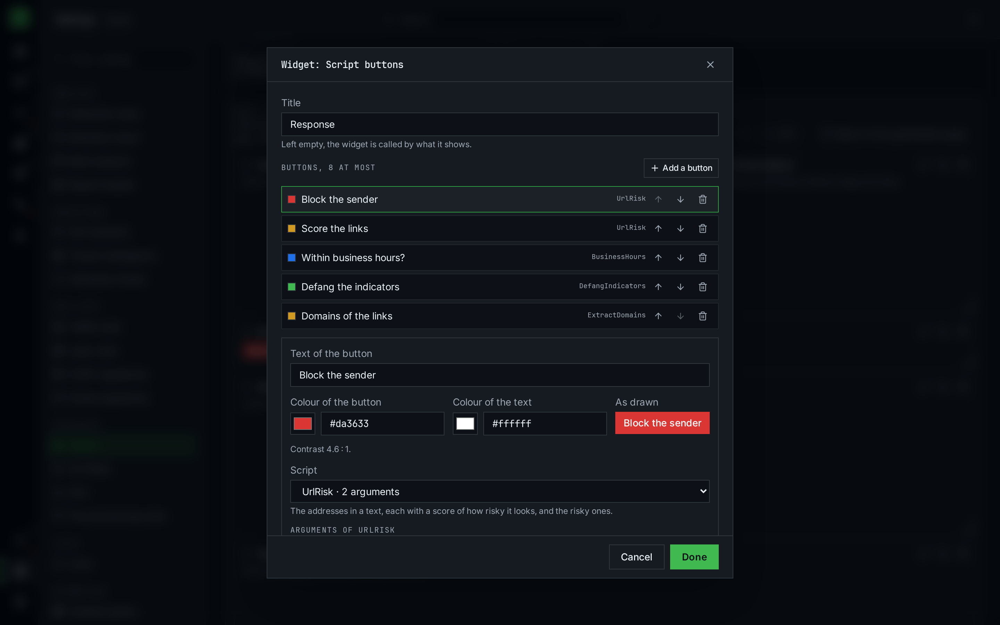

# A script

Write a Python script for the sandbox, test it, and use it as a playbook node, a War Room command and a button on the incident page.

**The script.** `UrlRisk` takes a text (or a list of texts), finds the web addresses in it, and scores each on a few signs of a lure: an IP address as host, punycode, a suspicious top-level domain, a user name before the host, a very long address. It returns every address with its score, writes them to the incident's context, and lists the risky ones.

!!! note "You need"
    The **Playbooks** role to write it. **Analyst** to run it on an incident (node, command, button). The sandbox must be configured (`SANDBOX_URL`): **Automations › Scripts** says so when it is not.

## What a script is

```python
def main(args):
    ...
    return {"name": value, ...}
```

| | |
| --- | --- |
| **Gets** | `args`: a dictionary with the arguments you declare, and nothing else. No secret, no database, no file of Nik, no incident unless a node passes its fields |
| **Returns** | Something JSON can hold: a dict whose keys are the outputs you declare. 1 MB at most |
| **Prints** | Kept as the step's log |
| **May use** | The standard library of Python 3.12. `urllib.parse` is allowed (taking an address apart is computing) |
| **May not** | Reach the network or start processes: `socket`, `ssl`, `http`, `urllib` (but `urllib.parse`), `subprocess`, `asyncio`, `ctypes`, `shutil`, `tempfile`, `pathlib`, `glob` and others are refused on import; `open()` and `input()` are gone. Its container has no route outside anyway |
| **Limits** | 10 seconds, 256 MB of memory, 16 open files |

A script that needs data from outside gets it from a node before it (a connector command, a look-up), as an argument.

## 1. Create it

1. Open **Automations › Scripts**, press **New script**.
2. **Name**: `UrlRisk` (a capital letter, then letters and digits; it cannot be changed). **Description**: `Finds the web addresses in a text and scores each on signs of a lure.` Press **Create**.

## 2. Write the code

Paste this in **Code**:

```python
import re
from urllib.parse import urlsplit

URL = re.compile(r"https?://[^\s<>\"']+", re.IGNORECASE)
SUSPICIOUS_TLDS = {"zip", "top", "xyz", "click", "country", "gq"}


def judge(url):
    parts = urlsplit(url)
    host = (parts.hostname or "").lower()
    reasons = []
    if re.fullmatch(r"[0-9.]+", host):
        reasons.append("an IP address as host")
    if host.startswith("xn--") or ".xn--" in host:
        reasons.append("punycode")
    if host.rsplit(".", 1)[-1] in SUSPICIOUS_TLDS:
        reasons.append("a suspicious top-level domain")
    if "@" in parts.netloc:
        reasons.append("a user name before the host")
    if len(url) > 150:
        reasons.append("a very long address")
    return host, min(100, 25 * len(reasons)), reasons


def main(args):
    given = args.get("text") or ""
    texts = given if isinstance(given, list) else [given]
    found = []
    for text in texts:
        for url in URL.findall(str(text)):
            url = url.rstrip(".,;)")
            if url not in found:
                found.append(url)
    urls, risky = [], []
    for url in found:
        host, points, reasons = judge(url)
        urls.append({"Data": url, "Host": host, "Score": points})
        if points >= int(args.get("threshold") or 50):
            risky.append({"url": url, "score": points, "reasons": reasons})
    print(f"{len(urls)} addresses, {len(risky)} risky")
    return {"urls": urls, "risky": risky, "count": len(urls)}
```

`urls` uses the keys of the `URL` entity of the [context](../../reference/playbook-nodes.md#the-context-of-an-incident) (`Data`, `Host`, `Score`), so it can be written there as it is.

## 3. Declare arguments and outputs

**Arguments**:

| Name | Type | Required | Description |
| --- | --- | --- | --- |
| `text` | any | yes | A text, or a list of texts |
| `threshold` | number | no | The score from which an address is risky (50) |

**Outputs**:

| Name | Type | Description |
| --- | --- | --- |
| `urls` | list | Every address: Data, Host, Score |
| `risky` | list | The risky ones, with their reasons |
| `count` | number | How many addresses |



## 4. Test it

1. In **Arguments given to the test**, write:

    ```json
    {"text": "Pay at http://bank.example@198.51.100.7/inv, or https://login.example.com/a. New: http://secure-update.zip/x"}
    ```

2. In **What it must return**, write:

    ```json
    {
      "urls": [
        {"Data": "http://bank.example@198.51.100.7/inv", "Host": "198.51.100.7", "Score": 50},
        {"Data": "https://login.example.com/a", "Host": "login.example.com", "Score": 0},
        {"Data": "http://secure-update.zip/x", "Host": "secure-update.zip", "Score": 25}
      ],
      "risky": [
        {"url": "http://bank.example@198.51.100.7/inv", "score": 50,
         "reasons": ["an IP address as host", "a user name before the host"]}
      ],
      "count": 3
    }
    ```

3. Press **Run the test**. The result shows what it returned and **Printed**: `3 addresses, 1 risky`.
4. Press **Save as version 1**. The test runs again; the version is saved only when it passes. `UrlRisk` is now in the library of nodes.

What a failure looks like, and what to do:

| The test says | Means |
| --- | --- |
| `Line 30: KeyError: 'text'` | The code read an argument that was not given: use `args.get("text")` |
| `Line 4: invalid syntax` | Python cannot read the code at that line |
| `"socket" is not available to scripts: a script computes, it does not reach out` | A refused module: get the data from a node before the script |
| `main(args) returned something that is not JSON: return dicts, lists, text, numbers` | A set, a date or an object was returned: convert it |
| `The script defines no main(args)` | The function is missing or misnamed |
| `The script ran, but did not return what the test expects` | Compare the result with **What it must return**; an empty expectation only asks that it does not fail |



## 5. Write to the context of the incident

To have `urls` kept in the incident's context (the **Context** tab), its output says where it goes: a `context_path`. The page has no field for it: set it in the file.

1. Press **Export** on the script's page: a JSON file.
2. In `outputs`, add `context_path` to `urls`:

    ```json
    { "name": "urls", "type": "list", "description": "Every address: Data, Host, Score",
      "context_path": "URL(val.Data == obj.Data)" }
    ```

3. Delete the script (or give the file another name), then **Import** the file on **Automations › Scripts**. It arrives as a draft; **Run the test** and **Save as version**.

The path is checked when the version is saved. Each item of `urls` is merged into `context.URL`, told apart by `Data`. Nothing is written in a dry run or on no incident. Editing the outputs on the page later keeps the path.

## 6. Try it in the Playground

1. Open **Playground** on the rail.
2. Type:

    ```text
    !UrlRisk text="see http://198.51.100.7/a and http://xn--pple-43d.example/login"
    ```

3. Press ++enter++. The result is under the line; open it for what was returned and printed. In the Playground nothing is written to an incident.



## 7. Use it as a War Room command

In an incident's War Room:

```text
!UrlRisk text=${incident.details}
!UrlRisk text=${context.Mail[0].Subject} threshold=25
```

`${…}` reads the incident and its context. The run is in the War Room and the audit log under your name, and `urls` lands in the context.

## 8. Use it in a playbook

1. In a playbook, open **Scripts** in the library and add **UrlRisk**. **Id** `risk`.
2. **text**: `{{ incident.details | default("") }}`. Leave **threshold** empty.
3. After it, a **Condition**: `{{ risk.risky | length }}` **is more than** `0`; on **yes**, **Add a note** with `Risky: {{ risk.risky | pluck("url") | defang | join(", ") }}`.

The playbook keeps version 1 of the script. When you save a version 2, the playbook is marked *updates available* and the node offers **Update to version 2**.

!!! info "What leaves"
    What a script returns carries the classes of data of everything it was given, and *results of scripts* besides. A node that would send it outside needs those classes opened for the playbook ([Data that may leave](../scripts.md#data-that-may-leave)).

## 9. Put it on a button

1. **Platform settings › Incidents › Types**, open *Phishing*, **Pages**, select the **Summary**.
2. **Add a widget**: **Script buttons**, **Add**. Press its pencil.
3. Add a button: text `Score the links`, colours of your choice, script **UrlRisk**, **text** = `{{ details }}`, **threshold** left empty (it will be asked).
4. **Save the type**.



On a phishing incident, **Score the links** opens a dialog: `text` read from the field, `threshold` to fill. Each press is a command in the War Room. An incident with no details asks for `text` too.

## Related

- [Scripts and the Playground](../scripts.md)
- [A playbook from scratch](playbook.md)
- [War Room commands](../commands.md)
- [Playbook nodes and expressions](../../reference/playbook-nodes.md)
- [A content pack](pack.md)
