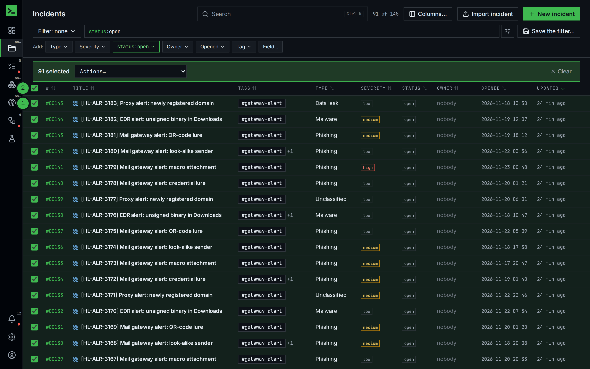
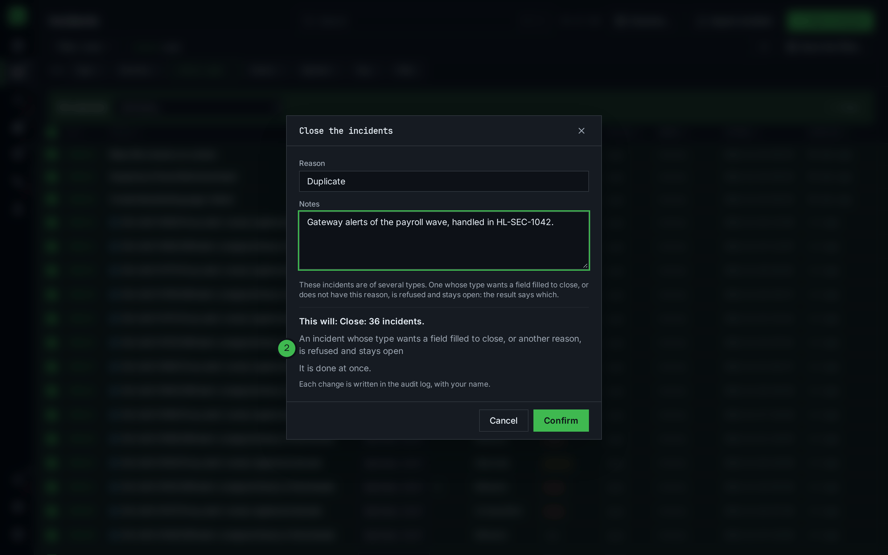
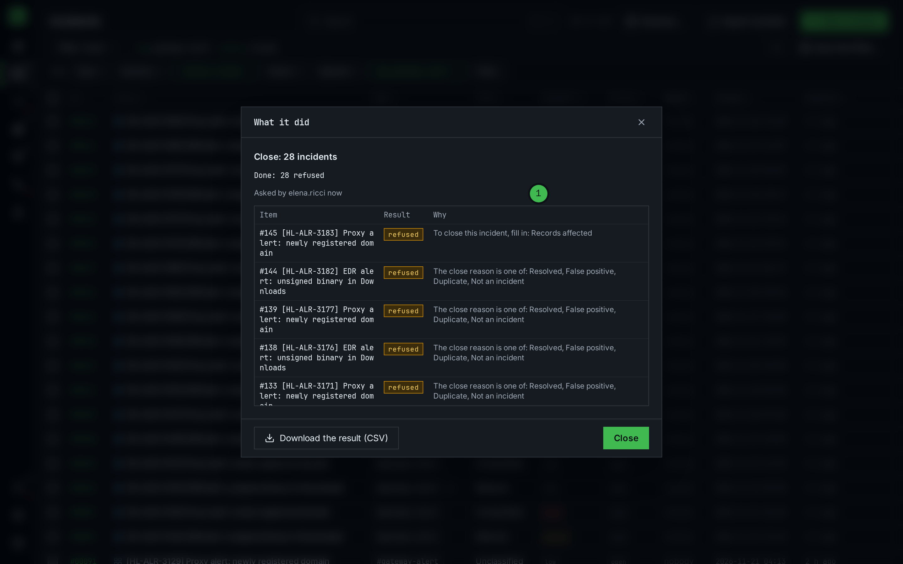

# Act on many at once

Select many incidents, artifacts or indicators and change them in one go: close, assign, tag, check, export, delete.

The three lists work the same way: the list of incidents, the artifacts panel, and the Indicators page (and the Indicators tab of an incident).

## Select rows

- **Tick a row**: click its checkbox 1. A click anywhere else on the row still opens it as usual.
- **Tick a range**: ++shift++ and click another checkbox. Every row between the last ticked one and this one is ticked.
- **Tick the rows on screen**: the checkbox in the heading 2. It is half ticked when only some are.
- **Tick everything the filter keeps**: when every row on screen is ticked and the filter keeps more, the bar offers **Select all 1,284 that match** 3. The server then works out which they are from the filter, not from what your browser has loaded.

With the keyboard, on a row:

| Key | Does |
|---|---|
| ++space++ | Ticks or unticks the row |
| ++shift+down++ / ++shift+up++ | Ticks the next row too and moves there |
| ++ctrl+a++ (++cmd+a++) | Ticks the rows on screen |
| ++esc++ | Unticks everything |

!!! note "The selection lives inside one filter"
    It survives another order of the rows and the next page. It is emptied when the filter changes (the list says **The filter changed: the selection was cleared.**), once an action on it has started, and when you leave the page. Nothing selected in one list is ever acted on from another.

## The bar

As soon as a row is ticked, a bar appears over the list:

`12 selected` · **Select all … that match** · **Actions…** · **Clear**

**Actions…** lists only what your roles let you do. A viewer can select and take out (export, copy), nothing more; the bar then says **Your roles let you read, not change**.

## What you can do

=== "Incidents"

    | Group | Action |
    |---|---|
    | Triage | **Set the status…**, **Close…**, **Set the severity…**, **Assign…** (me, someone, **Nobody (remove the owner)**), **Set the type…**, **Set the TLP…**, **Change the tags…**, **Set another field…** |
    | Evidence and mirroring | **Find indicators now**, **Change mirroring…** (In, Out, In-out, **None (stop mirroring)**) |
    | Automation | **Run a playbook on each…** |
    | Take out | **Export (JSON)** (25 at a time, one file each), **Copy the links**, **Delete…** |

    **Close…** asks the reason and the notes once. When all the incidents are of one type, it also offers that type's reasons and the fields it wants filled to close.

    **Set another field…** takes any field that holds one plain value. Out and In-out mirroring need the right to run playbooks, as on one incident.

=== "Artifacts"

    | Action | |
    |---|---|
    | **Change the tags…** | Add and remove tags |
    | **Analyse again** | Files and e-mails |
    | **Link to an incident…** / **Take out of an incident…** | |
    | **Set the expiry…** | The day they are deleted on, or none |
    | **Download together…** | One archive made by the server, the files inside an encrypted zip. 500 artifacts at most; the dialog states the size limit. |
    | **Delete…** | |

=== "Indicators"

    | Action | |
    |---|---|
    | **Check now…** | Asks the sources; first says what it costs each source |
    | **Analyse the addresses…** | The isolated browser visits the URLs |
    | **Change the tags…**, **Set the TLP…** | |
    | **Add to a list…**, **Save as a new list…**, **Take out of this list…** | |
    | **Add to the allowlist…** | |
    | **Export…**, **Copy the values** | |
    | **Remove from the library…** | |

    On the Indicators tab of an incident there is also **Remove from this incident…**, for the indicators found by themselves: they are not found again there.

!!! info "Not offered on many at once"
    What needs its own answer for each incident: its name and ticket, fields made of parts (tables, JSON, tags of hosts and users), starting a mirror (each has its own ticket on the other side), a script button, a War Room command, its report.

## Confirm

1. Choose an action in **Actions…**.
2. Fill in what it needs 1: the tags, the reason, the list, the playbook…
3. Read what it will do, under the form 2:
    - how many it applies to (`It applies to 9 of 12`);
    - what it sets in motion: `38 of these are mirrored Out: their tickets will be updated, one update for each`; for a check, the requests it costs each source against today's quota.
4. For a delete, or a close of more than 100 incidents, type the words the dialog shows (`delete 12`) 3.
5. Click **Confirm**.

!!! warning
    One action takes 5,000 rows at most: beyond that the dialog says to narrow the filter. If you selected everything a filter keeps and it changed while the dialog was open, nothing is done and the dialog shows the new count.

## How it runs

- Each row goes through exactly what changing it alone goes through: the same checks and permission, its own line in the audit log, the same events for playbooks, the same update to a mirrored ticket.
- Up to 50 rows are done before the dialog closes.
- More goes on **in the background**. Its progress is in the **Transfers** tray at the foot of the window; you can keep working. After a restart of the server it goes on from the row it had reached, without doing any row twice.
- One bulk action of yours runs at a time on each list.

## What it did

When every row was done, a notice says so. Otherwise **What it did** opens:

- how many were **done**, **skipped** (already so, or not for them), **refused** (a rule of a field, a type that wants something filled to close, a permission: with the sentence) and **failed**;
- the rows not done, with the reason for each 1;
- **Download the result (CSV)** 2 for all of them.

Nothing is undone when some rows fail: the others stay changed.

- **Try again on the N not done** 3 makes a new job of the rows that failed or were never reached.
- **Stop it**, on a running job, ends it after the row it is on. What was done stays.

### Every job of the last month

**Platform settings › System › Bulk actions** lists the bulk actions, newest first: what was asked, of how many, by whom, how it went. A row opens **What it did**, with the CSV, **Stop it** and **Try again**. You see your own; an administrator, and whoever reads the audit log, can tick **Everybody's, not only mine**. A job is kept for a month.

??? info "Details: the limits (administrators)"
    At the foot of **Bulk actions**, administrators set how many rows one action takes (5,000), up to how many are done before the dialog closes (50), and above how many a close is confirmed by typing (100; deleting always is).

The same jobs can be started through the API: see [API](../reference/api.md).

## Related

- [Search, filters and saved views](search.md)
- [Work an incident](incidents.md)
- [The Indicators page](indicator-library.md)
- [Connectors and mirroring](connectors.md)
- [Health and audit](../admin/health.md)
