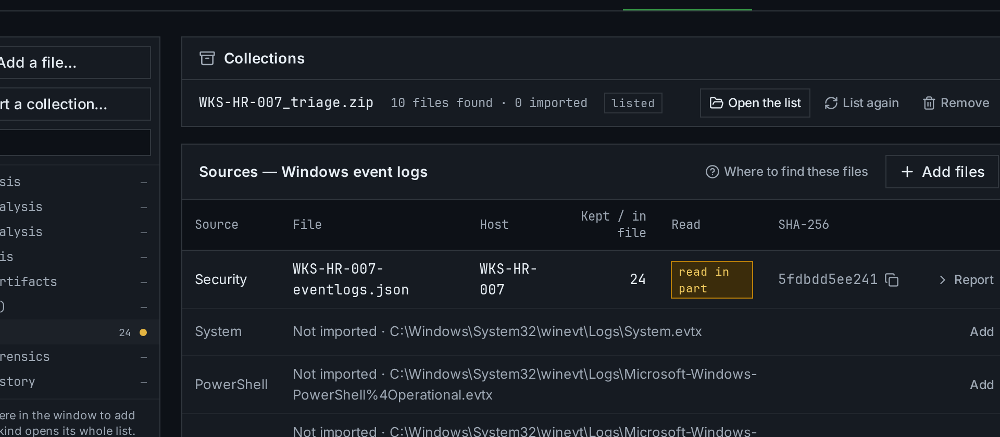
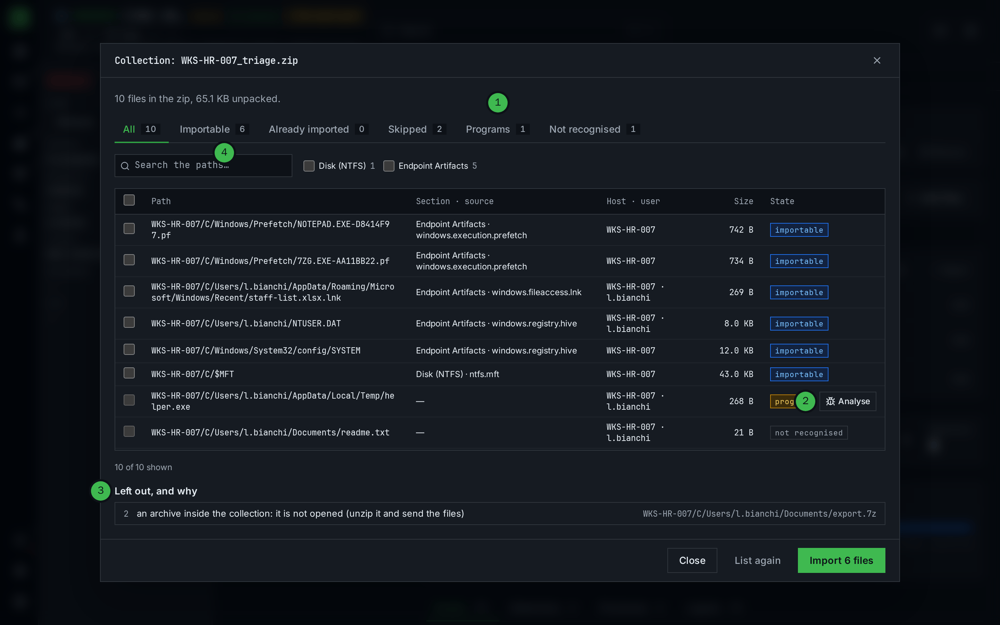

# Collections

Import a whole triage in one go: the zip of KAPE or Velociraptor, or the timeline of Plaso.

A triage tool copies dozens of files from a machine. A **collection** is that zip. Nik opens it on the server, lists what is in it, and imports the files it can read, each into its own page, as if you had added them one by one.

## A KAPE or Velociraptor zip

The import has two steps. Nothing is imported until you choose.

1. Press **Import a collection…** at the top of the Evidence tab, or drop the zip anywhere in the window.
2. The zip is sent and **listed** by the worker. A row appears under **Collections** with _N files found · 0 imported_.
3. Press **Open the list**. The dialog says how many files are in the zip and how much they take unpacked.
4. Tick the files, or press **Import N files** 4 for all the importable ones. You can filter the list first by section, or search the paths.
5. The files are read, one after the other. Each becomes a source of its page with its own parse report, with the path it had in the zip, and the host and the user taken from the path.

Press **List again** to list the zip again, for instance after an upgrade that reads more kinds of files. **Remove** removes the zip's row only: the files already imported stay.

### The list

The tabs of the dialog 1 sort the files.

| Tab                  | Holds                                                             |
| -------------------- | ----------------------------------------------------------------- |
| **All**              | Every file in the zip                                             |
| **Importable**       | Files Nik reads and has not imported yet                          |
| **Already imported** | Files whose bytes the incident already holds, in the same section |
| **Skipped**          | Files left out, with the reason                                   |
| **Programs**         | Executables                                                       |
| **Not recognised**   | Files no parser of Nik reads                                      |

Each file shows its path, the section and source it would go to, the host and the user, its size and its state.

### Programs and Analyse

An executable in a triage is not imported as evidence. It is marked **program**, and **Analyse** 2 sends it to [Malware Analysis](malware.md), where it is analysed without ever being run. It becomes a sample of the incident.

### What is left out, and why

**Left out, and why** 3 lists what was not taken, with the reason. Nik does not trust the zip.

- **An archive inside the collection** is not opened. Unzip it and send the files.
- **A file too big**: a member over 8 GB, or one that would take the total over the limit, is skipped. A file that expands more than 2000 times is skipped as a bomb. A zip whose members overlap is refused whole.
- **More than 20,000 members**: the rest are counted and not listed.
- **A member that is encrypted**. Nik tries the password `infected` when every member uses the old zip encryption. A member encrypted with AES cannot be opened and is skipped.
- **A path that goes outside the zip** is never followed: the paths in the zip are only names.

The size of a collection is limited by `COLLECTION_MAX_MB` (20480 MB by default).

## A Plaso export

Plaso (`log2timeline`) builds a timeline of a disk or a folder in a `.plaso` file. Nik reads the **output of `psort`**, not the `.plaso` file.

1. Export it: `psort.py -o json_line -w timeline.jsonl file.plaso`, or `-o dynamic -w timeline.csv file.plaso` for a CSV.
2. Drop the file on the window. It is recognised without asking.
3. Each event of the export goes to the page its type belongs to: file system and Prefetch events to Endpoint Artifacts, event log records to Event Logs, browser visits to Browser Forensics, and so on.

An event of a type Nik does not know is left out, and the parse report counts it. Plaso exports were tried on files made for the tests only.

## What is refused

A file Nik cannot read is refused at once, and the sentence says what to do.

| You gave                                                        | Nik says                                 | What to do                                                                                           |
| --------------------------------------------------------------- | ---------------------------------------- | ---------------------------------------------------------------------------------------------------- |
| A disk image (`.vhdx`, `.vhd`, `.e01`, `.dd`, `.raw`, `.vmdk`…) | Nik reads files, not disk images         | Mount the image read-only, collect the folders you need with KAPE or Velociraptor, and send that zip |
| A Plaso storage file (`.plaso`)                                 | Nik reads the output of `psort`          | Export it with `psort.py -o json_line`, as above                                                     |
| A `.7z`, `.rar` or `.tar`                                       | Nik opens collections that are zip files | Send a zip                                                                                           |
| A file nothing reads                                            | No parser of Nik reads this file         | Choose the section by hand, or leave it out                                                          |

!!! note "Tried on"
    Zips made like those of KAPE and Velociraptor, and Plaso exports, were tried on files made for the tests, not on the output of the tools. See [What Nik has and has not been tried on](host.md#what-nik-has-and-has-not-been-tried-on).

## Related

- [Host evidence](host.md)
- [Endpoint artifacts](endpoint.md)
- [Disk (NTFS)](disk.md)
- [Malware](malware.md)
