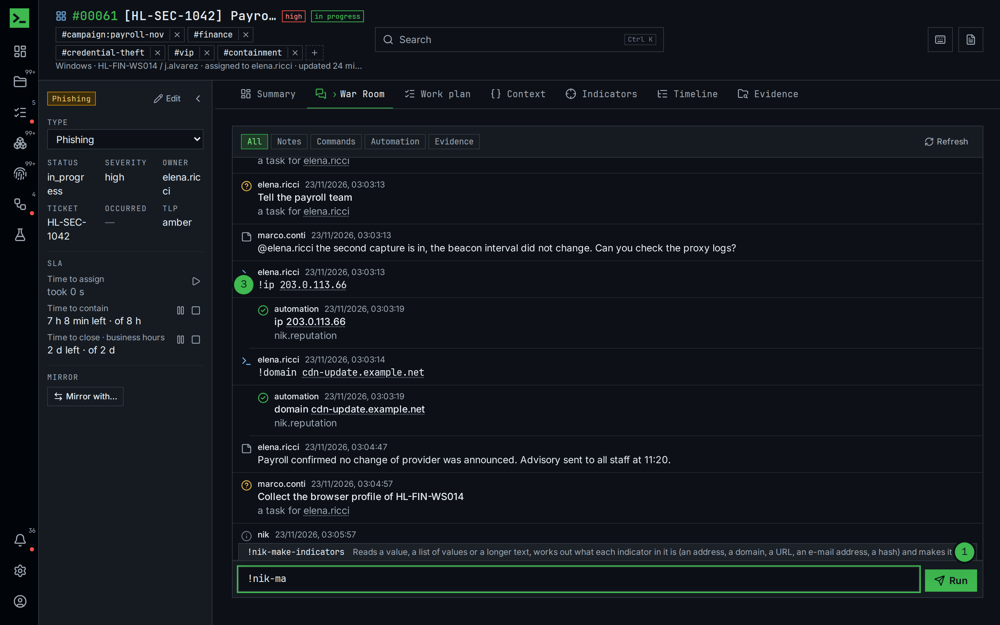
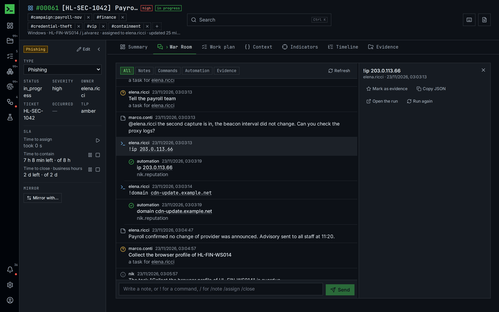

# War Room commands

Type a note or a command at the bottom of an incident's War Room: look an address up, read a ticket, isolate a host, now, without a playbook.

!!! note "You need"
    The permission to run playbooks and to read the incident: **Analyst** (or **Admin**). A note needs only the right to change the incident.

## The command line

The line at the bottom of the **War Room** tab takes three kinds of line:

| A line that starts with | Is |
| --- | --- |
| anything else | A note of the incident |
| `/` | A quick action: `/note`, `/assign`, `/task`, `/close` |
| `!` | A command, then its arguments |

```text
Called the user, who confirms the click.
/note The laptop is in the safe.
/assign @anna
/task Call the user @anna due=2h
/close
!ip 185.220.101.47
!servicenow-get-incident number=INC0012345
!sentinelone-isolate-agent agent_id=${context.Host[0].AgentID} using="SentinelOne EU"
!ExtractDomains text={{ context.Mail[0].Subject }}
!nik-make-indicators hxxp://update-cdn[.]net/gate.php
```



1. Type `!`. The commands that match are listed: <span class="step">1</span>. Move with the arrows, take one with ++tab++ or ++enter++.
2. Once the name is written, the arguments still to give are shown, the required ones marked: <span class="step">2</span>.
3. Press ++enter++. A command that changes something outside Nik opens a dialog that shows the line: confirm it.
4. The result is under the line. Choose the line to open it beside the stream: <span class="step">3</span>.

++arrow-up++ brings back the lines typed before.

### Slash commands

| Command | Does |
| --- | --- |
| `/note text` | Writes a note |
| `/assign @user` | Gives the incident to someone; alone, takes it from whoever has it |
| `/task Call the user @anna due=2h` | Adds a task to the work plan; with nobody named, for the owner of the incident |
| `/close` | Opens the form of closing |

## Syntax of a command

`!name arg=value arg2="a value with spaces"`

| Write | Means |
| --- | --- |
| `name=word` | A bare word |
| `name="two words"` | A quoted value |
| ``name=`["a","b"]` `` | JSON between backticks: an object or a list |
| `!ip 185.220.101.47` | A value alone, with no name, is the first argument |
| `tags=phishing,urgent` | An argument that is a list takes words separated by commas |
| `limit=10` · `force=true` | Numbers and `true`/`false` are read as such |
| `host=${context.Host[0].Name}` | `${path}` or `{{ … }}` reads the incident and its context |

The **Context** tab of an incident gives the path of any value, ready to paste (**Copy the path**, and the `${…}` form beside it).

**Reserved names**:

| Name | Does |
| --- | --- |
| `using=<instance>` | Picks the instance when a connector has more than one |
| `raw=true` | Shows the result as JSON |
| `extend=<anything>` | Keeps the result out of the context |

## What a command can be

| `!name` | What runs | Example |
| --- | --- | --- |
| `ip`, `domain`, `url`, `file`, `email` | A reputation look-up | `!domain update-cdn.net` |
| `<connector id>-<command>` | A command of a connector | `!jira-cloud-get-issue key=SOC-12` |
| `nik-…`, `list-…`, `timer-…`, `http-request` | An action of Nik: the node of the canvas with the dot made a dash | `!nik-add-tags indicators=1.2.3.4 tags=c2` |
| A script's name | A script with a saved version | `!DefangIndicators` |

### Reputation look-ups

`!ip`, `!domain`, `!url`, `!file` (a hash) and `!email` ask what is known of an indicator: the same look-up as **Check now** on an indicator's page.

- Every source that is on is asked: a connector that marks a command `reputation` for that kind, through the oldest of its instances that is on. An answer that still stands is not asked again.
- What a look-up never sends (a private address, an internal name, an allowlisted or TLP:RED value) is not sent.
- The value becomes an indicator of the incident, with the source **War Room · looked up**.

See [Threat intelligence](threat-intel.md).

### The commands Nik ships

Every action of the canvas library is a command: its id with a dash for the first dot.

| Command | Node | Command | Node |
| --- | --- | --- | --- |
| `nik-get-incident` | Get an incident | `nik-scan-url` | Scan an address |
| `nik-add-note` | Add a note | `nik-add-file` | Add a file |
| `nik-set-status` | Set the status | `nik-download-file` | Download a file |
| `nik-set-assignee` | Assign the incident | `nik-unpack-artifact` | Unpack an archive |
| `nik-set-incident-field` | Set a field of the incident | `nik-add-evidence` | Add host evidence |
| `nik-add-incident-tags` | Tag the incident | `nik-link-artifact` | Link an artifact |
| `nik-remove-incident-tags` | Take tags off the incident | `nik-unlink-artifact` | Take an artifact out of the incident |
| `nik-create-incident` | Create an incident | `nik-list-artifacts` | List the artifacts of an incident |
| `nik-add-indicators` | Add indicators | `nik-get-artifact` | Get an artifact |
| `nik-make-indicators` | Make indicators of a text | `nik-analyse-artifact` | Analyse an artifact |
| `nik-add-tags` | Tag indicators | `nik-get-analysis` | Read an analysis |
| `nik-add-to-ioc-list` | Add to a list (watch list) | `nik-add-artifact-tags` | Tag an artifact |
| `nik-remove-from-ioc-list` | Remove from a list (watch list) | `nik-remove-artifact-tags` | Take tags off an artifact |
| `nik-get-ioc-lists` | Get the lists | `nik-set-artifact-expiry` | Set the expiry of an artifact |
| `nik-recheck-list` | Check a list again | `list-get` · `list-contains` | Read a list · Is it in a list? |
| `nik-get-indicator` | Get an indicator | `list-add` · `list-remove` · `list-set` | Add to · Remove from · Set a list |
| `timer-start` · `timer-pause` · `timer-stop` | Start · Pause · Stop a timer | `http-request` | HTTP request |

What each takes and gives is in [Playbook nodes and expressions](../reference/playbook-nodes.md#what-a-playbook-does-in-nik).

### !nik-make-indicators

Turns a value written anywhere (a ticket, a mail, the output of a command) into indicators: IPv4 and IPv6 addresses, domains, URLs, e-mail addresses, MD5, SHA-1, SHA-256.

```text
!nik-make-indicators hxxps://login-portal[.]top/a?id=7
!nik-make-indicators text="C2 at 185.220.101[.]47 and update-cdn[.]net, dropper 44d88612fea8a8f36de82e1278abb02f"
!nik-make-indicators text=${context.ext.proofpoint.clicked} tags=phishing
!nik-make-indicators text=update.pl type=domain
```

- Defanged values are read as meant (`hxxp://`, `[.]`, `(.)`, `[at]`, `[:]`).
- A URL gives two indicators: the URL and its host. A longer text gives every indicator in it; a list is read item by item.
- What is not an indicator is listed in `not_recognised`, with the reason (`install.sh` is a file name, `1.2.3` a version number). When you know better, give `type`: the value is then that or nothing.
- Private addresses, documentation names, your own domains and allowlisted values are made like the rest, each with its `marks`. `leave_out_harmless=true` leaves them out.
- Safe to run twice: a known indicator is linked, not made again. Nothing is sent anywhere.

## Commands of connectors

Every command of an installed connector with an instance that is on is a `!` command, named `<connector id>-<command>`:

```text
!servicenow-get-incident number=INC0012345
!sentinelone-isolate-agent agent_id=${context.Host[0].AgentID} using="SentinelOne EU"
```

- With several instances, name one with `using=`.
- A command marked *changes* asks for confirmation first.
- It reaches the host of its instance and the hosts every playbook may reach, through the data guard with no class of data opened.
- What it declares is written to the context of the incident.

To find the exact name and arguments, open **Platform settings › Automation › Connectors**, a connector, and its commands: **Try it** opens the [Playground](scripts.md#the-playground) with the line ready.

## A command is a run

A command runs on the same engine as a playbook, as a run of one node. It appears in **Automations › Runs** and in the audit log under your name. Choose its line in the War Room to see what was sent, what came back and what was written to the context, and **Mark as evidence**.



## Related

- [Summary, timeline and War Room](war-room.md)
- [Scripts and the Playground](scripts.md)
- [Connectors and mirroring](connectors.md)
- [Threat intelligence](threat-intel.md)
- [Playbook nodes and expressions](../reference/playbook-nodes.md)
