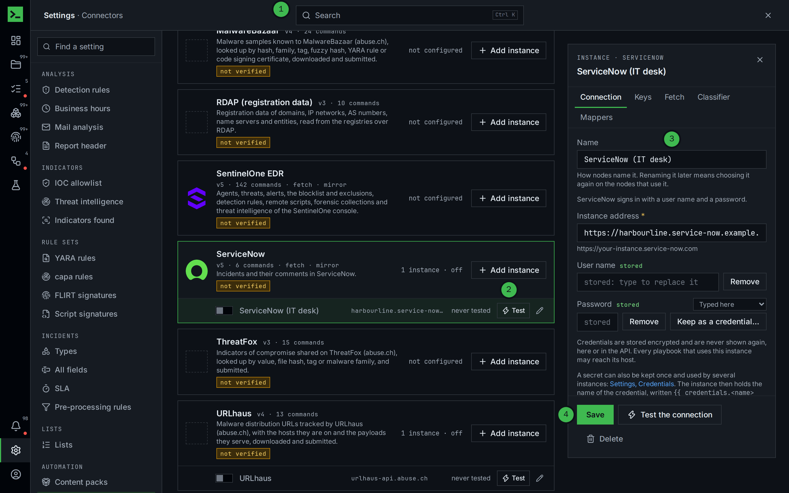
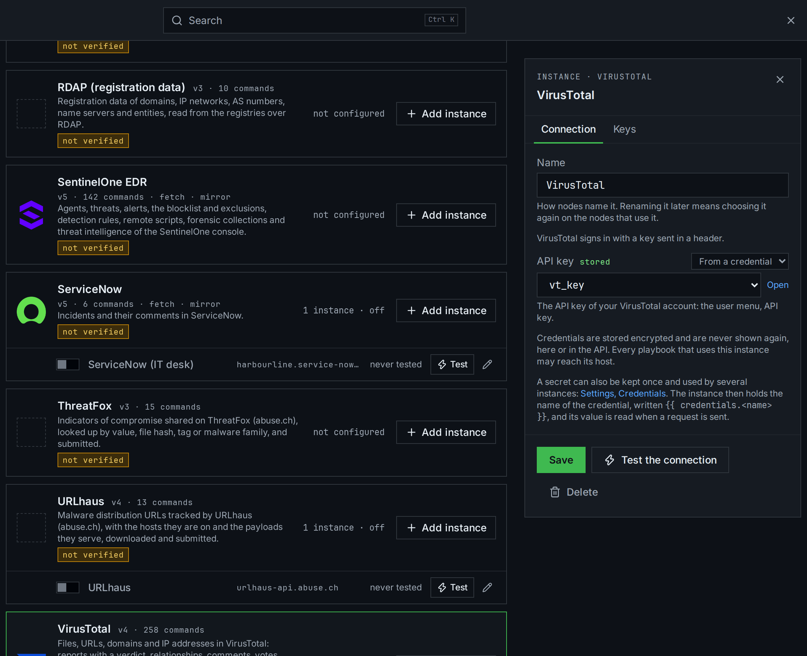
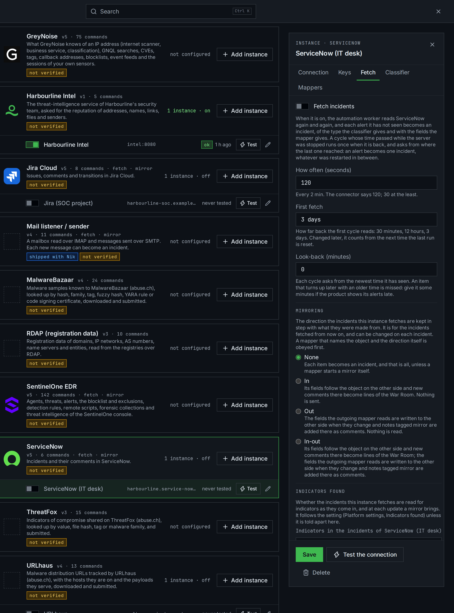
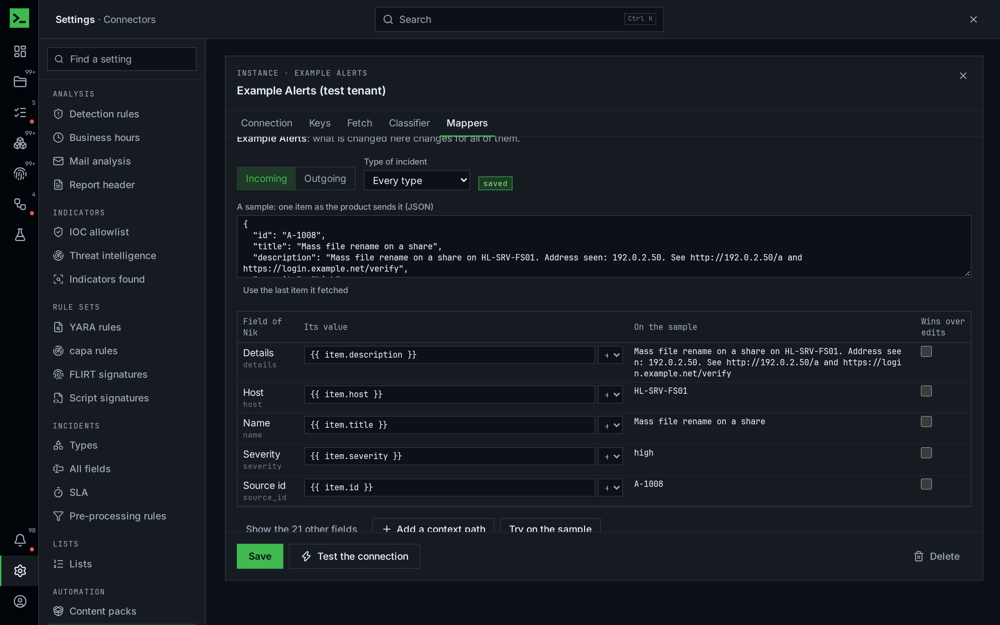
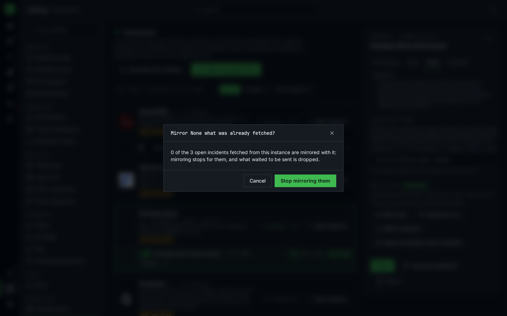
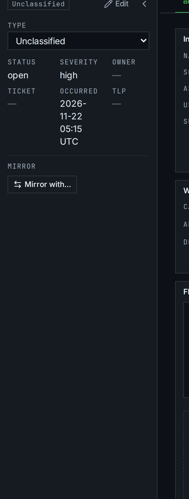

# Connectors and mirroring

Connect Nik to another product: add an instance with its credentials, bring its alerts in as incidents, and keep an incident and a ticket in step.

A **connector** is one YAML file that says how to talk to a product: what an instance needs, and its commands. An **instance** is one system of that product, "ServiceNow, production": the connector plus an address and credentials. Every command of a connector becomes a node of the canvas and a [War Room command](commands.md).

!!! note "You need"
    The **Connectors** role (or **Admin**) for **Platform settings › Automation › Connectors** and **Credentials**. Choosing a mirroring direction that sends (**Out**, **In-out**) also needs the permission to run playbooks; ticking the classes of data a mirror may send needs the permission that opens classes (**Admin**).

Most connectors come in [content packs](packs.md). The **Mail listener / sender** connector is part of Nik.

## Add an instance

1. Open **Platform settings › Automation › Connectors**.
2. Find the connector (**Find a connector or an instance**) and press **Add instance**.
3. On the **Connection** tab, give a **Name** (how nodes name it), the address and the credentials the connector asks for.
4. Press **Create** (later changes: **Save**), then **Test**: Nik sends the connector's test request and says what came back.
5. The switch beside the instance turns it on or off. Off, it runs no command, fetches nothing and is not offered for mirroring.

- 1 A connector and its instances; *not verified* means nobody ran it against a real system yet.
- 2 **Add instance**.
- 3 The form of the instance and its tabs: **Connection**, **Keys**, **Fetch**, **Classifier**, **Mappers**.
- 4 The one **Save** for every tab (**Create** for a new instance).

A connector is *enabled* while one of its instances is on; only then are its commands in the library. A node names its instance in its **Instance** field; a node that names none takes the only instance that is on when it runs. With two instances or more, a node must name one: the playbook is not saved until it does. With none yet, the node is saved and its step says, when it runs, that one is to be added.

!!! warning "Credentials are never shown again"
    They are stored encrypted, here and in the API. To change one, type it again. Every playbook that uses the instance may reach its host.

??? info "Adding a connector file of your own"
    **Add a connector file** takes a YAML file. It is checked as it is read: what is wrong is listed with its line, and nothing is installed until the file is right. A file with the id of an installed connector replaces it, and its version must be higher. **Download the samples** gives the shipped files to start from. A connector takes a logo (PNG or SVG, 256 KB at most). A connector a playbook uses cannot be removed. The format is in [Connector and pack format](../reference/connector-format.md).

## Credentials

A **credential** is a secret kept once under a name, for several instances. Change it in one place; it survives an instance being made again.

1. Open **Platform settings › Automation › Credentials** and press **New credential…**.
2. Give a **Name** (`vt_key`: a lower-case letter, then lower-case letters, digits, `_` or `-`), a **Description**, and the **Kind**: a secret (an API key, a token) or a pair (a user name and a password; a client id and secret).
3. In the form of an instance, a secret field offers **From a credential** or **Typed here**. Choose the credential.

- The value is never shown. **Edit…** replaces it; left empty, it stays. The list says where each credential is used.
- A credential an instance names is not deleted: give those instances another one first.
- **Keep as a credential**, beside a secret typed into an instance, moves it to **Credentials** and leaves the instance naming it.
- Only an instance reads a credential. A playbook, a script, a War Room line and a connector file cannot.
- Credentials travel to another server only inside a backup, under the same `SECRET_KEY`.

## Several keys, limits and kept answers

The **Keys** tab of an instance:

- **Add a key** adds another set of credentials. Keys are tried in order.
- **How the keys take turns**: **One request each**, **The same key until it is used up**, **The one with most left**, or **First key only, the others in reserve**.
- **Limits, for each key**: **Requests a minute**, **Requests a day** (counted per UTC day). A key is used up at its limit, or when the vendor answers `429`; the next key is tried.
- **When every key is used up**: **Wait for the first key to come back** (no worker is held) or **Fail the command**.
- **Keep an answer for this many hours**: a command that changes nothing outside is answered from what was kept. **Forget the kept answers** asks again.
- **Test every key** sends the test request with each.

## Fetching incidents

An instance whose connector has a `fetch` brings alerts in as incidents. Set it on the **Fetch** tab:

| Field | |
| --- | --- |
| **Fetch incidents** | Whether the instance fetches |
| **How often (seconds)** | 30 at least, once a day at most |
| **First fetch** | How far back the first cycle reads: `30 minutes`, `12 hours`, `3 days` (a month at most) |
| **Look-back (minutes)** | How far behind the newest time seen each cycle asks again, to catch late items |
| **Mirroring** | The direction for the incidents it fetches ([below](#mirroring)) |
| **Indicators found** | Whether its incidents are read for indicators; saved at once ([Threat intelligence](threat-intel.md#indicators-found)) |

One cycle: send the request (200 items at most), skip any item already fetched (by its id), classify and map each new item, make the incident with a War Room line that holds the item as it came, publish `incident.created`.

**How it goes**, under the form, is done at once (not part of **Save**): **Fetch now**, **Resume**, **Reset last run…**, and **What it fetched…** (each recent item and what became of it: an incident, an incomplete one, dropped, linked, closed as a duplicate).

!!! tip "When something is missed"
    - An item the mapper cannot make whole still becomes an incident: **What it fetched…** lists it as incomplete, with what was wrong. Fix the mapper.
    - A request that fails marks the instance *failing* and is tried again later, an hour apart at most.
    - More than 500 incidents in an hour pauses the instance, losing nothing. **Resume** goes on.
    - **Reset last run…** reads again from the first fetch. Items already imported are skipped by id, except those whose incident was deleted: they are imported again. Deleting an incident alone does not bring it back.

Before an item becomes an incident, the [pre-processing rules](types.md#pre-processing-rules) may drop it, link it to an open incident or close it as a duplicate.

## Classifiers and mappers

They live in the instance, on two wide tabs.

- **Classifier**: rules, each a comparison on `item` (**When**, **Compares**, **With**) and the type it becomes (**It becomes**). The first that holds wins; else **Otherwise**, else **Unclassified**.
- **Mappers**: choose **Incoming** or **Outgoing**, and the **Type of incident** (**Every type**, or one type that replaces the general mapper for it).
    - Incoming: each **Field of Nik** gets **Its value**, a template over `item` (`{{ item.priority | severity('inverse') }}`). **Wins over edits** lets the product write over what a person set in Nik. **Add a context path** writes to the context (`Alert(val.ID == obj.ID)`).
    - Outgoing: each **Name of the product** gets a template over `incident` and `context`.
- **Try on the sample**: paste an item, or **Use the last item it fetched**, and see what each field would get. Trying never writes to an incident.

The mappers belong to the connector: every instance of it uses the same ones. Changes are kept across tabs until **Save**; **Put back what is saved** gives them up.

## Mirroring

Mirroring keeps an incident in step with one object of another product: a ticket, an issue, a threat. Every connector Nik ships that fetches also mirrors.

| Direction | What happens |
| --- | --- |
| **None** | Each item becomes an incident, and that is all |
| **In** | What changes on the other side comes here. Nothing is sent |
| **Out** | What changes here is sent to the other side. Nothing is read |
| **In-out** | Each side follows the other |

### Choose it in the instance

1. Open the instance, tab **Fetch**, part **Mirroring**.
2. Choose **None**, **In**, **Out** or **In-out**. Each choice says what it does with this connector; one that cannot be chosen says why (a connector with no command that writes cannot go out; a mailbox is only ever read).
3. Tick the classes of data its mirrors may send, beyond those that always may (hashes, public indicators, verdicts, Nik's own ids).
4. Press **Save**. The incidents fetched **from then on** start mirrored that way.

A new instance says **None**: nothing changes until someone chooses.

### Apply it to open incidents

Saving changes nothing for incidents already there. **Apply mirroring to open incidents…**, in the same part, counts the open incidents the instance fetched and, once confirmed, gives them the saved direction. **None** stops their mirrors. An incident someone mirrored with another instance is left alone. It is in the audit log with the counts.

### On one incident

The **Mirror** panel beside the tabs of an incident shows the direction, where it came from (*from the instance*, *from the mapper*, *set here*), when the other side was last read and written, and the last problem.

- Change the direction for this incident alone.
- **Mirror with…** starts a mirror by hand: the instance, the id of the object there, and which way.
- **Read now** reads the other side at once.
- A note tagged `mirror` is sent as a comment.

??? info "How In and Out work"
    - **In**: the worker reads the object at the connector's interval; the incoming mapper turns it into fields. A field a person set is kept unless the mapper marks it **Wins over edits**. New comments become War Room notes, signed by who wrote them there. For SentinelOne, a closed incident takes as close notes the last note a person wrote on the threat; the instance field **Note authors that are automations** (Hyperautomation by default) says whose notes are skipped. A closed incident is read for a day more. An object deleted on the other side is said once, then read no more until **Read now**.
    - **Out**: when a field the outgoing mapper reads changes, the incident is sent. Sending goes through a queue; a failure is tried again eight times and listed under **Mirroring: what waits to be sent**, with **Send again**.
    - Starting a mirror that sends is a standing permission, in the War Room and the audit log. What is sent passes the data guard. A loop is not possible: what the mirror's own connector wrote is never sent back.
    - An incoming mapper that sets both `mirror_id` and `mirror_direction` starts the mirror itself, whatever the instance says. No shipped mapper does.

### What each shipped connector mirrors

| Connector | In | Out |
| --- | --- | --- |
| ServiceNow, Jira Cloud, Jira Data Center | The fields of the ticket or issue, and its comments | The fields the outgoing mapper writes, and notes as comments |
| SentinelOne EDR | The threat by its id: incident status → status, analyst verdict → close reason; its notes | Status and close reason as verdict, in one request; notes as notes of the threat |
| SentinelOne SIEM | The alert (`get-alert`): status; `FALSE_POSITIVE` closes the incident | The status (`update-alert`). No notes |
| Mail listener / sender | A reply to a message an incident was made from becomes a War Room line and evidence | Nothing, ever |

!!! warning "Updating Jira and ServiceNow packs"
    Up to their packs 1.1.0 their incoming mappers said `in`. When an update replaces such a mapper, every instance whose Mirroring is **None** is set to **In** in the same step (audit: `mirror.kept`). See [Content packs](packs.md#updating-the-jira-and-servicenow-packs).

## The connectors of the packs

Each was written from what the vendor publishes and tested against recorded answers, not a real system: each is *not verified*. Test the instance and try each command in a dry run, then on something harmless.

| Connector | Signs in with | Fetches |
| --- | --- | --- |
| Check Point Firewall | A user and a password, or an API key | — |
| Check Point Harmony SASE | An API key | — |
| Zscaler Internet Access | A user, a password and the API key | — |
| SentinelOne EDR | An API token | Threats created since the last cycle |
| SentinelOne SIEM | An API token | Alerts detected since the last cycle, 100 a cycle |
| ServiceNow | A user and a password | Incidents opened since the last cycle |
| Jira Cloud · Data Center | An e-mail and an API token · a personal access token | Issues a JQL filter finds |
| Confluence Cloud · Data Center | An e-mail and an API token · a personal access token | — |
| Bitbucket Cloud · Data Center | An e-mail and an API token · an HTTP access token | — |

Threat-intelligence sources (VirusTotal, AbuseIPDB, urlscan.io…) are connectors too: see [Threat intelligence](threat-intel.md).

??? info "Before turning a fetch on"
    - **Jira** compares times in JQL to the minute, in the time zone of the account that signs in: with an account outside UTC the first cycle starts some hours off.
    - **ServiceNow** reads comments from `sys_journal_field`: the account needs a role that may read it.
    - **SentinelOne SIEM** asks for alerts detected since five minutes before the last cycle and reads 100: with more between two cycles, some are not read.
    - None of the shipped mappers chooses the type of incident: add a classifier, or the default type is used.

## The Mail listener / sender

One instance is one mailbox: an IMAP server to read, an SMTP server to send through, one user name and password for both. Either half may be left empty.

- **Fetching** turns each message of the watched folder into an incident, and keeps the message as its evidence, analysed as an uploaded `.eml`.
- **Commands**: `send`, `reply`, `forward` (plain text, 50 recipients at most; each recipient's domain must be a host the playbook may reach), `search`, `get-message`, `list-folders`, `get-attachments` (keeps attachments as files), `move`, `mark-read`, `mark-unread`, `delete`.
- **Mirroring In**: a reply to a message an incident was made from (by `In-Reply-To` / `References`, never by subject) becomes a War Room line of that incident. **Out** and **In-out** are not offered.

## Related

- [Content packs](packs.md)
- [Threat intelligence](threat-intel.md)
- [War Room commands](commands.md)
- [Types, fields and pages](types.md)
- [Connector and pack format](../reference/connector-format.md)
- [Security](../reference/security.md)
