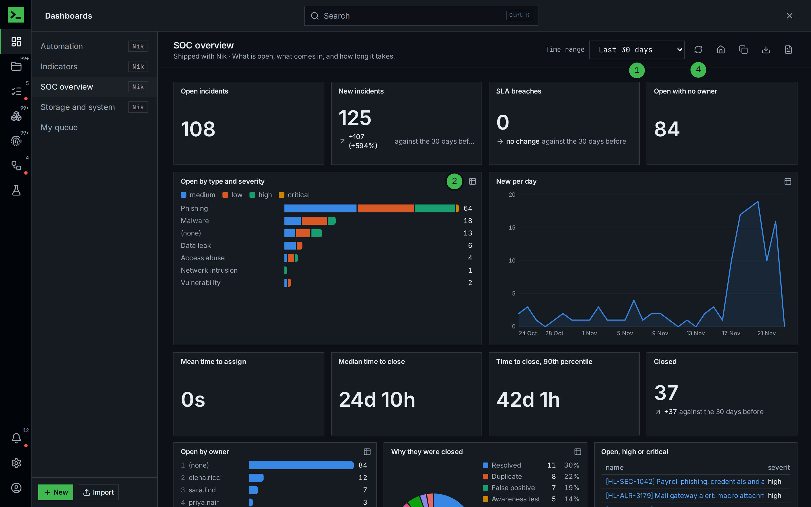
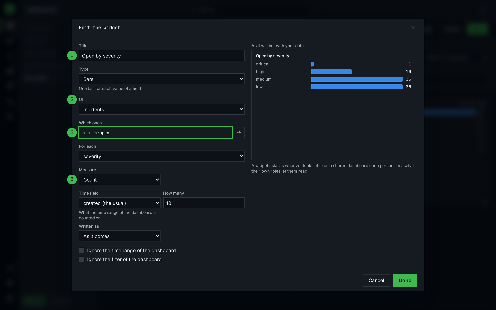
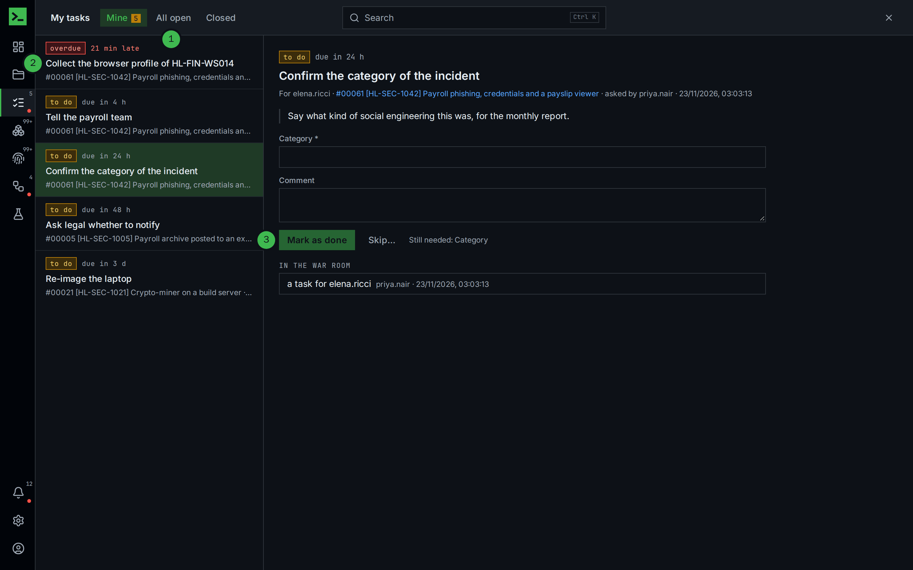

# Dashboards and My tasks

See how things stand at a glance, build your own dashboards, and work through the tasks that wait for you.

## Read a dashboard

**Dashboards**, on the rail, opens the dashboard you chose for sign-in, or the first one. The list of dashboards is on the left.

Each widget asks one question of what Nik holds and shows the answer: a number, a line, bars, a donut, a list or a table.

1. Pick the **Time range** 1: **Last 24 hours**, **Last 7 days**, **Last 30 days**, **Last 90 days**, **Last year** or **All time**. It applies to every widget that does not ignore it.
2. Point at a bar, a slice or a point to read its figures.
3. The button at the top right of a chart 2 shows the same figures as a table.
4. **Click a value** to see what is behind it: the query that finds those objects (with **Copy the query**) and the first of them. An incident opens from there.

A number can show its change against the period before: the same length of time, just earlier.

### Refresh

A dashboard is read when you open it. Two controls in its toolbar keep it current.

- The **refresh** button reads every widget again now.
- **Auto-refresh** reads them on a pace: **Dashboard default** (the pace the dashboard was saved with), **Off**, **30 seconds**, **1 minute**, **5 minutes**, **10 minutes** or **30 minutes**.

The choice is yours alone, for each dashboard, and it is kept in this browser.

The toolbar 4:

| Button | Does |
|---|---|
| **Refresh** | Reads every widget again. |
| The house | **Open this dashboard at sign-in**, in this browser. |
| **Duplicate** | Makes a copy of your own, to change. |
| **Export** | Saves the dashboard as a file. |
| **Report** | A PDF of the dashboard over the chosen time range: every widget with its answer, a chart as its table. |
| **Share** | Who else sees it (your own dashboards). |
| **Edit** | Changes it (your own dashboards). |

Every dashboard has its own address, `/dashboards/<id>`: bookmark it or send it.

!!! note "Each person sees their own answers"
    A shared dashboard shows the same questions to everyone, but each widget counts only what the viewer's roles let them read. A widget you may not ask says **Your roles do not let you see this.**

### The dashboards Nik ships

Seen by everyone, changed by nobody. **Duplicate** one to make it yours.

| Dashboard | Shows |
|---|---|
| **SOC overview** | Open incidents by type and severity, new ones per day, SLA breaches, mean time to assign, median and 90th percentile of the time to close, who owns what is open, why incidents were closed. |
| **Automation** | Runs per day by how they ended, failures by playbook, approvals that wait and the oldest, overdue tasks. For who may run playbooks. |
| **Indicators** | The Indicators page by verdict, type and origin, what is new per day, the most used tags and lists. |
| **Storage and system** | How full the file store is (administrators), how each fetching instance goes (who manages connectors), incidents fetched by instance, what is done in Nik per day (who reads the audit log). |

## Make a dashboard

1. Click **New** above the list of dashboards.
2. Give it a name and, if you want, a **Description**.
3. Choose what it **Opens on** (its default time range) and how often it **Refresh**es: **No refresh**, **Every minute**, **Every 5 minutes**, **Every 15 minutes**.
4. Click **Add a widget** and pick its type ([below](#widgets)).
5. Fill in the editor ([below](#the-widget-editor)) and click **Done**.
6. Click **Save**.

To change a dashboard of yours later, click **Edit**. **Cancel** throws the changes away; leaving with unsaved changes asks first.

### Arrange the widgets

While editing:

- drag a widget by the grip in its corner;
- resize it by the opposite corner. It snaps to twelve columns and the others make room;
- with the grip focused, the arrow keys move the widget, ++shift++ and the arrows resize it.

On a narrow window the widgets are one under the other, in reading order.

### A filter for the whole dashboard

While editing, **The filter of the dashboard** is one query for all the widgets of one kind of object (only the incidents of a customer, say). A widget can tick **Ignore the filter of the dashboard**.

## Widgets

| Type | Shows |
|---|---|
| **Number** | One figure, with its change against the period before |
| **Trend line** | A count or a measure over time |
| **Bars** | One bar for each value of a field |
| **Stacked bars** | Bars split by a second field |
| **Donut** | The parts of a whole |
| **Top values** | The most frequent values of a field, as a list |
| **Table** | The rows themselves, with the columns you choose |
| **Duration** | The time between two dates, or of an SLA timer |
| **Gauge** | A figure against a target |
| **Text** | A note in Markdown |
| **Storage** | How full the file store is, and with what |
| **Fetch health** | How each connection that fetches goes |

### The widget editor

1. **Title** 1.
2. **From** 2: what it counts. Incidents, Artifacts, Indicators, Tasks, Runs of playbooks, Approvals, Audit log, each for who may read it.
3. **Which ones** 3: a query, written or built with the builder. Same language as the lists: see [Write a query](search.md#write-a-query).
4. **Grouped by**: a field. A date is grouped by hour, day, week, month or year.
5. **Measure** 5: **Count**, or the **Mean**, **Median**, **90th percentile**, **Sum**, **Minimum** or **Maximum** of a number or of the time between two dates.
6. **Time field**: what the time range of the dashboard is counted on. Tick **Ignore the time range of the dashboard** for a widget that should not follow it.

The widget is drawn beside the form **as it will be, with your data**.

??? info "Details: how much is counted"
    A plain count is done by the database. Any other measure is worked out from the first 100,000 rows that match; past that the widget says **Worked out from the first 100,000 rows that match.** The API behind widgets is in the [Query language](../reference/query-language.md#counting-and-measuring).

## Share, export, import

**Share** (the Dashboards role, or an administrator):

1. Open your dashboard and click **Share**.
2. Tick **Everyone**, or fill **Whoever holds one of these roles** and/or **These accounts (usernames, with commas)**.
3. Save.

**Export** saves the dashboard as a file. **Import**, above the list of dashboards, reads such a file, here or in another Nik.

## A dashboard chart on an incident

The Summary of an incident can show one widget of a dashboard narrowed to that incident (the **Chart of a dashboard** widget). See [Summary, timeline and War Room](war-room.md#the-summary).

## My tasks

**My tasks**, on the rail, is what waits for you across every incident, the most pressing first. The icon counts the tasks and shows a dot when one is overdue.

A task comes from a playbook, or from a colleague. It is for one user, for whoever holds a role, or for the owner of its incident.

1. Choose **Mine** 1, **All open** or **Closed**.
2. Click a task 2. It shows its instructions and its form: a choice when it is a question, fields of the incident to fill, a comment.
3. Fill it in and click **Mark as done**, or **Send the answer** for a question 3. A playbook that waits for it goes on.
4. To give it up, click **Skip it** and give a reason.

Right-click a task › **Open the incident** goes to its incident.

### Give a task by hand

On the **Work plan** tab of an incident:

1. Click **Add a task**.
2. Write what is to do (Markdown works).
3. Choose who it is **For**: **The owner of the incident**, **A user** or **A role**, and a due time if you want.
4. Save.

Or type in the War Room: `/task Call the user @elena.ricci due=2h`.

## Related

- [Search, filters and saved views](search.md)
- [Query language](../reference/query-language.md)
- [Summary, timeline and War Room](war-room.md)
- [Your first playbook](playbooks.md)
- [Accounts, roles and sign-in](accounts.md)
