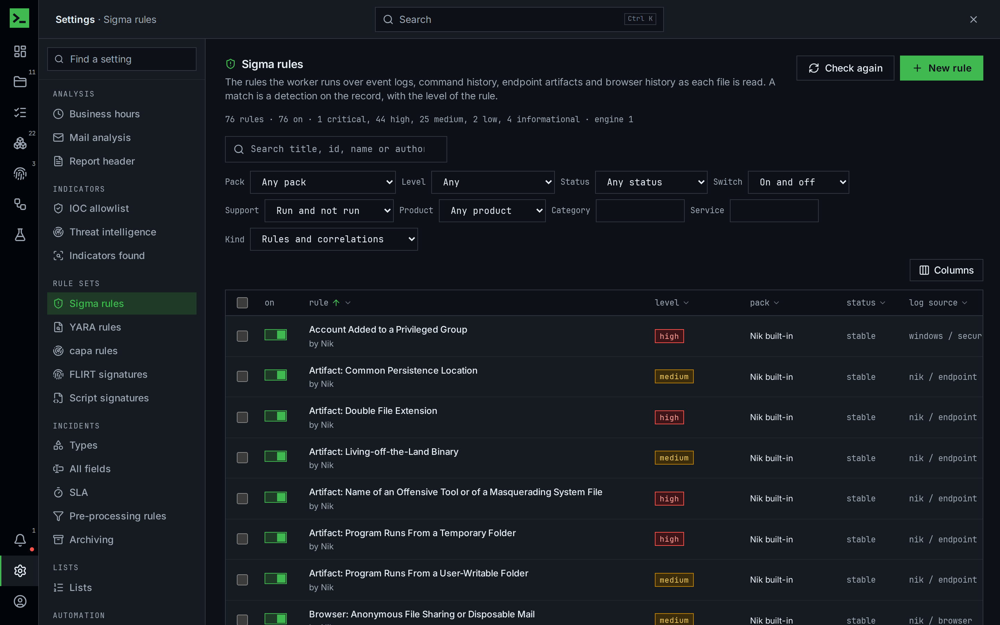
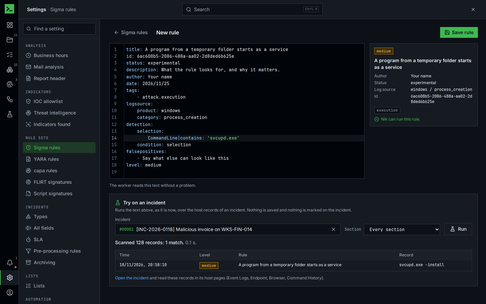
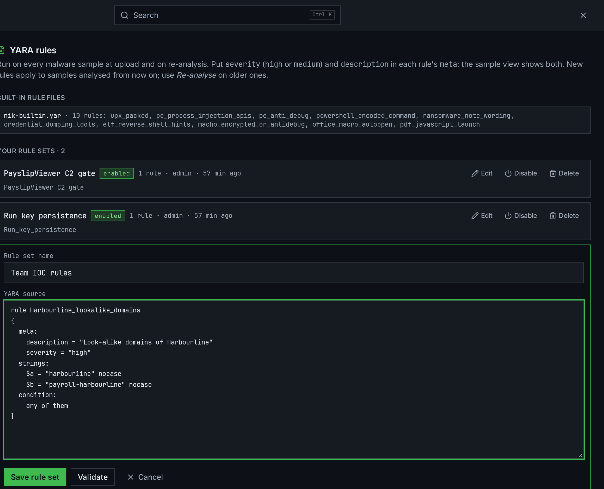

# Detection and rules

Tune what Nik flags in the evidence: Sigma rules, working hours, mail analysis, the report header, and your own YARA, capa, FLIRT and script rules.

!!! note "You need"
    | Section | To see | To change |
    | --- | --- | --- |
    | **Sigma rules** | Any account that reads | **Rules** (or **Admin**) |
    | **Business hours** | Any account | **Analyst** (or **Admin**) |
    | **Mail analysis**, **Report header** | **Admin** | **Admin** |
    | **YARA rules**, **capa rules**, **FLIRT signatures**, **Script signatures** | **Rules** (or **Admin**) | **Rules** (or **Admin**) |

All are under **Platform settings**. Type in **Find a setting** to narrow the sections by name or by what they hold.

## Sigma rules

**Platform settings › Rule sets › Sigma rules.** Detection of [host evidence](host.md) is done with [Sigma](https://sigmahq.io/), the open format for detection rules. A rule describes what to look for in a log; Nik runs the rules for you.

### What runs, where and when

1. A file of host evidence is sent to the server and read by the **forensics** worker.
2. As each record is read, the worker runs the rules that apply to it. It reads the **whole** value of each field, not a shortened one: a script of a megabyte is matched whole.
3. A rule that matches is a **detection** on the record. It carries the level of the rule.
4. When the file is read, the detections are counted in its [parse report](host.md#the-sources-table-and-the-parse-report), and the pages show them.

Rules are run **once, at the time the file is read**. A rule you add or change later applies to what you import from then on. To apply it to files already imported, press **Analyse again** on them. A rule costs about 0.05 ms for each record, with 3,000 rules loaded.

!!! note "Not the old keyword list"
    Before 7.0, a list of **suspicious keywords** was matched in your browser. It is gone, with every rule that ran in the browser. The rules Nik shipped became Sigma rules, and so did the entries a person had added to the list: they were converted when you upgraded.

### The page



The page counts the rules, how many are on, and how many of each level. Under it:

- **Search** by title, id, name or author.
- Filters: **Pack**, **Level**, **Status**, **Switch** (on or off), **Support** (rules Nik runs or does not), **Product**, **Category**, **Service**, and **Kind** (rules or correlations).
- The switch of a rule turns it on or off. Tick several and switch them together.
- **Check again** has the worker read every rule again with its present version, after an upgrade. It runs in the background.
- **New rule** writes a rule: see [Write a rule](#write-a-rule).

A level is one of **informational**, **low**, **medium**, **high** or **critical**. A rule with no level is **medium**.

### Built-in packs

| Pack                   | Rules | What it holds                                                                                                                                                                                                                                                                                       |
| ---------------------- | ----- | --------------------------------------------------------------------------------------------------------------------------------------------------------------------------------------------------------------------------------------------------------------------------------------------------- |
| **Nik**                | 60    | The rules that used to run in the browser, now as Sigma: Windows event logs (logons, brute force, services, tasks, accounts, log cleared, PowerShell, Defender), Linux logs (SSH brute force, `sudo` to a root shell, new accounts), the commands of shells, endpoint artifacts and browser history |
| **Nik process chains** | 16    | Rules about a process **and its parents**: Office starts a shell, a service starts a shell, a web server starts a shell, and so on. See [Process chains](#process-chains)                                                                                                                           |

You can switch a rule of a pack and change its text. A rule whose text was changed is marked, and **Reset** in its editor gives the pack's text back after showing what the reset changes.

### More rules: content packs

More rules arrive as a [content pack](packs.md) with a `sigma/` folder. A pack of Sigma rules shows a **notice**: read it, it carries the licence of the rules.

!!! warning "The rules of SigmaHQ are not inside Nik"
    The large public rule set of [SigmaHQ](https://github.com/SigmaHQ/sigma) is a **content pack to install**, not part of Nik. Its rules are under the Detection Rule License 1.1: the **author of a rule is always shown** next to a match, and the report names the authors. Install it only if you accept the licence.

A rule arrives switched **on** when the worker can run it, its `status` is `stable` or `test`, and its level is `medium` or higher. The others arrive off; switch on what you want. 
**Build the SigmaHQ packs**

1. Clone [SigmaHQ](https://github.com/SigmaHQ/sigma) yourself.
2. Run `python scripts/build_sigma_pack.py <checkout> --out <dir>`. It reads the checkout and changes nothing in it; it makes two packs, `sigmahq-windows` and `sigmahq-linux-macos`.
3. Install them in **Platform settings › Automation › Content packs** ([Content packs](packs.md#sigma-rules-in-a-pack)). Import takes a few seconds. The packs need Nik 7.0.

Measured on SigmaHQ master of 2026-11-23:

| Pack | Rules in it | Supported | On by default | Supported, off | Unsupported |
| --- | --- | --- | --- | --- | --- |
| Windows | 2,426 (one left out: longer than a pack file may be) | 2,417 | 2,086 | 331 (not stable, or below medium) | 9 |
| Linux and macOS | 280 | 197 | 123 | 74 | 83 (mostly macOS process creation) |

### Write a rule

1. Press **New rule**. The editor opens with a rule to change.
2. Write the rule in YAML. The page on the right says what the rule is: its level, its log source, whether **Nik can run this rule**. Errors are shown **on the line** where they are. **The worker reads this text without a problem** means it is valid.
3. **Try on an incident**: choose an incident (by title or number) and a section, and press **Run**. The rule runs over the host records of the incident as it is now. It says _Scanned N records: M matches_. Nothing is saved and nothing is marked on the incident.
4. Press **Save rule**.



A rule you write has an `id` (a UUID). A rule of a pack that has the same `id` is a conflict.

### Log sources

The `logsource` of a rule decides which records it reads. A rule for a log source Nik has no records for is not run, and the page says so.

| `product` | `category` or `service`                                                                                             | Reads                                                                                 |
| --------- | ------------------------------------------------------------------------------------------------------------------- | ------------------------------------------------------------------------------------- |
| `windows` | `process_creation`, `network_connection`, `file_event`, `registry_set`, `dns_query`, `ps_script`…                   | Sysmon events, and the Security events that are their equivalent (4688 for a process) |
| `windows` | `security`, `system`, `sysmon`, `powershell`, `taskscheduler`, `windefend`, `terminalservices-localsessionmanager`… | The channel of that name                                                              |
| `linux`   | `auth`, `sshd`, `sudo`, `syslog`, `cron`, `vsftpd`, `clamav`                                                        | Auth log and journal; for the programs, the lines written by that program             |
| `linux`   | `auditd`                                                                                                            | The audit log                                                                         |
| `linux`   | `process_creation`                                                                                                  | The `execve` events of the audit log                                                  |
| `macos`   | none                                                                                                                | The unified log, as keywords                                                          |
| `nik`     | `service: commands`                                                                                                 | Shell history                                                                         |
| `nik`     | `service: endpoint`                                                                                                 | Endpoint artifacts                                                                    |
| `nik`     | `service: browser`                                                                                                  | Browser history                                                                       |
| `nik`     | `service: process-chain`                                                                                            | One record for each process, with its parents: see below                              |

`process_creation` is **not supported on macOS**: a unified log record says which process wrote a line, not that one started.

### The fields a rule can use

The fields of a record are those the parser kept. Names are not case sensitive.

| Records                           | Fields                                                                                                                                                                                                                                                                                                  |
| --------------------------------- | ------------------------------------------------------------------------------------------------------------------------------------------------------------------------------------------------------------------------------------------------------------------------------------------------------- |
| Windows event logs                | `EventID`, `Channel`, `Computer`, `Provider_Name`, `User`, and every field of the event (`CommandLine`, `TargetUserName`, `LogonType`, `ImagePath`…). On a Security 4688, `Image`, `ParentImage`, `User` and `LogonId` are also given, with the Sysmon names, so a rule written for Sysmon runs on both |
| Linux and macOS logs              | `program`, `message`, `source_ip`, `type`, `recordtype`, `facility`, and for the audit log `Image`, `CommandLine`, `ParentProcessId`, `exe`, `auid`, `cwd`. For the journal `Image` and `CommandLine`                                                                                                   |
| `nik` commands, endpoint, browser | `summary`, `type`, `source`, `host`, `user`, and the fields of the record: `command` for a command, `name`, `path`, `command` and `target` for an endpoint artifact, `url` and `title` for a browser record                                                                                             |
| Every record                      | `NikOffHours`, see [Working hours](#working-hours-and-the-time-zone)                                                                                                                                                                                                                                    |

### Correlations

A **correlation** is a rule about other rules: how many times, how many different values, or in what order.

| Type               | Says                                                                                 |
| ------------------ | ------------------------------------------------------------------------------------ |
| `event_count`      | A rule matched at least N times in a time (ten failed logons in ten minutes)         |
| `value_count`      | A rule matched with at least N different values of a field (one address, many users) |
| `temporal`         | Several rules matched, in any order, in a time                                       |
| `temporal_ordered` | Several rules matched, in that order, in a time                                      |

One level of nesting is supported: a correlation may read another correlation. **A correlation counts within one file**: events in two files do not add up.

### What is not supported

Nik runs what pySigma can read and its own engine can evaluate. A rule it cannot run is **listed with the reason**: use **Support** on the page to list them, or open the rule in the editor, which says _Not evaluated_ and why. A common reason is a log source Nik has no records for, such as a cloud service, or a Linux category that no record can satisfy.

### Process chains

The rules of **nik / process-chain** read a process with the processes above it. Nik makes one record for each process of a host, after it has linked the process events (see [Event Logs](eventlogs.md#processes)), and runs the rules on it.

| Field                              | Holds                                              |
| ---------------------------------- | -------------------------------------------------- |
| `Image`, `CommandLine`             | The program and its command line                   |
| `ParentImage`, `ParentCommandLine` | The parent program and its command line            |
| `Ancestors`                        | The list of all the programs above it, to the root |
| `Host`, `User`                     | Where it ran and who ran it                        |

```yaml
logsource:
  product: nik
  service: process-chain
detection:
  selection_parent:
    ParentImage|endswith: '\WINWORD.EXE'
  selection_child:
    Image|endswith: '\cmd.exe'
  condition: selection_parent and selection_child
```

A parent that is not in the evidence (a _ghost_) has no record of its own: a rule on `Ancestors` sees only what was linked.

### Where detections show

- A **Detections** tab, column, filter and card on every host page and on the Timeline.
- In the drawer of a record, with the rule and its author.
- In the parse report of the file: the rules that matched most.
- In the War Room: one line for each file with detections of level medium or higher.
- In the [report](reports.md): detections come from the server, with the rule and its author.
- As the event `evidence.detected` for [playbooks](triggers.md#events-about-host-evidence).

A detection **never changes the severity** of an incident. A playbook that should react reads the level: see [Triggers and events](triggers.md#events-about-host-evidence).

!!! note "The Malware tab keeps its own keywords"
    [Malware Analysis](malware.md) still highlights a short list of suspicious words in the strings of a sample. That list is read in your browser and is not the Sigma rules.

## Working hours and the time zone

**Platform settings › Analysis › Business hours.**

1. Choose **From** and **to** (whole hours).
2. Tick **Also flag weekends** to treat Saturday and Sunday as outside hours.
3. Choose the **Time zone** the hours are read in: an IANA name, such as `Europe/Rome`. **It starts as UTC: set it.** An incident can carry a time zone of its own.

The hours do three things:

- The records outside them are marked with a clock on every host page and on the Timeline.
- The Sigma field **`NikOffHours`** is `true` for a record outside the hours, in the time zone, and `false` otherwise. The rule _Remote Desktop Logon Outside Working Hours_ reads it:

    ```yaml
    detection:
      logon:
        EventID: 4624
        LogonType: 10
      off_hours:
        NikOffHours: 'true'
      condition: logon and off_hours
    ```

- [SLA timers](types.md#sla) that count business hours read the same hours, in the same zone.

## Mail analysis

**Platform settings › Analysis › Mail analysis** (Admin).

| Field | Effect |
| --- | --- |
| **Your organisation's domains** | Messages claiming to come from them must pass authentication; look-alike domains are flagged. A name under one is an *internal name* to the data guard. A domain covers its subdomains. |
| **Your mail servers and gateways** | Only `Authentication-Results` headers written by these hosts are trusted (`protection.outlook.com`, `mx.google.com`…). |

Changes apply to messages analysed from now on: **Re-analyse** a message to apply them to it. Both are lists, editable in [Lists](lists.md). See [E-mail](mail.md).

## Report header

**Platform settings › Analysis › Report header** (Admin).

1. Type the **Organisation** name (`ACME Security Operations Center`).
2. **Choose an image** for the **Logo**: PNG, JPEG or SVG, up to 256 KB, shown on a white page.
3. Press **Save**.

Every incident report (HTML and PDF) carries them, for every analyst. See [Reports and exports](reports.md).

## Other rule sets

New rules apply to what is analysed from then on. Use **Re-analyse** (or **Analyse again** for an address) on what came before. For the rules of host evidence, see [Sigma rules](#sigma-rules).

### YARA rules

**Platform settings › Rule sets › YARA rules**. They run on every sample at upload and on re-analysis, beside the built-in rule files (listed under **Built-in rule files**).

1. Press **Add rule set**. Give a **Rule set name** (`Team IOC rules`).
2. Paste the **YARA source**. Put `severity` (`high` or `medium`) and `description` in each rule's `meta`: the sample view shows both.
3. Press **Validate**: the rules are compiled before they are saved.



### capa rules

**Platform settings › Rule sets › capa rules**. Your rules are matched with capa's bundled set.

1. Press **Add rule** and paste a **capa rule (YAML)**.
2. Press **Validate**: the capa worker checks it before it is saved.

### FLIRT signatures

**Platform settings › Rule sets › FLIRT signatures**. Library code the analyzer recognises is hidden by default in a sample's **Code** view. rizin ships signatures for common C runtimes; add yours for other libraries.

1. Give a **Name** (`tokio 1.38 (rustc 1.79, x86_64-pc-windows-msvc)`).
2. Choose the **Signature file (.sig or .pat, up to 32 MB)**.

Re-analyse samples already disassembled to apply them. See [Malware](malware.md).

### Script signatures

**Platform settings › Rule sets › Script signatures**. What the scripts of a scanned page are checked against in **URL Analysis › Scripts**.

1. Press **Add a signature**.
2. Fill **Key** (`team.gate`), **Title**, **Severity** (high, medium, low) and **Points (0 to 100, added to the score)**.
3. Write the **Pattern**: a regular expression, case does not matter. Optionally, **And, somewhere in the same script**: a second pattern that must also be found (a key listener is a keylogger only if the script also sends something out).
4. Paste code in **Try it on this code** to see it match, then **Save**.


- A pattern is tried on long texts before it is saved, so it cannot stall a scan.
- A signature Nik ships can be turned off, changed, and put back with **Restore**.

See [Links](url.md).

## Related

- [Host evidence](host.md)
- [Event Logs](eventlogs.md)
- [Content packs](packs.md)
- [Threat intelligence](threat-intel.md)
- [Lists and the allowlist](lists.md)
- [Malware](malware.md)
- [E-mail](mail.md)
- [Links](url.md)
