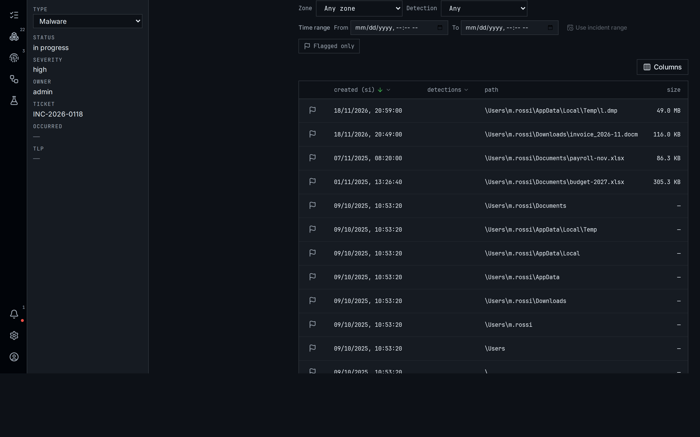
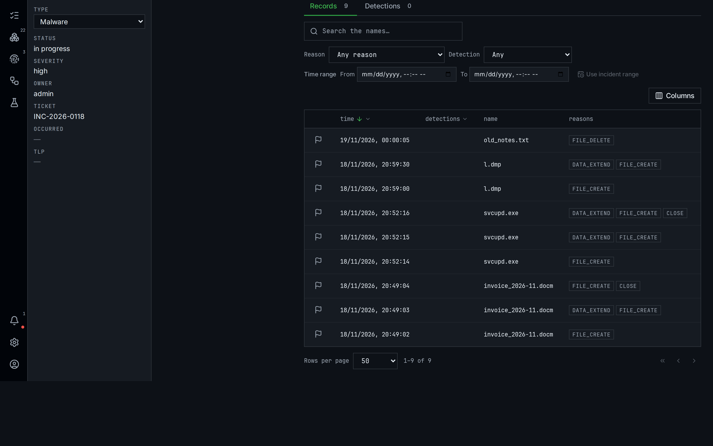

# Disk (NTFS)

Read the file table and the change journal of an NTFS volume: which files existed, and when they were made, changed and deleted.

**Evidence › Disk (NTFS).** Two files, one tab each.

| File   | What it is                                                                                                             | Time of a record              |
| ------ | ---------------------------------------------------------------------------------------------------------------------- | ----------------------------- |
| `$MFT` | The master file table: one entry for every file and folder of the volume, deleted ones too until their entry is reused | The creation time of the file |
| `$J`   | The change journal (USN): one record each time a file is created, written, renamed or deleted                          | The time of the change        |

## Collect them

They are hidden and locked on a running system.

- **`$MFT`**, in the root of the volume. With KAPE, use the target `$MFT`. With Velociraptor, `Windows.KapeFiles.Targets`. With FTK Imager, `[root]\$MFT`, then Export Files. From an image, with The Sleuth Kit: `icat image.dd 0 > MFT`.
- **`$J`**, the data stream of `\$Extend\$UsnJrnl`. It is sparse: keep the zeros. With KAPE, the target `$J`. With Velociraptor, `Windows.KapeFiles.Targets`. With FTK Imager, `[root]\$Extend\$UsnJrnl`, then `$J`. Collectors name it `$J`, `$UsnJrnl_$J` or `C_$Extend_$UsnJrnl_$J`.

## Read the `$MFT`

1. Add the file. Nik reads the entries in order and rebuilds the path of each from its parents.
2. The cards say the number of **Entries**, how many are **Deleted**, the **Time span**, and the disk records of both files together.
3. In **Records**, search the paths and filter by **State**, **Entry type**, **Alternate stream**, **Zone**, **Detection** and time.

Things to know about a row:

- A **deleted** entry is a file that was deleted and not yet overwritten.
- An **alternate stream** called `Zone.Identifier` says the file came from the Internet: its **Zone** is 3, and the stream holds the address.
- Each entry has two sets of times: **standard information** and **file name**.

### The timestomp hint

Attackers change the times of a file to hide it. The tools that do this change the standard-information times and not the file-name times, which only the system writes. A row whose standard-information creation time is **before** the file-name one carries a warning sign.

!!! warning "A hint, not a detection"
    The sign says only that the two sets of times do not agree. A file copied with its times does the same. No rule runs on it and it is not counted as a detection. Open the record in the [viewer](viewer.md) and read both sets.

## Read the `$J`

1. Open the **`$J`** tab.
2. Each record has the name of the file, its entry, its parent and the **reasons**: `FILE_CREATE`, `DATA_EXTEND`, `RENAME_NEW_NAME`, `FILE_DELETE`, `CLOSE`…
3. Search for a name to see its life: created, written, closed, deleted.

The records of both files are in the [Timeline](timeline.md) when its **Kind** is **Disk**, and in the [global search](search.md#global-search).

!!! note
    `$MFT` was checked against a real volume. `$J` was tried on files made for the tests: see [What Nik has and has not been tried on](host.md#what-nik-has-and-has-not-been-tried-on).

## Related

- [Host evidence](host.md)
- [Collections](collections.md)
- [Timeline](timeline.md)
