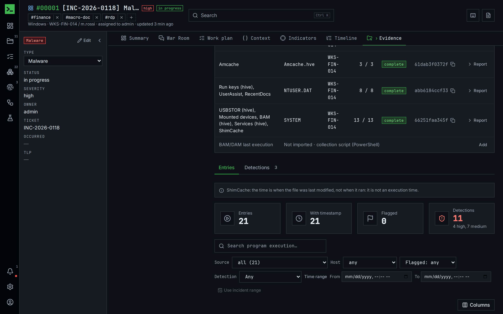
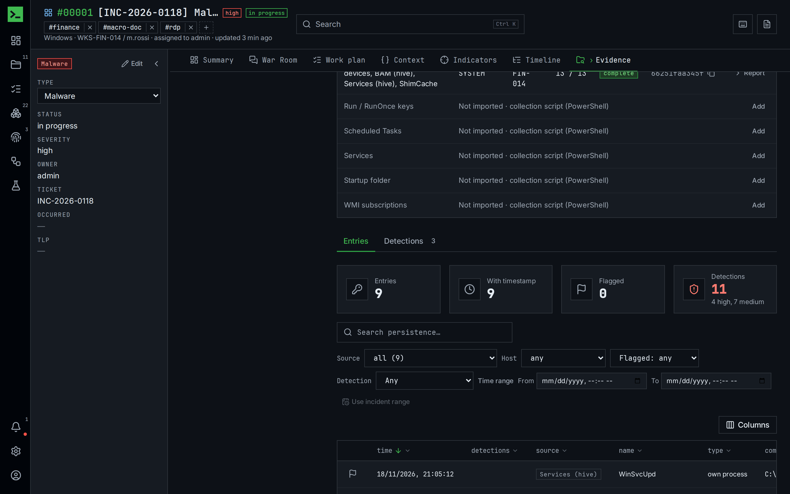

# Endpoint artifacts

Read what a machine remembers about programs that ran, files that were opened, devices that were plugged in and what starts by itself.

**Evidence › Endpoint Artifacts.** Five categories are chosen at the top, each with a count. The sources a category offers depend on the system of the incident ([Host evidence](host.md#the-system-of-the-incident)).

| Category                 | What it answers                         |
| ------------------------ | --------------------------------------- |
| **Program Execution**    | What ran                                |
| **Persistence**          | What starts by itself                   |
| **File & Folder Access** | What was opened                         |
| **USB & Devices**        | What was plugged in                     |
| **Network usage**        | How much each program sent and received |

## Add a source

1. Open the category.
2. In **Sources**, find the source you have. A grey row says where its file is on the system. **Collection scripts** gives native scripts for sources that have one.
3. Press **Add files**, or drop the file on the window.

A registry hive is added **once**: one hive file fills several rows of the list. The rows marked _(hive)_ turn into records as the keys are read.

Any source also takes the CSV or the JSON that a DFIR tool produces for it.

## Every source

The time of a record is not always the time of the thing you want. The last column says what the time means.

| Source                         | What it is                                                    | Where it is on the system                                                                                                                                          | What the time is                                           |
| ------------------------------ | ------------------------------------------------------------- | ------------------------------------------------------------------------------------------------------------------------------------------------------------------ | ---------------------------------------------------------- |
| **Prefetch**                   | The program that ran, how many times, the files it loaded     | `C:\Windows\Prefetch\*.pf` (often disabled on servers)                                                                                                             | One record for each of the last run times the file keeps   |
| **ShimCache** (AppCompatCache) | Programs the system looked at                                 | The `SYSTEM` hive                                                                                                                                                  | **The modification time of the file**, not the time it ran |
| **Amcache**                    | Programs, with their SHA-1, size and publisher                | `C:\Windows\appcompat\Programs\Amcache.hve`                                                                                                                        | The time the key was written                               |
| **BAM**                        | The last run of a program, by user                            | The `SYSTEM` hive                                                                                                                                                  | The last execution                                         |
| **UserAssist**                 | Programs run from the desktop: count and time in focus        | `NTUSER.DAT`                                                                                                                                                       | The last execution                                         |
| **Run keys**                   | Programs that start at sign-in                                | `SOFTWARE` and `NTUSER.DAT`                                                                                                                                        | The time the key was written                               |
| **Services**                   | Services, with their image path and account                   | The `SYSTEM` hive                                                                                                                                                  | The time the key was written                               |
| **LNK**                        | A shortcut: the target, its times, the volume and the machine | `C:\Users\<user>\AppData\Roaming\Microsoft\Windows\Recent\*.lnk`                                                                                                   | The target's times, as the shortcut recorded them          |
| **Jump lists**                 | The files an application opened, pinned or not                | `...\Recent\AutomaticDestinations\*.automaticDestinations-ms` and `...\CustomDestinations\*.customDestinations-ms`. Keep the file name: it is the application's id | The last access                                            |
| **RecentDocs**                 | The documents the user opened                                 | `NTUSER.DAT`                                                                                                                                                       | The time the key was written                               |
| **USBSTOR**                    | USB storage: vendor, product, serial                          | The `SYSTEM` hive                                                                                                                                                  | First install, last arrival and last removal               |
| **Mounted devices**            | Drive letters and volumes                                     | The `SYSTEM` hive                                                                                                                                                  | None                                                       |
| **SRUM**                       | Network use and applications, by hour                         | `C:\Windows\System32\sru\SRUDB.dat`, locked on a live system                                                                                                       | The hour                                                   |

Other sources, from scripts or exports: BAM/DAM, scheduled tasks, services, the Startup folder and WMI subscriptions on Windows; cron, SSH `authorized_keys`, shell startup files and enabled systemd units on Linux; LaunchAgents and LaunchDaemons, cron and KnowledgeC on macOS; the `setupapi` log and the kernel's USB events.

!!! warning "ShimCache is not an execution time"
    The time of a ShimCache record is when the file was last modified. A file in the cache may never have run. Read it with Prefetch, Amcache and BAM.

## Registry hives

A hive is **one file, several sources**. Give Nik the file; it recognises the kind and writes the records of every source that is in it.

| Hive          | Where                                       | Sources read from it                               |
| ------------- | ------------------------------------------- | -------------------------------------------------- |
| `SYSTEM`      | `C:\Windows\System32\config\SYSTEM`         | ShimCache, BAM, services, USBSTOR, mounted devices |
| `SOFTWARE`    | `C:\Windows\System32\config\SOFTWARE`       | Run keys                                           |
| `NTUSER.DAT`  | `C:\Users\<user>\NTUSER.DAT`                | Run keys, UserAssist, RecentDocs                   |
| `Amcache.hve` | `C:\Windows\appcompat\Programs\Amcache.hve` | Amcache                                            |

Windows locks these files. Copy them with KAPE, Velociraptor, FTK Imager, `reg save`, or from a shadow copy.

!!! note "Hives that were not closed cleanly"
    The `.LOG1` and `.LOG2` files that go with a hive are **not applied**. The newest changes of a hive that was not closed cleanly may be missing, and the parse report says so.

## Network usage

The **Network usage** category reads `SRUDB.dat`, the database of the System Resource Usage Monitor. Each row is an hour of use: the program, the user, the interface, the bytes sent and received. It answers _which program sent 3 GB out last Tuesday_. The logs of the database are not replayed, so the last hours before the copy may be missing.

## The page

The page shows the totals (**Entries**, **With timestamp**, **Flagged**, **Detections**), then **Entries** and **Detections** as two tabs. Filter by source, host, flag, detection and time. The flag marks a record as malicious. **Source** opens the [viewer](viewer.md). A clock marks activity outside working hours.

Rules that read these records are the Sigma rules of **nik / endpoint**: a program run from a temporary folder, a double extension, a living-off-the-land binary. See [Detection and rules](detection.md).

## Related

- [Host evidence](host.md)
- [Collections](collections.md)
- [Detection and rules](detection.md)
