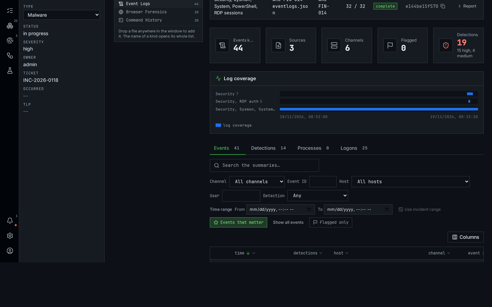
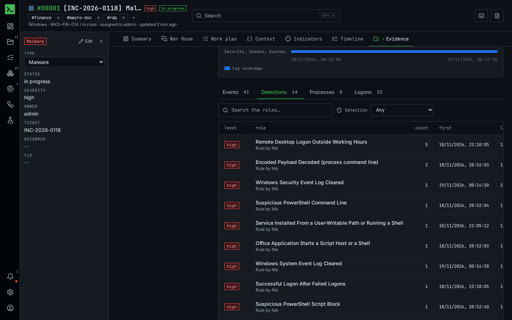
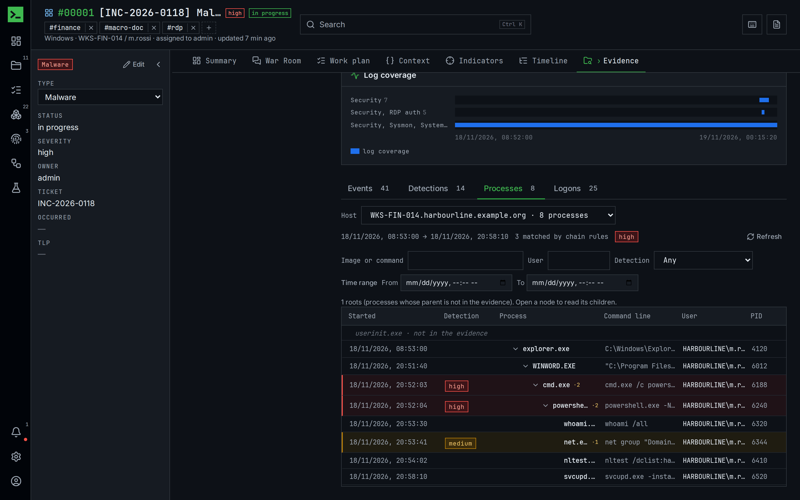
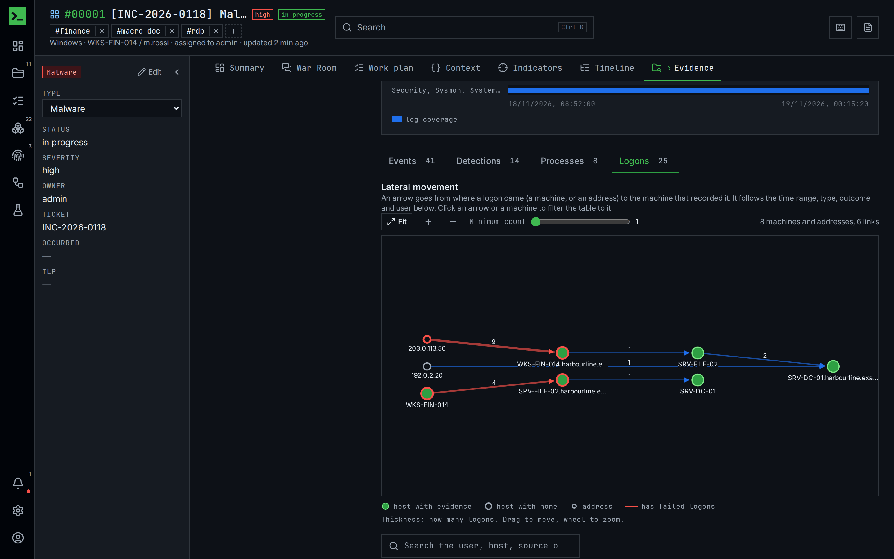
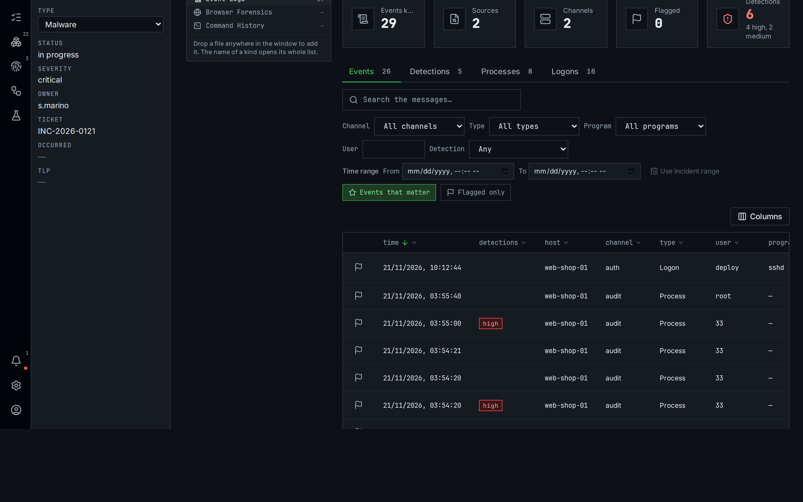

# Event Logs

Read the Windows event logs of a machine, and the logs of a Linux or macOS machine, with the detections, the processes and the logons they hold.

**Evidence › Event Logs.** The page is the same for the three systems; the sources it expects depend on the system of the incident. See [Host evidence](host.md) for the parse report, the original and what a file read in part means.

!!! note "You need"
    The **analyst** role to add files, and the role **Evidence** (permission `evidence.download`) to download an original. A viewer reads.

## Windows

1. Copy the `.evtx` files from the machine (or from a disk image). They are in `C:\Windows\System32\winevt\Logs`. The channels Nik names are Security, System, PowerShell (and its classic log), Sysmon, Task Scheduler, Defender and the two Remote Desktop channels.
2. Or, on a live machine, run the PowerShell script that **Where to find these files** shows, as administrator. It writes `nik-eventlogs.json` with the events that matter.
3. Drop the files on the window, or press **Add files** in **Sources — Windows event logs**.

The server keeps the original, reads every event and recovers records left in the file after a log was cleared. A file from the script is not the whole log, and a note says so.

The page shows, from the top:

- **Sources**: one row per file, with its channels, host, **Kept / in file** and its **Report**.
- The totals: **Events kept**, **Sources**, **Channels**, **Flagged** and **Detections**, with the number of high and medium.
- **Log coverage**: for each file, the span it covers. A hole is a time with no event. Compare it with the suspicious window of the incident.
- Four parts: **Events**, **Detections**, **Processes** and **Logons**.

## Events

A table of every record, a page at a time. Use the search box, the filters (for example channel, category and **Detection**, and a time range), and **Use incident range**. The clock marks a record outside business hours: set the hours and the time zone in [Business hours](detection.md#working-hours-and-the-time-zone).

- The menu of a column header sorts, filters on a value, hides the column and **Stack values**: see [Stacking](stacking.md).
- The flag marks a record as malicious; **Add a note…** in the row's menu comments it.
- **Source** on a row opens the [source viewer](viewer.md): the record in its original.

## Detections

The **Detections** part lists the rules that matched, one row per rule: the **level**, the **rule** and its author, the **count**, the time of the **first** and of the last match. Filter the **Events** by **Detection** to see the records. The same list is in the parse report of each file.

A detection never changes the severity of the incident.

## Processes

Nik links the process events of a host in a tree: Security 4688 and 4689, Sysmon 1 and 5, and the audit log's `execve` on Linux. The host list at the top says how many processes each machine has.

1. Choose the **Host**.
2. Open a node to read its children. A process whose parent is not in the evidence shows a grey line (_not in the evidence_): the parent is a ghost, and its children are roots.
3. Filter by image or command line, by user, by **Detection**, or by time.

The line above the table says how many processes were matched by **chain rules**: Sigma rules that read a process with its parent and ancestors, like _Office Application Starts a Script Host or a Shell_. See [Process chains](detection.md#process-chains).

A file read before 7.0 has no processes: press **Analyse again** on its row.

## Logons

The **Logons** part pairs logons with their logoffs (4624, 4625, 4634, 4647, 4648, 4672, 4778, 4779 and the Remote Desktop events 21, 24, 25 and 1149, and `sshd` on Linux). Each row has the user, the type, the source address, the outcome and the duration.

Above the table, the **lateral movement graph** draws one node per host or address and one arrow per source and target.

- A green node is a host you have evidence of. A hollow node is a host with none. A small dot is an address.
- The thickness is the number of logons. A red arrow has failed logons.
- Drag to move, use the wheel to zoom.

!!! note
    A machine can be two nodes: one under its name and one under the address it logged on from. The graph does not know that they are the same machine.

## Linux and macOS

On an incident whose system is Linux or macOS, the page expects these files:

| Source              | Where it is                                                              | How to collect it                                                                               |
| ------------------- | ------------------------------------------------------------------------ | ----------------------------------------------------------------------------------------------- |
| Auth log            | `/var/log/auth.log` (Debian, Ubuntu) or `/var/log/secure` (RHEL, Fedora) | Copy the file and its rotated copies. Unpack a `.gz` first                                      |
| Journal             | The systemd journal                                                      | `journalctl -o json --since "2026-11-01" > journal.json` (one object a line, not `json-pretty`) |
| Audit log           | `/var/log/audit/audit.log`, root only                                    | Copy it as it is                                                                                |
| Unified log (macOS) | The system's log store                                                   | `sudo log show --style ndjson --last 7d > unified.ndjson`, or `--archive system.logarchive`     |

The lines of an auth log carry no year: Nik takes it from the date of the file and says which year it assumed. A line that is not syslog is a skip in the report, with its offset.

The records are logons, failed logons, `sudo`, accounts, sessions, processes (an `execve` of the audit log) and other lines. The same four parts are there. The macOS log is read for keywords only: its records have no process or logon, so no process tree.

## Related

- [Host evidence](host.md)
- [Detection and rules](detection.md)
- [Source viewer](viewer.md)
- [Timeline](timeline.md)
- [Stacking](stacking.md)
