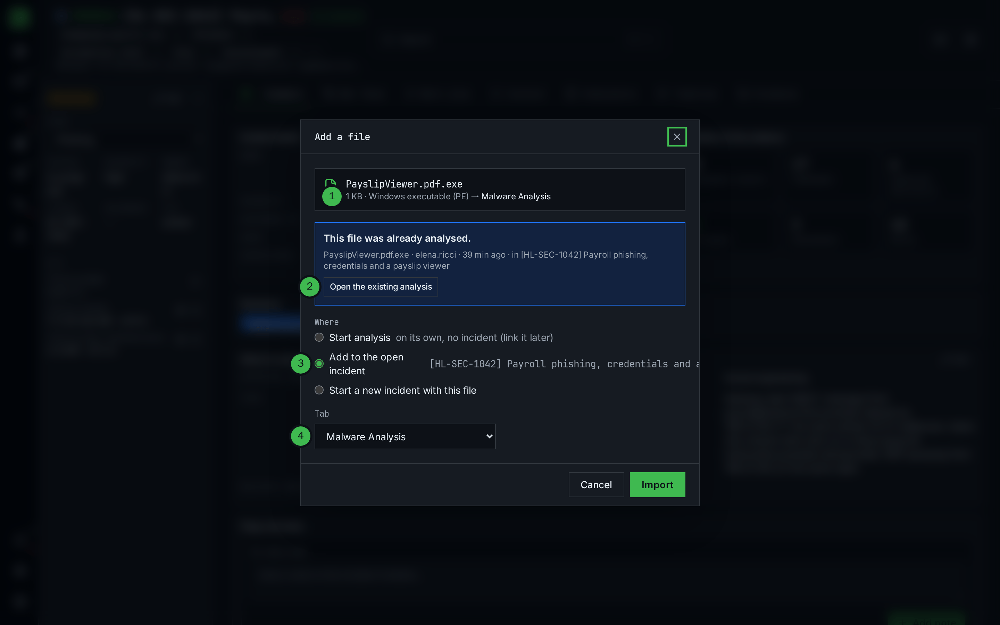
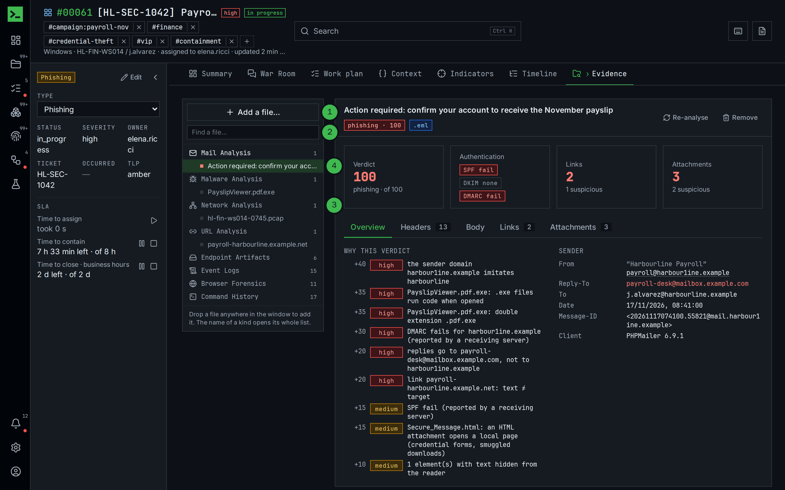
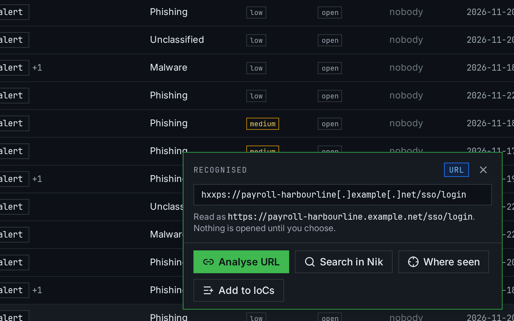
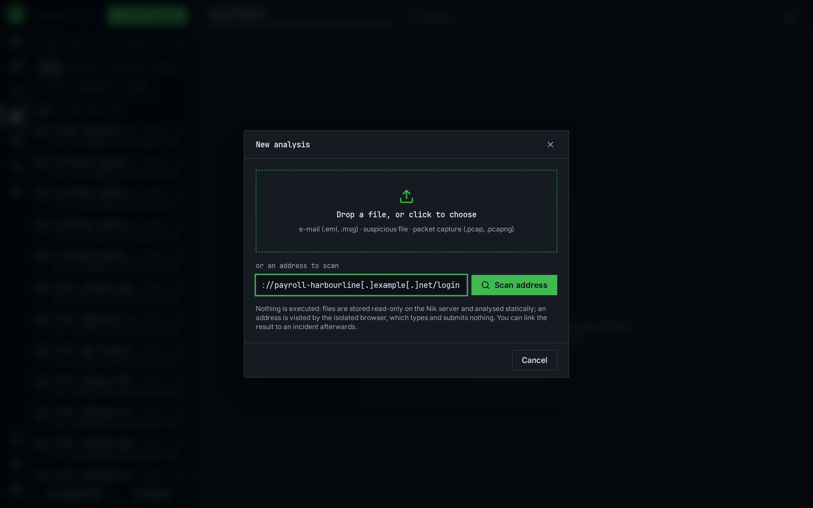
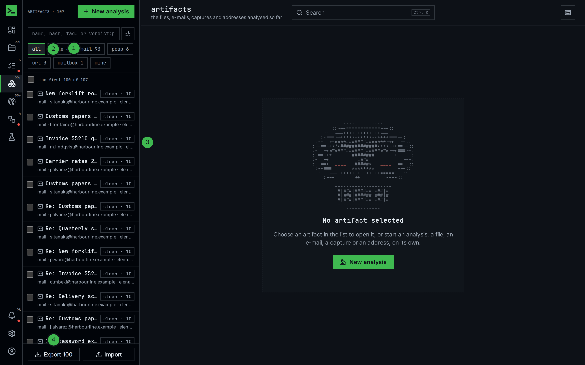
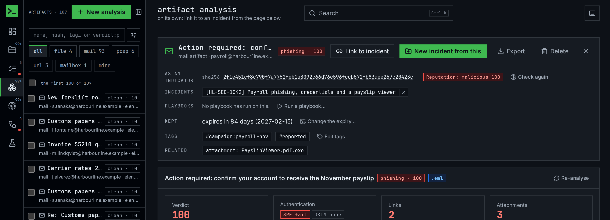
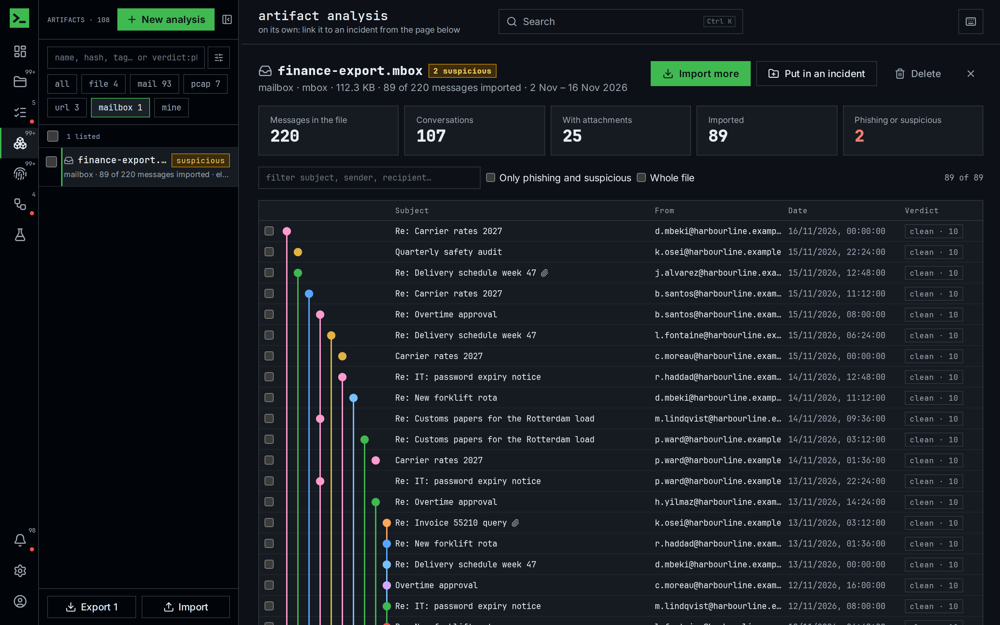

# Add evidence

Bring a file, a mailbox, an address or a piece of text into Nik, in an incident or on its own.

Nik never runs what you give it. Files are stored read-only on the server and analysed statically; an address is visited by the [isolated browser](url.md#the-isolated-browser-window), which types, clicks and submits nothing.

## Four ways in

| How | Where | What happens |
|---|---|---|
| **Drop a file anywhere** in the window | Any screen | Nik reads the file's name and first bytes, proposes where it goes, and asks. |
| **Add a file…** | The top of the [Evidence tab](#the-evidence-tab) | The same, for who cannot drag a file. |
| **New analysis** | The **Artifacts** panel, the incident list | A file or an address, analysed with no incident. See [Analyse without an incident](#analyse-without-an-incident). |
| ++ctrl+v++ or drag selected text | Any screen, outside a text field | Nik offers what to do with an address or an indicator. See [Paste or drag text](#paste-or-drag-text). |

!!! note "You need"
    The **analyst** role (permission `write`) to add evidence. A **viewer** sees everything, adds nothing. See [Accounts, roles and sign-in](accounts.md).

## Drop a file

1. Drop the file anywhere in the window.
2. The **Add a file** dialog opens. Its first line names the file and what Nik recognised 1 (for example *Windows executable (PE) → Malware Analysis*).
3. If Nik has seen this file before, it says **This file was already analysed**, with who added it and in which incidents. **Open the existing analysis** opens it instead 2.
4. Under **Where**, choose 3:
    - **Start analysis** — on its own, no incident (link it later). Only for e-mails, suspicious files and captures.
    - **Add to the open incident** — the incident you are on.
    - **Start a new incident with this file** — the dialog asks the name and the fields of the new incident.
5. Check **Tab** 4, and the source when the tab needs one (**Browser** and **File**, **Shell**, **Category** and **Source**, or **Format**).
6. Press **Start analysis**, **Import**, or **Create incident and import**.

A file Nik cannot place says *not recognised: choose where it goes*: pick the **Tab** yourself.

### What Nik recognises

| The file | Goes to |
|---|---|
| `.eml`, a message saved without extension, Outlook `.msg` | [Mail Analysis](mail.md) |
| An executable (PE, ELF, Mach-O), a PDF, an Office document, a script, an archive | [Malware Analysis](malware.md) |
| `.pcap`, `.pcapng` (gzip too) | [Network Analysis](network.md) |
| Windows `.evtx`, the `nik-eventlogs.json` of the collection script | [Event Logs](host.md#event-logs) |
| Chrome `History`, `Shortcuts`, `Bookmarks`; Firefox `places.sqlite`; Safari `History.db`, `Downloads.plist`, `Bookmarks.plist` | [Browser Forensics](host.md#browser-forensics) |
| `.bash_history`, `.zsh_history`, `fish_history`, `ConsoleHost_history.txt` | [Command History](host.md#command-history) |
| An mbox, an Outlook PST, an archive of a Maildir | A [mailbox](#mailboxes-mbox-maildir-pst), stored at once, no dialog |
| A list of indicators (text, CSV, STIX 2.1, MISP, Nik's export) | The **Add indicators** dialog of the [Indicators page](indicator-library.md#add-one-or-many) |

!!! tip
    A file that holds indicators but is evidence (a CSV export of a tool, for example) opens **Add indicators** first. Press **Not indicators? Place the file in a tab** to drop it as evidence instead.

### Where a file is read

- **In your browser**: browser databases, plists, shell histories, CSV and JSON exports. The raw file never leaves your machine; only the entries reach the server.
- **On the server**: e-mails, mailboxes, suspicious files, packet captures, `.evtx` logs. They are stored, then analysed without ever being run.

### Size limits

| Evidence | Largest file | Set by |
|---|---|---|
| Suspicious file, e-mail | 100 MB | `SAMPLE_MAX_MB` |
| Packet capture | 500 MB | `PCAP_MAX_MB` |
| Host evidence sent to the server (`.evtx`, tool output) | 500 MB | `ARTIFACT_MAX_MB` |
| Mailbox (mbox, Maildir archive) | 2048 MB | `MAILBOX_MAX_MB` |
| Outlook PST | 4096 MB | `PST_MAX_MB` |
| A file of indicators | 5 MB | fixed |

An administrator changes them: see [Environment variables](../reference/configuration.md).

## The Evidence tab

The **Evidence** tab of an incident lists everything it holds, kind by kind.

- 1 **Add a file…** chooses a file from the disk.
- 2 **Find a file…** narrows the list by name, sender or kind.
- 3 **The name of a kind** (Mail Analysis, Malware Analysis, Network Analysis, URL Analysis, Endpoint Artifacts, Event Logs, Browser Forensics, Command History) opens the whole kind: its own list, where files are added, compared and removed. The number beside it counts the files or records.
- 4 **A file** opens alone, in the page of its kind. A small square in front of it shows its verdict: red for high or phishing, amber for medium or suspicious.

Right-click a file for **Open**, **Open in the list of …**, **Copy the name** and **Copy the detail**. Drag the edge of the list to resize it.

**Remove** in the page of a file takes it out of this incident. The file stays as an [artifact](#analyse-without-an-incident).

!!! note
    Endpoint Artifacts, Event Logs, Browser Forensics and Command History need the incident's operating system. See [Host evidence](host.md#the-system-of-the-incident).

## Paste or drag text

1. Press ++ctrl+v++ outside a text field, or drag selected text onto the app.
2. When Nik recognises an address or an indicator, a panel opens at the bottom right: **RECOGNISED**, its kind, and the text as you gave it.
3. Choose:

| Button | What it does | Offered for |
|---|---|---|
| **Analyse URL** / **Analyse as URL** | The isolated browser visits it (a domain as `https://<domain>/`) | An address, a domain |
| **Open the analysis** | Opens what Nik already analysed (*Already analysed: …*) | The SHA-256 of a file or an e-mail Nik holds |
| **Search in Nik** | Opens the [search](search.md) on the value | Every kind |
| **Where seen** | Opens the indicator's window: its reputation and the incidents that hold it | Every kind |
| **Add to IoCs** | Opens **Add indicators** with the value | Every kind |

Nothing is opened until you choose. ++esc++ or the × closes the panel.

- **Defanged text** is read as meant: `hxxps://payroll-harbourline[.]example[.]net/sso/login`, `203.0.113[.]66`, `payroll[at]payroll-harbourline.example.net`. The panel says *Read as …*.
- A **file** on the clipboard is handled like a dropped file.
- **Several values** open **Add indicators** with them.
- Sentences and longer text are ignored.

## Analyse without an incident

Not everything starts as a case. A reported e-mail, a suspicious file, a capture or a link can be analysed on its own. The result is an **artifact**: the same analysis as in an incident, seen by the whole team.

1. Press **New analysis** in the **Artifacts** panel.
2. Drop a file on **Drop a file, or click to choose**, or type an address under **or an address to scan** and press **Scan address**.
3. A file goes on to the **Add a file** dialog, with **Start analysis** chosen. An address opens as a URL artifact while it is scanned.

Host evidence (browser and shell history, endpoint artifacts, event logs) always belongs to an incident.

### The Artifacts page

The **Artifacts** entry of the rail opens `/artifacts`: the list of every artifact at the side, nothing open until you choose one.

- 1 **Filter artifacts** takes text (a name, a hash, a tag) or the [query language](../reference/query-language.md): `verdict:phishing`.
- 2 The chips narrow by kind: **file**, **mail**, **pcap**, **url**, **mailbox**, and **mine** for those you added.
- 3 Each row shows the name, the verdict badge, who added it and when, and its tags.
- 4 **Export** at the foot exports the artifacts listed (500 at most). **Import** (administrators) brings in an archive from another Nik.

Tick rows to act on many at once: tags, **Analyse again**, link or take out of an incident, expiry, **Download together…**, delete. See [Act on many at once](bulk.md).

Right-click a row for **Open**, **Export…**, **Analyse as an e-mail** or **Analyse as a capture** (when the name fits), and **Filter by #tag**.

### The page of an artifact

| Button or row | What it does |
|---|---|
| **Link to incident** | Puts the artifact in that incident's Evidence, indicators, timeline and report. A file or an e-mail can be in several incidents; a capture in one. |
| **New incident from this** | Creates an incident and links the artifact in one step. |
| **Analyse as an e-mail** / **Analyse as a capture** | See [below](#analyse-as-an-e-mail-or-a-capture). |
| **Export** | An archive of the analysis, with or without the original file. See [Download safely](#download-samples-safely). |
| **Delete** | Deletes the file, its analyses and its place in every incident. **Delete permanently** confirms. |
| × | Closes the artifact: back to the list. |
| **AS AN INDICATOR** | The value of the artifact as an indicator, its reputation, **Check reputation**. |
| **INCIDENTS** | The incidents it is in. The × of one takes it out; the artifact stays. |
| **KEPT** | Its expiry. See [When an artifact is deleted](#when-an-artifact-is-deleted). |
| **TAGS** | Free labels (a campaign, a family, a customer). **Add tags** / **Edit tags**, separated by spaces. |
| **RELATED** | Where it comes from and what was taken out of it: the e-mail an attachment came from, the objects extracted from a capture, the browser session of a scan. |

Under these rows is the same analysis as in the incident's tab.

### Analyse as an e-mail or a capture

A file that is really a message (`.eml`, `.msg`) or a packet capture (`.pcap`, `.pcapng`) can come in as a plain file: a connector downloaded it, an archive held it, a message carried it.

1. Open the file's artifact. The button **Analyse as an e-mail** or **Analyse as a capture** is there only when the file's first bytes say it fits.
2. Press it. Nik makes the e-mail or the capture an upload of the same file would have made, and opens it.

The new artifact goes to the incidents the file is in (a capture only when there is one). The file stays as it is; each shows the other under **RELATED**.

## Analyse again

The analysis engine and the rules change. To read a stored item again with what Nik has now:

| Where | Button |
|---|---|
| A sample in Malware Analysis | **Re-analyse** (runs the analysis, YARA, the disassembler and capa again) |
| An e-mail in Mail Analysis | **Re-analyse** (repeats the DNS checks; applies [Mail analysis](mail.md#what-the-mail-settings-change) settings) |
| A capture in Network Analysis | **Re-analyse** |
| An address in URL Analysis | **Re-scan** (visits it again) |
| Many artifacts | **Analyse again** in the bulk menu of the Artifacts panel |

A sample or an e-mail analysed by an older engine says so, with **Re-analyse now**.

## Download samples safely

A sample is never served as it is. **Download zip** (in Malware Analysis, or **Download zip…** in the right-click menu of a sample) opens a dialog:

1. Choose **Standard password: infected** or **Custom password** (shown to you only now; Nik does not keep it).
2. Press **Download <name>.zip**.

The file arrives in an AES-encrypted zip, so mail filters and antivirus do not block it on the way. The download is written to the audit log.

!!! warning
    Open what is in the zip only inside an isolated analysis machine.

**Export** of an artifact offers **Analyses only** (verdicts, indicators, tags: safe to send) or **Analyses and the original files**, which puts the files in an encrypted zip inside the archive, password `infected`. Objects of a capture and scripts of a page download the same way.

## When an artifact is deleted

An artifact is kept until someone deletes it, unless it is given a date.

1. On the artifact's page, row **KEPT**, press **Set an expiry…** (or **Change the expiry…**).
2. Choose **In 30 days**, **In 90 days**, **In 1 year**, or a date and **Set**. **Never** takes the date away.

On that day Nik deletes the artifact as **Delete** would, and writes it in the audit log. Seven days before, the event `artifact.expiring` fires once (see [Events](../reference/events.md)).

!!! note
    An artifact that an incident **not closed** still references is not deleted. Its date is put off by a week, and the row **KEPT** says why.

For a mailbox, the file and its index go; the e-mails imported from it stay. **Platform settings › System › Storage** lists the artifacts with a date, the soonest first.

## Mailboxes (mbox, Maildir, PST)

A file of many e-mails is an artifact of its own.

1. Drop an **mbox**, an Outlook **PST**, or a zip or tar archive of a **Maildir**. Nik looks inside an archive for its `cur` and `new` folders; any other archive stays a file to analyse.
2. Nik stores it and reads its index. A large one shows how far it is: *Converting… 41 %* for a PST or a Maildir, then *Indexing… 41 % · 7,400 messages*.
3. The page shows **Messages in the file**, **Conversations**, **With attachments**, **Imported**, **Phishing or suspicious**. Nothing is analysed yet.

!!! tip
    If an archive of a Maildir is taken for a file to analyse, put "maildir" or "mailbox" in its name.

### Import messages

1. Press **Import messages** (later **Import more**).
2. Narrow what to take: the dates, **Sender or domain**, **Subject contains**, **Only with attachments**, **Take the whole conversation of each match**. A click on a name under **Main senders** fills the sender.
3. The dialog counts the messages before you start. Press **Import N messages**.

Each message becomes an e-mail artifact with its verdict, as if you had dropped its `.eml`. At most 500 go at a time, the newest first; when more match, the page says how many were left and **Import the next 500** goes on.

### The graph of conversations

- A row per message, newest first, joined to the message it answers. A colour is a conversation; two lines leaving one message are two answers, or an answer and a forward.
- A **hollow node** is a message of the file not imported: select it and **Import this message**.
- Selecting a row shows the message below: **From**, **To**, **Date**, **Answers**, **Answered by**. **Open the e-mail** opens its analysis; **Show only this conversation** narrows the graph to one thread.
- **Only phishing and suspicious** and **Whole file** (every message, imported or not) change what is listed.

### Put the messages in an incident

1. Tick rows to send only some (or none, for all).
2. Press **Put in an incident** (or **Put N in an incident**), choose the incident, press **Put all N** / **Put the N selected**.

The messages go to the incident's Evidence, under Mail Analysis. Only the phishing and suspicious ones add indicators: a mailbox is mostly ordinary mail.

**Delete** removes the file and its index; the e-mails imported from it stay.

## Indicators and artifacts

An **indicator** is a value and what the sources say about it. An **artifact** is what Nik saw when it analysed something itself. Each leads to the other:

- The artifact's page has **AS AN INDICATOR**: its value, its reputation, **Check reputation**.
- The indicator's window has the analysis by Nik, or the offer to analyse an address. See [Indicators of an incident](indicators.md#the-window-of-an-indicator).
- Right-click a URL anywhere: **Analyse URL**, or **Open the analysis** and **Scan again** when Nik has it.

## Move artifacts to another Nik

1. Tick artifacts (or export the list shown), press **Export**, choose what goes in, **Download the archive**.
2. On the other Nik, an administrator presses **Import** in the Artifacts panel and **Choose the archive** (`nik-artifacts-….zip`).

The other Nik adds what it does not have, with analyses and tags, and leaves the rest. Nothing is run. A mailbox travels only with its file.

## Related

- [Work an incident](incidents.md)
- [E-mail](mail.md) · [Malware](malware.md) · [Network capture](network.md) · [Links](url.md) · [Host evidence](host.md)
- [Act on many at once](bulk.md)
- [Indicators of an incident](indicators.md)
- [How each analysis works](../reference/architecture.md)
