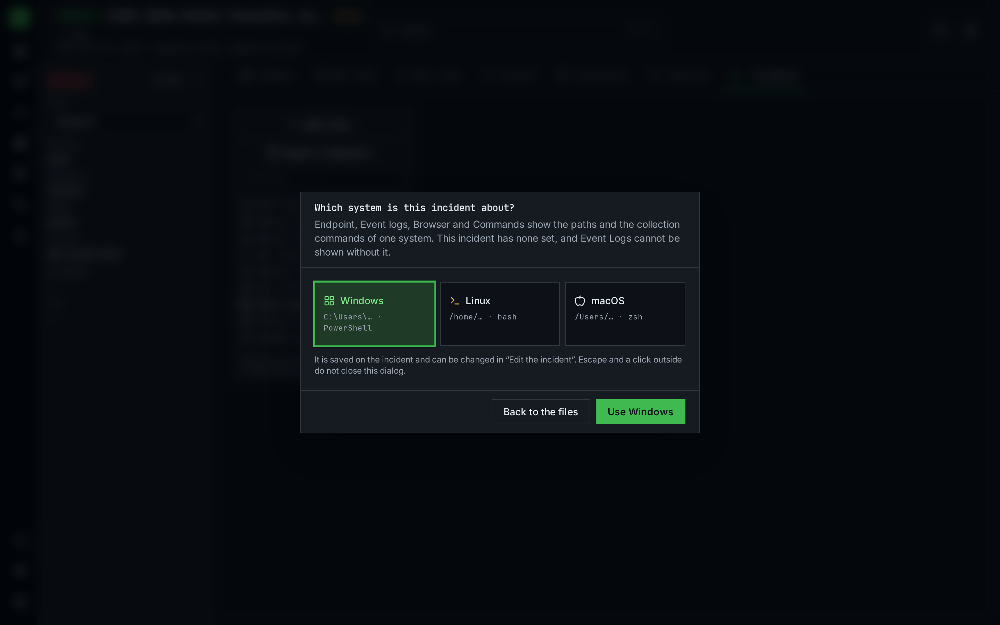
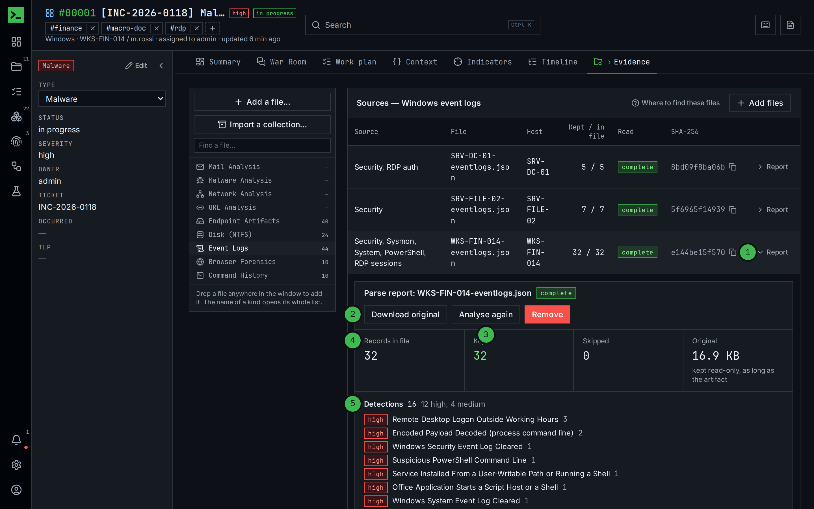
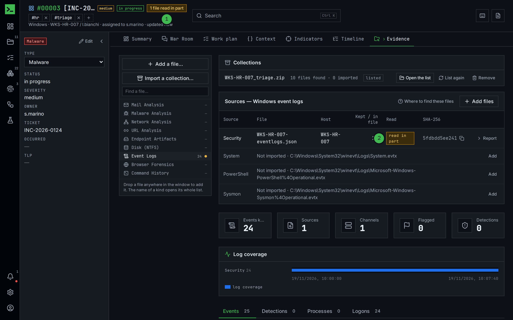

# Host evidence

Import what was collected on a machine and read it in one place, with the original of every record one click away.

Host evidence is the files of a machine: event logs, browser history, shell history, endpoint artifacts, the NTFS tables of a disk, and whole collections made by a triage tool. It always belongs to an incident. It sits in **Evidence**, beside the e-mails, samples, captures and addresses.

| Page                              | What it reads                                                                                 |
| --------------------------------- | --------------------------------------------------------------------------------------------- |
| [Event Logs](eventlogs.md)        | Windows event logs; Linux and macOS logs. Detections, processes, logons and the lateral graph |
| [Browser Forensics](browser.md)   | The history, downloads, bookmarks and shortcuts of six browsers                               |
| [Command History](command-history.md) | The history files of Bash, Zsh, Fish and PowerShell                                           |
| [Endpoint Artifacts](endpoint.md) | Registry hives, Prefetch, LNK, jump lists, SRUM and more                                      |
| [Disk (NTFS)](disk.md)            | `$MFT` and `$J`                                                                               |
| [Collections](collections.md)     | A KAPE or Velociraptor zip, a Plaso export                                                    |

Around them: the [source viewer](viewer.md), the [Timeline](timeline.md) and [Stacking](stacking.md). Rules that flag records are in [Detection and rules](detection.md).

## Files are no longer read in your browser

Before 7.0 a browser history or a shell history was read on your machine, and only the entries went to the server. **That is gone.** Every file of host evidence is now sent to the server as it was given, and read there.

1. The **original** is kept on the server, read-only, with its SHA-256. It is never changed.
2. A worker container with no network access, **forensics**, reads it. Each file is read by a child process with limits on time and memory.
3. What it read goes to the tables of the incident, and a **parse report** says what was read and what was not.

Your file therefore leaves your machine and is kept, as e-mails and samples already were. Do not give Nik a file you may not store. The pages read the records from the server, a page at a time, so a big incident does not have to be loaded in your browser.

| Limit                     | Value    | Set by              |
| ------------------------- | -------- | ------------------- |
| One file of host evidence | 8192 MB  | `EVIDENCE_MAX_MB`   |
| One collection (a zip)    | 20480 MB | `COLLECTION_MAX_MB` |

Big files go up in parts and can be resumed. Nik checks the free space before it takes a file. A file the incident already holds, with the same SHA-256 and the same source, is not read twice: the screen says **already imported** and **Show its row** opens the row it has. The API of 6.x for uploading (`POST /incidents/{id}/upload`) still works, up to 500 MB.

## Import a file

1. Drop the file anywhere in the window, or press **Add a file…** at the top of the Evidence tab. Nik proposes the kind and the source. See [Add evidence](evidence.md#drop-a-file).
2. Or open the kind and use its **Sources** table. It lists what the page expects, with where it lives on the machine, and **Add files** chooses one.
3. A file given without a source is recognised by the server from its name and its first bytes. A disk image or a `.plaso` file is refused, with what to do: see [Collections](collections.md#what-is-refused).

A dropped `.zip` or `.lnk` still goes to [Malware Analysis](malware.md), as before: use **Import a collection…** for a triage zip.

## The system of the incident

The pages show the paths and the collection commands of one operating system. The first time one is opened on an incident that names none, Nik asks.

1. Open **Evidence › Event Logs** (or any other host page).
2. **Which system is this incident about?** Choose Windows, Linux or macOS.
3. Press **Use**. It is saved on the incident; change it with **Edit** in the incident's facts.

**Back to the files** leaves without choosing.

## The sources table and the parse report

Each page starts with its **Sources**: one row per file, with the host, **Kept / in file**, the state of the reading and the SHA-256. A grey row is a file the page expects and does not have yet.

1. **Report** opens the parse report of a file.
2. **Download original** gives the file back, as it was given. It needs the permission `evidence.download` (the role **Evidence**). It comes in an encrypted zip, password `infected`, and each download is written to the audit log.
3. **Analyse again** reads the original again with the current rules. Flags and notes stay.
4. **Records in file**, **Kept** and **Skipped**: how many records the file holds, how many Nik kept, and how many it left out. The report also says how many were duplicates, which parts were skipped and why, and gives notes.
5. **Detections**: the rules that matched this file. See [Detection and rules](detection.md).

**Remove** deletes the file and its records from the incident. A file with the same bytes can be added again.

A parser that is improved offers **Analyse again** on the files read by its older version. The parsers of event logs, Linux and macOS logs and Plaso exports became version 2 in 7.0 (they now write processes and logons): files read before offer it.

## A file read in part

A file can stop being readable half way: a cut download, a damaged table. Nik keeps what it read before the break and says so in three places.

- The row says **read in part**.
- The incident's header says **1 file read in part**.
- The Evidence list marks the kind with a yellow dot.

1. Read the report: it says where the file stopped and why.
2. Get a whole copy and add it, if you can.
3. Or press **Seen** and write a note. The warning goes away, and the note goes to the audit log and the War Room.

Nothing marks it seen for you.

## Flags and notes

On every record of every host page:

- The flag column marks a record as malicious (**Flag as malicious**). Flagged records go in the [report](reports.md).
- **Add a note…** in the row's menu (right click) keeps a comment on the record.

Flags and notes belong to a record's key, which is stable, so they stay when you press **Analyse again**.

## Evidence from before 7.0

Host evidence that was in an incident when you upgraded is moved to the tables in the background. Its files show **imported before 7.0**: there is no report and no original. Add the file again to have both.

## Addresses from the evidence

An address found in host evidence (a visited page, a bookmark, a download source) is never a live link.

- The arrow next to it asks first, shows the address defanged, and offers to copy it that way.
- Only `http` and `https` addresses can be opened at all, and doing so contacts the site **from your workstation**.

!!! tip
    To look at a page safely, scan it in [URL Analysis](url.md): the isolated browser visits it, not you.

## Where it goes

- Every timestamped record joins the incident's [Timeline](timeline.md).
- Addresses, domains, URLs and hashes found in the records join the incident's [Indicators](indicators.md).
- A match of a rule is a **detection**, shown on the record, in the report of its file and on the Timeline. A file with detections of level medium or higher adds one line to the War Room.

## What Nik has and has not been tried on

!!! warning "What Nik has and has not been tried on"
    **Tried on real data:** an `.evtx` file of Windows; an `$MFT`, checked field by field against a volume written by `ntfs-3g`; registry hives (the public sample hives of the regipy project, Windows 7 and Windows 10); Prefetch, LNK, jump lists and SRUM (`SRUDB.dat`), by hand on the test files of Plaso.

    **Tried on data made for the tests only:** `$J`; KAPE and Velociraptor zips; Plaso exports; Linux logs; the macOS unified log (the patterns of its messages were written from memory); anything from Windows 11 24H2.

    **Known limits:**

    - The `.LOG1` and `.LOG2` files of a registry hive are not applied: the newest changes of a hive that was not closed cleanly may be missing.
    - SRUM logs are not replayed.
    - ShimCache's time is the modification time of the file, not the time it ran.
    - A correlation rule counts within one file.
    - The same machine can be two nodes of the lateral graph, when it appears once by address and once by name.
    - VHDX, VHD, E01 and `.plaso` files are not opened.
    - A member of a zip that is encrypted with AES is not opened.

    **Speed**, measured on a developer's machine with PostgreSQL 18, default settings, a disk volume: about 5,300 to 7,000 records a second at import (5,300 sustained over 10,000,000 records, loaded in 31 minutes); 300,000 processes linked and judged in about 90 seconds; a Sigma rule costs 0.05 ms a record with 3,000 rules loaded. At 1,000,000 records every screen answers in under 0.8 s; at 10,000,000, see [Size and speed](../admin/install.md#size-and-speed).

    Your files may differ. Check what a parse report says, and keep the original.

## Related

- [Add evidence](evidence.md)
- [Summary, timeline and War Room](war-room.md)
- [Detection and rules](detection.md)
- [Indicators of an incident](indicators.md)
- [Reports and exports](reports.md)
- [Upgrading to 7.0](../admin/upgrades.md#upgrading-to-70)
- [Architecture](../reference/architecture.md)
