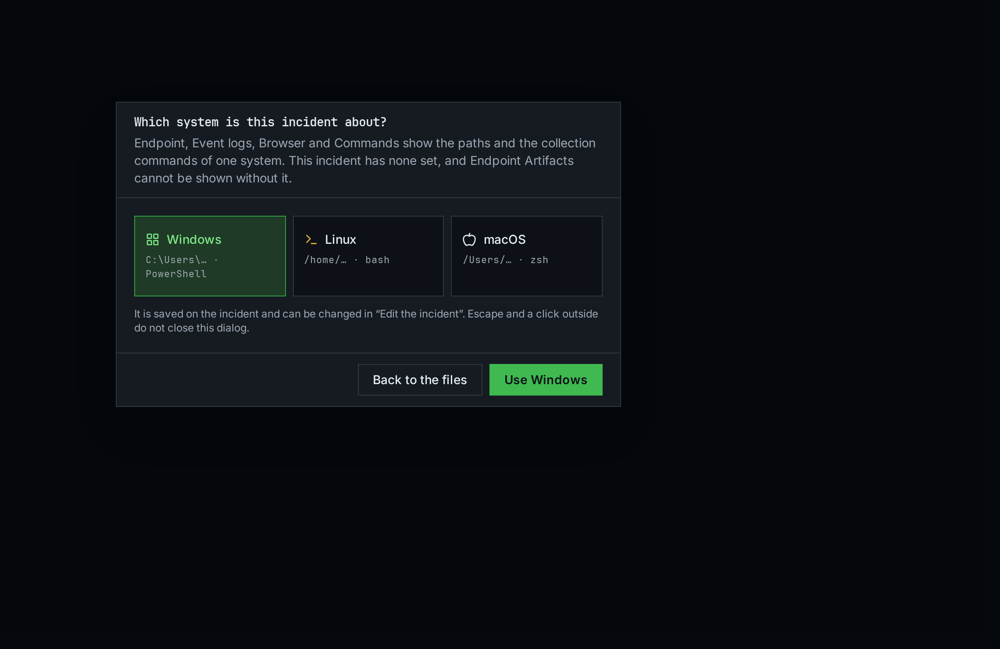
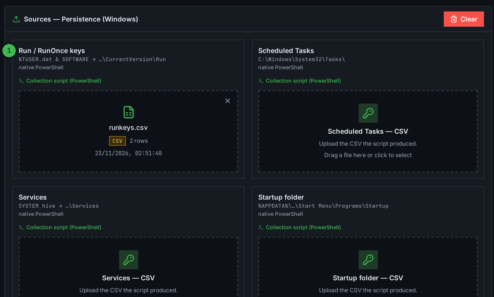
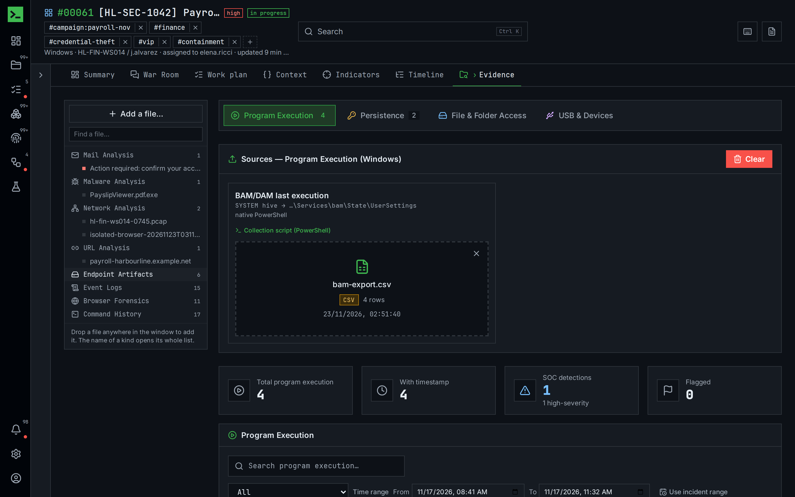
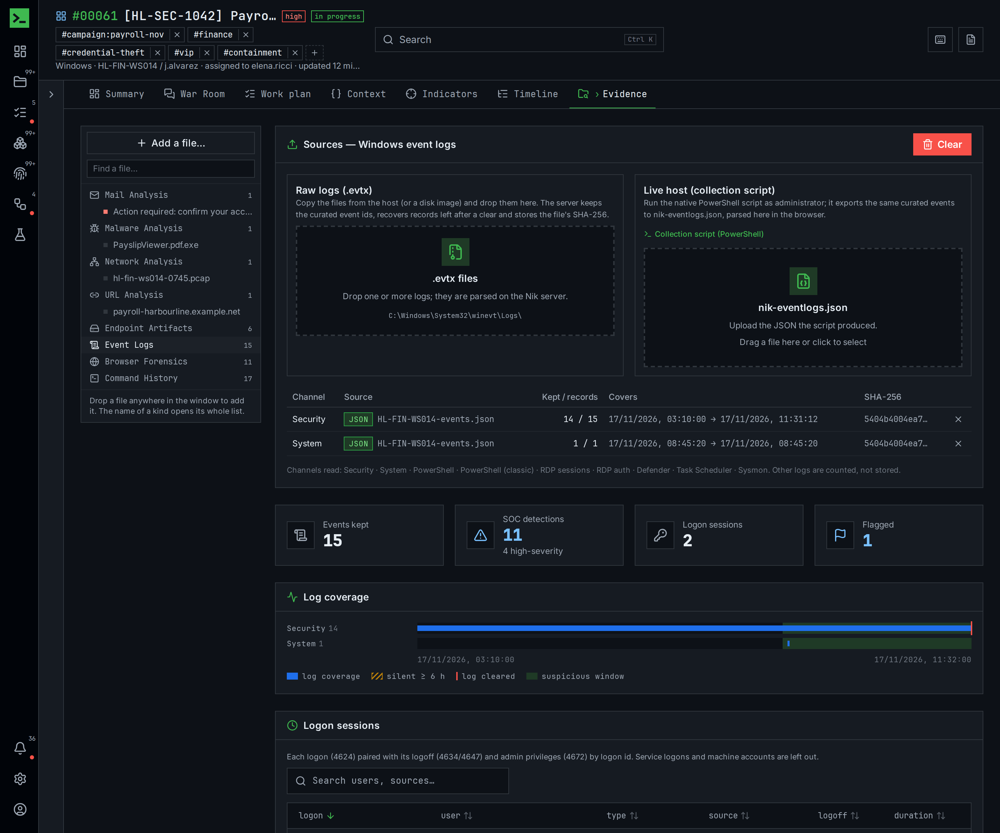
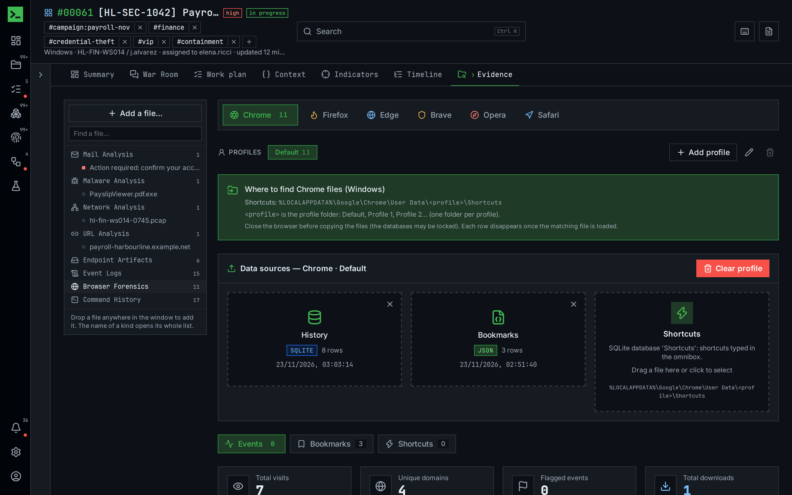
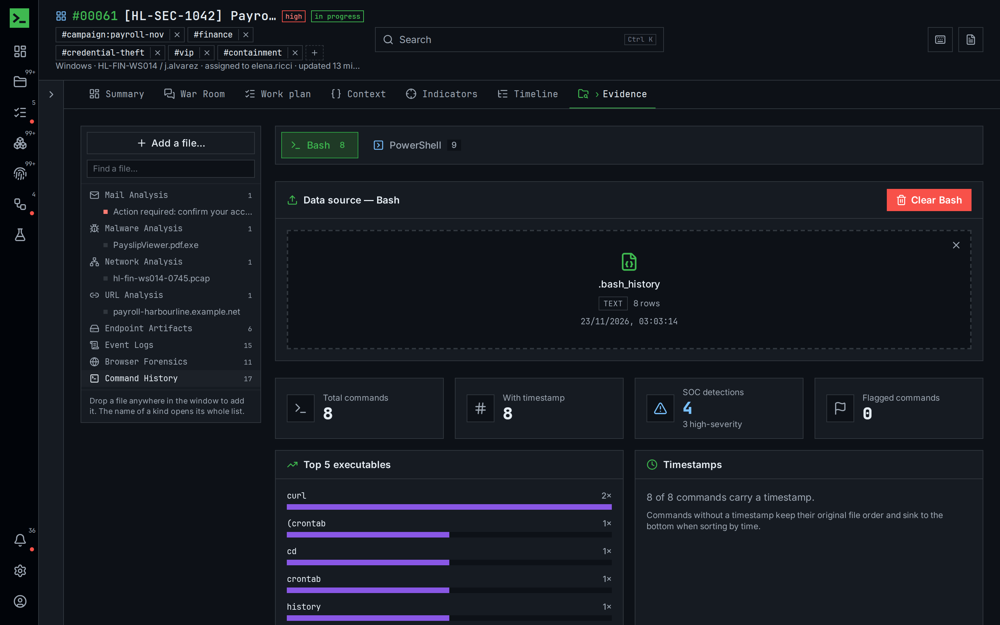

# Host evidence

Import what was collected on a machine (endpoint artifacts, Windows event logs, browser history, shell history) and read it in one timeline with the rest of the incident.

These four kinds are in **Evidence**, beside the e-mails, samples, captures and addresses. They always belong to an incident: they cannot be analysed on their own.

## Where each file is read

| Kind | Read | What reaches the server |
|---|---|---|
| **Endpoint Artifacts** (CSV or JSON of the script or a DFIR tool) | In your browser | The entries |
| **Event Logs**, `.evtx` | On the server | The file, parsed there |
| **Event Logs**, `nik-eventlogs.json` of the collection script | In your browser | The entries |
| **Browser Forensics** (SQLite, JSON, plist, CSV/JSON export) | In your browser | The entries |
| **Command History** (the shell's history file) | In your browser | The entries |

A file read in your browser never leaves your machine: only what was read from it does. The largest `.evtx` is 500 MB (`ARTIFACT_MAX_MB`).

## The system of the incident

The four kinds show the paths and the collection commands of one operating system. The first time one is opened on an incident that names none, Nik asks.

1. Open **Evidence › Endpoint Artifacts** (or Event Logs, Browser Forensics, Command History).
2. **Which system is this incident about?** Choose Windows, Linux or macOS.
3. Press **Use**. It is saved on the incident and not asked again; change it with **Edit** in the incident's facts.

**Back to the files** leaves without choosing; nothing is saved. Someone who may not change the incident can only go back.

## Import a file

1. Drop the file anywhere in the window: Nik proposes the kind and the source. See [Add evidence](evidence.md#drop-a-file).
2. Or open the kind and use its **Sources** card (**Data sources** in Browser Forensics): it says where the file lives on the host, gives a native script that collects it, and has a drop zone for each source.

1 the source, 2 where it lives on the host, 3 the collection script to copy, 4 the drop zone.

## Endpoint Artifacts

Four categories, chosen at the top:

| Category | Sources, for example |
|---|---|
| **Program Execution** | BAM/DAM last execution (Windows), KnowledgeC app usage (macOS) |
| **Persistence** | Run / RunOnce keys, Scheduled Tasks, Services, Startup folder, WMI subscriptions (Windows); cron, SSH authorized_keys, shell rc / profile, enabled systemd units (Linux); LaunchAgent / LaunchDaemon, cron (macOS) |
| **File & Folder Access** | GTK recently-used (Linux). Windows and macOS have no source here: LNK, JumpLists and ShellBags need third-party tools. |
| **USB & Devices** | USBSTOR, setupapi log (Windows); kernel USB events (Linux) |

The sources offered depend on the incident's system. Any of them also takes the CSV or JSON a DFIR tool produces.

Each source says where it lives on the incident's system and offers a collection script. Import the CSV or JSON the script, or your DFIR tool, produces.

The page shows the totals, **With timestamp**, **SOC detections** and **Flagged**, then the records. A clock marks activity outside business hours. Flag a record with **Flag as malicious**. The range can be set to the incident's suspicious window.

## Event Logs

1. In **Sources — Windows event logs**, drop the `.evtx` files under **Raw logs (.evtx)**, or the JSON of the script under **Live host (collection script)**.
2. Nik keeps about fifty event IDs that matter: logons, process creation, services, scheduled tasks, accounts, PowerShell, RDP, Defender, Sysmon. Records left in the file after a log was cleared are recovered and marked.

- 1 The table of logs: **Channel**, **Source**, **Covers**. A badge marks records recovered after a clear.
- 2 **Log coverage**: each log's span, its silences and clears, against the suspicious window.
- 3 **Logon sessions**: logons paired with their logoffs, with user, type, source and duration. A badge marks special privileges (4672).
- 4 **Events**: filter by **Only flagged by SOC**, **High severity**, **Outside hours**, by category and by channel.

A ruleset flags log clearing, brute force, RDP outside business hours and more. See [Detection and rules](detection.md).

## Browser Forensics

One tab per browser (**Chrome**, **Firefox**, **Edge**, **Brave**, **Opera**, **Safari**), each with its **profiles**. **Rename profile** names one.

1. Open the browser's tab and the profile.
2. In **Data sources**, import the history, downloads, bookmarks and shortcuts as the browser keeps them (Chrome's `History`, `Bookmarks`, `Shortcuts`; Firefox's `places.sqlite`; Safari's `History.db`, `Downloads.plist`, `Bookmarks.plist`), or a CSV/JSON export.
3. Read **Events** (visits, searches, redirects, downloads), **Bookmarks** and **Shortcuts**.

## Command History

One tab per shell: **Bash**, **Zsh**, **Fish**, **PowerShell**.

1. Import the native history file (`.bash_history`, `.zsh_history`, `fish_history`, `ConsoleHost_history.txt`).
2. Commands with a timestamp join the timeline.
3. The detection engine marks download-and-execute, encoded payloads, reverse shells and other tradecraft.

## Addresses from the evidence

An address found in host evidence (a visited page, a bookmark, a download source) is never a live link.

- The arrow next to it asks first, shows the address defanged, and offers to copy it that way.
- Only `http` and `https` addresses can be opened at all, and doing so contacts the site **from your workstation**.

!!! tip
    To look at a page safely, scan it in [URL Analysis](url.md): the isolated browser visits it, not you.

## Where it goes

Every timestamped record joins the incident's **Timeline**, with the events inside the suspicious window standing out. Addresses, domains, URLs and hashes found in the records join its [Indicators](indicators.md).

## Related

- [Add evidence](evidence.md)
- [Summary, timeline and War Room](war-room.md)
- [Detection and rules](detection.md)
- [Indicators of an incident](indicators.md)
- [Architecture](../reference/architecture.md)
