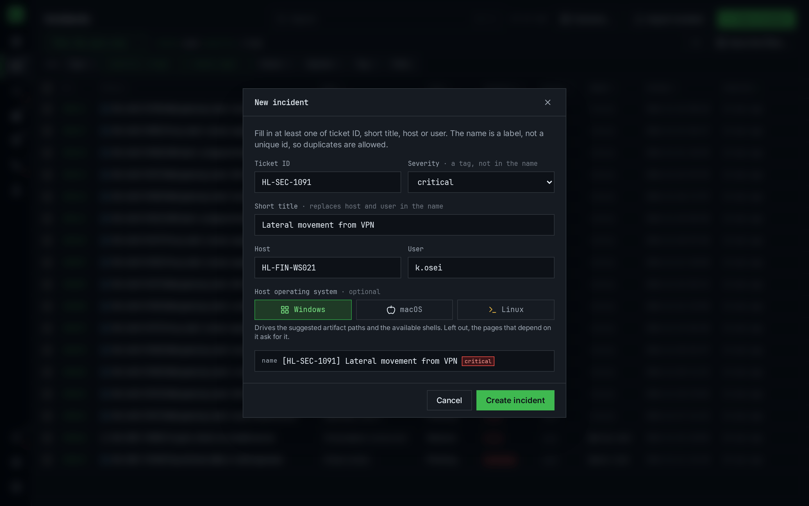
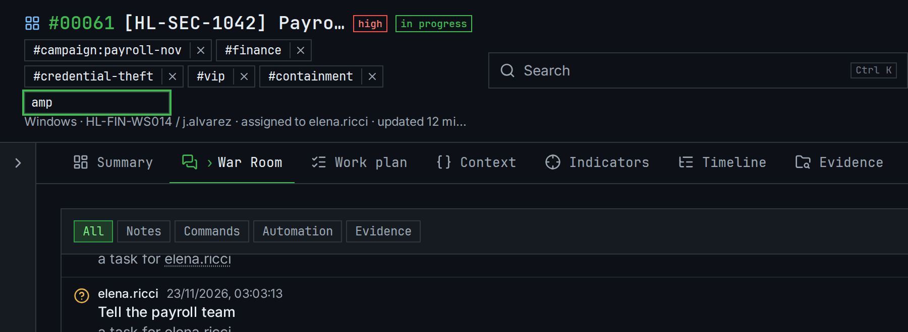
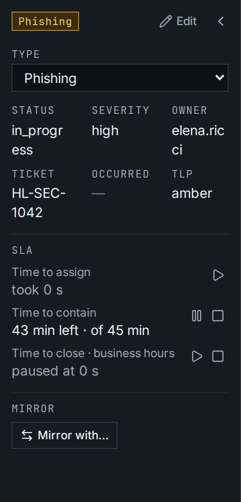
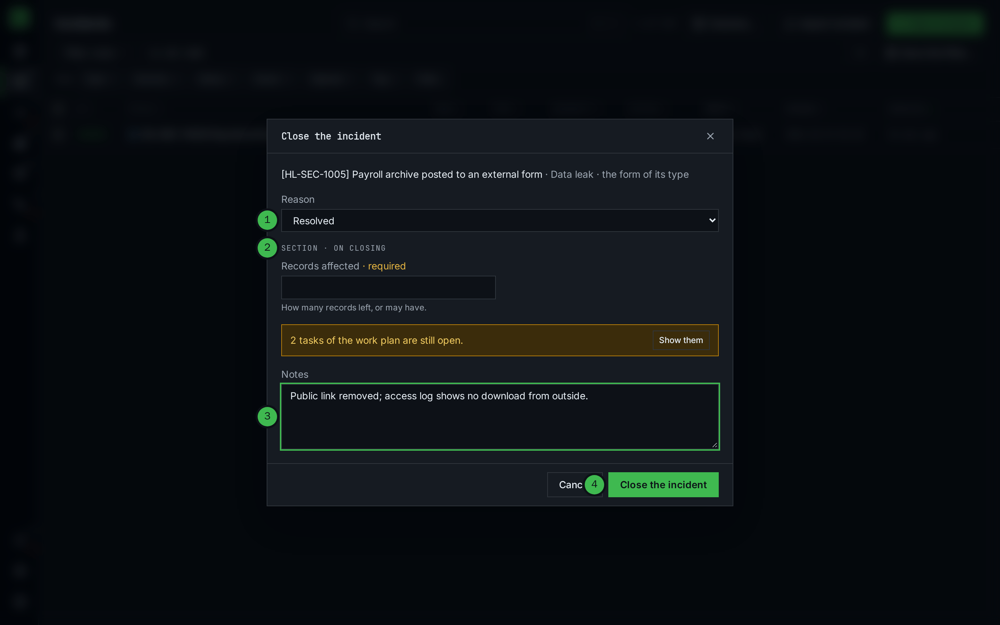
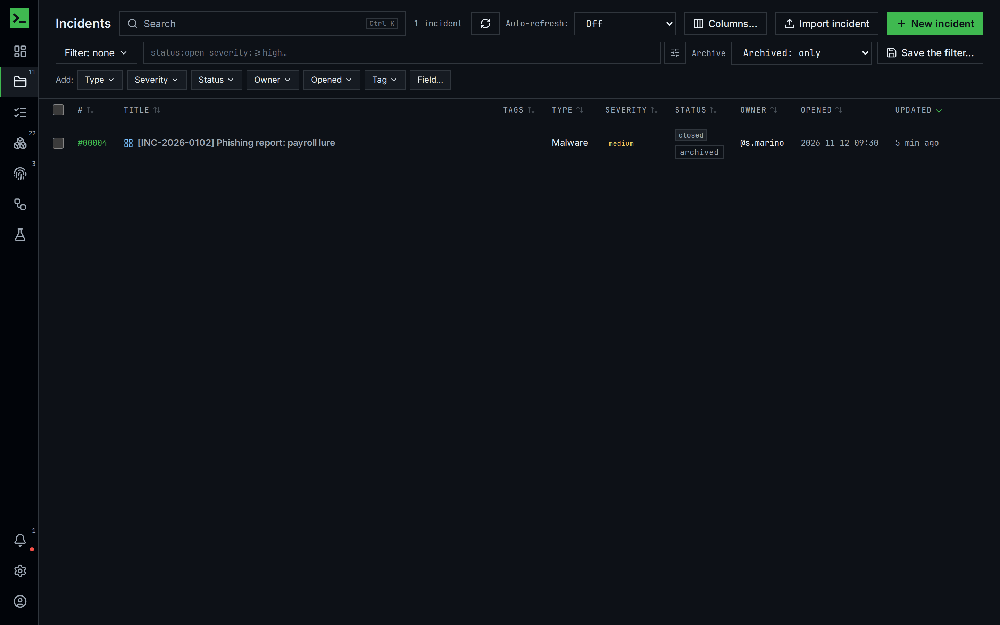

# Work an incident

Create an incident, set who has it and how serious it is, fill in its fields, and close it with a reason.

An **incident** is one case: one machine or one user under investigation, and everything found about it.

## Create an incident

1. In **Incidents**, click **New incident** (or right-click the list › **New incident…**).
2. Fill in at least one of these:

    | Field | What to write |
    |---|---|
    | **Ticket ID** | Its id in your tracker: `HL-SEC-1091` |
    | **Short title** | Replaces host and user in the name: `Lateral movement from VPN` |
    | **Host** | The machine: `HL-FIN-WS021` |
    | **User** | The account: `k.osei` |

3. Pick the **Severity**. It is a tag, never part of the name.
4. If the case is about a machine, pick its operating system. It decides the artifact paths, shells and collection scripts Nik suggests. You can leave it out: the pages that need it ask the first time.
5. Click **Create incident**. The incident opens on its **Summary**.

Other ways an incident is born: a file dropped with **Create incident and import** ([Add evidence](evidence.md)), **New incident from this** on an artifact, a connector that fetches alerts ([Connectors and mirroring](connectors.md)), a playbook, the [API](../reference/api.md).

### Its name and its number

- **The name** is built from the fields: the ticket in brackets, then the title, or `host - user` without a title. `[HL-SEC-1042] Payroll phishing, credentials and a payslip viewer`. Two incidents may have the same name.
- **The number** is given at creation, in order, and never reused: `#00061`. Use it to find the incident:
    - type `#61` in the search (++ctrl+k++);
    - write `number:61` in a query;
    - open `/incident/61`.

## Status, severity, owner

| | Values | Change it |
|---|---|---|
| **Status** | open, in progress, closed | **Edit the incident**, the right-click menu (**Mark as in progress**, **Mark as closed**…), the quick view, `/close` |
| **Severity** | low, medium, high, critical | **Edit the incident**, the facts column |
| **Owner** | an analyst, or nobody | **Assign to me** (right-click or quick view), **Edit the incident**, `/assign @elena.ricci` in the War Room |

1. On the **Summary**, click **Edit the incident**.
2. Change **Status**, **Severity**, **Assigned to**, and the **Suspicious activity · start** / **end** if you know them.
3. Click **Save**.

The **suspicious window** (start and end) highlights the events inside it everywhere, the Timeline included.

To change many incidents at once, select them: see [Act on many at once](bulk.md).

## Type

The **type** of an incident (Phishing, Malware, Network intrusion…) decides its fields, the page of its Summary, the order of its tabs, its close form and its timers. An incident given no type is **Unclassified**.

1. Open the incident.
2. In the facts column, pick another type in the select under **Type**.

Every value the incident holds is kept. What the new type does not show is hidden, not lost.

Types are made by administrators: see [Types, fields and pages](types.md).

## TLP

The **TLP** field (clear, green, amber, amber+strict, red) says how far what is in the incident may travel.

- Set it in the facts column, with **Edit**, or for many incidents with **Set the TLP…**.
- The values of a **TLP:RED** incident are never sent to threat-intelligence sources.
- The report has its own **Classification**: see [Reports and exports](reports.md).

## Tags

Tags are short words that say what an incident belongs to: a campaign, a customer, a kind of case. They are chips under the incident's name, in the list and in the quick view.

1. Click **+** next to the tags. An input opens and offers the tags other incidents carry.
2. Type a tag, or choose one with the arrows. Press ++enter++.
3. To remove one: click its **×**, or press ++backspace++ in the empty input for the last one.
4. ++esc++ closes the input.

Each change is saved at once and written to the audit log.

!!! info "How a tag is written"
    Lower case (`Phish` is kept as `phish`); a letter or a digit, then letters, digits and `. _ : -`; 40 characters at most. A leading `#` is dropped; spaces become `-` (`data leak` is `data-leak`). Twelve tags per incident at most. In types, mappers, playbooks and the API the field is named `labels`.

Filter by tag with the **Tag** chip, or `tag:finance` in a query: see [Search, filters and saved views](search.md).

## Fields

Beyond the details above, an incident holds the **fields** its type lists, in sections on its Summary.

1. On the Summary, find the section.
2. Click its **Edit**.
3. Fill in the fields. **Required** ones are marked.
4. Click **Save**.

The facts column has its own **Edit** for the fields shown there.

Fields are defined under **Platform settings › Incidents › All fields**: see [Types, fields and pages](types.md).

## SLA timers

When the type of the incident times it, **SLA** in the facts column shows what is left of the time to assign, to contain and to close, or by how much it is over.

- Each timer has **Pause**, **Start** and **Stop** for whoever may change incidents.
- Past its time the incident is marked and its owner is told by the bell.
- `slaBreached:true` in a query finds those that ran over.

The times are set per type and severity under **Platform settings › Incidents › SLA** (administrators): see [Types, fields and pages](types.md).

## Close an incident

1. Open the close form, any of these ways:
    - set **Status** to closed in **Edit the incident**;
    - right-click the incident in the list › **Mark as closed**;
    - **Close…** in the quick view;
    - type `/close` in the War Room.
2. Pick a **Reason** 1. The reasons are those of its type; with none, type one.
3. Fill in the sections of the type's close form 2, if it has one. A field marked **required** must be filled to close.
4. Read the line about open tasks of the work plan, if there is one. **Show them** opens the Work plan. It informs; it stops nothing.
5. Write **Notes** 3.
6. Click **Close the incident** 4.

The reason and the notes are stored as `close_reason` and `close_notes`, and the time as `closed`. A closed incident shows them in its facts column, under **Closed**, whatever its type's layout shows. Query them: `closeReason:"False positive"`, `closed:>=now-30d`.

!!! note "The server checks too"
    An incident closed through the API or by a playbook is held to the same reason and required fields.

To close many at once with one reason, see [Act on many at once](bulk.md).

## Reopen an incident

1. Right-click the incident › **Mark as open** (or **Mark as in progress**), or set **Status** in **Edit the incident**.

The closing time is cleared. The reason and notes stay until it is closed again.

## Archive an incident

An incident that is closed and will not be worked on again can be **archived**. Archiving keeps what matters and drops what weighs.

- **Dropped:** the host records of the incident (the rows of its event logs, browser history, endpoint artifacts and disk tables) leave the database.
- **Kept:** the original files, their parse reports, the flags and the notes.
- The incident becomes **read-only** and leaves the lists. A strip says **Archived**, who did it and when.

1. Close the incident ([above](#close-an-incident)).
2. Press **Archive** in its header, and read what the question says.
3. To see archived incidents in the list, set the filter **Archived** to **only** (or **include**).

To take an incident out of the archive, press **Take out of the archive** in its header. It becomes writable again and Nik **reads its files again**: the records come back when the reading is done.

Archiving needs the permission `incidents.archive` (the role **Archive**). Two more ways:

- In the list, select incidents and choose **Archive…** from the bulk actions. See [Act on many at once](bulk.md).
- **Platform settings › Incidents › Archiving** can archive by itself the incidents closed for more than a number of days. It is **off** by default.

An archived incident's pages show _Archived: the records are not loaded_.

## Saving, and working on the same incident

There is no Save button on an incident: every change is saved as you make it.

- Several analysts can work on one incident at once. When a colleague saved something meanwhile, Nik reads their version and puts your change on top: a note or a flag added by one never erases the other's.
- If a change cannot be saved (the server is unreachable), a red bar says **Changes not saved yet**. Nik keeps trying; **Retry now** tries at once. Nothing is lost while the window stays open.
- If your session expires, a dialog asks for your password. The screen stays, and what was not saved is saved after you sign in.

## Related incidents

Nik does not merge incidents. To tie them together:

- the **Related incidents** field holds the ids or numbers of others. The **Linked incidents** widget of the Summary lists them, and those that share indicators with this one. See [Summary, timeline and War Room](war-room.md#the-summary).
- **Pre-processing rules** can link an incoming alert to the open incident it belongs to, or close it as a duplicate: see [Connectors and mirroring](connectors.md).
- Right-click an indicator › **Where else was this seen?** lists the other incidents that hold it.

## Mirroring

**Mirror**, in the facts column, keeps the incident in step with a ticket or an alert in another product. See [Connectors and mirroring](connectors.md).

## Delete an incident

1. Right-click it in the list › **Delete…**.
2. Confirm.

Deleting is for mistakes and tests. To keep a record, close it instead.

If someone deletes an incident you have open in another window, Nik takes you back to the list and says "The incident was deleted".

## Related

- [Summary, timeline and War Room](war-room.md)
- [Act on many at once](bulk.md)
- [Reports and exports](reports.md)
- [Types, fields and pages](types.md)
- [Search, filters and saved views](search.md)
- [Add evidence](evidence.md)
