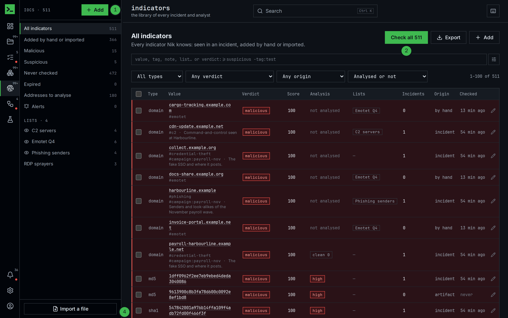
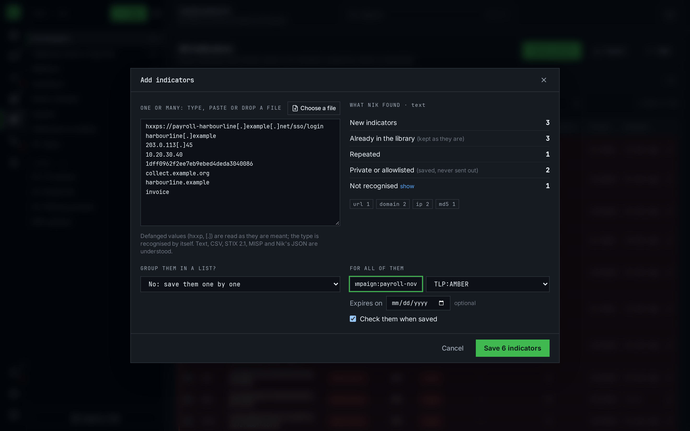
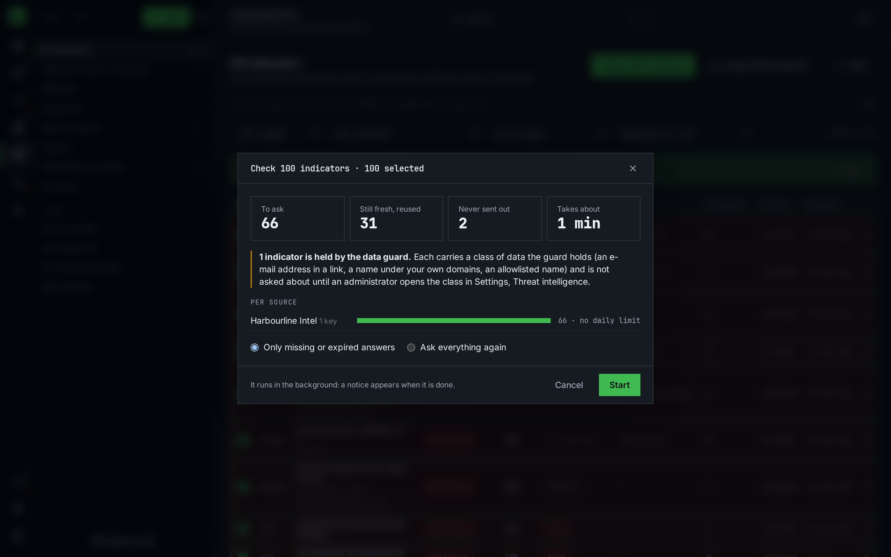
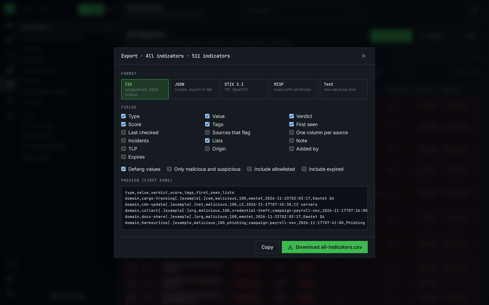
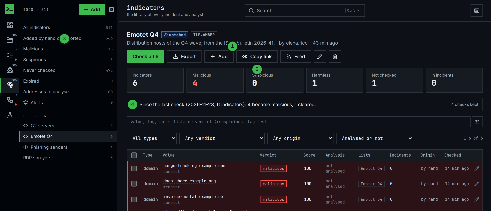

# The Indicators page

Keep every indicator Nik knows in one library: filter it, check it, tag it, group it in lists, watch it, and export it to other tools.

## Open the library

Press **Indicators** in the rail (`/iocs`). The library holds every indicator, whether an incident holds it, an artifact analysed on its own holds it, or an analyst added it.



**The side panel** <span class="step">1</span>:

- **Add** opens [Add indicators](#add-one-or-many); **Import a file** at its foot does the same from a file.
- Quick filters: **All indicators**, **Added by hand or imported**, **Malicious**, **Suspicious**, **Never checked**, **Expired**, **Addresses to analyse**, each with its count.
- **Alerts**: an incident came to hold an indicator of a [watched list](#watch-a-list). A red count, and a red dot on the rail, when there are some.
- **Lists · N**: the [lists of indicators](#lists-of-indicators).
- **Hide the indicators panel** gives the table the whole width; the **Indicators** entry of the rail brings it back.

**The head of the table** <span class="step">2</span>: **Check all N** (or **Check N selected**), **Export** (or **Export N selected**), **Add**.

**The filters** <span class="step">3</span>:

| Filter | Choices |
|---|---|
| **Filter indicators** | A value, a tag, a note, a list, or the [query language](../reference/query-language.md): `verdict:>=suspicious -tag:test` |
| Type | **All types**, or one |
| Verdict | **Any verdict**, **Malicious or suspicious**, **Malicious**, **Suspicious**, **Harmless**, **Never checked** |
| Origin | **Any origin**, **From an incident**, **From an artifact**, **Added by hand** |
| Analysis | **Analysed or not**, **Analysed by Nik**, **Addresses to analyse** |

**The table** <span class="step">4</span>: **Type**, **Value**, **Verdict**, **Score**, **Analysis**, **Lists**, **Incidents**, **Origin**, **Checked**. Click a header to sort. A row is tinted by its verdict only: red for malicious, amber for suspicious.

- Click a value for the indicator's page (see [The window of an indicator](indicators.md#the-window-of-an-indicator)).
- **never sent out** marks a value that never leaves Nik; **held** one the [data guard](indicators.md#when-a-look-up-is-held) holds.
- **Analysis** opens what Nik saw when it analysed the value itself.
- A list name in **Lists** opens that list.

## Add one or many

1. Press **Add**, or drop a file of indicators anywhere in the window, or paste several values on the app.
2. **One or many: type, paste or drop a file**, or **Choose a file** (5 MB at most). Nik reads plain text, CSV with a `value` column, a STIX 2.1 bundle, a MISP event and Nik's own JSON export. Defanged values (`hxxps://evil[.]example`) are read as meant; the type is recognised by itself.
3. Before anything is saved, **What Nik found** says: **New indicators**, **Already in the library** (kept as they are), **Repeated**, **Private or allowlisted** (saved, never sent out), and what was not recognised.
4. **Group them in a list?** **No: save them one by one**, an existing list, or **Yes: a new list…** with its name and **Alert me when an incident holds one of them**.
5. **For all of them**: tags, a note, **Expires on**. Tick **Check them when saved** to check them at once.
6. Press **Save N indicators**.



An indicator the library already has is kept as it is, and joins the list too.

## Edit an indicator

Press the pencil at the end of a row (**Edit <value>**):

| Field | What it does |
|---|---|
| **Tags** | Free labels, separated by spaces. |
| **Note** | What you know about it. |
| **Classification** | **TLP:CLEAR**, **TLP:GREEN**, **TLP:AMBER**, **TLP:RED (never sent out)**. A TLP:RED value is never sent to a source. |
| **Expires on** | Past this day the indicator is marked expired and left out of exports and feeds. |

## Check many

1. Tick rows (or **Select all … that match**), or tick nothing to act on everything the view keeps.
2. Press **Check N selected** or **Check all N**.
3. The dialog counts: **To ask**, **Still fresh, reused**, **Never sent out**, **Takes about**, and **Per source** the requests against what is left of today's quota. Values held by the data guard are counted apart and not asked.
4. Choose **Only missing or expired answers** or **Ask everything again**, and press **Start**.



The check runs in the background, with its progress at the top of the library and **Stop**. When a source's quota is used up the check says **Check waiting** and goes on by itself when the quota resets. Held values read *held* in the table.

!!! note "You need"
    The **analyst** role to check, tag, add and remove. A viewer can filter, export and copy.

## Addresses to analyse

**Addresses to analyse** lists the URLs and domains Nik has not visited yet.

1. Select some and choose **Analyse the addresses…**.
2. **Analyse addresses** shows what will be visited and what is left out (analysed already, not an address, never visited: allowlisted, internal, TLP:RED).
3. Press **Visit N addresses**. The isolated browser visits them one after the other, at most 20 at a time; the others wait for the next time.

A visit is seen by the site. See [Links](url.md).

## Export

1. Press **Export** (or **Export N selected**).
2. Choose the **Format**:

| Format | For |
|---|---|
| **CSV** | A spreadsheet, a SIEM lookup |
| **JSON** | Scripts, and import back into Nik with tags and lists |
| **STIX 2.1** | A TIP, OpenCTI |
| **MISP** | An event with attributes |
| **Text** | One value per line |

3. For CSV and JSON, tick the **Fields**. Type, Value, Verdict, Score, Tags and First seen are ticked at first; the choice is remembered.
4. Tick **Defang values**, **Only malicious and suspicious**, **Include allowlisted**, **Include expired** as needed. **Preview (first rows)** shows the result.
5. Download, or copy it.



**Copy the values**, in the menu of a selection, copies one value per line.

## Lists of indicators

A list is a named group of indicators, with its own page (`/iocs/lists/<id>`). The same indicator can be in several lists.

### Make a list

- Select indicators and choose **Save as a new list…**, or **Save as a list** on an incident's [Indicators tab](indicators.md#keep-share-allowlist).
- Or group them when you [add them](#add-one-or-many).

The form asks **Name**, **Description** (source, campaign, ticket…), **Classification** (the TLP of the list) and **Watch this list**. Press **Make the list**.

### The page of a list



- <span class="step">1</span> Its name, **watched**, its **TLP**, its description and author.
- <span class="step">2</span> **Copy link**, **Feed**, the pencil (**Edit the list**), the bin (**Remove the list**).
- <span class="step">3</span> The counters: **Indicators**, **Malicious**, **Suspicious**, **Harmless**, **Not checked**, **In incidents**.
- <span class="step">4</span> The history of its checks.

| Action | What it does |
|---|---|
| **Add to a list…** (selection) | Puts the selected indicators in a list. |
| **Take out of this list…** (selection, on a list) | Takes them out of the list; they stay in the library. |
| **Remove the list** | Its author or an admin. The indicators stay in the library. |
| Right-click a list in the panel | **Open**, **Add indicators to it…**, **Copy the name**. |

### Watch a list

With **Watch this list** on, Nik raises an alert when an incident comes to hold one of its indicators:

- under **Alerts** in the panel, with a red dot on the rail;
- in the audit log;
- to the `ioc.watch_hit` webhook.

A watch is of a list, not of an indicator: watch an indicator by putting it in a watched list.

### History of the checks

Each time the whole list is checked (**Check all** on its page, or the playbook that checks the watched lists every week), the page says what changed: *since the last check: 4 became malicious, 1 cleared*. Open the line for **What the last check changed** and **The checks of this list**. A row the last check changed says so under its verdict. A check of a selection or a filter is not a check of the list.

### Feed

**Feed** gives the address a firewall, a SIEM or a SOAR polls for the list as it is now. Allowlisted and expired indicators are left out; a TLP:RED list has no feed.

1. Make an API key with read scope (**Platform settings › Access › API keys**).
2. Send it in the `X-API-Key` header, or as the password of HTTP Basic.
3. Add `?format=txt` (default), `csv`, `json`, `stix` or `misp`; `&types=ip,domain`; `&flagged=true` for malicious and suspicious only.

```text
https://nik.example.org/api/iocs/lists/<id>/feed?format=csv&flagged=true
```

**Copy the address** copies it.

## Act on many at once

Tick rows, or **Select all … that match**, then open the menu of the selection:

| Group | Actions |
|---|---|
| Look up | **Check now…**, **Analyse the addresses…** |
| Organise | **Change the tags…** (add and remove tags in one go), **Set the TLP…**, **Add to a list…**, **Save as a new list…**, **Take out of this list…**, **Add to the allowlist…** |
| Take out | **Export…**, **Copy the values** |
| | **Remove from the library…**: takes the indicators out of the library and every list, except what an incident still holds, which stays as part of that incident. |

Each asks what it needs, then says what it will do. See [Act on many at once](bulk.md).

## Related

- [Indicators of an incident](indicators.md)
- [Lists and the allowlist](lists.md)
- [Threat intelligence](threat-intel.md)
- [Act on many at once](bulk.md)
- [API](../reference/api.md)
