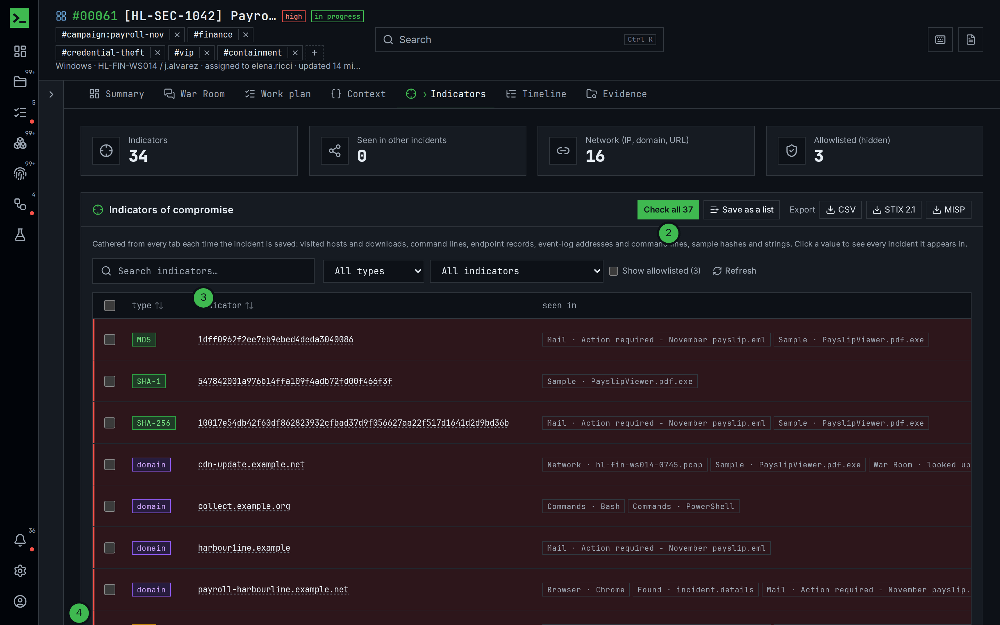
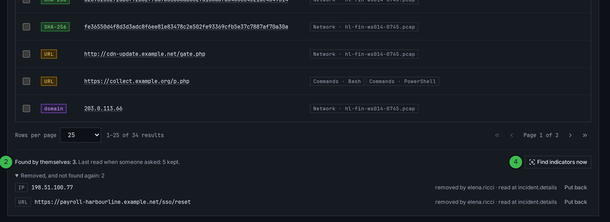
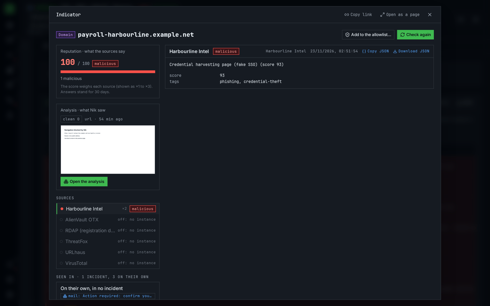

# Indicators of an incident

See every address, domain, URL, e-mail address and hash an incident holds, where each came from, and what threat intelligence says about it.

## The Indicators tab

Open an incident and its **Indicators** tab.



- The counters: **Indicators**, **Seen in other incidents**, **Network (IP, domain, URL)**, **Allowlisted (hidden)**.
- <span class="step">2</span> **Check all N**, **Save as a list**, and **Export** as **CSV**, **STIX 2.1** or **MISP** (allowlisted values left out).
- <span class="step">3</span> The filters: **All types** (or one type), **All indicators** or **Seen in other incidents**, **Show allowlisted**, **Refresh**, and **Search indicators…**.
- <span class="step">4</span> The table.
- **Found by themselves**, under the table. See [Found by themselves](#found-by-themselves).

| Column | What it says |
|---|---|
| **Type** | IP, domain, URL, e-mail, MD5, SHA-1, SHA-256. |
| **Indicator** | The value. Click it for [its window](#the-window-of-an-indicator); right-click for its menu. A shield marks an allowlisted value. |
| **Seen in** | Where the incident holds it. See [Where indicators come from](#where-indicators-come-from). |
| **Times** | How many times. |
| **First / last seen** | The first and last time, from the evidence. |
| **Reputation** | The [verdict](#verdicts) and its score. |
| **Other incidents** | How many other incidents hold it. |

A row is red when the indicator is malicious and amber when it is suspicious. Being in other incidents is a number, not a colour. The table opens sorted by reputation, the worst first.

At the end of a row: **×** removes an indicator [found by itself](#found-by-themselves); the shield adds the value to the [allowlist](lists.md#the-ioc-allowlist).

## Where indicators come from

Indicators are gathered from every kind of evidence each time the incident is saved. **Seen in** says from where:

| Seen in | Source |
|---|---|
| **Mail · <file>** | An [e-mail](mail.md): sender, sending IP, links, attachment hashes. |
| **Sample · <file>** | A [sample](malware.md): its hashes and the indicators in its strings. |
| **Network · <file>** | A [capture](network.md): hosts, DNS, HTTP, TLS names, objects. |
| **URL scan · <id>** | An [address scanned](url.md): the address, the hosts it led to, the server. |
| **Browser · …**, **Commands · …**, **Endpoint · …**, **Event log · …** | [Host evidence](host.md). |
| **War Room · looked up** | Looked up in the War Room: see [Add one by hand](#add-one-by-hand). |
| **Made by a playbook** | A playbook made it. |
| **Found · <path>** | [Found by itself](#found-by-themselves) when the incident came in. |

### Add one by hand

Type a reputation command in the incident's **War Room**: `!ip`, `!domain`, `!url`, `!file` (a hash) or `!email`, followed by the value.

```text
!ip 203.0.113.66
```

The answer comes in the War Room, and the value becomes an indicator of the incident (**War Room · looked up**). You need the **analyst** role.

To make indicators of a longer text (a ticket, a line of a log, a defanged address), run `nik.make-indicators` from the War Room: it finds every indicator in the text and links them to the incident.

```text
!nik-make-indicators text="C2 at 203.0.113[.]66 and cdn-update[.]example[.]net"
```

See [War Room commands](commands.md).

## Found by themselves

When an incident comes in (fetched by a connector, the Mail connector included; made by hand; made through the API; made by a playbook), Nik reads its fields and its context. Every address, domain, URL, e-mail address and hash it recognises there becomes an indicator, with the path it was read at: `Found · context.URL[0].Data`, the same path the **Context** tab shows.

- Defanged values are read as meant (`hxxp://`, `[.]`, `[at]`). A URL gives two indicators: the URL and its host.
- The War Room keeps **one line** for it: *12 indicators found: 5 domains, 4 URLs, 3 hashes; 40 left out as private or benign*.
- Finding an indicator asks nothing of any threat-intelligence source.

### What is left out

So that an alert with hundreds of strings does not fill the incident:

- private and reserved addresses, and URLs on internal names;
- what is known to be benign: names kept for documentation (`example.com`), the hosts of XML and JSON schemas, your organisation's own domains and the IOC allowlist;
- keys that are noise by nature (identifiers, versions, console links, the other system's address of its own ticket);
- what is not an indicator: `kernel32.dll`, `10.0.19041.1`, `this.name`.

An incident is given **500** indicators at most this way (the setting goes from 1 to 1000). Past it nothing more is kept, and the War Room line says how many were not.

### Updates from a mirror

A mirrored incident is read again at each update the mirror brings, once per update and only when it changed something: its fields and context, and what the other side *said* (a comment, a note, a reply to a message of a mailbox mirrored *In*). What was said has the path `Found · warroom.mirror`. Nothing that was found is sent to the other side. See [Connectors and mirroring](connectors.md).

What a playbook writes to the context later is not read by itself: the playbook calls `nik.make-indicators` for that.

### Remove, put back, read again



- **×** at the end of a row removes an indicator that is in the incident only because it was found. It does not come back when the incident is read again or updated by a mirror.
- <span class="step">2</span> **Found by themselves: N.** says what the last reading came to (kept, left out, over the limit, removed).
- **Removed, and not found again: N** lists what was removed, with who removed it and **Put back**.
- <span class="step">4</span> **Find indicators now** reads the incident as it is now: for an incident that came in before incidents were read, or whose context has grown.

To remove many at once, tick them and choose **Remove from this incident…**. See [Act on many at once](bulk.md).

!!! tip "In a playbook"
    The event `indicators.found` fires when a reading kept something new. See [Triggers and events](triggers.md).

### The setting

**Platform settings › Indicators › Indicators found** (administrators):

| Setting | Default |
|---|---|
| **Read incidents for indicators as they come in** | On |
| **Types that are kept** | All seven |
| **What is left out**: private and reserved addresses; what is known to be benign | Both ticked |
| **How many an incident may be given** | 500 (1 to 1000) |
| **Paths that are never read** | A list Nik ships; **Back to the defaults** restores it |
| **Look-ups**: the automatic look-ups also ask about indicators that were only found | Off |

A path is written one a line. A word alone is the name of a key wherever it is (`*uuid`, `console*`); with dots it is a whole path as the Context tab shows it, without the numbers of a list (`context.ext.sentinelone.*Url`). `*` stands for anything; capitals do not matter.

An instance of a connector follows the setting unless it is told apart (**Read** or **Not read**) under **Indicators found** in the **Fetch** part of its form. The instances told apart are listed under the setting.

## Check with threat intelligence

A **source** is a connector that judges indicators (VirusTotal, AbuseIPDB, urlscan.io, ThreatFox, URLhaus, MalwareBazaar, OTX, GreyNoise, Shodan, Safe Browsing, RDAP, or any other whose file marks a command for it), asked through an instance of that connector. Setting them up is in [Threat intelligence](threat-intel.md).

| To check | Do |
|---|---|
| One indicator | Open its window, press **Check now** (**Check again** asks past the answers that still stand). |
| Every indicator of the incident | **Check all N**. |
| A few | Tick them, **Check now…**. |

A check of many first says what it costs: how many are asked, how many answers are still fresh, how many are never sent out, and per source how many requests against what is left of today's quota. Press **Start**; it runs in the background. See [Check many](indicator-library.md#check-many).

### The window of an indicator



- The type and the value; **allowlisted** or **never sent outside** when it is.
- **Add to the allowlist…** and **Check now** / **Check again**.
- The overall verdict and how many sources gave each verdict. A domain registered in the last 30 days is flagged beside it (not in the picture: RDAP has no instance there).
- Nik's own analysis of the value, or **Not analysed by Nik yet** and the button that has the isolated browser visit an address.
- **Sources**: one line per source. Open one for what it returned (engines, reports, pulses, open ports…), its whole answer to copy or download as JSON, and **Over time**, how its verdict changed.
- **Seen in**: the incidents and the artifacts that hold it.

**Open as a page** gives it a full page; **Copy link** copies its address (`/ioc/<type>?v=<value>`) to send to a colleague.

A source whose connector has no instance that is on is listed as off. An answer older than the retention of its type is asked again when the window opens.

### Verdicts

Each source answers `malicious`, `suspicious`, `harmless` or `unknown`. Nik weighs them: each source has the weight its connector declares; a malicious answer counts in full, a suspicious one half. The score is the weighted share of the sources that answered, from 0 to 100.

| Verdict | When |
|---|---|
| **malicious** | Score 50 or more, with at least one malicious answer. |
| **suspicious** | Score 20 or more, or any malicious answer. |
| **harmless** | Nobody flags it and some source says harmless. |

Nik's own analysis counts as a source when it flags the value. **RDAP** counts only when it flags (a young domain), never by staying silent.

### What is never sent

Whoever asks, these never leave Nik: private and other non-public addresses, internal names and URLs on them, values on the IOC allowlist, values of a **TLP:RED** incident or classified TLP:RED, and e-mail addresses.

### When a look-up is held

The **data guard** reads each value before it is sent, and holds it when it carries:

- an **e-mail address** (`https://portal.example.org/reset?user=elena.ricci@example.org`);
- an **internal name or address**: a domain under your organisation's own domains, a link on one, or a link with a private address in it;
- an **allowlisted name**: a link that names a value of the allowlist.

A held indicator says **held** where its verdict would be, with the classes it carries. No source was asked; it is not an error. The value is read again each time, so it is looked up as soon as its class is opened or the allowlist or your domains change.

!!! note "You need"
    An administrator opens a class in **Platform settings › Indicators › Threat intelligence**, under *What the look-ups may send*. See [Threat intelligence](threat-intel.md).

## Keep, share, allowlist

| Action | What it does |
|---|---|
| **Save as a list** | Makes a list of the incident's indicators on the [Indicators page](indicator-library.md#lists-of-indicators). Tick rows first to save only those. |
| **Export** CSV, STIX 2.1, MISP | Downloads the indicators of the type shown; allowlisted ones are left out. |
| Shield, or right-click › **Add to the allowlist** | Puts a known-good value on the [IOC allowlist](lists.md#the-ioc-allowlist): it is hidden here and never exported. |
| Tick rows | **Check now…**, **Change the tags…**, **Save as a list…**, **Add to the allowlist…**, **Remove from this incident…**, **Export…**, **Copy the values**. See [Act on many at once](bulk.md). |

## Related

- [The Indicators page](indicator-library.md)
- [Lists and the allowlist](lists.md)
- [Threat intelligence](threat-intel.md)
- [War Room commands](commands.md)
- [Connectors and mirroring](connectors.md)
