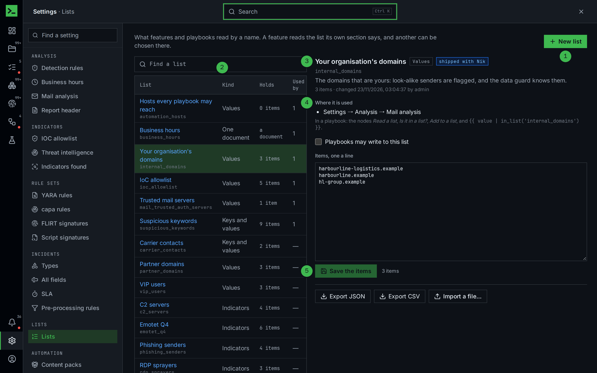
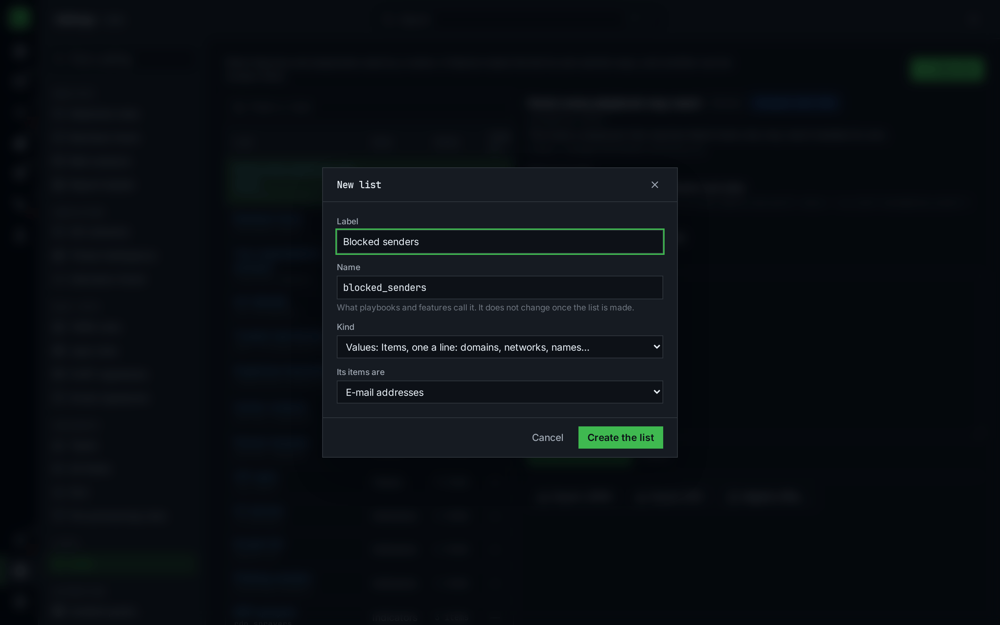
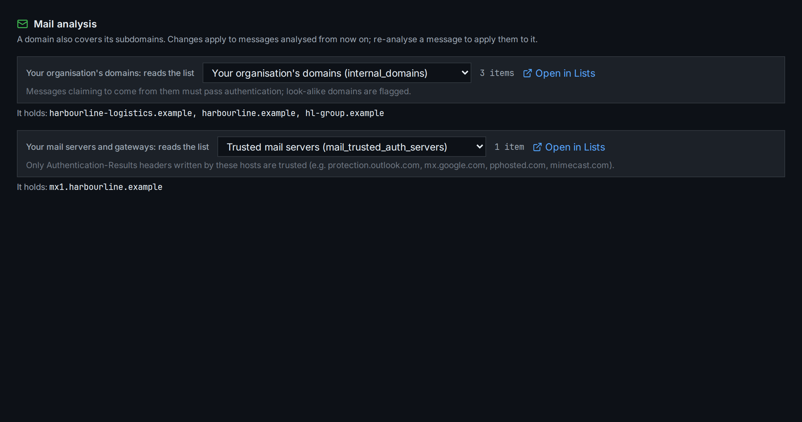

# Lists and the allowlist

Keep the values that features and playbooks read by a name (the allowlist, your domains, your mail servers, keywords, hosts) in lists you can edit, import, export and swap.

!!! note "You need"
    **Platform settings › Lists › Lists** is for who manages lists: the **playbooks** role, or an admin (permission `lists.manage`).

!!! info "Two kinds of list"
    This page is about the lists of **Platform settings › Lists**. The lists of the Indicators page, which group indicators and can be watched, are on [The Indicators page](indicator-library.md#lists-of-indicators). They show here too, read-only.

## The Lists section

- 1 **New list**.
- 2 **Find a list**, and the table: **List**, **Kind**, **Holds**, **Used by**. Right-click a row for **Open** and **Copy the name**.
- 3 The chosen list: its label, its kind, **shipped with Nik** or **read here only**, its name, what it holds, who changed it last.
- 4 **Where it is used**: the features and playbooks that read it.
- 5 Its items, and **Save the items**.
- **Export JSON**, **Export CSV**, **Import a file…**, **Delete the list**.

The address of the section is `/settings/lists/all`; `?open=<name>` opens one list.

## Kinds

| Kind | Holds | Edited as |
|---|---|---|
| **Values** | Items, one a line: domains, networks, names… | A box, **Items, one a line** |
| **Keys and values** | Each item is a key with a value | Rows, **Add a row** |
| **One document** | A single JSON document | **The document, as JSON**, **Save the document** |
| **Indicators** | A list of the Indicators page | Read here only: changed where indicators are |

The items of a list of values or of keys are of one type: **Text**, **Domains**, **Hosts**, **Networks**, **Addresses**, **E-mail addresses**, **Users**, **URLs**, **Indicators** or **Keywords**. Nik checks each item against it.

## The lists Nik ships

| List | Name | Kind | Read by |
|---|---|---|---|
| **IoC allowlist** | `ioc_allowlist` | Values (indicators) | [The allowlist](#the-ioc-allowlist) |
| **Your organisation's domains** | `internal_domains` | Values (domains) | [Mail analysis](mail.md#what-the-mail-settings-change), the data guard |
| **Trusted mail servers** | `mail_trusted_auth_servers` | Values (hosts) | [Mail analysis](mail.md#what-the-mail-settings-change) |
| **Suspicious keywords** | `suspicious_keywords` | Keys and values (label, pattern, severity, description) | [Detection rules](detection.md) |
| **Business hours** | `business_hours` | One document (hours in UTC) | Business hours, SLA timers |
| **Hosts every playbook may reach** | `automation_hosts` | Values (hosts) | **Network and data** of Automation |

They are yours to change. They cannot be deleted.

## Make a list

1. Press **New list**.
2. **Label**: what people read.
3. **Name**: what playbooks and features call it. It follows the label; it starts with a letter, holds lowercase letters, digits and `_`, 2 to 49 characters, and never changes once the list is made.
4. **Kind**, and **Its items are** for a list of values or keys.
5. Press **Create the list**.

## Fill a list

=== "Values"

    1. Type the items in **Items, one a line**.
    2. Press **Save the items**. The count of items is beside it.

=== "Keys and values"

    1. Press **Add a row**, fill the key and its value (a text, or JSON).
    2. The × of a row removes it.
    3. Press **Save the items**.

=== "One document"

    1. Write the JSON in **The document, as JSON**.
    2. Press **Save the document**.

A list holds 50,000 items at most. A key is 500 characters at most.

Nothing you have not saved is lost without asking: leaving the list, or opening another, asks first.

### Playbooks may write to this list

Tick **Playbooks may write to this list** to let the playbook nodes **Add to a list** and **Remove from a list** change it. Unticked, playbooks only read it.

## Import and export

| Button | What it does |
|---|---|
| **Export JSON** | The list as JSON. |
| **Export CSV** | The items as CSV (not for a list that is one document). |
| **Import a file…** | Replaces the items with those of a `.csv`, `.txt` or `.json` file. |

## Where a list is used

**Where it is used** names every feature and playbook that reads the list. In a playbook:

- the nodes **Read a list**, **Is it in a list?**, **Add to a list**, **Remove from a list**;
- the filter `{{ value | in_list('my_list') }}` in an expression.

See [Playbook nodes and expressions](../reference/playbook-nodes.md).

## Point a feature at another list

Each feature that reads a list says which one, in its own section of **Platform settings**:

| Section | The line |
|---|---|
| **Analysis › Detection rules** | **Keywords: reads the list** |
| **Analysis › Business hours** | **Hours: reads the list** |
| **Analysis › Mail analysis** | **Your organisation's domains: reads the list**, **Your mail servers and gateways: reads the list** |
| **Indicators › IOC allowlist** | **Allowlist: reads the list** |
| **Automation › Network and data** | **Hosts: reads the list** |

1. Make the other list, of the same kind as the one the feature reads.
2. In the feature's section, choose it in the select of **…: reads the list**.

The select offers the lists of the same kind, the one Nik ships first. **Open in Lists** opens the list that is read, to edit its items. Choosing needs the `lists.manage` permission.

## The IoC allowlist

The allowlist holds known-good values: your own addresses and domains, and well-known services.

| An entry | Matches |
|---|---|
| A domain | The domain, its subdomains, and URLs and e-mail addresses on it |
| An IP address or a network (`10.0.0.0/8`) | The address, or every address in the network |
| Any other value (a hash) | That exact value |
| A line starting with `#` | Nothing: a comment |

A value on the allowlist is:

- hidden in an incident's [Indicators tab](indicators.md) (**Show allowlisted** shows it) and left out of its exports;
- never sent to a threat-intelligence source;
- left out of the indicators [found by themselves](indicators.md#found-by-themselves);
- what makes a longer value that names it *held* by the [data guard](indicators.md#when-a-look-up-is-held).

To add a value:

- right-click an indicator anywhere and choose **Add to the allowlist**, or press the shield at the end of its row;
- or select indicators and choose **Add to the allowlist…**;
- or edit the list `ioc_allowlist` here.

**Platform settings › Indicators › IOC allowlist** shows which list is read and how many entries it has. **Restore defaults** puts back the entries Nik ships.

!!! tip
    A change applies at once to every incident: the index keeps everything, and the allowlist only hides.

## Items that expire

An item can be given a time after which it is dropped. Once past, it is no longer read: the feature or the playbook sees the list without it.

- In a playbook, the node **Add to a list** takes `expires_minutes`: *dropped after so long; empty to keep it*.
- Through the API, an item added to a list takes `expiresAt`. See [API](../reference/api.md).

A watch list of the Indicators page has no expiry on its items; an indicator has its own **Expires on** (see [Edit an indicator](indicator-library.md#edit-an-indicator)).

## Delete a list

**Delete the list** removes a list you made. The lists Nik ships, and the lists of the Indicators page, are not deleted here.

## Related

- [The Indicators page](indicator-library.md)
- [Indicators of an incident](indicators.md)
- [E-mail](mail.md#what-the-mail-settings-change)
- [Detection and rules](detection.md)
- [Your first playbook](playbooks.md)
