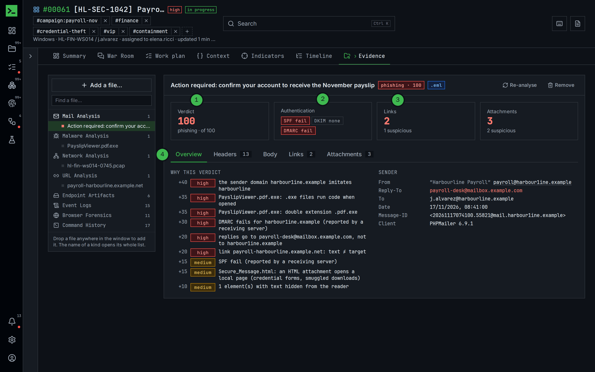
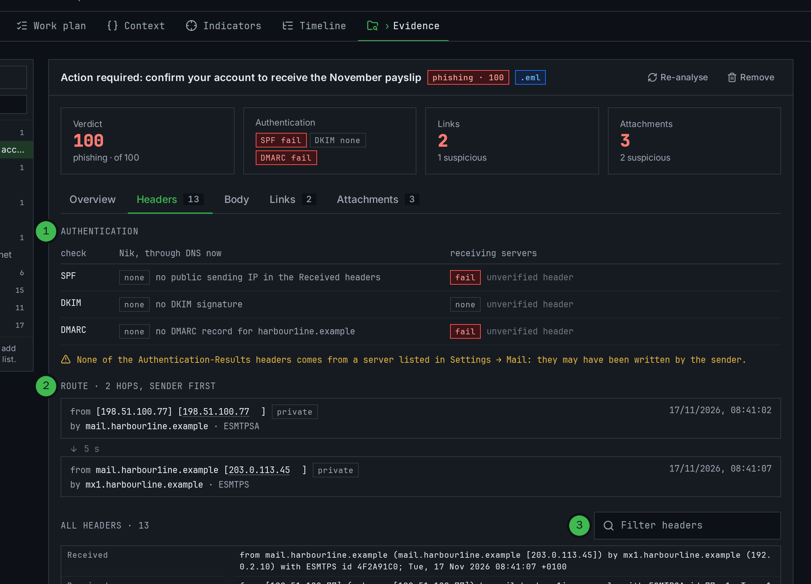
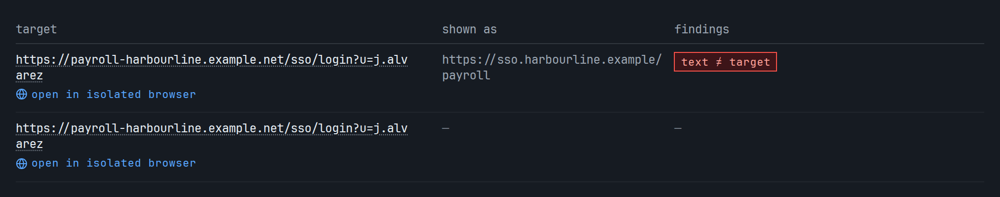
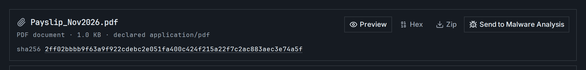
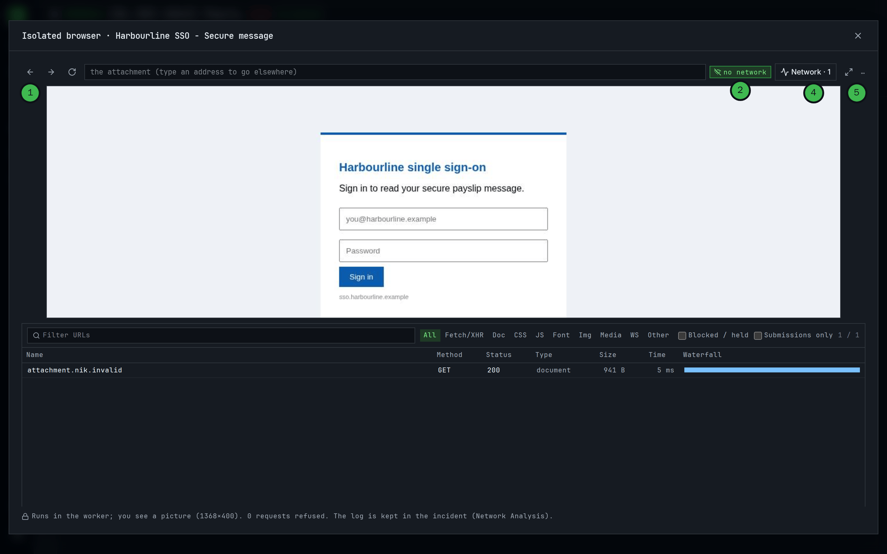

# E-mail

Triage a reported e-mail: Mail Analysis gives a verdict with its reasons and shows the message without letting anything in it run.

## Open an e-mail

1. Drop the `.eml` or Outlook `.msg` anywhere in the window, or on **Drop e-mails here** in **Evidence › Mail Analysis** (100 MB at most). See [Add evidence](evidence.md).
2. Choose the incident, or **Start analysis** for an e-mail with no incident.
3. The message opens. In the list at the side, each message shows its subject, its score, the sender and the date.

A file of many e-mails (mbox, PST, Maildir) is a [mailbox](evidence.md#mailboxes-mbox-maildir-pst): its messages are imported from there.

The head of the message shows 1 the verdict and the score, 2 **Authentication** (SPF, DKIM and DMARC), 3 **Links** and **Attachments** with how many are suspicious, and 4 the views: **Overview**, **Headers**, **Body**, **Links**, **Attachments**.

## The verdict

Every finding weighs a fixed number of points; the score is capped at 100.

| Score | Verdict |
|---|---|
| 70 or more | **phishing** |
| 40 to 69 | **suspicious** |
| less than 40 | **no strong signs** |

**Overview** lists **Why this verdict**: each finding with its severity. For example a look-alike sender domain weighs 40, DMARC failing 30, a password-protected archive 35, urgency in the text 8.

!!! warning
    The verdict is an aid to triage, not a proof. *No strong signs* means nothing stood out.

**Overview** also shows **Sender** (From, Reply-To, Return-Path, Sender, To, Cc, Date, Message-ID, Client, the sending and client IP) and **Pressure in the text**: urgency, payment, credential and secrecy phrases (English and Italian). A Reply-To or Return-Path on another domain is marked.

## Headers and authentication

- 1 **Authentication**: one row per check, with two columns. **Nik, through DNS now** is what Nik finds itself; **receiving servers** is what your mail servers wrote in `Authentication-Results`.
- 2 **Route**: the `Received` hops, sender first, with the delay of each and clocks that go back. The sending server is the first public address that is not one of your servers.
- 3 **All headers**, with **Filter headers**.

How to read it:

- Nik checks **SPF** of the sending address, verifies **DKIM** signatures, and checks the **DMARC** policy and alignment. A DNS lookup that fails reads `temperror`, never a pass.
- Nik's checks say what the DNS says *now*: a DKIM key rotated since the message was sent fails. That is why the servers' answers are shown beside them.
- Only the `Authentication-Results` of **your mail servers and gateways** are believed (marked *your server*); any other is an *unverified header*, since anyone can write one. Set them in [the mail settings](#what-the-mail-settings-change).
- An Outlook `.msg` keeps no original body: its DKIM cannot be checked.

## Body

The body is drawn in a sandboxed frame: no script runs, no link is followed, no form is submitted.

- **HTML**, **Text** and **Source** (the **HTML part** or the **Whole message**) are the three ways to read it.
- Remote images stay blocked. **Load N images** asks first; tracking pixels and images hidden in the styles are never loaded.
- Hidden text, which the recipient could not see, is revealed and outlined in red.
- Links lose their target: hover one to read where it goes.

## Links

Each link of the message, with its **target**, how it was **shown as**, and its **findings**:

- Links wrapped by Safe Links, Proofpoint, Google, Facebook or Barracuda are unwrapped to their real target.
- A text that names another host than the target says *reads as …*.
- Look-alikes of well-known brands and of your own domains are found, punycode and `rn`→`m` tricks included.
- A form of the message shows as **form**.
- **open in isolated browser** opens the target in the [isolated browser](#the-isolated-browser-window).

## Attachments

Each attachment shows its type (from its bytes, against its extension), its hashes and its findings: double extensions, right-to-left tricks, macros, archive listings (the password is looked for in the text and tried; nothing is extracted to disk), PDF actions, QR codes in images, calendar invitations.

| Button | What it does |
|---|---|
| **Preview** | The pages of a Word, Excel, PowerPoint, OpenDocument or RTF file, or an image, rendered on the server; you receive pictures only (the first 20 pages). |
| **Open in isolated browser** | An HTML attachment, opened in the isolated browser. |
| **Show the bytes in hex** | The hex view of the file. |
| **Show macro source** | The VBA or XLM code of a document with macros. |
| **Send to Malware Analysis** | Stores the attachment as a sample of the incident, for [static analysis](malware.md). |
| **Download as a protected zip** | In the right-click menu: the file in an encrypted zip. See [Download safely](evidence.md#download-samples-safely). |

A button says *not configured* when the server has no document viewer or no isolated browser (`DOCVIEW_URL`, `BROWSER_URL`).

## The isolated browser window

The page runs in a browser on the server. What you see is a picture of it; your clicks, typing and scrolling are replayed there. Nothing of the page reaches your workstation.

1. Press **Open in isolated browser** (an attachment) or **open in isolated browser** (a link).
2. Choose the network:
    - **No network (recommended)**: only the attachment loads; every request it makes is refused. A link opened this way shows only that it was blocked.
    - **Allow internet for this session**: the page and its redirects load from the internet through the server, never from private addresses. The sites see the company's address. Recorded in the audit log.
3. Press **Open**.

- 1 **Back**, **Forward**, **Reload** and the **Address** bar.
- 2 **network** or **no network**: what this session may reach.
- 3 **Submissions held**: what the page submits (a form, a POST) is recorded, not sent. Press it and **Send submissions** to let them through for this session (audited).
- 4 **Network · N** lists every request, like the browser's developer tools.
- 5 **Full screen**; ++esc++ leaves it.
- 6 A window the page opens (a sign-in pop-up, a link in a new tab) is a tab above the page; the × closes it.

!!! warning
    Live phishing pages may log the visit and change what they serve. Never type real credentials: use invented ones.

Opened from an incident, the requests of the session are kept. When the window closes they become a capture in [Network Analysis](network.md#isolated-browser-sessions).

A session closes after 5 minutes without an action, 30 minutes at most.

## What the mail settings change

**Platform settings › Analysis › Mail analysis** (administrators) holds two lists:

| Setting | What it changes |
|---|---|
| **Your organisation's domains** | A message that claims to come from them but fails authentication, or a domain that imitates them, is flagged. A domain covers its subdomains. The [data guard](indicators.md#when-a-look-up-is-held) treats a name under them as internal. |
| **Your mail servers and gateways** | Only their `Authentication-Results` are believed, and their hops are skipped when Nik looks for the sending server. |

Both are [lists](lists.md): the section shows which list each reads, and **Open in Lists** edits it.

!!! note
    Changes apply to messages analysed from then on. Press **Re-analyse** on a message to apply them to it.

## Act on a message

| Action | Where |
|---|---|
| **Re-analyse** | The head of the message: analyses the stored message again, DNS checks included. |
| **Remove** | The head of the message: takes it out of this incident; it stays as an artifact. |
| **Open as an artifact** | Right-click the message in the list. |
| Flag | Right-click the message in the list: it joins the incident's flagged events, and its row shows a flag. See [Summary, timeline and War Room](war-room.md). |
| **Remove from the incident** | Right-click the message in the list. |

The message's indicators (sender address and domain, sending IP, link targets and hosts, attachment hashes, QR and invitation links) go to the incident's [Indicators](indicators.md). The timeline shows the message at the time it was sent, high when it is phishing. The report has an **E-mails** section.

## Related

- [Add evidence](evidence.md)
- [Malware](malware.md) for the attachments
- [Links](url.md) for a link visited on its own
- [Lists and the allowlist](lists.md)
- [How mail analysis works](../reference/architecture.md)
