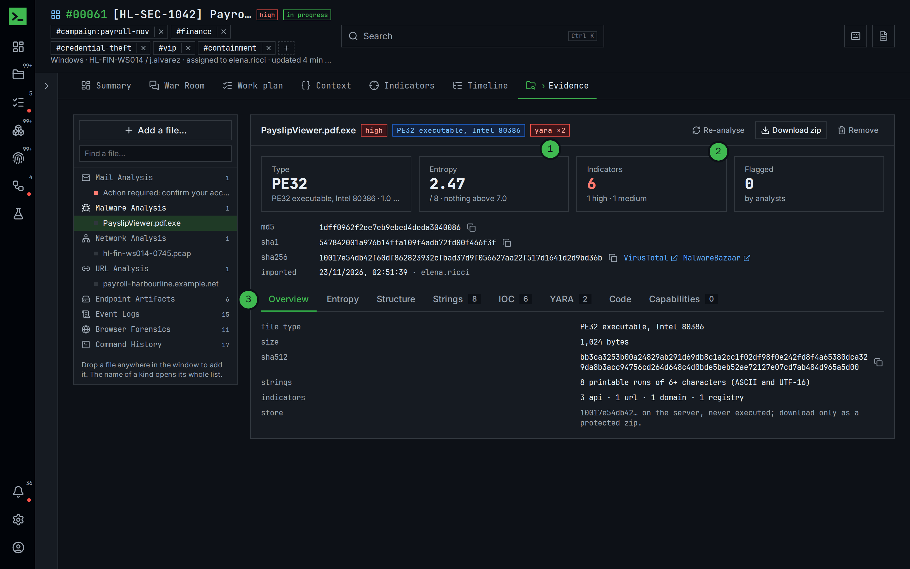
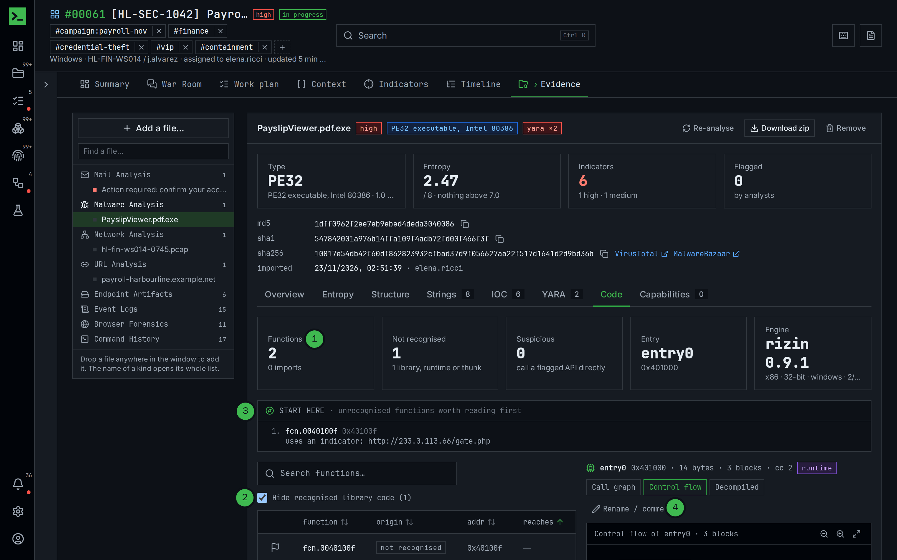
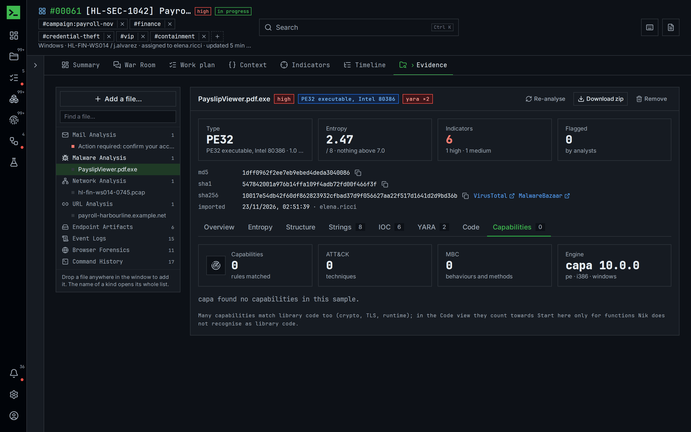

# Malware

Analyse a suspicious file without running it: its structure, strings, indicators, YARA matches, capabilities and code.

!!! note "Never executed"
    A sample is stored on the server under its SHA-256, read-only, with no execute bit, and analysed **statically**. Nik has no detonation sandbox: no sample is ever run. The disassembler and capa read the file from a read-only mount, in containers with no route outside.

## Add a sample

1. Drop the file anywhere in the window, or on the drop zone of **Evidence › Malware Analysis** (100 MB at most). See [Add evidence](evidence.md).
2. Choose the incident, or **Start analysis** for a file with no incident.
3. The sample opens. The same file in two incidents is stored and analysed once.

Attachments of an e-mail and objects of a capture come here with **Send to Malware Analysis**.

The head of the sample shows 1 its badges (type, severity, YARA matches, **signed**), 2 **Re-analyse**, **Download zip** and **Remove**, and 3 the views.

## The views

| View | What it shows |
|---|---|
| **Overview** | Type, entropy, indicators, flagged; the MD5, SHA-1, SHA-256 and imphash; links that look the SHA-256 up on public sites (they open the site and send only the hash). |
| **Entropy** | Entropy of the whole file and per 64 KB block: packed or encrypted parts stand out. |
| **Structure** | For PE, ELF and Mach-O: header, **Sections** (entropy, flags; writable and executable is red), **Imports** by library, **Exports**, **Resources**, compile time, PDB path, signature. Malformed headers become warnings, not failures. |
| **Strings** | ASCII and UTF-16 strings, with the detection rules that match them. |
| **IOC** | Addresses, domains, URLs and hashes found in the file, with **Used by**: the functions that use each. |
| **YARA** | The YARA rules that matched, with their severity. |
| **Code** | Functions, call graph, control-flow graph and decompiled code. |
| **Capabilities** | What capa says the program can do, mapped to MITRE ATT&CK and the Malware Behavior Catalog. |

### Strings

- Choose **ASCII + UTF-16**, **ASCII only** or **UTF-16 only**.
- The first 5,000 strings come with the analysis. **Search the whole file** (a substring) reads the stored file again for the rest.
- A string that matches a detection rule shows it under **Detection**. Right-click to copy its offset.

### YARA

Every sample is scanned with the rules Nik ships and the rule sets added in **Platform settings › Rule sets › YARA rules**. A match with severity `high` counts in the sample's severity.

### Code

Open **Code**. The disassembler runs after the upload by itself; on an older sample press **Disassemble**.

- 1 The list of functions, each with the severity of the APIs it reaches.
- 2 **Hide recognised library code** (on by default) keeps only the functions Nik does not recognise: library code matched by a **FLIRT** signature or a Rust crate, runtime code, thunks and imports are hidden. *Not recognised* does not mean "the author's code".
- 3 **Start here** ranks the unrecognised functions most worth reading: those that call suspicious APIs, use an indicator, reach a suspicious API through their callees, or are complex.
- 4 Choose **Call graph**, **Control flow** or **Decompiled** for the selected function. Drag to pan, scroll to zoom; a minimap shows where you are.
- In **Decompiled**, a call to another function of the sample is a link; calls to suspicious APIs are red.

**Rename / comment** gives a function a name and a note. Everyone who opens the same sample sees them, in the list, the graphs and the code. **Strings used** lists the strings a function references.

The crates found in a Rust binary are listed above the table.

!!! info "FLIRT signatures"
    Library functions are recognised with rizin's bundled signatures and the `.sig` / `.pat` files added in **Platform settings › Rule sets › FLIRT signatures**. Press **Re-analyse** on samples already disassembled to apply new ones.

### Capabilities

capa runs after the upload, for x86 and x64 PE and ELF files; other types say they are not supported. On a large binary it can take ten minutes or more. **Run capa** starts it by hand.

- Capabilities are grouped by namespace, with **ATT&CK** and **MBC** badges.
- Each links to the functions it was found in; the Code view shows the capabilities of each function.
- A match of a rule of your own carries a **custom** badge (**Platform settings › Rule sets › capa rules**).
- Capabilities do not change the sample's severity.

??? info "When a worker is not there"
    The Code view needs the analyzer worker (`ANALYZER_URL`), Capabilities the capa worker (`CAPA_URL`). Without one, the view says *not configured* and the rest of the analysis works. See [Environment variables](../reference/configuration.md).

## Rules of your own

| Section | What it holds | Who |
|---|---|---|
| **YARA rules** | Your YARA rule sets, compiled before they are saved. | The **rules** role, or an admin |
| **capa rules** | Your capa rules (YAML), checked by capa before they are saved. | The **rules** role, or an admin |
| **FLIRT signatures** | `.sig` and `.pat` files for library recognition. | The **rules** role, or an admin |

All three are under **Platform settings › Rule sets**. New rules apply to samples analysed from then on: press **Re-analyse** on older ones.

## Act on a sample

| Action | What it does |
|---|---|
| **Re-analyse** | Runs the current engine, YARA, the disassembler and capa again on the stored file. A sample analysed by an older engine says so, with **Re-analyse now**. |
| **Download zip** | The file in a password-protected zip. See [Download safely](evidence.md#download-samples-safely). |
| **Remove** | Takes the sample out of this incident; it stays as an artifact. |
| Flag an indicator | In **IOC**, the flag of a row adds it to the incident's flagged events. |

!!! warning "On the server"
    Exclude the sample store from the server's antivirus: it would quarantine the evidence. Include it in backups. See [Backups and restore](../admin/backups.md).

The sample's indicators go to the incident's [Indicators](indicators.md); the timeline and the report show it.

## Related

- [Add evidence](evidence.md)
- [E-mail](mail.md) and [Network capture](network.md), where samples come from
- [Detection and rules](detection.md)
- [Indicators of an incident](indicators.md)
- [How malware analysis works](../reference/architecture.md)
