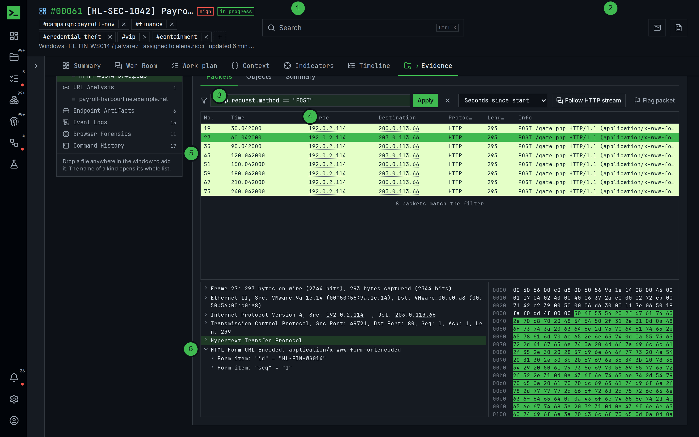
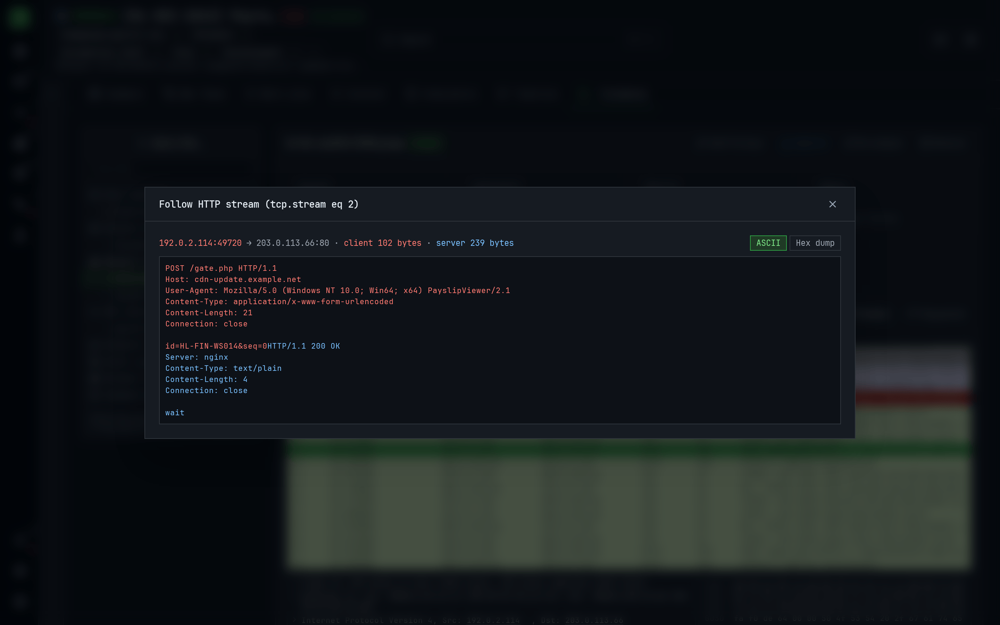
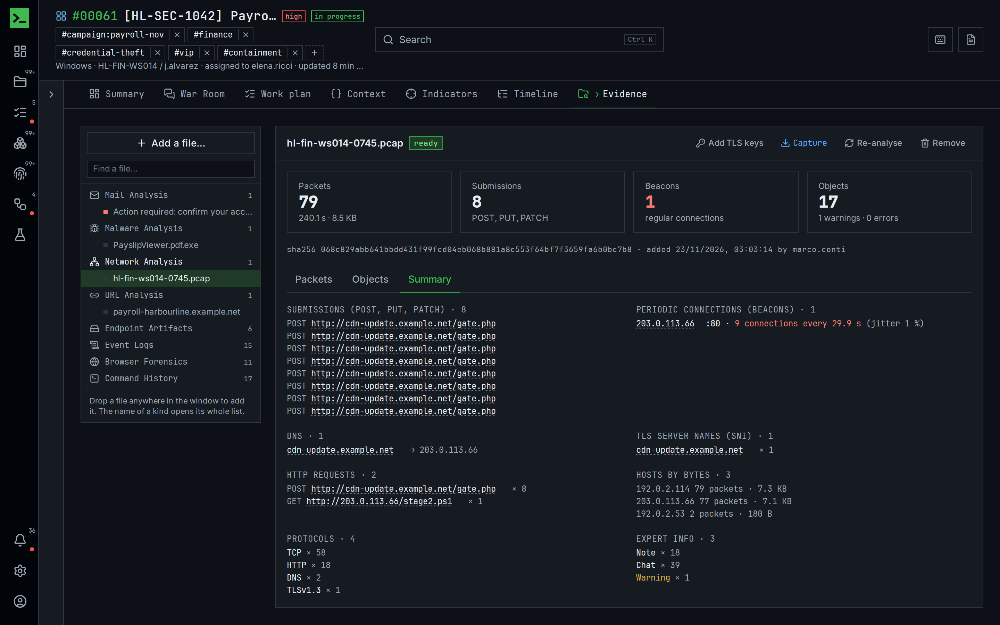

# Network capture

Read a packet capture in the browser with Wireshark's own engine: packets, filters, streams, the files they carried and a summary.

## Add a capture

1. Drop a `.pcap` or `.pcapng` (gzip too) anywhere in the window, or on **Drop captures here** in **Evidence › Network Analysis**. The largest is 500 MB (`PCAP_MAX_MB`).
2. Choose the incident, or **Start analysis** for a capture with no incident. A capture belongs to one incident at most.
3. The capture shows **analysing…** while Wireshark reads it, then **ready**.

A capture stays **stored, not analysed** when the server has no packet capture worker (`PCAP_URL`). Nothing is ever captured on the server: Nik only reads files.

The head of the capture holds 1 its state and badges, 2 **Add TLS keys**, **Capture** (download), **Re-analyse** and **Remove**, and 3 the views: **Packets**, **Objects**, **Summary** (and **Requests** for a session of the isolated browser).

## Packets

- 4 **Display filter**: type a filter in Wireshark's syntax (`http.request.method == "POST"`) and press ++enter++. The × clears it.
- 5 The packet list, with Wireshark's colours. Click a column header to sort the packets loaded so far; again for the reverse; a third time for the capture's order.
- 6 The protocol tree and the bytes of the selected packet. Selecting a field highlights its bytes.
- **Time format**: **Seconds since start**, **Date and time (UTC)** or **Since previous packet**.

Right-click a field of the tree for **Apply as filter**, **Copy the field** and **Copy the filter**.

Public addresses, host names, URLs and hashes in the list and the tree are indicators: click one for its window, right-click for its menu. Private addresses stay plain text.

### Follow a stream

1. Select a TCP or UDP packet.
2. Press **Follow TCP stream** (or HTTP, TLS, UDP: the button names what the packet carries).
3. The conversation opens, reassembled. Choose **ASCII** or **Hex dump**.

### Flag a packet

Select a packet and press **Flag packet**. It joins the incident's flagged events and its timeline. **Flagged** shows on a packet already flagged.

## Objects

The files carried by HTTP, SMB, FTP, TFTP, IMF and DICOM, as Wireshark's *Export Objects* finds them, each with its SHA-256.

| Action | What it does |
|---|---|
| **Send to Malware Analysis** | Stores the object as a sample of the incident. See [Malware](malware.md). |
| **Download as a protected zip** | Right-click: the object in an encrypted zip. See [Download safely](evidence.md#download-samples-safely). |
| **Copy the name**, **Copy the host**, **Copy the SHA-256** | Right-click. |

## Decrypt TLS

1. Ask for the key log of the client: the file `SSLKEYLOGFILE` wrote (NSS format, `.log`, `.txt` or `.keys`).
2. On the capture, press **Add TLS keys** and choose the file.
3. Wireshark reads the capture again with the keys: HTTPS shows in clear, and the badge **TLS keys** appears.

**Replace TLS keys** changes the file; **Remove keys** takes it away.

!!! note
    The key log is stored encrypted, like the credentials of connectors, and given to the worker only while the capture is open.

## Summary

| Panel | What it lists |
|---|---|
| **Submissions (POST, PUT, PATCH)** | Requests that send data. |
| **Periodic connections (beacons)** | Six or more connections to the same address and port, at least 5 s apart, at intervals within 15 % of each other: a sign of malware calling home. |
| **DNS** | The names asked and their answers. |
| **TLS server names (SNI)** | The hosts asked for over TLS. |
| **HTTP requests** | Method, host, path. |
| **Hosts by bytes** | Who talked the most. |
| **Protocols** | What the capture holds. |
| **Expert Info** | Wireshark's warnings and errors, counted. |

The summary feeds the incident's [Indicators](indicators.md) (`Network · <file>`), its timeline and the report's **Network** section.

## Isolated browser sessions

A session of the [isolated browser](mail.md#the-isolated-browser-window) opened from an incident, or a [URL scan](url.md), is a capture too. It carries the badge **isolated browser · reconstructed**.

- **Requests** lists every request like the browser's developer tools: **Headers**, **Payload**, **Preview**, **Response**, **Timing**, **Messages** (WebSocket). Refused requests and held submissions are listed too.
- When the window closes, the log is rebuilt as a pcapng, so display filters, Follow Stream and Objects work on it. **pcapng** downloads it, **HAR** gives it as HAR 1.2.
- The preview of a captured page is a picture: its links, forms and redirects are disarmed.

## Act on a capture

| Action | What it does |
|---|---|
| **Re-analyse** | Reads the stored capture again. |
| **Capture** | Downloads the file. |
| **Remove** | Takes the capture out of the incident; it stays as an artifact. |
| **Open as an artifact** | Right-click the capture in the list. |
| Hide the list | The button in the corner of the list of captures; it stays hidden the next time. |

## Related

- [Add evidence](evidence.md)
- [Links](url.md), whose visits become captures
- [Malware](malware.md), for the objects
- [Indicators of an incident](indicators.md)
- [How network analysis works](../reference/architecture.md)
