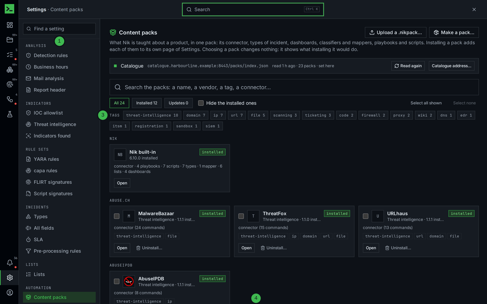
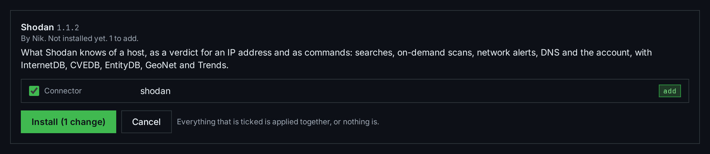
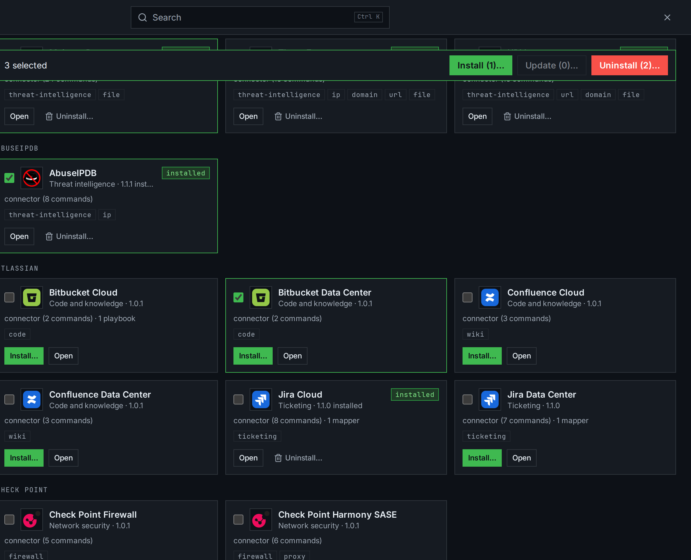

# Content packs

Install, update and remove what Nik is taught about a product: its connector, types, mappers, playbooks, scripts and dashboards, in one pack.

!!! note "You need"
    The permission `content.manage`: the **Admin** role. **Platform settings › Automation › Content packs**.

Nothing of a vendor is inside Nik until its pack is installed. A vendor has a pack for each product (Atlassian: Jira Cloud, Confluence Cloud…). **Nik built-in** is the one pack that is part of Nik: its types, lists, scripts, playbooks, dashboards and the Mail connector. It follows Nik's releases and is never uninstalled.

## The catalogue

- 1 **Search the packs**: a name, a vendor, a category, a tag, a connector. Every word must be found in the card (`atlassian wiki`).
- **All**, **Installed**, **Updates**, and **Hide the installed ones** (remembered in this browser).
- 3 **Tags**: what the product is (`ticketing`, `edr`, `siem`, `firewall`, `threat-intelligence`…) and what it works on (`ip`, `domain`, `url`, `file`). A pack must have every tag chosen.
- 4 A card: what the pack holds (*connector (17 commands) · 1 mapper · 1 playbook*) and its state: *installed*, *update*, *later Nik*.

The cards are grouped by vendor.

??? info "Where the catalogue comes from"
    The packs are published from the folder `packs/` of Nik's repository as the release `packs`: one `.nikpack` per pack, an index (`index.json`) and its signature. Nik reads the index the first time the page opens and when **Read again** is pressed.

    - The index is read only when its Ed25519 signature is of the key Nik holds; a pack is taken only when its size and SHA-256 match the signed index.
    - The backend must reach `github.com`, `objects.githubusercontent.com` and `release-assets.githubusercontent.com` (through `HTTPS_PROXY` when set).
    - **Catalogue address…** sets another address: a copy inside your network (leave the key empty: a copy keeps Nik's signature), or a catalogue of your own with the public half of your key.

## Install a pack

1. Find the pack and press **Install…** on its card.
2. Nik inspects it and changes nothing yet. Each item is listed with what applying it would do:

    | It says | Which means |
    | --- | --- |
    | **add** | Nothing with this name is here |
    | **update** | It is here and differs: the difference is shown, line by line |
    | **same** | It is here exactly as the pack has it |
    | **conflict** | It cannot be applied, and why (a field of another type, an older connector, a mapper for an absent connector…) |

3. Leave out any item you do not want. A conflict must be left out or settled first.
4. Press **Install**. The rest is applied in one transaction: all of it, or nothing.

!!! warning "A script is code"
    A script in a pack runs in the sandbox. Read its difference before installing it, as you would read a script someone sends you.

After installing:

- A playbook from a pack arrives **off**, reaching only listed hosts and sending no class of data.
- A new instance of its connector starts with the classifier the pack gives.
- A pack never carries an instance, a credential, an allowed host or an opened class of data. Make the instance yourself: [Connectors and mirroring](connectors.md#add-an-instance).

A pack that requires another says so and is installed after it. One written for a later Nik is not offered. **Open** shows what an installed pack gave, and marks what was changed here since or is no longer here.

## What a pack holds

| Folder | Item |
| --- | --- |
| `connectors/` | A connector, with its logo and README |
| `scripts/` | Scripts |
| `playbooks/` | The graph of a playbook's current version, and its limits |
| `fields/` | Custom fields |
| `incident_types/` | Types: fields, layout, SLA, close reasons, playbook |
| `mappers/` | Incoming and outgoing rules, and the classifier a new instance starts with |
| `lists/` | Lists, with their items only when the pack was made to carry them |
| `dashboards/` | Dashboards |
| `preprocess_rules/` | Pre-processing rules |

The file format is in [Connector and pack format](../reference/connector-format.md#the-pack-format).

## Update a pack

1. Choose **Updates**, or look for *update* on a card.
2. Press **See what changes…**: the newer version is inspected item by item, with the differences.
3. Leave out what you want to keep as it is, and install.

- A playbook or a script **gets a new version**; a version in use is never rewritten.
- A playbook whose graph lacks something here (an instance, a command) is kept as a draft, its version in use untouched.
- What you changed since the pack gave it (a script edited, a mapper rewritten) shows as **update**: leave it out to keep yours.

### Updating the Jira and ServiceNow packs

Up to their packs 1.1.0, the incoming mappers of ServiceNow, Jira Cloud and Jira Data Center set the mirroring direction themselves (`in`): every ticket fetched was mirrored **In**, whatever the instance said. From 1.1.0 the instance decides, like every other connector.

When the update replaces such a mapper:

- every instance of that connector whose **Mirroring** is **None** is set to **In** in the same step, so nothing changes in practice. The update reports it, and the audit log records `mirror.kept`;
- an instance someone gave a direction is left as it is;
- a mapper you changed and leave out of the update still names the direction, is still obeyed first, and no instance is touched.

A new installation of these packs starts at **None**. See [Mirroring](connectors.md#mirroring).

## Several at once

1. Tick the box of each card, or **Select all shown**.
2. The bar offers **Install (n)…**, **Update (n)…**, **Uninstall (n)…**.
3. One confirmation shows the whole plan, pack by pack, in order (a pack after those it requires). A pack that cannot be done is marked *left out*, with why.
4. The packs are done one after the other, each in its own transaction. The dialog ends with what happened to each.

A pack with a conflict cannot be done in bulk: install it alone, where an item can be left out. **Nik built-in** and a pack for a later Nik cannot be ticked.

## Uninstall a pack

1. Press **Uninstall…** on its card. What would happen is shown first, item by item.
2. If something of the pack is in use, the dialog lists what holds it, and offers no **Uninstall**:

    | What holds a pack | What to do first |
    | --- | --- |
    | An instance of its connector | Delete the instance (its stored credentials stay) |
    | A playbook of the pack that is on, or has a run in progress | Turn it off; wait for the run, or stop it |
    | A playbook or pre-processing rule of yours that uses its connector, script, playbook or list | Take it out, or delete them |
    | Incidents of its type; a type of yours with its playbook | Give the incidents another type; give the type another playbook |
    | Its field, listed by a type or holding a value | Take it off the type; empty it |
    | Its list, read by a setting | Point the setting to another list |
    | Another installed pack that requires it | Uninstall that pack first |

3. What you changed since the pack gave it stays: it is yours now.

**Only take it off the list** removes nothing: the pack leaves the list and everything it gave stays.

## Make a pack, and packs without the catalogue

- **Make a pack…** asks for an id, a name, a version, then the items. What an item needs comes with it (the scripts and connectors of a playbook, the fields of a type…). A list goes without its items unless you ask.
- **Download as a file** on an installed pack gives its `.nikpack`.
- **Upload a .nikpack…** installs a file the same way as the catalogue.

A Nik that cannot reach the catalogue:

=== "A file"

    Download the `.nikpack` from the release `packs` on another machine, then **Upload a .nikpack…**.

=== "A folder"

    Set `NIK_PACKS_DIR` to a folder the server reads. The packs in it (a folder with a `pack.yml`, or a `.nikpack`) are installed at start when they are missing or older. Nothing there is checked against a signature.

=== "Your own catalogue"

    In the backend container, `python -m app.pack_build <folder of packs> <folder to write>` writes the `.nikpack` files and the index, signed with the Ed25519 key in `PACKS_SIGNING_KEY`. Serve the folder over HTTPS and set its address and public key in **Catalogue address…**.

`NIK_PACKS_CATALOGUE=` (empty) starts Nik with no catalogue: the page lists what is installed, and packs come as files.

## Related

- [Connectors and mirroring](connectors.md)
- [Threat intelligence](threat-intel.md)
- [Types, fields and pages](types.md)
- [Connector and pack format](../reference/connector-format.md)
- [Environment variables](../reference/configuration.md)
