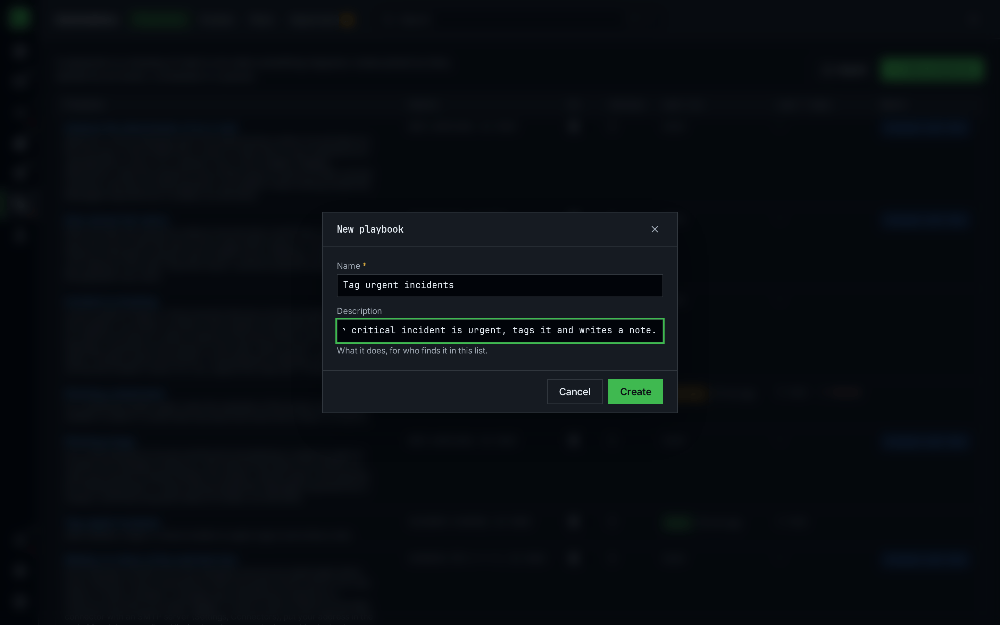
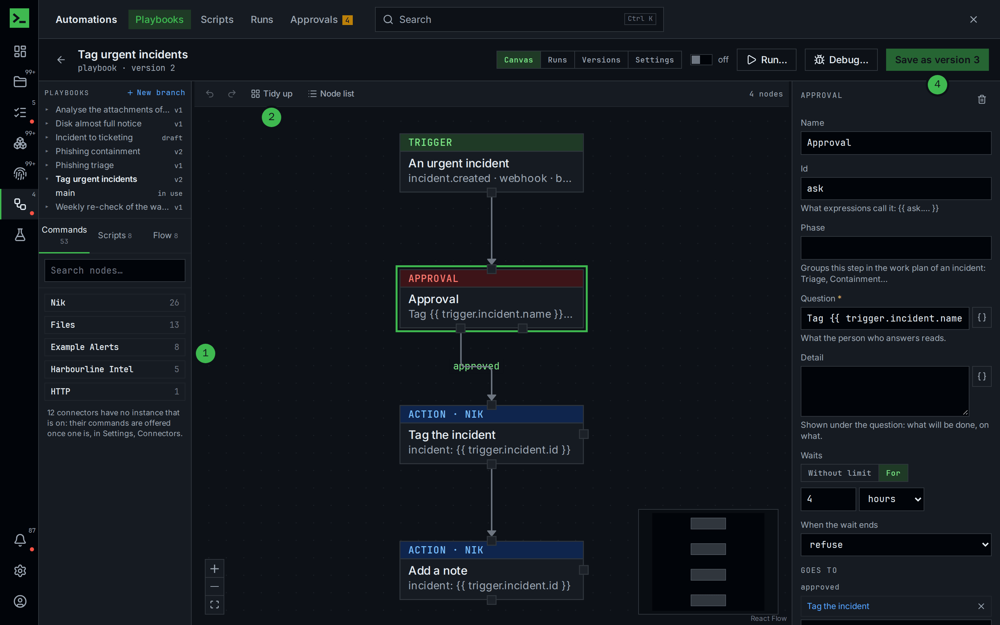
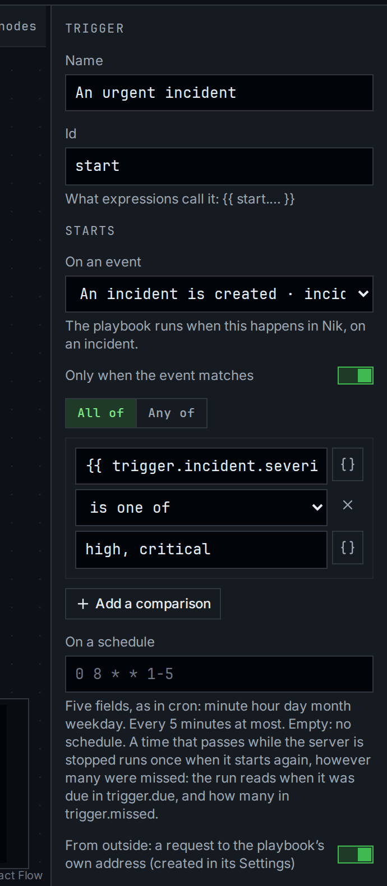
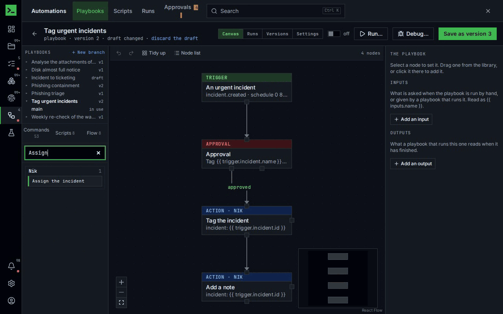
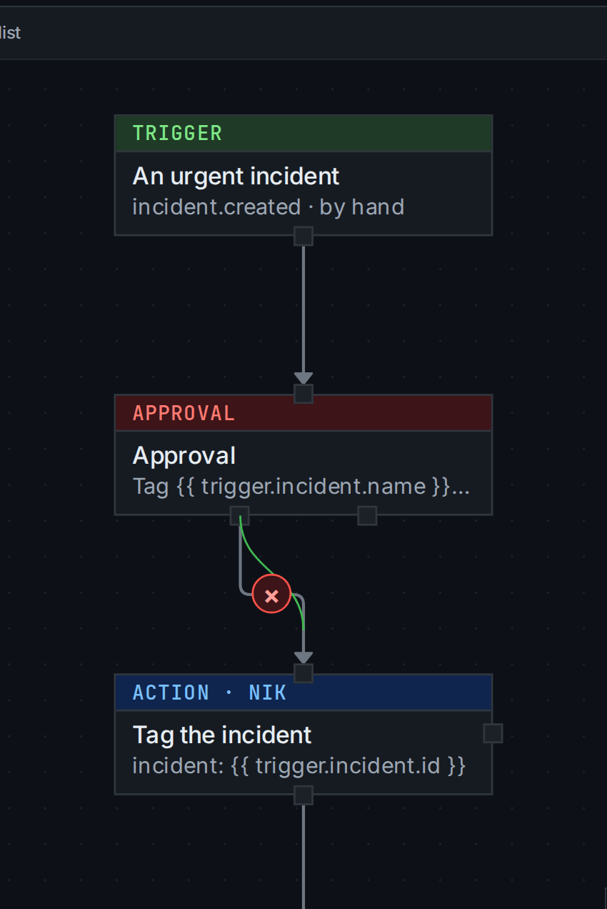
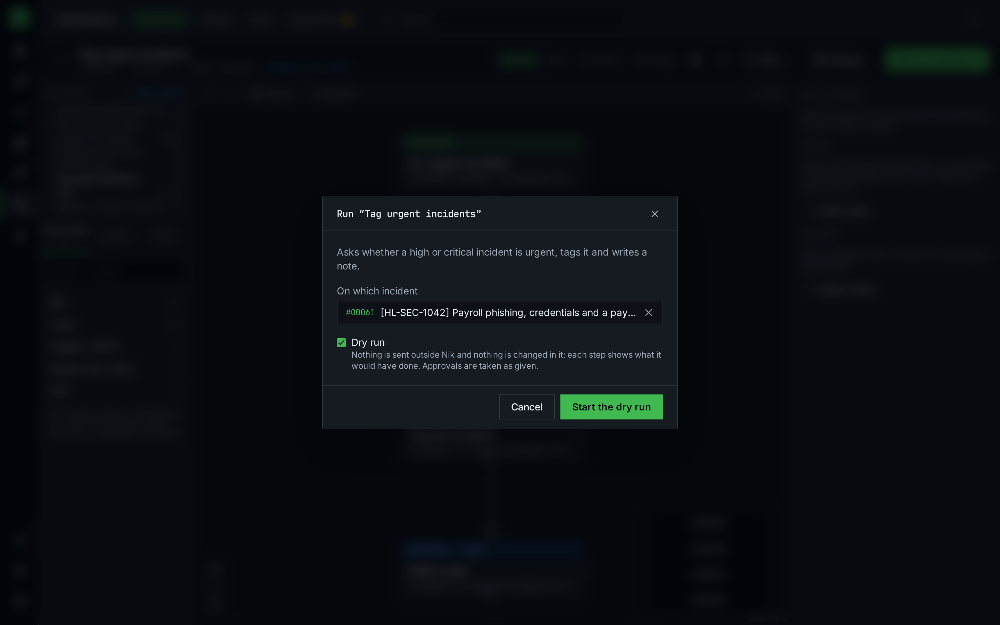
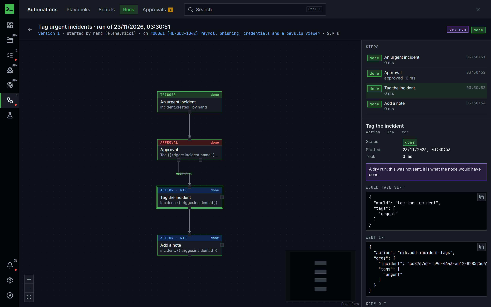
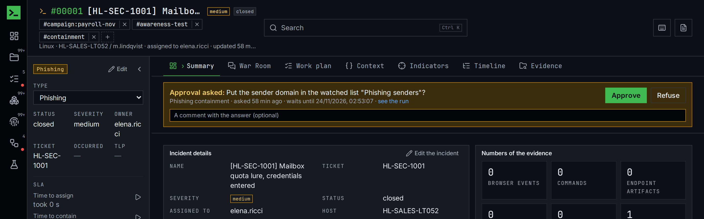
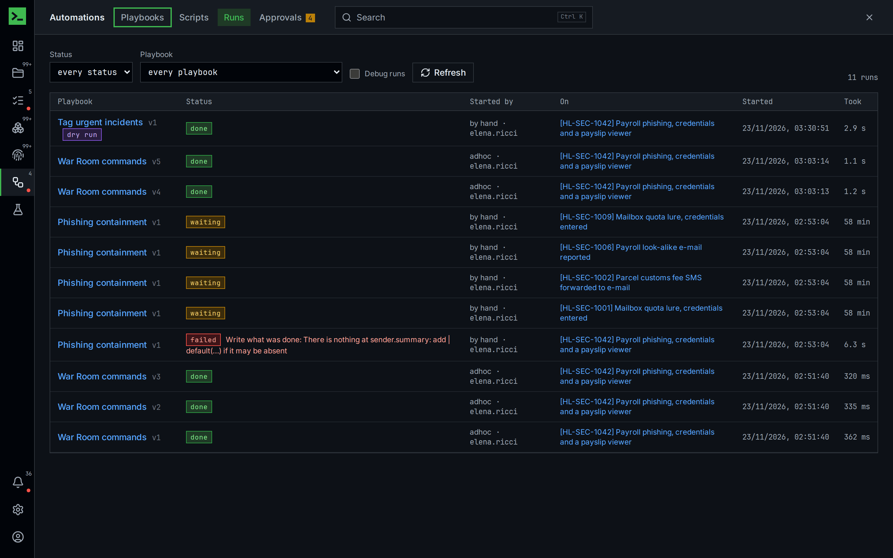
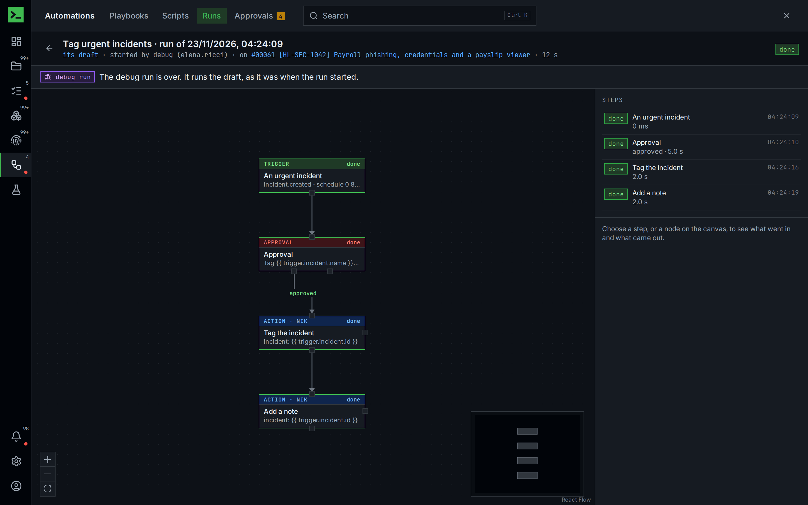

# Your first playbook

Build a playbook on the canvas, try it without risk, turn it on and follow what it does.

A **playbook** is a drawing of what to do when something happens: one trigger, then nodes joined by lines. Nik runs it step by step, asks a person where you said so, and keeps what every step got and gave.

!!! note "You need"
    The **Playbooks** role (or **Admin**) to build and change playbooks. **Analyst** sees them read-only, runs them, stops a run and answers an approval. See [who may do what](#who-may-do-what).

## Build it step by step

The example: when an incident of high or critical severity is created, ask a person whether to tag it `urgent`, then tag it and write a note.

### 1. Create the playbook

1. Open **Automations** on the rail (or `/automation/playbooks`). The area has four tabs: **Playbooks**, **Scripts**, **Runs**, **Approvals**.
2. Press **New playbook**. Type a **Name** (and a **Description** if you want) and press **Create**.
3. The canvas opens with one node, the **Trigger**. The playbook is a draft, and off.

### 2. Know the screen

- 1 **The library**, in three tabs: **Commands** (what Nik does, then one group per connector that has an instance on), **Scripts** and **Flow** (condition, for each, wait, approval, task, question, another playbook, end). **Search nodes…** looks in all three. A node marked *changes* does something outside Nik and asks for approval by default.
- 2 **The canvas**: the nodes and their lines. Zoom buttons and the minimap are in the corners.
- **The inspector**, on the right: the settings of the selected node, **Goes to**, what it **Gives**, and what is still to fix. With no node selected, it shows the playbook's **Inputs** and **Outputs**.
- 4 The header: **Canvas**, **Runs**, **Versions**, **Settings**, the on/off switch, **Run…**, **Debug…** and **Save as version N**.

Every change saves itself a moment later (*draft saved*). Undo and redo are ++ctrl+z++ and ++ctrl+shift+z++.

### 3. Set the trigger

1. Select the **Trigger**.
2. In **On an event**, choose **An incident is created · incident.created**.
3. Turn on **Only when the event matches**. Write the comparison: `{{ trigger.incident.severity }}` **is one of** `high, critical`.
4. Turn on **Can be run by hand**, so you can try it on a real incident.

Every kind of trigger is on [Triggers and events](triggers.md).

!!! tip "React to a detection"
    **Sigma rules match records of a host file** · `evidence.detected` starts a playbook when a file of [host evidence](host.md) has detections. A detection never changes the severity of the incident, so say here what should happen: add a condition on `{{ trigger.levelNumber }}` **is at least** `4` to act only on high and critical matches. See [Triggers and events](triggers.md#events-about-host-evidence).

### 4. Add nodes

1. In the library, open **Flow** and drag **Approval** onto the canvas, under the trigger. Or click it: it lands after the selected node, joined to it.
2. In the inspector, write the **Question** (`Tag this incident urgent?`) and a **Detail** (`{{ trigger.incident.name }}`).
3. Open **Commands › Nik** and add **Tag the incident**. Set **tags** to `urgent`.
4. Add **Add a note**. Set **text** to `Tagged urgent by a playbook.`

!!! tip "Values from the run"
    Type `{{` in a field, or press the **{ }** button beside it, to pick a value the node can read. The full language is in [Playbook nodes and expressions](../reference/playbook-nodes.md#expressions).

### 5. Connect the nodes

1. Drag from the square under a node to the next node to draw a line.
2. An approval has two squares: **approved** and **refused**. Draw **approved** to **Tag the incident**, then **Tag the incident** to **Add a note**. Leave **refused** empty: the run ends there.
3. To remove a line, point at it and press its **×**.
4. Press **Tidy up** to put the nodes in order, top to bottom.

A condition has **yes** and **no**; a for each has **for each item** and **when done**; nodes that can fail have an **on error** square on their right side. Without a mouse, draw lines in the inspector under **Goes to**; **Node list** shows the same playbook as a table.

??? info "Keys and the right-click menu"
    ++ctrl+c++ / ++ctrl+v++ copy and paste the selected nodes with their lines, ++ctrl+x++ cuts, ++ctrl+d++ duplicates, ++ctrl+a++ selects every node. ++tab++ moves through the nodes, ++enter++ selects one, the arrow keys move it, ++delete++ removes it, ++shift+f10++ opens its menu.

    Right-click a node for **Open in the inspector**, **Debug, stopping before it…**, **Duplicate**, **Copy**, **Cut**, **Disconnect its lines**, **Delete**. Right-click the empty canvas for **Add a node here…**, **Paste here**, **Select all**, **Fit the view**, **Tidy up**, **Undo**, **Redo**. An entry that cannot be done is greyed and says why.

### 6. Conditions and approvals

- A **Condition** node holds **all of** or **any of** a list of comparisons and leaves by **yes** or **no**. The operators are in [the reference](../reference/playbook-nodes.md#condition).
- An **Approval** node stops and asks. It waits **Without limit** unless you set **Waits › For**; then **When the wait ends** goes on as refused, refuses, or stops the run. An approval nobody answered is never taken as given.
- Every node that changes something outside Nik (an HTTP request that is not a GET, a connector command marked *changes*) also asks first, by default. Turn it off for one node in the inspector, under **Approval before this node**, or for the playbook in **Settings › Ask before what changes something outside Nik**.

### 7. Save a version

1. Press **Save as version 1**. The server checks the draft: one trigger, no circle, every required argument filled, every expression reading a node that is sure to have run before it.
2. If something is wrong, the nodes show it (*2 to fix*) and the inspector says what, in words. Fix and save again.

The canvas always edits a draft. A version is what runs; versions are never rewritten. **Versions** restores an old one as a new version. **discard the draft**, under the name, throws the draft away.

### 8. Test with a dry run

1. Press **Run…**. The **Run a playbook** dialog opens.
2. In **On which incident**, type part of a title or its number, and choose one.
3. Tick **Dry run** and press **Start the dry run**.
4. The run opens: each node shows what it would have done. Nothing is sent outside Nik and nothing is changed in it. Approvals are taken as given, so the *yes* path can be read to the end.

!!! warning "An HTTP node in a dry run"
    An HTTP request gives no answer in a dry run, so a later step that reads its answer fails there. A connector command gives its `sample` instead.

### 9. Turn it on

1. Flip the switch in the header to **on**. It works only once there is a version.
2. From now on the trigger starts the playbook. A playbook that is off is started by nothing but a person.

### 10. Watch the runs

1. **Automations › Runs** lists every run; the playbook's **Runs** tab and an incident's **Automation** tab list their own. Filter by status (**interrupted** among them) and playbook.
2. Open a run. The canvas of the version it used colours each node: done, running, waiting, interrupted, failed, skipped, not reached.
3. Select a step, or its node, for **Went in**, **Came out**, what was sent, the tries, the **Log** and **Restarts**.
4. **Stop the run** skips what is still to do. A step already talking to another system finishes, and what it gives is discarded.

An approval shows on the run, in **Automations › Approvals**, and above the tabs of the incident. The rail counts what waits. Press **Approve** or **Refuse**, with a comment if you want.

## Who may do what

| To… | You need |
| --- | --- |
| See playbooks and runs, run a playbook by hand, stop a run, answer an approval or an interrupted step | **Analyst**, **Playbooks** or **Admin** |
| Type a command in the War Room, press a script button | **Analyst** or **Admin** (running, and reading the incident; **Playbooks** alone reads no incident) |
| Create and change playbooks and scripts, turn a playbook on or off, change its limits, use the debugger | **Playbooks** or **Admin** |
| Choose the hosts a playbook may reach, let it reach any host, open a class of data, stop all automation | **Admin** |

A **Viewer** does not see **Automations**. What a playbook changes in Nik is signed `nik-automation` (an account that cannot sign in) and written to the audit log with the run and whoever approved the step. The full table of roles is on [Accounts, roles and sign-in](accounts.md#roles).

## Runs and limits

Set in the playbook's **Settings › Limits and approvals**:

| Limit | Default | Range |
| --- | --- | --- |
| **Runs an hour, at most** | 60 | 1 to 10 000 |
| **One run at a time on the same object** | on | |
| **Longest run** (time waiting for a person not counted) | 24 hours | 1 minute to 7 days |

Fixed for the server: 200 runs in progress (`AUTOMATION_MAX_ACTIVE_RUNS`), 4 steps at the same time (`AUTOMATION_CONCURRENCY`), 500 finished runs kept per playbook (`AUTOMATION_RUNS_KEPT`), 200 nodes and 600 lines in a playbook, 1 MB of JSON for what one step gives. See [Environment variables](../reference/configuration.md).

- A trigger refused by a limit starts nothing and is not queued.
- A change a playbook makes can start other playbooks, three deep at most. A playbook never starts on its own doing.
- **Platform settings › Automation › Stop all** (Admin) stops every playbook: nothing starts and no step is taken; runs keep their place and go on when automation starts again. The same page shows whether the `automation` worker answers.

What a playbook may reach and send (its **Network** and **Data that may leave**) is on [Scripts and the Playground](scripts.md#what-a-playbook-may-reach-and-send).

## When a step fails

Actions, scripts and **Run another playbook** have **If it fails**:

- **Stop at once**: the step failed.
- **Try again**, up to 100 times, waiting longer each time (about 5 seconds, 15, 45… up to 15 minutes). A failure that cannot be cured by trying again (a missing argument, a refused address, a script error) is not retried.

When the step has failed for good, the run follows the **on error** line if one is drawn. The node there can read the failure, write a note, tell someone. With no such line, the run ends as failed.

An HTTP request that changes something and whose answer never came is not retried by itself: Nik cannot know whether the other side did it. Turn on **Safe to repeat** (inspector, **After a restart**) when sending twice does no harm.

## Interrupted steps after a restart

A run is rows of the database: after a restart, an upgrade or a move to the standby host, the next worker goes on with it.

| The step was | After the restart |
| --- | --- |
| Waiting (a time, an approval, a task, a question, another playbook, a file being analysed) | It waits on. |
| Working inside Nik (a condition, a script, a note, a field, a tag) | Done again from its beginning. |
| Reading another system (a look-up, a GET) | Done again. |
| Changing another system in a way that may be repeated (`idempotent`, or with an idempotency key) | Done again. |
| Changing another system in a way that may not be repeated (open a ticket, send a mail, any HTTP request that is not a GET) | **Interrupted**: the run waits for a person. |

Whoever started the run is told (everyone who may run playbooks, for an event or a schedule). The run's page shows the step, what it was about to send, and three answers:

1. **It happened, go on**: you checked the other system. The step is taken as done, with no result of its own.
2. **It did not, do it again**: the step is taken again from its beginning.
3. **Stop the run**: what was done before stays done.

!!! tip "Look at the other system first"
    The answer is in the audit log with your name. Time spent waiting for it does not count against the longest run. **Automations › Runs** finds these runs with the status **interrupted**.

??? info "Details"
    - A step cut three times while it ran fails with that reason. A stop that was asked for (a restart, an upgrade) is not counted.
    - A script whose sandbox was restarting is tried again after 10, 20, then 30 seconds, without using one of its tries.
    - An event is written with the change that causes it: an incident created just before a restart starts its playbook once, not twice and not never.
    - Mirroring: a field change being sent is sent again; a comment being sent is marked failed ("it is not known whether the comment reached the other side") for a person to send again.

## The debugger

The debugger goes through a run one node at a time. It needs the permission `automation.debug` (the **Playbooks** role).

1. Press **Debug…**. Choose **What to run** (the draft as it is drawn now, or the version in use), **On** (an incident, or **Nothing**), and **Where to stop** (before every node, or before the nodes selected on the canvas).
2. The run opens with the **Debugger** above the canvas.

| In the debugger | What it does |
| --- | --- |
| **Step** | Runs the node it is stopped before, stops before the next. |
| **Continue** | Goes on to the next breakpoint, or to the end. |
| **Skip** | Does not run the node; goes on by its normal way out. |
| What the node will be given | Change the arguments, then **Step**: the node runs with them this once. |
| **Send for real, this once** | Lets this one node send (it also needs the permission to run playbooks, asks its approval, passes the data guard, and is audited). |
| **Stop before this node** | A breakpoint on the selected step's node. |
| **Run this node again** | Runs a finished node once more; its new result replaces the old one. |
| **What it gave** | Rewrite a node's output to reach a hard branch (a malicious verdict, an empty list). |

A debug run counts for no limit, holds what goes outside as a dry run does, answers tasks and questions by itself, and is listed apart (**Automations › Runs › Debug runs**). It is deleted after a week.

??? info "Branches"
    **New branch** (top of the library) copies what is on the canvas, to work on beside the version in use. A playbook has 20 branches at most. Only who made a branch, or an admin, changes it; others open it read-only. A branch runs only in the debugger. **Compare with main** shows main and the branch side by side (`+` added, `-` removed, `~` changed). **Push to main…** checks the branch and makes it the next version; if main got a newer version meanwhile, it stops and offers **Push over it**.

## The playbooks Nik ships

They are in the list from the first start, marked *shipped with Nik* and **off**. Read them on the canvas, change them, delete them: an upgrade never overwrites one you changed. Try each with a dry run first.

| Playbook | Starts on | What it does | Before turning it on |
| --- | --- | --- | --- |
| **Phishing triage** | `mail.analysed`, verdict phishing or suspicious, e-mail analysed on its own | Opens an incident with the e-mail, notes where its links lead (defanged) and its attachments, asks whether the sender's domain goes in the watched list *Phishing senders* | Nothing |
| **Analyse the attachments of an e-mail** | `mail.analysed`, with attachments, not from a mailbox | Keeps each attachment as a file, analyses it, tags the e-mail `flagged-attachment` when one gets a verdict | Nothing |
| **Weekly re-check of the watched lists** | Monday 06:30 UTC | Asks the sources again about every watched indicator; mails what changed | A Mail instance with SMTP, your address in *Send the report*, its domain in the playbook's hosts |
| **Disk almost full notice** | `storage.low` | Mails how much of the evidence disk is free | As above |

Two more come with content packs: **Incident to ticketing** (ServiceNow pack) and **Malicious indicator to a block list** (Bitbucket Cloud pack). See [Content packs](packs.md).

The two that send a message ship with `soc@example.org`: a dry run says `example.org` is not among the hosts the playbook may reach, which reminds you to put your own.

## Playbooks as files

- **Export** (in a playbook's **Settings**) gives a JSON file. **Import** on the list brings one in.
- An imported playbook arrives as a draft, **off**, reaching only listed hosts and sending no class of data: what it may reach and send is never in the file.
- The file format is in [Playbook nodes and expressions](../reference/playbook-nodes.md#the-playbook-file).

## Related

- [Triggers and events](triggers.md)
- [Scripts and the Playground](scripts.md)
- [War Room commands](commands.md)
- [Connectors and mirroring](connectors.md)
- [Playbook nodes and expressions](../reference/playbook-nodes.md)
- [Events](../reference/events.md)
