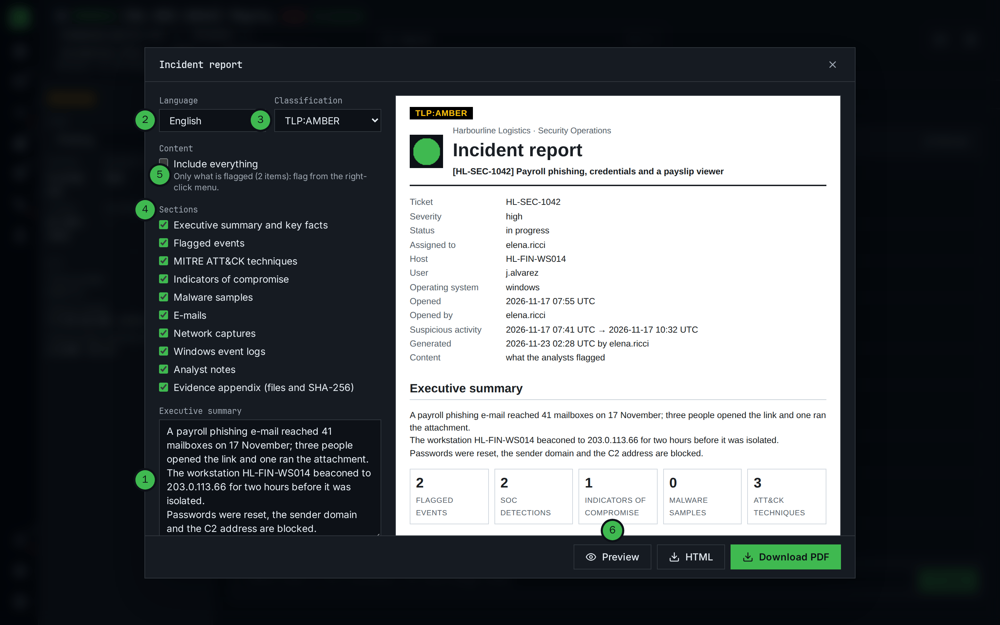
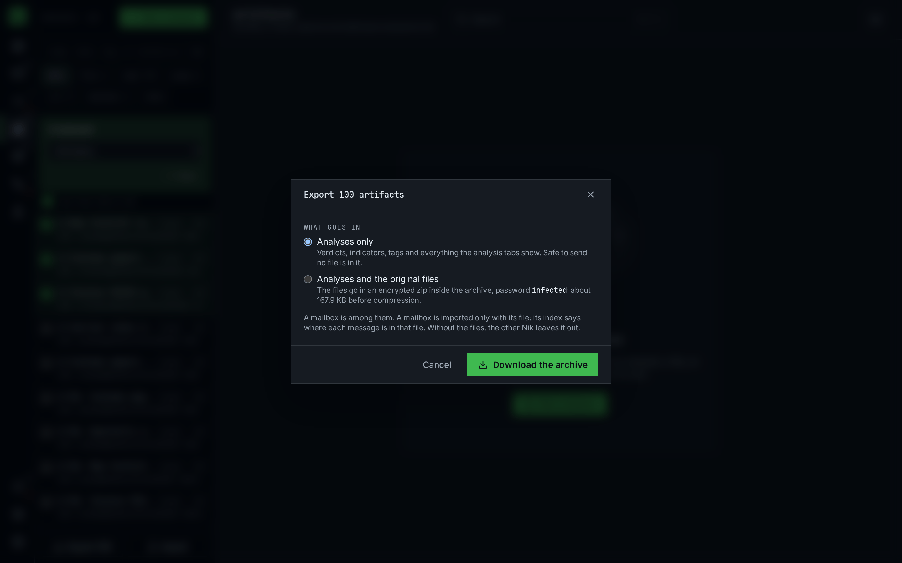
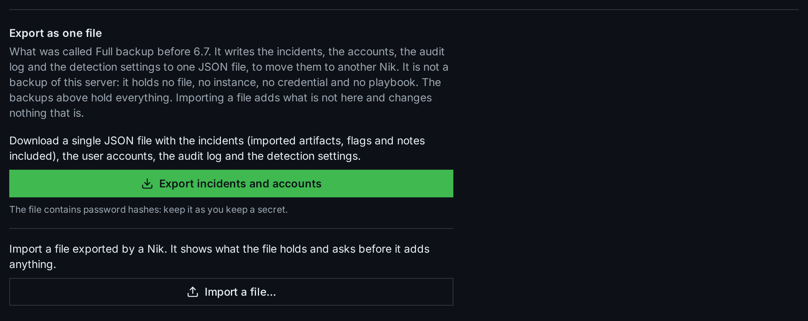

# Reports and exports

Hand over an incident as a PDF or HTML report, move incidents and evidence to another Nik, and export content as one file.

## The incident report

1. Open the incident and click **Incident report** in the header. From the list: right-click an incident › **Incident report…**.
2. Write the **Executive summary** 1: what happened, the impact, what was done and what should happen next. It is saved with the incident.
3. Pick the **Language** 2 (English or Italiano) and the **Classification** 3 (TLP:CLEAR to TLP:RED; TLP:AMBER at first).
4. Tick or untick the **Sections** 4.
5. Choose the **Content** 5: what is flagged, or **Include everything**.
6. Click **Preview** 6 to see the report as the server builds it.
7. Click **Download PDF**, or **HTML**.

The options are kept per incident and saved as you change them.

### What goes in

By default the report holds **what you flagged**, so it stays about the incident and not about everything imported:

| Section                                                | Holds                                                                                                                         |
| ------------------------------------------------------ | ----------------------------------------------------------------------------------------------------------------------------- |
| **Executive summary and key facts**                    | Your summary, and the details of the incident: status, owner, severity…                                                       |
| **Flagged events**                                     | The flagged events, in order, with their comments. Host records are read from the server's tables                             |
| **MITRE ATT&CK techniques**                            | Those of the flagged samples and of the detections on flagged events                                                          |
| **Indicators of compromise**                           | The indicators flagged by hand                                                                                                |
| **Malware samples**, **E-mails**, **Network captures** | Those flagged, or holding something flagged (an indicator, a function, a packet)                                              |
| **Windows event logs**                                 | The logs that hold a flagged event                                                                                            |
| **Rule matches**                                       | The [Sigma rules](detection.md#sigma-rules) that matched host evidence: the rule, its level, how many records, and its author |
| **Analyst notes**                                      | Every note                                                                                                                    |
| **Evidence appendix (files and SHA-256)**              | The SHA-256 of the imported files that hold something flagged                                                                 |

### Evidence integrity

Beside the sections is a tick, **Evidence integrity**, on by default, asked for with each report. It adds a table that says, for each file of [host evidence](host.md): the parser and its version, the records **in the file**, **read**, **kept**, **already imported** and **lost**, and how it was **read**: _complete_, _read in part_, _failed_, _not read yet_, or _no report: imported before 7.0_. A file read in part says why, and who acknowledged it, and when. The last line counts the files, those read in part and those that failed.

A reader of the report can see what the evidence does not cover. Detections in the report come from the server: the rules that matched, with their authors, as the licence of the rule sets asks.

Tick **Include everything** for the full inventory instead: every indicator, sample, e-mail, capture and imported file of the incident. The choice is kept per incident.

!!! tip "Nothing in the report?"
    Flag what matters first: right-click a row › **Flag the …**, or ++f++. See [Flags and comments](war-room.md#flags-and-comments).

### Your organisation's name and logo

An administrator sets them once under **Platform settings › Analysis › Report header**. The logo must be 256 KB or smaller. They are printed at the top of every report.

### A dashboard as a PDF

A dashboard has its own **Report** button: see [Dashboards and My tasks](dashboards.md#read-a-dashboard).

## Export and import incidents

**Export one:**

1. Right-click the incident in the list › **Export (JSON)**.

The file holds everything the incident holds, to archive it or hand it to another Nik. To export many, select them and choose **Export (JSON)** in **Actions…** (25 at a time): see [Act on many at once](bulk.md).

**Import one:**

1. In **Incidents**, click **Import incident**.
2. Choose the `.json` file.

!!! note
    An imported incident starts **Unclassified**: its type and its fields are those of the Nik it came from. Set its type afterwards.

## Export and import artifacts

1. Export from the artifacts panel (**Export**: what the filter lists, 500 at most), from an artifact's page, or from its right-click menu › **Export…**.
2. Choose what goes in:
    - **Analyses only** (the default): verdicts, indicators, tags and everything the analysis pages show. Safe to send: no file is in it.
    - **Analyses and the original files**: the files go in an encrypted zip inside the archive, password `infected`. The dialog says how large they are.
3. Click **Download the archive**.

A capture and a mailbox travel only with their file. Without the files, the other Nik leaves them out.

**Import** (administrators), beside **Export** in the artifacts panel, adds the artifacts this server does not have. A file is stored only when its SHA-256 matches its artifact, and nothing is run.

To export many files in one archive, select them and use **Download together…**: see [Act on many at once](bulk.md).

## Export and import indicators

From the Indicators page or the Indicators tab of an incident, **Export…** writes the chosen indicators as:

| Format | For |
|---|---|
| CSV | A spreadsheet, a SIEM lookup |
| JSON | Scripts, import in Nik |
| STIX 2.1 | A TIP, OpenCTI |
| MISP | An event with attributes |
| Text | One value per line |

To import, drop the file anywhere in the window. See [The Indicators page](indicator-library.md).

## Export content as one file

!!! note "You need"
    The Admin role.

**Platform settings › System › Backup**, at its foot: **Export as one file**.

- **Export incidents and accounts** writes one JSON file with the incidents (imported artifacts, flags and notes included), the accounts (with their password hashes), the audit log and the detection settings. Keep it as you keep a secret.
- **Import a file…** shows what the file holds (incidents, users, audit entries) and asks. **Add to this server** adds what is not here. Nothing that is here is changed or deleted. An account that arrives signs in with the password it had.

!!! warning "This is not a backup"
    The file holds no file of the store (samples, e-mails, captures, mailboxes), no indicators of the Indicators page, no playbook, script, connector, instance or credential. It moves content between two servers. The server's own backups are in [Backups and restore](../admin/backups.md). Playbooks and connectors travel as [Content packs](packs.md).

## Related

- [Summary, timeline and War Room](war-room.md)
- [Act on many at once](bulk.md)
- [Add evidence](evidence.md)
- [The Indicators page](indicator-library.md)
- [Backups and restore](../admin/backups.md)
- [API](../reference/api.md)
