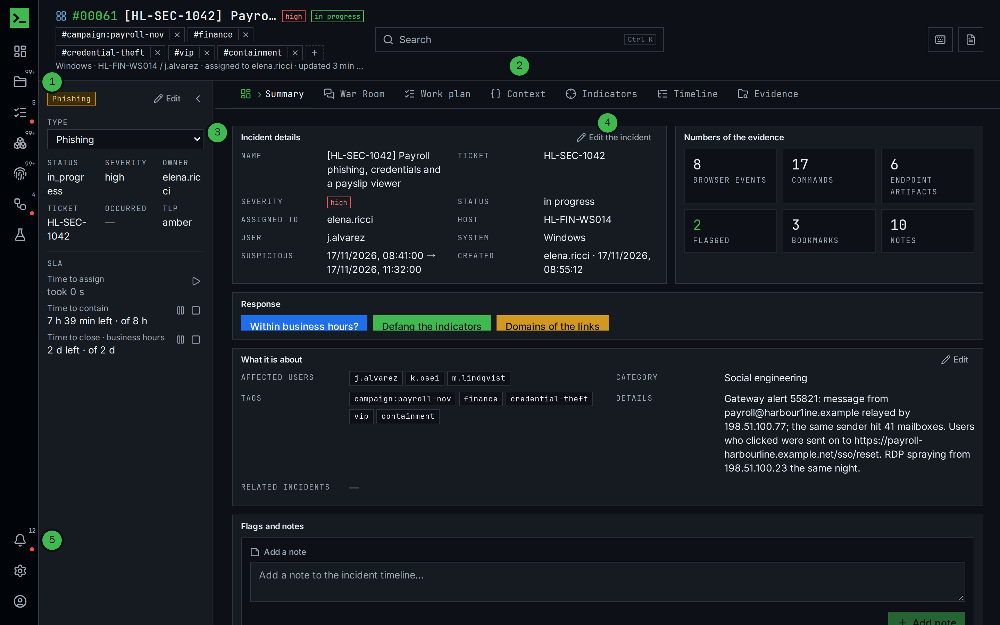
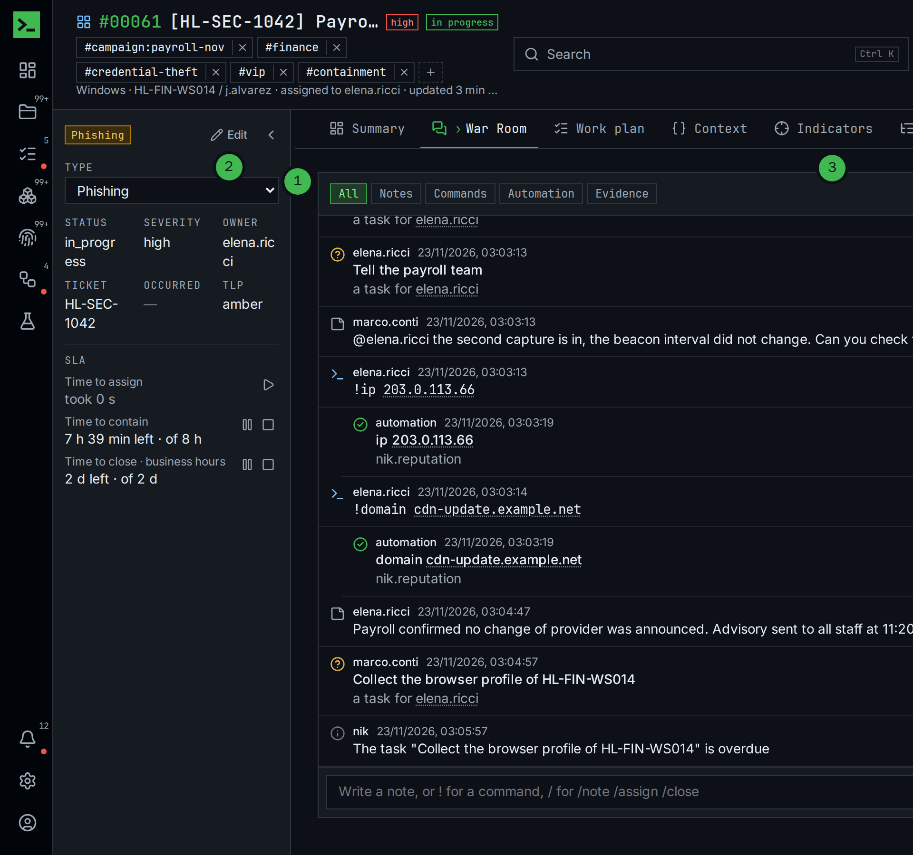
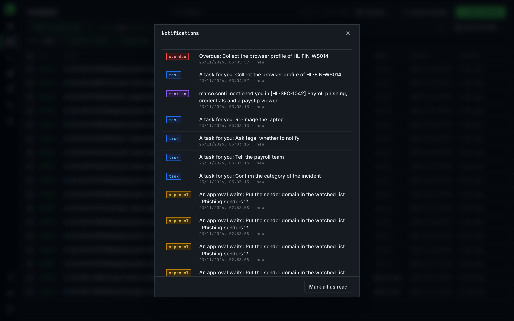
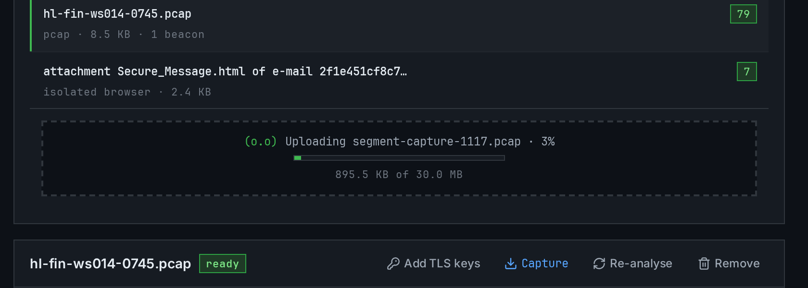
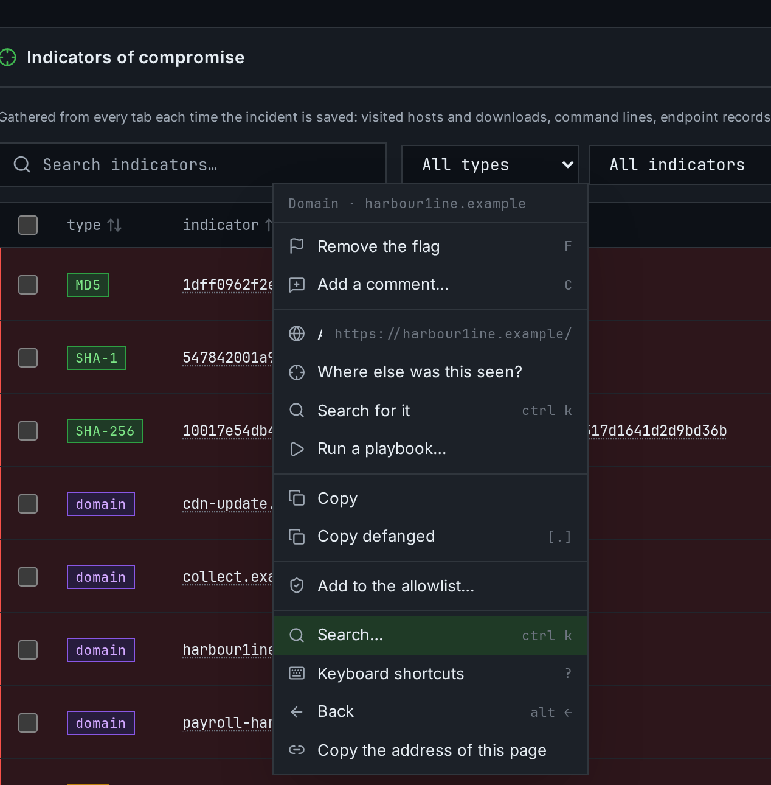
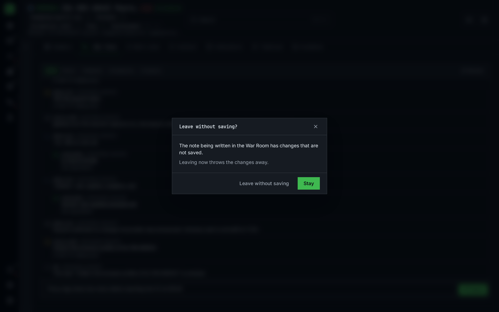

# Find your way around

Know every part of Nik's screen, its menus and its shortcuts.

| | Part | |
|---|---|---|
| 1 | The rail | [The rail](#the-rail) |
| 2 | The header: the name of what is open, the search, the shortcuts, the report | [The header](#the-header) |
| 3 | The facts of the incident | [An open incident](#an-open-incident) |
| 4 | The tabs of the incident | [An open incident](#an-open-incident) |
| 5 | The bell | [Notifications](#notifications) |

## The rail

The narrow column of icons on the left. Point at an icon to read its name.

| Entry | Opens | You need |
|---|---|---|
| **Dashboards** | The dashboard you chose for sign-in, or the first. [Dashboards](dashboards.md) | |
| **Incidents** | The list of incidents. [Work an incident](incidents.md) | |
| **My tasks** | What waits for you. The icon counts it, with a dot when something is overdue. [My tasks](dashboards.md#my-tasks) | |
| **Artifacts** | Every file, e-mail and capture analysed so far (`/artifacts`). [Add evidence](evidence.md) | |
| **Indicators** | The Indicators page, with its side panel of lists. [The Indicators page](indicator-library.md) | |
| **Automations** | The playbooks, their runs and approvals. [Your first playbook](playbooks.md) | Analyst or Playbooks |
| **Playground** | A War Room outside any incident, to try commands. [Scripts and the Playground](scripts.md) | Analyst or Playbooks |

At the foot of the rail:

- the **Notifications** bell ([below](#notifications));
- **Platform settings**, the gear;
- **your account**: your name and roles, **My account**, **Sign out**.

An entry is shown only to the accounts whose roles let them use it.

!!! tip "An entry always goes to the first screen of its section"
    **Incidents** shows the list, also from an open incident. **Automations** shows the playbooks, also from the editor. Pressed on that first screen, an entry does nothing. The browser's **Back** returns to where you were.

A page that takes the whole area (Dashboards, My tasks, Automations, the Playground, Settings) has its own close button at its top right. It goes back to what was open before.

### Side panels

The artifacts and the Indicators come with a list in a side panel.

- The button at the top right of the panel (**Hide the artifacts panel**, **Hide the indicators panel**) gives the whole width to what is open. Press the rail entry again to bring the panel back.
- Every side panel can be resized: drag its edge. Or focus the edge with ++tab++ and use the arrow keys (++shift++ for a larger step, ++home++ / ++end++ for the narrowest and widest). A double-click or ++enter++ puts the width back. Each panel remembers its width in your browser.

### Settings

**Platform settings** opens a page with the sections on the left, in groups (Analysis, Indicators, Rule sets, Incidents, Lists, Automation, Access, System).

- Type in **Find a setting** to narrow the sections by name or by what they hold (`password`, `restore`, `domains`).
- Every section has its own address, such as `/settings/access/accounts`: bookmark it or send it.
- You see only the sections your roles allow.

## The header

- **The search bar**, in the middle of every page. Click it or press ++ctrl+k++ (++cmd+k++ on a Mac) or ++"/"++. See [Global search](search.md#global-search).
- **Keyboard shortcuts** (the keyboard button), the same as ++"?"++.
- **Incident report**, when an incident is open. See [Reports and exports](reports.md).
- **read-only**, when your roles let you read and not change.

On a narrow window the search bar shrinks to its magnifier first.

## An open incident

- **The facts column** 1: the type of the incident and its key facts (status, severity, owner, ticket, TLP, or whatever its type puts there). **Edit** 2 changes them. The select changes the type: values the new type does not show are hidden, not lost. The arrow folds the column away.
- **The tabs** 3: Summary, War Room, Work plan, Context, Indicators, Timeline, Evidence, and the pages of its type. A type can reorder and hide tabs. On a narrow window the tabs shorten to icons; the open one always shows its name.
- **SLA timers** and **Mirror** appear in the facts column when the type times its incidents or the incident is mirrored. See [Work an incident](incidents.md#sla-timers).

More: [Summary, timeline and War Room](war-room.md).

## Notifications

The bell counts what is new. You are told when:

- a task is given to you, or is overdue;
- an approval waits for you;
- a colleague writes `@you` in a War Room;
- a timer of an incident you own is past its time.

Administrators are also told when a worker stops answering and when it is back, and when a row of the health page gets worse. Click a notification to go where it points.

## Progress and the transfers tray

What is on its way always says so the same way:

- a file going up or down shows a **bar** with how much has passed;
- anything else that takes a moment (a report being built, an export being prepared) shows the blinking skull `(o.o)` with a sentence, in or beside the button that started it.

A transfer with no place of its own (a file dropped anywhere, an export started from a menu, a bulk action running in the background) is shown in the **Transfers** tray at the foot of the window until it ends. An upload cut by a restart of the server stays there with **Try again** and **Dismiss**.

## Right-click menus

A right-click opens Nik's menu on every page, never the browser's. The menu key or ++shift+f10++ opens the same menu on what has the focus.

The menu is built from what is under the pointer, innermost first:

| Part | Offers | Where |
|---|---|---|
| The item's own actions | **Open**, **Run a playbook…**, **Export…** | Incidents, artifacts, playbooks, runs, tasks… |
| Flag and comment | **Flag the …** / **Remove the flag**, **Add a comment…** (flags too) | Rows of evidence, events, indicators, inside an incident |
| Indicator | **Where else was this seen?**, **Search for it**, **Copy**, **Copy defanged**, **Add to the allowlist…** | Any address, domain, IP, hash or e-mail address |
| Copy | **Copy as text**, **Copy as JSON**, or one field | Everywhere |
| Show in the Timeline | Opens the Timeline filtered on the item | Flaggable items |
| Remove or delete | Last, after a line | Lists, notes, tags |

Then, around the item:

- **Selected text**: **Copy**; for an address or indicator also **Where else was this seen?**, **Search for it**, **Add to the Indicators…**.
- **A text field**: **Cut**, **Copy**, **Paste**, **Select all** (greyed with the reason when they do not apply). The first **Paste** may make the browser ask for the clipboard; ++ctrl+v++ always works.
- **A link**: **Open**, **Open in a new tab**, **Copy the address**.
- **A cell or a line**: **Copy this cell**, **Copy this row**, **Copy this text**.
- **What the page offers**: **New incident…** and **Columns…** on the list of incidents, **Refresh** on lists that have it.
- **Always last**: **Search…**, **Keyboard shortcuts**, **Back**, **Copy the address of this page**.

!!! note
    The body of an e-mail, a scanned page and the report are shown in a sealed frame. A right-click inside it is the browser's.

## Keyboard shortcuts

Press ++"?"++ for the list.

| Key | Does |
|---|---|
| ++f++ | Flag the row under the pointer, or remove its flag. Removing a flag removes its comments; the notice has **Undo**. |
| ++c++ | Comment on the row under the pointer (it is flagged too). |
| ++ctrl+k++ or ++"/"++ | Search. |
| ++ctrl+v++ | Paste a file, an address or an indicator to analyse it. |
| ++shift+f10++ or the menu key | The right-click menu of what has the focus. |
| ++esc++ | Close a menu or the dialog on top. |
| Click, ++up++ / ++down++, ++enter++ | In the list of incidents: quick view of a row, move from row to row, open the incident. |
| ++space++ · ++shift+down++ / ++shift+up++ · ++ctrl+a++ | Tick a row · tick the next one too · tick the rows on screen. See [Act on many at once](bulk.md#select-rows). |

++f++, ++c++ and ++"?"++ act on the row under the pointer, or on the focused row after ++tab++. They are off while you type and while a dialog is open.

!!! tip "Dictation or an assistive tool?"
    Untick **Single-key shortcuts (F, C, ?)** at the bottom of the list. The choice is kept in your browser.

Everything works without a mouse: ++tab++ stops on every row that has a menu, a dialog keeps the focus inside, and ++esc++ closes only the dialog on top.

## Nothing unsaved is lost without asking

Most things save themselves as you go. While a form, an editor or a dialog holds changes that are **not saved**, anything that would take you away asks first: a rail entry, another tab, a link, **Back**, ++esc++, a click outside a dialog, signing out.

The dialog names what is not saved and offers:

- **Stay** (also ++esc++);
- **Leave without saving**;
- **Save and leave**, where what you edited can be saved from there. If saving fails you stay, and the reason is shown.

A form you opened and did not touch never asks. What saves itself (a playbook's canvas, a script's code, the report options, tags) is never asked about. Closing or reloading the browser tab with unsaved work makes the browser ask.

If a change cannot reach the server, a red bar says **Changes not saved yet**. Nik keeps trying; **Retry now** tries at once.

## Related

- [Search, filters and saved views](search.md)
- [Work an incident](incidents.md)
- [Act on many at once](bulk.md)
- [Accounts, roles and sign-in](accounts.md)
- [First sign-in](../get-started/first-sign-in.md)
