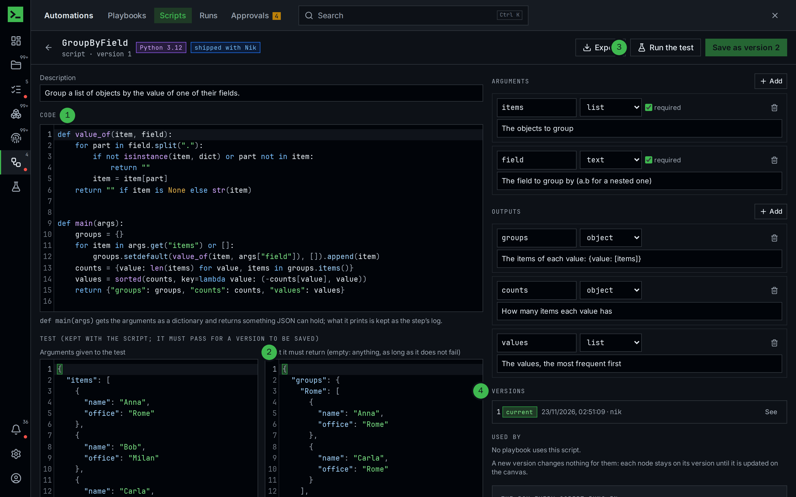
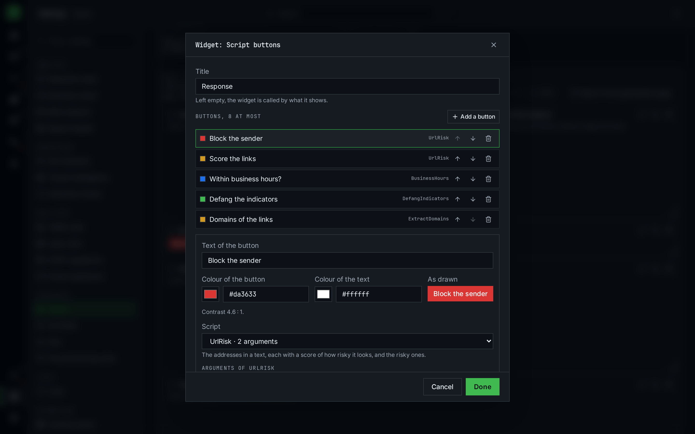
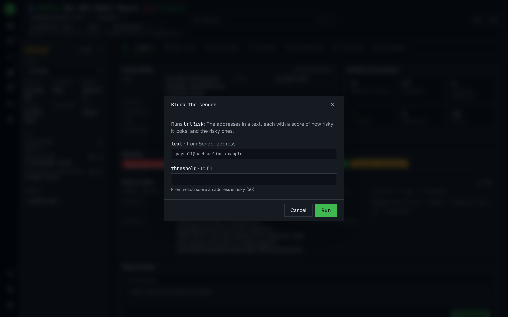
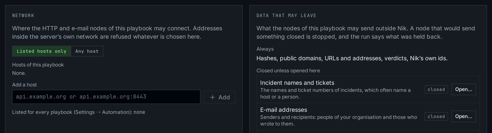
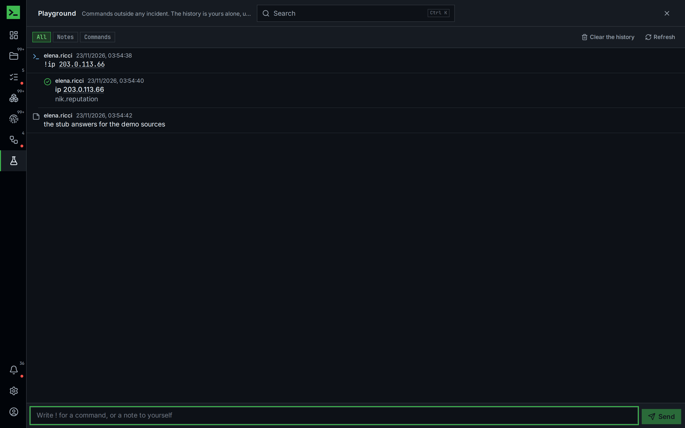

# Scripts and the Playground

Write a piece of Python once and use it as a node, a War Room command or a button; try commands in the Playground.

!!! note "You need"
    The **Playbooks** role (or **Admin**) to write scripts. Running one (a node, a command, a button, the Playground) needs the permission to run playbooks, which **Analyst** has.

## Write a script

A script is a function `main(args)` with named arguments and outputs. It runs in the [sandbox](#the-sandbox).

```python
def main(args):
    groups = {}
    for item in args["items"]:
        groups.setdefault(item.get(args["field"], ""), []).append(item)
    return {"groups": groups, "count": len(groups)}
```

1. Open **Automations › Scripts** and press **New script**.
2. Give a **Name**: a capital letter, then letters and digits (`GroupByField`). It cannot be changed later: nodes and commands call the script by it.
3. Give a **Description** in a line: the library of nodes shows it. Press **Create**.
4. Write the **Code**. What it returns must be something JSON can hold. What it prints is kept as the step's log.
5. Declare the **Arguments** (name, type, required, description) and the **Outputs**. Later nodes read an output as `{{ node.groups }}`.
6. Fill the **Test**: **Arguments given to the test** and, if you want, **What it must return**. An empty expectation passes when the script does not fail.
7. Press **Run the test**. It runs the draft in the sandbox and shows the result and what was printed.
8. Press **Save as version 1**. The test runs again; the version is saved only when it passes. The script is then in the library of nodes, under **Scripts**.



- <span class="step">1</span> The code, Python 3.12.
- Arguments and outputs, on the right.
- <span class="step">2</span> The test: the arguments it is given and what it must return. <span class="step">3</span> **Run the test** shows its result.
- <span class="step">4</span> **Versions** and **Used by**.

??? info "Versions, updates and the context"
    - A script with no version is a draft (*draft · not usable yet*): it is in the list, not in the library of nodes.
    - A playbook keeps the version of a script it was saved with. When a newer one exists, the playbook is marked *updates available* and the node offers **Update to version N**.
    - **See** on a version shows what the draft changes from it, line by line, and can put that version back in the draft. Each version is in the audit log with the difference in the code.
    - An output can be written to the incident's context: in the file of a script, give it a `context_path` beside its `name` and `type` (`{ name: hosts, type: list, context_path: "Host(val.Name == obj.Name)" }`). The forms of a path are in [Playbook nodes and expressions](../reference/playbook-nodes.md#the-context-of-an-incident).

**Export** on a script's page gives a JSON file; **Import** on the list brings one in as a draft, which enters the library when its test passes here.

## Where a script runs

A script with a saved version runs in four ways, always in the same sandbox:

| From | How |
| --- | --- |
| A playbook | As a node, with the arguments the node gives it |
| The War Room of an incident | Typed by its name: `!ExtractDomains text=${incident.details}` ([War Room commands](commands.md)) |
| The Playground | Typed the same way, with no incident ([below](#the-playground)) |
| A script button | Pressed on the page of an incident ([below](#script-buttons)) |

### Script buttons

A type of incident can put a **Script buttons** widget on its Summary or its other pages: up to eight buttons, each running a script on the incident.

1. In **Platform settings › Incidents › Types**, open a type, choose **Pages**, and add the widget **Script buttons** ([Types, fields and pages](types.md#pages-of-a-type)).
2. Press the pencil of the widget. For each button choose its text, its two colours (picker or `#rrggbb`), the script, and what each argument receives:
    - nothing: it is asked when the button is pressed;
    - a template such as `{{ sender_address }}`: filled from that field of the incident. Typing `{{` offers the fields of the type and `incident.number`, `incident.host`, `incident.user`, `incident.url`. Text may stand around it (`INC {{ incident.number }}`).
3. Save the type.



On the incident, pressing the button opens a dialog with every argument: those filled from the incident (read-only, with their field) and those to fill.

- A field that holds several values runs the script **once for each**: the button reads **Run 3 times**. Only one argument may hold several values; join another with `| join(", ")`. Above fifty runs the dialog asks a second time.
- The dialog lists the runs as they finish; **Run the failed one again** starts only those.
- Each run is written in the War Room as the command it is, with its result, and in the audit log.
- Under 4.5 : 1 of contrast, the settings warn that the text is hard to read (the button is saved all the same).



## The sandbox

| | |
| --- | --- |
| Where | Its own container, `sandbox`, on a network with no route outside, whatever the playbook may reach. Read-only filesystem, no capabilities, not root, no volume. |
| Each run | A new process with an empty environment: no secrets, no database, no files of Nik. Only the arguments of its node. |
| Limits | 10 seconds (`SANDBOX_TIMEOUT`), 256 MB of memory, 16 open files, no other process, 1 MB of result. |
| Python | The standard library of Python 3.12 only. Modules that open connections or start processes are refused on import. |

!!! warning "No sandbox, no scripts"
    When `SANDBOX_URL` is not set, **Automations › Scripts** says so: scripts cannot be tested, saved as versions or run.

What a script returns carries the classes of data of everything it was given, and "results of scripts" besides: a script cannot launder a value past the [data guard](#data-that-may-leave).

### The scripts Nik ships

Seven scripts ship with Nik, each with its test. They can be changed like any other; a later release adds its own version on top, and playbooks stay on the version they use.

| Script | What it does |
| --- | --- |
| `GroupByField` | Groups a list of objects by the value of one of their fields |
| `FilterList` | Keeps the items of a list whose field compares as asked |
| `ExtractDomains` | The host names in a text or a list of addresses and e-mail addresses, once each |
| `DefangIndicators` | Makes addresses and domains safe to paste in a message |
| `BusinessHours` | Whether a moment falls in working hours, from the days and hours given |
| `CsvToList` | Reads CSV text into a list of objects, named by the header row |
| `VerdictChanges` | What changed between two checks of the same indicators, and a line that says it |

## What a playbook may reach and send

Two choices in a playbook's **Settings** decide what it does outside Nik. Both belong to an **Admin**. Opening either beyond the default asks twice (a box to tick, and the playbook's name typed) and is written in the audit log.

### Network

**Where the playbook may connect**:

- **Listed hosts only** (the default): the hosts in **Hosts of this playbook**, plus those every playbook may reach in **Platform settings › Automation › Network and data**. A host is a name or an address, with a port when it is not the usual one (`api.example.org:8443`). A name does not cover its subdomains.
- **Any host**: any address on the internet.

In both modes an address inside the network is refused: loopback, private, link-local and carrier-grade ranges, the containers of the stack, cloud metadata. To reach an internal system, list it **by name**. Every redirect is checked again, three at most.

### Data that may leave

Values carry the class of what they are, through filters, texts and scripts. A node that would send a closed class is stopped, and its step says what was held and which class to open.

| Class | By default |
| --- | --- |
| Hashes · public domains, URLs and addresses · verdicts · Nik's own ids | Always leave |
| Incident names and tickets · e-mail addresses · e-mail subjects · internal names and addresses · allowlisted indicators · file and attachment names · results of scripts | Closed; an admin opens each for a playbook |
| E-mail bodies · attachments · samples | Closed, under **Whole messages and files** and a warning of its own: they leave whole |
| TLP:RED data | Never leaves, in any playbook |



A private address, an internal name or an allowlisted value typed into a field by hand is caught too. More on the guard in [Security](../reference/security.md).

## The Playground

The **Playground** (on the rail, or `/playground`) is the War Room without an incident: try a command of a connector you just set up, or look something up.

1. Open **Playground** on the rail.
2. Type `!` and the command: the commands that match are listed, then the arguments still to give. ++enter++ runs it.
3. Plain text, or `/note`, is a note to yourself. `/assign` and `/close` are refused.



- **Nothing touches an incident.** A command that needs one fails and says so; `!ip` and the other look-ups add no indicator.
- **The history is yours.** Nobody else reads it, an admin included, until you press **Clear the history**. The runs behind the commands stay in **Automations › Runs** and the audit log.
- **Try it**, beside each command of a connector (**Platform settings › Automation › Connectors**), opens the Playground with that line ready: nothing is sent until you press ++enter++.

## Related

- [War Room commands](commands.md)
- [Your first playbook](playbooks.md)
- [Types, fields and pages](types.md)
- [Playbook nodes and expressions](../reference/playbook-nodes.md)
- [Security](../reference/security.md)
