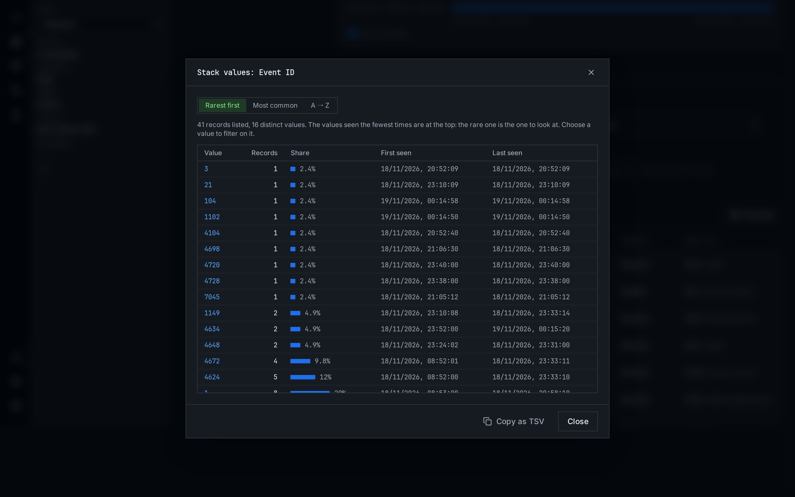

# Stacking

Count the values of a column and read the rare ones first.

Stacking is counting how many records share each value: a program that ran once on one host is more interesting than one that ran four thousand times. Every host page has it.

1. Open the menu in the header of a column. Only columns that can be counted have one.
2. Choose **Stack values**.
3. Read the panel: **Value**, **Records**, **Share**, **First seen** and **Last seen**.
4. Change the **Order** to put the rare values first, or the common ones.
5. Press a value to filter the table on it.

**Copy as TSV** copies the panel as tab-separated text, to paste in a spreadsheet.

The count follows the filters of the page: filter first on a host, a time range or a detection, then stack. The other choices in the same menu are **Sort**, **Filter on a value** and **Hide**.

## Related

- [Event Logs](eventlogs.md)
- [Timeline](timeline.md)
