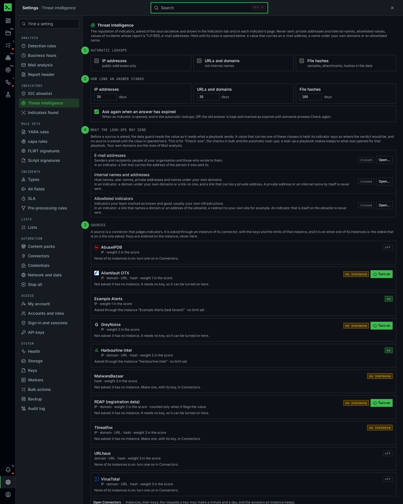
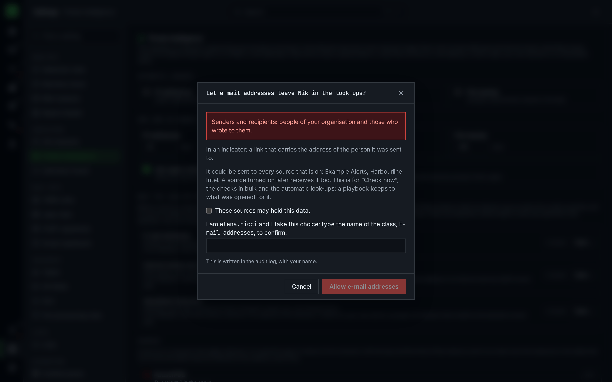
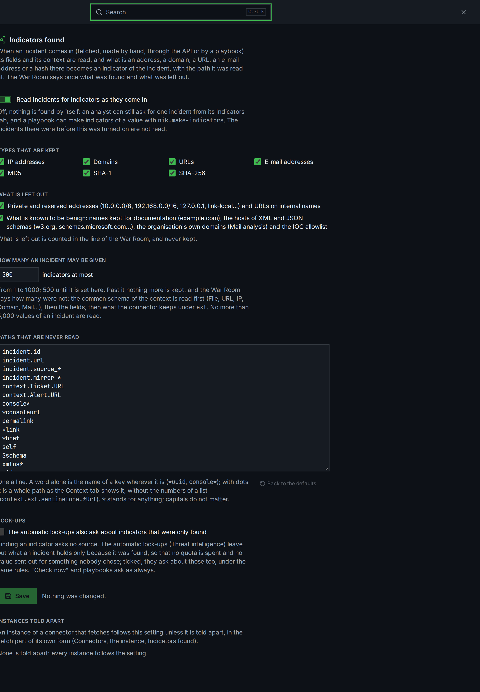

# Threat intelligence

Choose which sources judge your indicators, when they are asked, how much they may be asked, and what may be sent to them.

!!! note "You need"
    **Admin** for **Platform settings › Indicators › Threat intelligence** and **Indicators found**. The keys and limits of a source are set on its instance: the **Connectors** role ([Connectors and mirroring](connectors.md)). Installing a source's pack: **Admin** ([Content packs](packs.md)).

## Sources

A **source** is a connector that judges indicators: VirusTotal, AbuseIPDB, urlscan.io, ThreatFox, URLhaus, MalwareBazaar, AlienVault OTX, GreyNoise, Shodan, Google Safe Browsing, RDAP, or any connector whose file marks a command `reputation`. Each comes as a content pack.

To turn a source on:

1. Install its pack: **Platform settings › Automation › Content packs** ([Content packs](packs.md#install-a-pack)).
2. Make an instance of its connector with your key: **Platform settings › Automation › Connectors › Add instance** ([Add an instance](connectors.md#add-an-instance)). A source that needs no key (RDAP, Shodan's InternetDB, urlscan.io and GreyNoise without an account) has a **Turn on** button in **Threat intelligence** that makes the instance for you.
3. The source is on while one of its instances is on. With several, the oldest that is on is asked.

- 1 **Automatic lookups**, per type.
- 2 **How long an answer stands**.
- 3 **Sources**: each with what it judges, its weight in the score, whether it is on and through which instance.
- 4 **What the look-ups may send**.

A source's **weight** (1 to 3, from its connector file) is how much its verdict counts in the overall score. An *informational* source (who registered a domain) counts only when it flags the value. A look-up runs the one command marked for that kind of indicator, never one that needs a paid plan or changes something at the vendor.

## Look-ups

| Look-up | Started by |
| --- | --- |
| **Check now** | A person, on an indicator's window or page |
| **Check all** | A person, on an incident's **Indicators** tab, or a selection of indicators |
| Automatic look-ups | The worker, for the types switched on below |
| `!ip`, `!domain`, `!url`, `!file`, `!email` | A person, in the War Room ([War Room commands](commands.md#reputation-look-ups)) |
| **Reputation of an indicator** | A playbook node (`nik.reputation`) |

An answer that still stands is not asked again. An e-mail address is looked up only by a playbook or a War Room command.

### Automatic look-ups and how long an answer stands

| Setting | Default |
| --- | --- |
| **Automatic lookups**: **IP addresses** (public only), **URLs and domains** (not internal names), **File hashes** | all off |
| **How long an answer stands**: IP addresses · URLs and domains · file hashes | 30 · 30 · 180 days (1 to 730) |
| **Ask again when an answer has expired** | on |

With **Ask again…** off, an expired answer is kept and marked as expired until someone presses **Check again**.

## Quotas and limits of a key

A free key runs out fast. The limits live on the instance of the source, tab **Keys** ([Connectors and mirroring](connectors.md#several-keys-limits-and-kept-answers)):

| Setting | What it does |
| --- | --- |
| **Requests a minute**, **Requests a day** | The most a key may be asked; counted per UTC day |
| **Add a key** and **How the keys take turns** | Several keys for one source |
| **When every key is used up** | **Wait for the first key to come back**, or **Fail the command** |
| **Keep an answer for this many hours** | Answers kept and given back without a request |

A key is also used up when the vendor answers `429`; it is left alone for a while, and the next key is tried.

!!! warning "Check the vendor's terms"
    Some vendors do not allow several free accounts to raise their limits. Check before giving an instance more than one key.

## The data guard

Two rules decide whether a value is sent to a source.

1. **Never sent**, whatever is set: a private, loopback or reserved address, an internal name, a value on the IOC allowlist, a value of an incident marked TLP:RED.
2. **The data guard** reads what passed, and **holds** the look-up when the value carries:

    | Class | Example |
    | --- | --- |
    | An e-mail address | `https://portal.example.org/reset?user=anna.bianchi@example.org` |
    | An internal name or address | A domain under your organisation's domains, a link with a private address in it |
    | An allowlisted name | A link that names a domain of the allowlist |

A held indicator says *held*, the classes it carries, and that an admin can open them. No source was asked. Nothing is remembered: once the class is opened (or the allowlist or your domains change), it is looked up.

To open a class:

1. In **Threat intelligence**, under **What the look-ups may send**, press the button of the class.
2. Tick the box (*These sources may hold this data*) and type the name of the class.
3. Confirm. It is written in the audit log with your name, and goes to every source that is on.

!!! info "Two separate settings"
    This setting is for **Check now**, the checks in bulk and the automatic look-ups. A look-up made by a playbook keeps to the classes opened for that playbook ([What a playbook may reach and send](scripts.md#data-that-may-leave)). Neither opens anything for the other.

Your organisation's domains are those of **Mail analysis** ([Detection and rules](detection.md#mail-analysis)). The allowlist is in [Lists and the allowlist](lists.md).

## Indicators found

**Platform settings › Indicators › Indicators found** decides how Nik reads a new incident for indicators by itself: its fields and its context, as it comes in (fetched, by hand, by the API, by a playbook) and at each update a mirror brings.

| Setting | Default |
| --- | --- |
| **Read incidents for indicators as they come in** | on |
| **Types that are kept** | IP, domain, URL, e-mail, MD5, SHA-1, SHA-256 |
| **What is left out**: private and reserved addresses and URLs on internal names; what is known to be benign (documentation names, XML and JSON schema hosts, your own domains, the allowlist) | both left out |
| **How many an incident may be given** | 500 (1 to 1000) |
| **Paths that are never read** | Nik's list (identifiers, versions, console links…) |
| **The automatic look-ups also ask about indicators that were only found** | off |

- **Paths that are never read**: one a line. A word alone is a key name anywhere (`*uuid`, `console*`); with dots it is a whole path as the Context tab shows it, without list numbers (`context.ext.sentinelone.*Url`). `*` stands for anything. **Back to the defaults** restores Nik's list.
- Past the limit, the War Room line says how many more there were, and none of them is kept.
- Finding an indicator asks no source. **Check now** and playbooks ask as always.
- An instance that fetches follows this setting unless it is *told apart* in its own **Fetch** tab; **Instances told apart** lists them.
- Off, nothing is found by itself: an analyst can still press **Find indicators now** on one incident, and a playbook can use **Make indicators of a text**.

See [Indicators of an incident](indicators.md) for how found indicators look and how to remove them.

## Related

- [Indicators of an incident](indicators.md)
- [The Indicators page](indicator-library.md)
- [Lists and the allowlist](lists.md)
- [Content packs](packs.md)
- [Connectors and mirroring](connectors.md)
- [Security](../reference/security.md)
