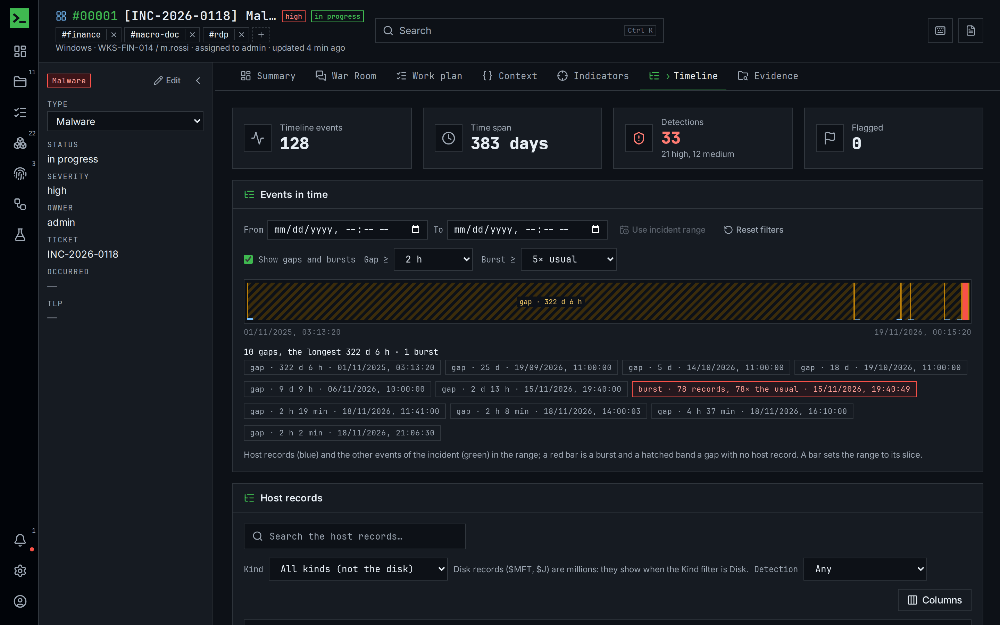

# Timeline

Read every event of an incident, and the host records of the server, in time. Find the quiet hours and the bursts.

**Incident › Timeline.** It holds two parts: **Events in time**, a density chart of everything with a time, and **Host records**, a table of the records of the host evidence that the server holds. The events of the War Room, e-mails and captures are on the chart too: see [Summary, timeline and War Room](war-room.md).

## The host records

The table reads the server a page at a time. It joins the records of every kind of [host evidence](host.md) that have a time.

| Kind                | Holds                                           |
| ------------------- | ----------------------------------------------- |
| **Event log**       | Windows event logs                              |
| **Linux/macOS log** | Auth, journal, audit and unified logs           |
| **Browser**         | Visits, downloads, searches                     |
| **Command**         | Shell history with a time                       |
| **Endpoint**        | Registry hives, Prefetch, LNK, jump lists, SRUM |
| **Disk**            | `$MFT` and `$J`                                 |

1. Choose a **Kind**, or leave **All kinds (not the disk)**.
2. Filter by **Detection**, and set a time range, or press **Use incident range**.
3. Open a row's **Source** to read the record in its [original](viewer.md).

!!! note "The disk is off by default"
    A `$MFT` or a `$J` holds millions of records, and they would bury everything else. They show only when the **Kind** is **Disk**.

## Gaps and bursts

Under the chart, **Show gaps and bursts** marks two things in the host records.

- A **gap**: a stretch with no host record, at least as long as the threshold. It is drawn as a hatched band. A gap in the logs of a host that was working is the first thing to look at: a log cleared, a service stopped, a file that was not collected.
- A **burst**: a slice with several times the usual number of records. It is a red bar. A burst is a scan, a brute force, a mass copy.

Choose the thresholds: **Gap ≥** 30 min, 1 h, 2 h, 6 h or 24 h; **Burst ≥** 3×, 5× or 10× usual. The choice is kept in your browser. The line under the chart lists the gaps and bursts, up to twelve, and the others are counted. Press one to set the time range to it, and read what is inside.

!!! tip
    A single old record, such as the creation time of a file from years ago, makes a long gap. Set the range on the days of the incident with **Use incident range**.

## Related

- [Summary, timeline and War Room](war-room.md)
- [Host evidence](host.md)
- [Stacking](stacking.md)
