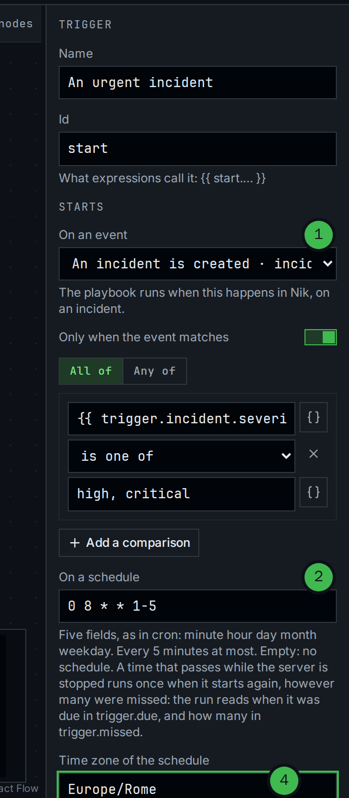
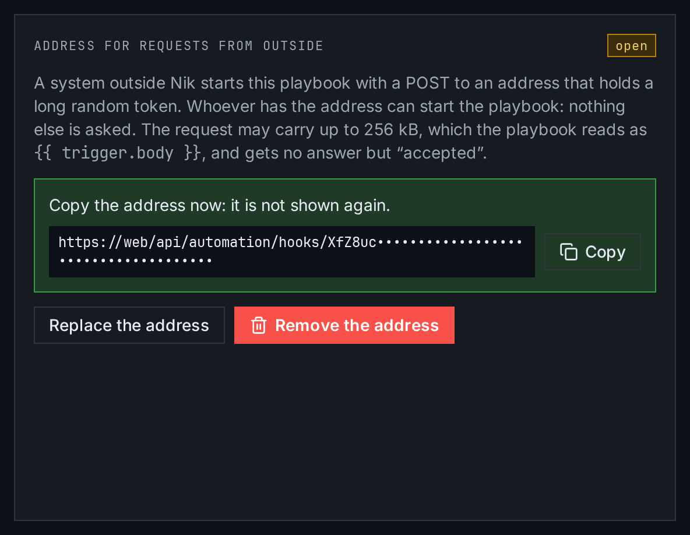
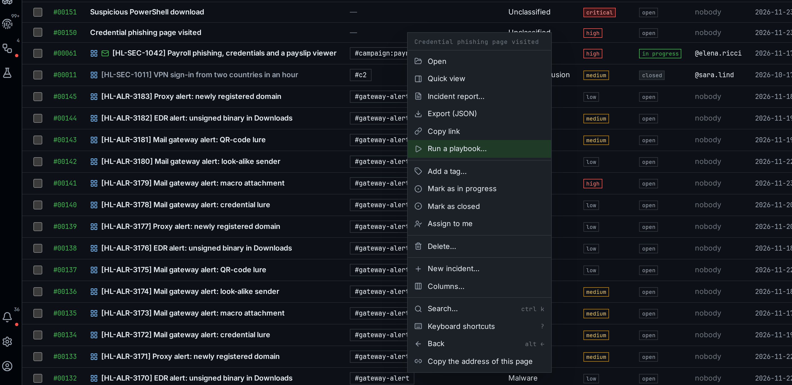

# Triggers and events

Choose what starts a playbook: something Nik analyses, an event, a schedule, a request from outside, or a person.

Every playbook has exactly one **Trigger** node. Its four ways to start can be used alone or together.



| In the inspector | Starts the playbook |
| --- | --- |
| <span class="step">1</span> **On an event** | when something happens in Nik ([below](#what-nik-analyses)) |
| <span class="step">2</span> **On a schedule** | at the times of a cron line ([below](#schedules)) |
| **Starts from outside** | when another system sends a request to its address ([below](#requests-from-outside)) |
| **Can be run by hand** | when a person runs it ([below](#a-person)) |

A run reads what started it under `{{ trigger.… }}`. Every field of every event is in [Events](../reference/events.md).

!!! note "The playbook must be on"
    Events, schedules and requests from outside start only a playbook that is **on** and has a version. See [Your first playbook](playbooks.md#9-turn-it-on).

## Only when the event matches

An event can be narrowed:

1. Choose the event in **On an event**.
2. Turn on **Only when the event matches**. Nik writes a first comparison to start from.
3. Change it: a left side (`{{ trigger.mail.verdict }}`), an operator (**is**, **is one of**, **matches the pattern**…), a right side (`phishing`).

The comparisons are those of a [Condition](../reference/playbook-nodes.md#condition) node. A list can be used too: `{{ trigger.mail.sender_domain | in_list('internal_domains') }}` **is** `true`.

## What Nik analyses

| Event | When |
| --- | --- |
| **An e-mail is analysed** · `mail.analysed` | An e-mail is analysed: uploaded alone or in an incident, analysed again, imported from a mailbox |
| **A file is analysed** · `file.analysed` | The analysis of a file ends |
| **The disassembly of a file ends** · `code.analysed` | Done or failed |
| **capa ends on a file** · `capabilities.analysed` | Done or failed |
| **The analysis of a capture ends** · `capture.analysed` | Ready or failed |
| **An address is scanned** · `url.analysed` | The scan of an address ends |

Example: tag every e-mail judged phishing that was not imported from a mailbox.

```text
On an event: An e-mail is analysed · mail.analysed
Only when the event matches:
  {{ trigger.mail.verdict }}       is         phishing
  {{ trigger.from_mailbox }}       is empty
```

An event a playbook's own step caused (a file it kept, an address it scanned) names the run: that playbook does not start again on it.

## Events about incidents and indicators

| Event                                                                          | When                                                                                                            |
| ------------------------------------------------------------------------------ | --------------------------------------------------------------------------------------------------------------- |
| **An incident is created** · `incident.created`                                | An incident is created (by hand, by the API, fetched, by a playbook)                                            |
| **An incident changes** · `incident.updated`                                   | One of its fields changes; `trigger.changed` lists which                                                        |
| **An indicator's verdict changes** · `ioc.verdict_changed`                     | What the sources say of an indicator, taken together, changes                                                   |
| **An incident holds a watched indicator** · `ioc.watch_hit`                    | An incident comes to hold an indicator of a watched list                                                        |
| **Indicators are found in an incident** · `indicators.found`                   | A reading of an incident kept indicators it did not hold                                                        |
| **A timer of an incident passes its time** · `sla.breached`                    | Once for each SLA timer                                                                                         |
| **The disk is nearly full** · `storage.low`                                    | Less than a tenth free; once a day while it stays so                                                            |
| **An artifact with a date is a week from being deleted** · `artifact.expiring` | Once                                                                                                            |
| **An artifact was deleted because its date came** · `artifact.expired`         | Once                                                                                                            |
| **Sigma rules match records of a host file** · `evidence.detected`             | A file of [host evidence](host.md) was read and at least one rule matched: [below](#events-about-host-evidence) |

### incident.created

Open a ticket for every high incident that has none yet:

```text
On an event: An incident is created · incident.created
  {{ trigger.incident.severity }}   is one of   high, critical
  {{ trigger.incident.ticket }}     is empty
```

### ioc.watch_hit

The run works on the incident. `trigger.list.name` and `trigger.ioc.value` are the first hit; `trigger.hits` lists them all (each with `type`, `value`, `list`, `incident`).

```text
On an event: An incident holds a watched indicator · ioc.watch_hit
  {{ trigger.list.name }}   is   Phishing senders
```

### indicators.found

Said once for a reading that kept something new: as an incident came in, at an update its mirror brought, or when someone pressed **Find indicators now**. Never once per indicator, and not at all for a reading that found nothing new. See [Indicators found by themselves](indicators.md).

`trigger.found.door` says how: `fetch`, `api`, `hand`, `playbook`, `mirror`, `asked`. `trigger.found.indicators` lists the first 100 (each `type`, `value`, `path`).

A playbook that checks what was found and tags the incident:

1. **Trigger**: **Indicators are found in an incident**, with **Only when the event matches** `{{ trigger.found.count }}` **is at most** `20` (leave the large readings to a person).
2. **For each** over `{{ trigger.found.indicators }}`.
3. Inside it, **Reputation of an indicator** with **kind** `{{ item.type | map(md5='file', sha1='file', sha256='file') }}` and **value** `{{ item.value }}`, then a **Condition** `{{ check.verdict }}` **is** `malicious`.
4. On **yes**: **Tag the incident** with `malicious-indicator`, and **Add a note** naming `{{ item.value }}` and `{{ item.path }}`.

!!! tip "It cannot start itself again"
    What a run writes to the context starts no reading. An incident a run makes is read, and its event names the run, so the playbook that made it does not start on it. The same event never starts the same playbook twice.

### Bulk actions

A bulk action changes each row through what changes one alone, so it writes the same events: closing 500 incidents writes 500 `incident.updated`. Two differences:

- `{{ trigger.bulk }}` is the id of the job, and empty for a change made alone. To ignore mass changes, add `{{ trigger.bulk }}` **is empty** to the trigger.
- While a playbook waits for the event, the job keeps to the pace of the engine: it waits while 50 events are still unread, or while they and the runs in progress would pass `AUTOMATION_MAX_ACTIVE_RUNS`.

The playbook's own limits still hold: one that starts 60 runs an hour starts 60 for a bulk change of 500. **Run a playbook on each**, from a selection of incidents, starts 20 unfinished runs at a time. No node starts a bulk action. See [Act on many at once](bulk.md).

## Events about host evidence

**Sigma rules match records of a host file** · `evidence.detected` starts a playbook **once for each file**, when the file has been read and at least one [Sigma rule](detection.md#sigma-rules) matched. It is not said once for each detection. The run works on the incident.

| Field                                            | Holds                                                                                          |
| ------------------------------------------------ | ---------------------------------------------------------------------------------------------- |
| `trigger.source.fileName`, `trigger.source.kind` | The file and its section (`eventlog`, `endpoint`, `browser`, `commands`, `disk`, `syslog`)     |
| `trigger.count`                                  | How many detections the file has                                                               |
| `trigger.level`, `trigger.levelNumber`           | The highest level among them, as a word and as a number from 1 (informational) to 5 (critical) |
| `trigger.rules`                                  | The rules that matched most, each with `id`, `title`, `level` and `count`                      |

A detection never changes the severity of an incident: a playbook that should react says so here. To act only on serious matches, use a condition on `levelNumber`:

```text
On an event: Sigma rules match records of a host file · evidence.detected
Only when the event matches:
  {{ trigger.levelNumber }}   is at least   4
```

Level 4 is **high**. Every field is in [Events](../reference/events.md#evidencedetected).

## Schedules

1. In **On a schedule**, write five fields as in cron: minute hour day month weekday. `0 8 * * 1-5` is 08:00 from Monday to Friday.
2. In **Time zone of the schedule** (<span class="step">4</span> in the picture at the top), name the zone: `Europe/Rome`. Empty is UTC.

- A schedule fires every five minutes at most.
- A firing that finds the run of the last one still going is skipped.
- Times missed while the server was down run **once** when it is back. The run reads `{{ trigger.due }}`, `{{ trigger.late_seconds }}` and `{{ trigger.missed }}` (how many other times passed).

Example: every Monday at 06:30 UTC, `30 6 * * 1` (the shipped *Weekly re-check of the watched lists*).

## Requests from outside

Another system starts the playbook with a `POST` to the playbook's own address.

1. Turn on **Starts from outside** in the trigger and save a version.
2. Open the playbook's **Settings**, **Address for requests from outside**, and press **Create the address**.
3. Copy the address now: it is shown once. It ends with a long random token.



```http
POST https://nik.example.org/api/automation/hooks/<token>
Content-Type: application/json

{"alert": "beacon", "host": "WKS-12"}
```

The playbook reads `{{ trigger.body.host }}`, `{{ trigger.query }}` and `{{ trigger.headers }}`.

| Answer | When |
| --- | --- |
| `202 {"accepted": true}` | The run started |
| `404` | No such address, a playbook that is off or does not start from outside, automation stopped (one answer for all) |
| `413` | Body over 256 kB |
| `400` | JSON that cannot be read |
| `429` | Over 60 requests a minute for the address, or the playbook's runs an hour |

!!! warning "The address is the credential"
    Whoever has it starts the playbook: no account, no API key (a cookie or a key sent along is not read). Nik keeps only its SHA-256. **Replace the address** and **Remove the address** stop the old one at once. Of the headers, only the content type, the user agent and the sender's own `X-` headers are kept.

The address is under the same origin as the rest of Nik, behind the same reverse proxy: the sender must reach it.

!!! info "Nik telling another system"
    The opposite way, Nik can send the same events to an address of yours as signed webhooks, with no playbook: `/api/webhooks` in the [API](../reference/api.md).

## A person

With **Can be run by hand** on, a person starts the playbook:

- **Run a playbook…** in the right-click menu of an incident, an analysed e-mail, file or address, and an indicator; on an incident's **Automation** tab; on an artifact's page.
- **Run…** on the playbook's page: choose **On which incident**, or leave it empty to run on nothing.



A playbook whose event is about one kind of object is offered on that kind only. One with no event is offered everywhere. The run reads `{{ trigger.actor }}` (who started it) and the fields of what it was run on (`trigger.incident.…`, `trigger.mail.…`, `trigger.ioc.…`).

A playbook without **Can be run by hand** can still be tried as a **Dry run** from **Run…**.

!!! tip "Buttons on the incident page"
    A **Script buttons** widget runs a script, not a playbook, on the incident. See [Scripts and the Playground](scripts.md#script-buttons).

## Related

- [Events](../reference/events.md): every field of every event
- [Your first playbook](playbooks.md)
- [Playbook nodes and expressions](../reference/playbook-nodes.md)
- [Indicators of an incident](indicators.md)
- [Act on many at once](bulk.md)
