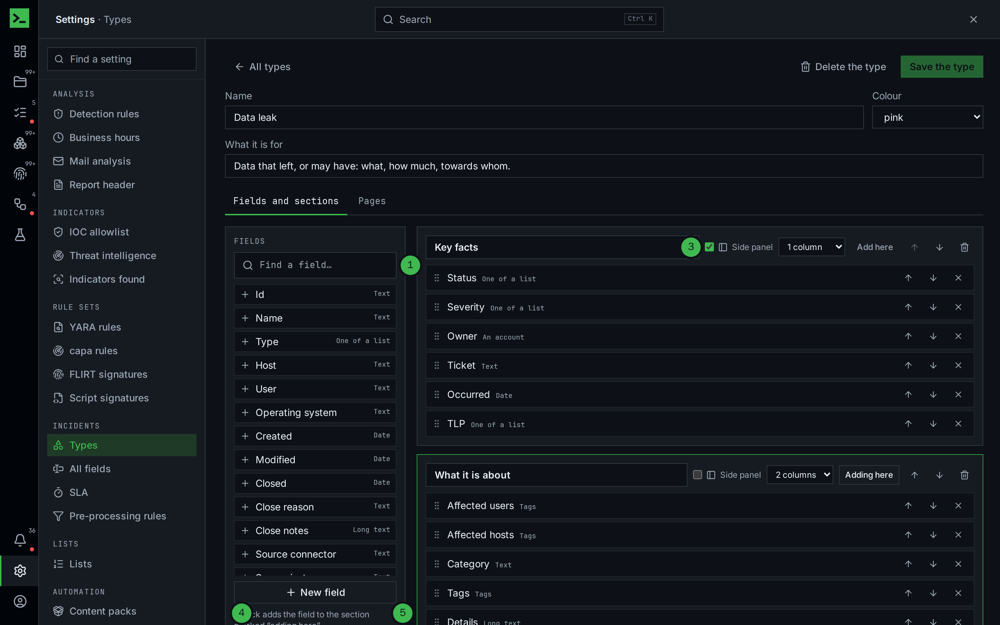
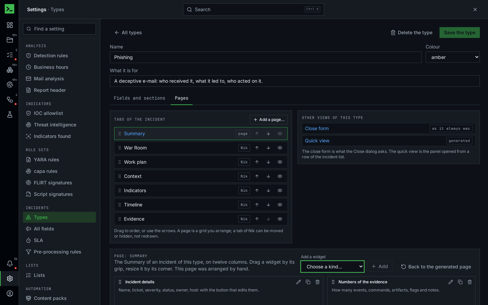
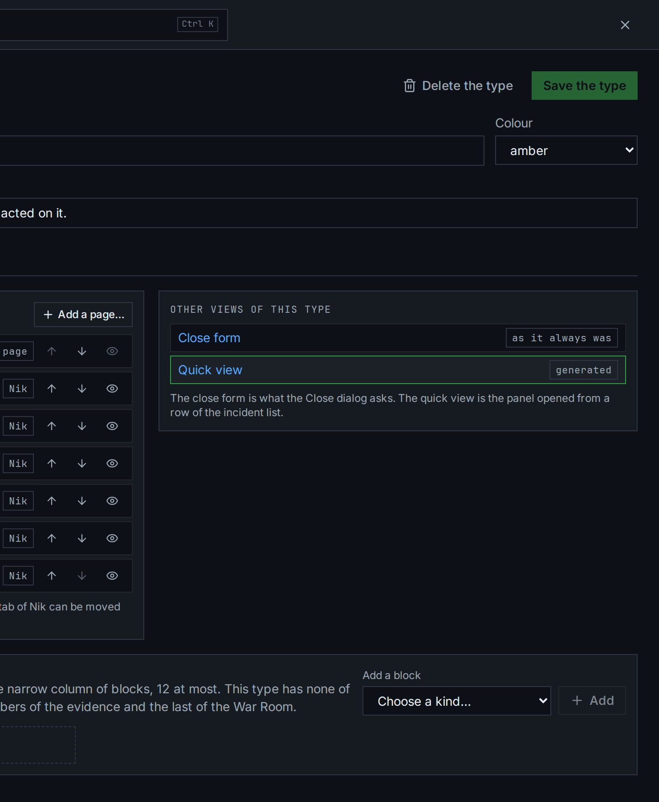
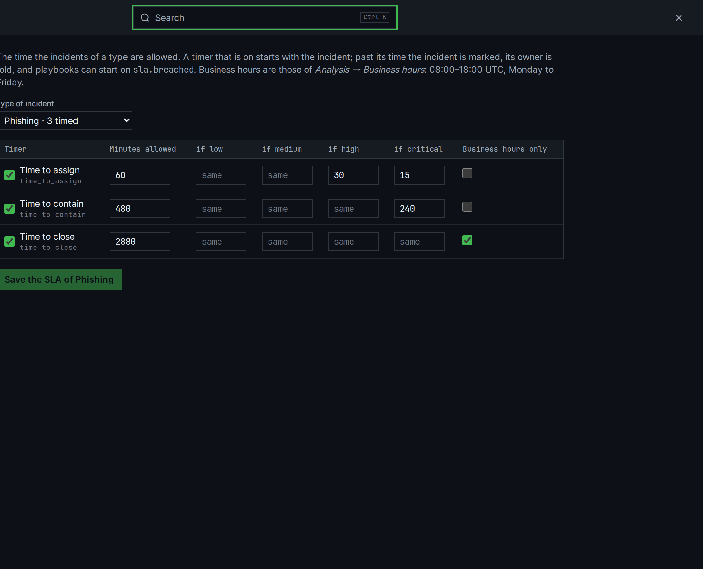
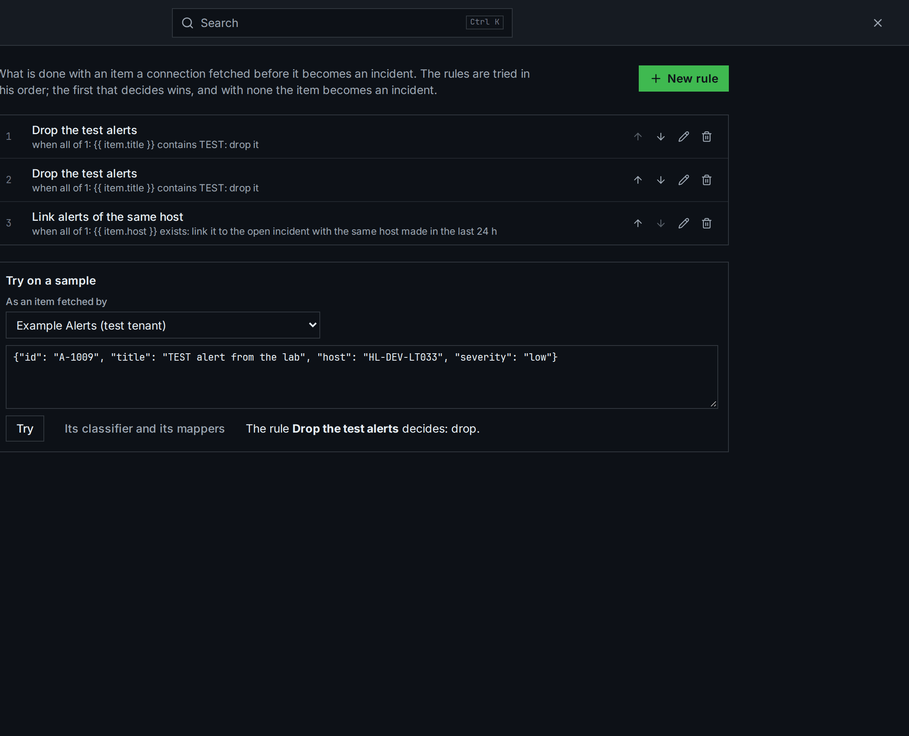

# Types, fields and pages

Decide what an incident holds and how its page looks: incident types, fields and sections, pages, SLA timers, and what is done with an alert before it becomes an incident.

!!! note "You need"
    The permission `incidents.configure`: the **Admin** role. Everything here is under **Platform settings › Incidents**.

| Section | Sets |
| --- | --- |
| **Types** | The types of incident: their fields, sections, close reasons, pages and views |
| **All fields** | Every field an incident can hold |
| **SLA** | The timers of each type and the minutes they allow |
| **Pre-processing rules** | What is done with a fetched item before it becomes an incident |

## Incident types

A type says which fields its incidents have, where they are on the page, and how one is closed. An incident given no type is **Unclassified**.

Seven types ship, and are yours to change: **Unclassified**, **Phishing**, **Malware**, **Network intrusion**, **Data leak**, **Access abuse**, **Vulnerability**. Content packs can add more.

### Create a type

1. Open **Platform settings › Incidents › Types** and press **New type**.
2. Give its name (`Business e-mail compromise`) and press **Create the type**. It starts with the key facts every incident has.
3. Choose a **Colour** and write **What it is for**.
4. Press **Save the type**. Incidents of the type follow at once.

### Fields and sections

On the tab **Fields and sections**:

- 1 The fields of the registry, on the left (**Find a field…**). A click adds a field to the section marked *adding here*; or drag it there. **New field** makes one of your own.
- 2 The sections of the Summary, on the right. **Add a section**; give it a title and **1 column** or **2 columns**. A type has 20 sections at most.
- 3 One section can be the **Side panel** of the incident page.
- 4 For a field of your own: whether it is required, or required **to close**. A field required to close holds the closing back while it is empty.
- 5 **Close reasons, one per line**: what the closing form offers (30 at most). With none, any reason can be written.

### Pages of a type

On the tab **Pages**, the left side lists **Tabs of the incident**, in this type's order:

- A tab of Nik (War Room, Work plan, Evidence…) can be moved (drag, or its arrows) and hidden (its eye), not redrawn.
- The **Summary** is a page: it is arranged on the right, and never hidden.
- **Add a page…** adds a page of your own: its name is its tab. It is arranged like the Summary. A type has ten pages of its own at most.

A page is a grid of twelve columns. Drag a widget by its grip, resize it by its corner, or use the arrow keys on the grip (++shift++ to resize). To add one, choose a kind in **Add a widget** and press **Add**:

| Widget | Shows |
| --- | --- |
| **Incident details** | Name, ticket, severity, status, owner, host, user, OS, the suspicious window |
| **A section of fields** | One section of the type, with an **Edit** |
| **Numbers of the evidence** | Counters per source, flags, notes |
| **Flags and notes** | What was flagged and written, in time order |
| **Timers** | The SLA timers |
| **Evidence**, **War Room**, **Work plan**, **Indicators** | Those parts of the incident |
| **Script buttons** | Up to eight buttons that run scripts ([Scripts](scripts.md#script-buttons)) |
| **Chart of a dashboard** | One widget of a dashboard, narrowed to what this incident shares (a field you choose) |
| **Linked incidents** | Up to ten incidents that are related or share indicators |
| **A text** | A text of your own: what to check first, who to call |

The pencil of a widget sets its title and what it shows. A type that never arranged its Summary shows the one Nik makes from its sections; **Back to the generated page** returns to it.

### Other views of a type

Under the tabs, **Other views of this type**:

- **Close form**: the sections the **Close** dialog shows, besides the reason and a note. A field marked *to close* must be filled. With no section, the dialog asks the reason, a note and the fields marked *to close*.
- **Quick view**: the blocks of the panel opened from a row of the incident list (12 at most). **Add a block**: the details, a section, the numbers, the timers, the last of the War Room, the linked incidents, a text. **Back to the generated view** forgets them.

## All fields

**Platform settings › Incidents › All fields** lists every field an incident can hold: its name, type, and where it is used.

1. Press **New field**. Give the **Label**, **What it is for**, the type, and (for a choice) **Choices, one per line**.
2. Tick **On every type of incident**, or leave it to the types that list it.

| Type | Holds |
| --- | --- |
| **Text** · **Long text** | Text |
| **Number** · **Yes / no** · **Date** | A number, true or false, a date |
| **One of a list** · **Several of a list** | Choices |
| **An account** · **A role** | A user or a role |
| **Address (URL)** · **Tags** · **Indicator** | A link, tags, a typed indicator |
| **Table** | Rows with columns (text, number, yes/no, date, choice, URL) |
| **Timer** | An SLA timer |
| **JSON** | Any value |

- A field has one name for one thing: its name and type never change; its label and choices do.
- A choice taken away stays on the incidents that hold it, and can no longer be chosen.
- A field is deleted only when no type lists it and no incident holds a value of it.
- Playbooks read every field by its name: `{{ incident.business_unit }}`.

## SLA

**Platform settings › Incidents › SLA** sets, for each **Type of incident**, the timers its incidents get.

1. Choose the type.
2. For each **Timer** (**Time to assign**, **Time to contain**, **Time to close**, or a timer field of your own), tick it on and give the **Minutes allowed**, by severity if you want (**same** keeps the general value).
3. Tick **Business hours only** to count only working hours (those of **Analysis › Business hours**, in UTC).
4. Save. It applies to the incidents of this type from now on, and to those still open.

- A timer starts with the incident. *Time to assign* stops when the incident has an owner, *time to close* when it is closed (and goes on if reopened), *time to contain* when a playbook or a person stops it.
- Past its time a timer is breached, once: the incident is marked, its War Room says so, its owner is told, and `sla.breached` starts the playbooks waiting for it ([Triggers and events](triggers.md)).
- The timers show in the panel beside the tabs. Whoever works incidents pauses, starts and stops one; a playbook can too (**Start a timer**, **Pause a timer**, **Stop a timer**).

## Pre-processing rules

**Platform settings › Incidents › Pre-processing rules** decides what happens to an item an instance fetches, before anything is written. The rules are tried in order; the first that decides wins. With none, the item becomes an incident.

1. Press **New rule** and give it a **Name**.
2. **When (nothing for always)**: comparisons over `incident` (what the item would become: its type and the fields its mapper gave) and `item` (what came).
3. **Then**:

    | Action | Does |
    | --- | --- |
    | **Drop it** | No incident; the item does not come back |
    | **Link it to an open incident** | No incident: the item becomes a War Room line of the open incident with the same values in the fields you name (`name`, `host`, `username`, `ticket`, `severity`, `source_id`, `type`), made in the last so many hours if you say so |
    | **Close it as a duplicate** | The incident is made and closed at once as a duplicate |
    | **Ask a script** | A script gets `item` and `incident` and returns `{"action": "drop"}`, `{"action": "link_to_existing", "same": ["host"]}`, `{"action": "close_duplicate", "same": ["name"]}`, or anything else to go on |

4. **The rule is on**, then **Save the rule**.

A rule that finds no incident that is the same decides nothing, and the next is tried.

**Try on a sample**: choose the instance (**As an item fetched by**), paste an item as JSON, press **Try**. It shows the classifier, the mappers and which rule would decide, and does nothing.

## Related

- [Work an incident](incidents.md)
- [Connectors and mirroring](connectors.md)
- [Scripts and the Playground](scripts.md)
- [Triggers and events](triggers.md)
- [Dashboards and My tasks](dashboards.md)
